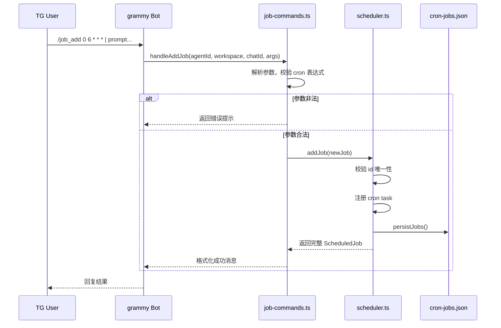

# agent-scheduler - 技术设计文档

> **2026-08-17 node-placement addendum**：placement 模式的 owner/runNode、delivery client、state generation 与 CRUD fence 以 `features/node-placement/design.md` 为准；下文即时 CRUD 和 owner 同名语义只适用于 legacy 非 placement 模式。

> **设计概述**：在 Relay（Node.js/TypeScript）中以 `scheduler.ts` 作为 batch job 的唯一执行语义入口，使用 `node-cron` 实现 tz-aware 定时任务，通过 `runtime.ts` orchestrator 执行 CC/Codex runtime fallback，结果按 job delivery 配置投递。**v0.1.3 以 run-level terminal registry 联结业务 `/internal/push` 与 scheduler failure fallback，在投递前预留终态，保证同 run 最多一次用户可见终态。**Cron、missed-run reconciliation 与同进程 manual run 共享可选的 scheduler 全局 FIFO 并发闸；同 workspace 串行语义仍保留。
>
> **关联文档**：
> - L1 项目架构：`project-specs/project-architecture.md`
> - L2 功能需求：`features/agent-scheduler/requirements.md`
> - L2 任务拆分：`features/agent-scheduler/tasks.md`

---

## 1️⃣ 技术栈（Tech Stack）

**基于 `project-specs/project-architecture.md` 定义的技术栈**：

| 层 | 选型 | 来源 |
|----|------|------|
| 运行时 | Node.js ≥ 18 | L1 约束 |
| 语言 | TypeScript 5.x，strict: true | L1 约束 |
| 测试 | vitest | L1 约束 |
| Cron 引擎 | `node-cron ^3.0`（v0.0.1 已引入） | 复用 |
| TG 投递 | grammy（已有，`channels/telegram.ts`）| 复用 |
| CC 调用 | `child_process.spawn`（已有，`pool.ts` 同款）| 复用模式 |

**v0.1.0 不引入新生产依赖**。Cron 表达式人性化描述（P1-004）可用轻量映射表实现，无需 `cronstrue` 等外部库。

---

## 2️⃣ 架构设计（Architecture Design）

### 组件划分

```
Relay
├── index.ts              ← 启动时初始化 Scheduler，注入 Bot 实例
├── scheduler.ts          ← Scheduler 核心（job 注册、执行、投递）— v0.0.1 已有
├── job-terminal-registry.ts ← runId 生命周期、终态投递预留与回执去重
├── http-server.ts        ← /internal/push 接受 runId + terminal，并写共享终态回执
├── job-commands.ts       ← ★ 新增：Bot 命令处理器（/jobs, /job_add, /job_del, /job_run）
├── runtime.ts            ← Batch runtime orchestrator（cc / cc-interactive / codex）
├── scripts/
│   └── relay-jobs.ts     ← CLI 管理面；run 复用 scheduler.runJob，不实现 runtime
├── command-menu.ts       ← 修改：注册新增的 4 个命令到 TG 菜单
├── commands.ts           ← 修改：路由新命令到 job-commands.ts
├── channels/
│   └── telegram.ts       ← 修改：在 createSingleBot 中 wire 新命令
├── types.ts              ← 修改：ScheduledJob 新增 owner 字段
└── config/
    └── cron-jobs.json    ← Job 配置文件（运行时由 CRUD 操作读写）
```

### 模块关系

```
telegram.ts (Bot command routing)
  └── /jobs, /job_add, /job_del, /job_run
        └── job-commands.ts (command handlers)
              ├── handleListJobs(agentId, scheduler)
              ├── handleAddJob(agentId, args, scheduler)
              ├── handleDelJob(agentId, jobId, scheduler)
              └── handleRunJob(agentId, jobId, scheduler)
                    └── scheduler.ts (Scheduler API — v0.1.0 扩展)
                          ├── listJobs(owner?)       → ScheduledJob[]
                          ├── addJob(job)             → ScheduledJob
                          ├── removeJob(id, owner)    → boolean
                          ├── runJob(id)              → Promise<JobResult>
                          └── 内部: persistJobs()     → 写 cron-jobs.json

src/relay-jobs.ts run
  └── createScheduler(registerCronTasks=false, deliveryEnabled=false)
        └── scheduler.runJob(id)
              └── 同上：executeJob() → runtime.ts orchestrator
```

**职责边界**：
- `job-commands.ts`（新增）：解析 Bot 命令参数、权限校验（owner）、格式化输出
- `scheduler.ts`（扩展）：Job CRUD 内存 + 持久化操作，cron 注册/注销，CC 执行
- `job-terminal-registry.ts`：同一进程内的 run 终态协调器；`open/failed` 可预留，`sending/sent` 去重；完成 run 的 sent 状态保留两小时拦截迟到重试
- `http-server.ts`：终态 push 在外部 I/O 前向 registry 预留；未知/owner 不匹配/同 owner 多并发且无 runId 时 fail closed
- `runtime.ts`：唯一 batch runtime fallback 实现，Scheduler 不复制 runtime 细节
- `src/relay-jobs.ts`：CLI 管理面。`list/add/del` 仍直接操作 JSON；`run` 请常驻 Relay 经 `POST /internal/jobs/run` 执行，`run --local` 调用本进程 scheduler manual-run；两者都不得复制 `cc` / `cc-interactive` / `codex` 执行逻辑；由 `npm run build` 编译为 `dist/relay-jobs.js`
- `scripts/relay-jobs.ts`：兼容 shim，继续支持旧的 `npx tsx scripts/relay-jobs.ts ...` 运维入口
- `commands.ts`（扩展）：分发新命令到 job-commands.ts
- `channels/telegram.ts`（扩展）：wire 新 bot.command()

### S1 batch execution contract

Cron、Telegram `/job_run`、CLI `relay-jobs run` 必须共享同一套 batch job 执行语义：

| Trigger | Canonical path | Delivery behavior |
|---|---|---|
| Cron | `scheduler.registerCronTask -> executeJob -> runtime.ts` | 按 `job.delivery` 投递 |
| Telegram `/job_run` | `job-commands.ts -> scheduler.runJob -> executeJob -> runtime.ts` | 按 `job.delivery` 投递 |
| CLI `relay-jobs run` | `src/relay-jobs.ts -> POST /internal/jobs/run -> 常驻 scheduler.runJob -> executeJob -> runtime.ts` | 按 `job.delivery` 投递；认领后即返回 202 |
| CLI `relay-jobs run --local` | `src/relay-jobs.ts -> createScheduler({ registerCronTasks:false, deliveryEnabled:false }) -> scheduler.runJob -> executeJob -> runtime.ts` | 输出到 CLI；不投递 |

入口契约见 `../../relay-scheduler-jobs.md` §4d。`--local` 的两个差异是显式的：

- `registerCronTasks=false`：加载 job store 但不注册 cron callback，避免一次性 CLI 进程意外参与调度。
- `deliveryEnabled=false`：复用 execution/runtime/inject_file/workspace queue 语义，但不向 Telegram 投递，避免 CLI 需要 Bot token 或产生重复外部通知。

### Workspace Serialization Contract

Scheduler 在 job id overlap protection 之外，还维护一条按 `agent.workspace` 分组的 Promise queue：

- 同一 `agent.workspace` 的 job 串行执行，后触发者等待前一个 job 完成后再进入 `executeJob()`。
- 不同 `agent.workspace` 的 job 在全局并发闸未启用时保持原有并发；启用后受同一 scheduler 实例的容量上限约束。
- queue 在 release 时清理当前 workspace 条目；只有确实存在前序 job 时才记录 `workspace busy, queuing behind running job`。

这个语义用于保护 CC workspace/session lock，尤其是夜巡与心跳扫描这类共享 workspace 的 cron job。它不是业务调度策略，而是 batch execution 的一致性保护层。

### Run-level Terminal Contract

1. `executeJob()` 启动时创建 UUID `runId`，并通过 `RELAY_JOB_RUN_ID`、`RELAY_JOB_TERMINAL_CONTRACT=v1` 注入 batch runtime 环境；`JobResult` 与结构化日志同时携带该 id。
2. 业务层最终成功/失败消息调用 `/internal/push` 时提交 `runId` 与 `terminal:true`。HTTP 层先 `reserve()`，再调用 Feishu/TG；并发或迟到重试看到 `sending/sent` 时直接返回 deduplicated receipt，不再真实发送。
3. scheduler 收到非零退出时用相同 `runId` 预留 fallback。已有 `sent/sending` 则只记录次生 runtime 失败并压制第二条；内部 push 为 `failed/open` 时仍发送一次兜底。
4. 不使用 per-job cooldown 做跨 run 去重：不同 run 是不同事故，各自有告警权。`runId` 缺失仅在该 owner 恰有一个 active run 时可兼容解析；同 owner 并发时必须显式 id，否则 409。
5. 终态发送成功后，producer 必须立即结束回合；后续独立验收放到终态前或下一 run，避免已关闭终态后的长等待再制造次生失败。

### Global Concurrency Contract

- `RELAY_SCHEDULER_MAX_CONCURRENT_JOBS=<正整数>` 显式启用 scheduler 实例级 FIFO semaphore；未设置时保留既有跨 workspace 并发，不在代码中替生产决定阈值。
- `SchedulerOptions.maxConcurrentJobs` 提供同语义的显式注入，优先于环境变量；非正整数或非安全整数 fail-fast，不静默退回无上限。
- Cron、missed-run reconciliation、Telegram `/job_run` 及同一 scheduler 实例上的 `runJob()` 在 job claim 后进入同一 FIFO。超限只排队、不丢弃。
- 已 claim 的排队项继续出现在 `getRunningJobIds()`；因此 `/internal/cc-status.safeToRestart` 在队列清空前保持 `false`。
- 全局 permit 先于 workspace lock 获取，以保持跨入口 FIFO；同 workspace job 仍不会并发执行。任务完成或异常时，两级 permit 均在 `finally` 释放。
- `stop()` 停止新 cron/watcher 触发，但不取消已认领 Promise；只要进程仍存活，它们继续保持 restart-visible 并自然 drain。进程级停机仍必须等待 `safeToRestart=true`。
- Handoff watcher 的 stop 丢弃内存通知队列；每次 start/reload 在建立文件监听后重扫持久 handoff 账本，按当前 owner/job 配置重建待处理通知。终态交接不重投，未被 scheduler 认领的等待项不依赖新文件事件或下一次 cron 才继续。
- `reload()` 不清空已认领队列，也不得把旧执行的 running claim 重置为 false。reload 前 job 完成时，execution outcome 按 job id 合并进 reload 后当前 store，同时保留当前定义的 `definitionHash` / `activatedAt`，再持久化 `lastRunAt` / `lastStatus`。
- `removeJob(id, owner)` 对 running 或全局 queued 的已认领 job 返回 `false`，不删除定义、不停止 task、不清 claim；待执行完成后才允许再次删除。
- 此闸是**进程内、scheduler 实例级**。`relay-jobs run` 由常驻 Relay 执行，进入同一 FIFO；`relay-jobs run --local` 是独立进程，不与常驻 Relay 共享 semaphore。

---

## 3️⃣ 接口定义（Interface Definition）

### 数据类型

**ScheduledJob**（v0.1.0 新增 `owner` 字段）：

```typescript
interface ScheduledJob {
  id: string                        // 唯一 ID，kebab-case
  name: string                      // 人类可读名称
  enabled: boolean
  owner: string                     // ★ 新增：创建者 agentId（如 "aki"、"ken"）
                                    //   无此字段的旧 job → 视为 "system"
  schedule: {
    expr: string                    // 5 字段 cron 表达式
    tz: string                      // IANA timezone，如 "Asia/Shanghai"
  }
  agent: {
    workspace: string               // CC 进程 cwd，决定 CLAUDE.md 人格
    prompt: string                  // 注入给 Agent 的任务指令
    timeout?: number                // 秒，默认 300
  }
  delivery: {
    mode: 'announce' | 'none'
    channel?: 'telegram'
    to?: string                     // TG chat_id（mode=announce 时必需）
  }
  deleteAfterRun?: boolean          // true = one-shot [P1]
  maxConsecutiveErrors?: number     // 熔断阈值，默认 5 [P1]
  _state?: {
    consecutiveErrors: number
    lastRunAt?: string              // ISO8601
    lastStatus?: 'ok' | 'error' | 'timeout'
  }
}
```

**JobResult**（不变）：

```typescript
interface JobResult {
  jobId: string
  runId?: string
  status: 'ok' | 'error' | 'timeout'
  output: string
  durationMs: number
  errorMessage?: string
}
```

### Scheduler API（v0.1.0 扩展，实现 FR-P0-006~011）

**Function-002：Scheduler 对象**

```typescript
interface Scheduler {
  // v0.0.1 已有
  start(): void
  stop(): void

  // v0.1.0 新增 — CRUD
  listJobs(owner?: string): ScheduledJob[]
  // 返回 job 列表。owner 为空时返回全部；否则返回 owner 匹配 + system job

  addJob(job: Omit<ScheduledJob, '_state'>): ScheduledJob
  // 校验 → 写入内存 → 注册 cron → 持久化 JSON → 返回完整 job
  // 抛出 Error 如果 id 冲突或参数非法

  removeJob(id: string, owner: string): boolean
  // 仅允许 owner 匹配的 job 被删除（system job 不可通过此接口删除）
  // running / globally queued job 拒绝删除并返回 false
  // 注销 cron → 从内存移除 → 持久化 JSON → 返回是否成功

  updateJob(id: string, owner: string, patch: Partial<ScheduledJob>): ScheduledJob
  // 仅允许 owner 匹配 [P1]
  // 如果 patch 含 schedule.expr：注销旧 cron → 重新注册

  runJob(id: string): Promise<JobResult>
  // 立即执行一次（不影响 cron 调度），返回结果
}
```

**SchedulerOptions（v0.1.1 补充）**

```typescript
interface SchedulerOptions {
  getBotByAgentId?: (agentId: string) => Bot | null
  registerCronTasks?: boolean  // default true; false for CLI/manual one-shot runner
  deliveryEnabled?: boolean    // default true; false for CLI/manual one-shot runner
  terminalRegistry?: JobTerminalRegistry // 与 /internal/push 共享
  maxConcurrentJobs?: number   // env fallback: RELAY_SCHEDULER_MAX_CONCURRENT_JOBS
  runtimePolicy?: {
    primary?: RuntimeId
    fallbacks?: RuntimeId[]
    cooldownMs?: number
  }
}
```

### Bot 命令接口（实现 FR-P0-006~009）

**新增模块 `job-commands.ts`**：

```typescript
// ── /jobs ──────────────────────────────────────────────────
export function handleListJobs(
  agentId: string,
  scheduler: Scheduler,
): string
// 返回格式化文本（TG Markdown），按 owner 过滤

// ── /job_add ───────────────────────────────────────────────
export function handleAddJob(
  agentId: string,
  workspace: string,           // 从 relay.json agent config 读取
  chatId: string,              // 当前对话 chatId，用于 delivery.to 默认值
  args: string,                // 用户输入的参数部分
  scheduler: Scheduler,
): string
// 解析参数 → 构建 ScheduledJob → scheduler.addJob() → 返回成功/失败消息

// ── /job_del ───────────────────────────────────────────────
export function handleDelJob(
  agentId: string,
  jobId: string,
  scheduler: Scheduler,
): string
// scheduler.removeJob(jobId, agentId) → 返回成功/失败消息

// ── /job_run ───────────────────────────────────────────────
export async function handleRunJob(
  agentId: string,
  jobId: string,
  scheduler: Scheduler,
): Promise<string>
// 权限校验 → scheduler.runJob(jobId) → 返回执行结果摘要
```

### /job_add 参数格式（FR-P0-007 细化）

采用管道分隔符，简洁易用：

```
/job_add <cron_expr> | <prompt> [| name=<名称>] [| timeout=<秒>] [| delivery=announce]
```

**示例**：
```
/job_add 0 6 * * * | 执行每日新闻数据采集，运行 news_feed_snapshot.py ...
/job_add 0 7 * * * | 推送早报 EPUB | name=早报推送 | timeout=300 | delivery=announce
/job_add 30 22 * * * | 睡前血压测量提醒 | delivery=announce
```

**解析规则**：
1. 第一段（管道前）：5 字段 cron 表达式
2. 第二段：prompt（必填）
3. 后续段：`key=value` 可选参数
4. `id` 自动生成：`{agentId}-{timestamp_hex}`（如 `aki-6804a3b0`）
5. `owner` 自动设为当前 agentId
6. `workspace` 自动从 relay.json 中该 agent 的 config 读取
7. `schedule.tz` 默认 `Asia/Shanghai`
8. `delivery.to` 默认当前 chatId（mode=announce 时）

---

## 4️⃣ 数据模型（Data Model）

### cron-jobs.json 结构（v0.1.0 演进，实现 FR-P0-010 归属模型）

```json
{
  "version": 2,
  "jobs": [
    {
      "id": "briefing-data-collect",
      "name": "早报：数据采集",
      "owner": "system",
      "enabled": true,
      "schedule": { "expr": "0 6 * * *", "tz": "Asia/Shanghai" },
      "agent": {
        "workspace": "/Users/owner/Coevolution/Bigbird",
        "prompt": "执行每日新闻数据采集...",
        "timeout": 300
      },
      "delivery": { "mode": "none" },
      "_state": { "consecutiveErrors": 0 }
    },
    {
      "id": "aki-6804a3b0",
      "name": "每日采集",
      "owner": "aki",
      "enabled": true,
      "schedule": { "expr": "0 6 * * *", "tz": "Asia/Shanghai" },
      "agent": {
        "workspace": "/Users/owner/Coevolution/PARA",
        "prompt": "...",
        "timeout": 300
      },
      "delivery": { "mode": "none" },
      "_state": { "consecutiveErrors": 0 }
    }
  ]
}
```

**版本迁移**：
- `version: 1` → `version: 2`：loadJobs 兼容处理，无 `owner` 字段的 job 自动填充 `owner: "system"`
- 新创建的 job 必须有 `owner`

### 运行时内存状态

```typescript
// scheduler 内部维护
Map<jobId, {
  job: ScheduledJob              // 完整 job 对象
  task: ScheduledTask            // node-cron 返回的 task 对象
  running: boolean               // 防重叠执行
}>
```

**CRUD 操作的内存 ↔ JSON 同步**：
- `addJob()`：push 到 Map + Array → persistJobs()
- `removeJob()`：task.stop() → delete from Map + Array → persistJobs()
- 已认领 job（running 或 global queued）不进入上述删除流，返回 `false`；避免队列仍执行但 running claim 被删、`safeToRestart` 假绿。
- `updateJob()`：task.stop() → update Map + Array → 重新 schedule → persistJobs()
- `persistJobs()`：将当前 jobs 数组 JSON.stringify 写回文件，200ms debounce

---

## 5️⃣ 数据流（Data Flow）

### Flow-001：Relay 启动加载 Jobs（不变）

```
index.ts
  └── createScheduler(bot, configPath).start()
        ├── loadJobs() → 读取 cron-jobs.json
        ├── 兼容处理：version 1 的 job 补充 owner="system"
        └── 对每个 enabled job：注册 cron
```

### Flow-002：Job 触发执行（不变）

（参见 v0.0.1 设计）

### Flow-004：/job_add 创建 Job（FR-P0-007 + FR-P0-011）



### Flow-005：/job_del 删除 Job（FR-P0-008）

```
User → /job_del <id>
  → job-commands.handleDelJob(agentId, id, scheduler)
    → scheduler.removeJob(id, agentId)
      → 校验 owner 匹配
      → 校验 job 未被认领（running / global queued 均拒绝删除）
      → task.stop()          // 注销 cron
      → 从 jobs 数组移除
      → persistJobs()        // 写回 JSON
    → 返回成功/拒绝消息
```

### Flow-006：/job_run 立即执行（FR-P0-009）

```
User → /job_run <id>
  → job-commands.handleRunJob(agentId, id, scheduler)
    → 权限校验（owner = agentId 或 system）
    → scheduler.runJob(id)
      → executeJob(job)      // 复用现有执行逻辑
    → 返回执行结果摘要
```

---

## 6️⃣ 错误处理（Error Handling）

### 新增错误场景（v0.1.0）

**Error-006：/job_add 参数非法**
- **触发**：cron 表达式格式错误、缺少 prompt、timeout 非数字
- **处理**：返回明确错误文本给用户，不创建 job
- **日志**：`WARN { module: 'job-commands', msg: 'invalid job_add args', agentId, error }`

**Error-007：/job_add id 冲突**
- **触发**：自动生成的 id 与现有 job 重复（极小概率）
- **处理**：重新生成 id（最多重试 3 次），仍冲突则返回错误
- **日志**：`WARN { module: 'scheduler', msg: 'job id collision', id }`

**Error-008：/job_del 权限拒绝**
- **触发**：消费者尝试删除非自己 owner 的 job
- **处理**：返回"该任务不属于你，无法删除"
- **日志**：`WARN { module: 'job-commands', msg: 'unauthorized job_del', agentId, jobId }`

**Error-009：/job_run 目标不存在**
- **触发**：指定的 job id 不存在
- **处理**：返回"未找到该任务"
- **日志**：无（用户操作错误，不记录）

**Error-010：persistJobs 写入失败**
- **触发**：文件系统错误（磁盘满等）
- **处理**：内存状态已更新（cron 已注册），记录 ERROR 日志。下次 Relay 重启时 JSON 可能不一致——此为已知风险，通过启动时 JSON 优先恢复
- **日志**：`ERROR { module: 'scheduler', msg: 'persistJobs failed', error }`

### 保留的错误处理（v0.0.1）

Error-001 ~ Error-005 不变。

---

## 7️⃣ 安全设计（Security Design）

- **Token 隔离**：spawn CC 子进程前，从继承的 env 中删除 `TELEGRAM_BOT_TOKEN`（不变）
- **工作区锁定**：Bot 命令创建 job 时，workspace 强制从 relay.json 的 agent 配置读取，消费者不能自行指定任意路径
- **归属隔离**：CRUD 操作严格按 owner 过滤，消费者无法操作其他 Agent 的 job
- **Prompt 不落日志全文**：日志中只记录 job id 和 name

---

## 8️⃣ 性能优化（Performance Optimization）

- **并发上限**：默认保留既有无硬上限行为；生产可用 `RELAY_SCHEDULER_MAX_CONCURRENT_JOBS=<owner-approved positive integer>` 显式启用实例级 FIFO 上限。阈值须由 canary 的 RSS、延迟与 queue drain 证据决定。
- **文件写回防抖**：`persistJobs()` 使用 200ms debounce，CRUD 操作和 _state 更新共用同一个 debounce 函数
- **命令响应**：Bot 命令处理全在内存中完成（listJobs、addJob 的参数解析和校验），JSON 写回异步，不阻塞用户响应

---

## 9️⃣ 命令注册（TG Bot Menu）

### command-menu.ts 新增

```typescript
const SCHEDULER_COMMANDS: MenuCommand[] = [
  { command: 'jobs',    description: '列出我的计划任务' },
  { command: 'job_add', description: '注册计划任务' },
  { command: 'job_del', description: '删除计划任务' },
  { command: 'job_run', description: '立即执行任务' },
];
```

合并到 `getAllMenuCommands()` 返回值中。

### channels/telegram.ts wiring

在 `createSingleBot()` 中为每个 bot 添加 4 个 command handler，遵循现有模式：

```typescript
bot.command('jobs', async (ctx) => {
  const resolved = router.resolveByBotAgent(agent.id, chatId);
  if (!resolved) { await ctx.reply(UNREGISTERED_MSG); return; }
  const result = handleListJobs(agent.id, scheduler);
  await ctx.reply(result, { parse_mode: 'Markdown' });
});

bot.command('job_add', async (ctx) => {
  const resolved = router.resolveByBotAgent(agent.id, chatId);
  if (!resolved) { await ctx.reply(UNREGISTERED_MSG); return; }
  const args = ctx.match;  // grammy 提取 /command 后的参数
  const result = handleAddJob(agent.id, agent.workspace, chatId, args, scheduler);
  await ctx.reply(result, { parse_mode: 'Markdown' });
});

// job_del, job_run 类似
```

**关键依赖**：`createSingleBot` 需要注入 `scheduler` 实例。当前签名只有 `(agent, pool, router, stateManager)`，需要扩展参数或通过 deps 对象传入。

---

## 🔟 向后兼容设计

### cron-jobs.json 版本迁移

```typescript
function loadJobs(configPath: string): ScheduledJob[] {
  const data = JSON.parse(readFileSync(configPath, 'utf-8'));

  // 版本迁移：v1 → v2
  if ((data.version ?? 1) < 2) {
    for (const job of data.jobs) {
      if (!job.owner) job.owner = 'system';
    }
    data.version = 2;
    // 写回升级后的 JSON
    writeFileSync(configPath, JSON.stringify(data, null, 2));
  }

  return data.jobs.filter(validate);
}
```

### 现有命令不受影响

新增的 4 个命令（jobs、job_add、job_del、job_run）与现有 9 个命令无命名冲突。

---

## 1️⃣1️⃣ CLI 入口（Agent 自服务接口，FR-P0-006~011）

> TG Bot 命令供用户从手机操作；CLI 供 Agent 在 CC session 中通过 Bash 调用。两者共用 job-store.ts 的 CRUD 逻辑和 cron-jobs.json 数据文件。

### 脚本位置

`Relay/src/relay-jobs.ts` → 编译为 `Relay/dist/relay-jobs.js`

Agent 通过 Bash 调用：
```bash
npm run jobs -- <command> [args...]
# or:
node /path/to/Relay/dist/relay-jobs.js <command> [args...]
```

`Relay/scripts/relay-jobs.ts` 只保留为兼容 shim；旧入口仍可用：

```bash
npx tsx scripts/relay-jobs.ts <command> [args...]
```

建议在 Agent workspace 中通过环境变量、npm script 或 symlink 简化路径。

### 子命令

```
relay-jobs list [--owner <agentId>]
relay-jobs add --cron "<expr>" --prompt "<text>" [--name <name>] [--timeout <sec>] [--owner <agentId>] [--workspace <path>] [--delivery announce --to <chatId>]
relay-jobs del <id> --owner <agentId>
relay-jobs run <id> [--local]
```

### 设计要点

1. **直接操作 cron-jobs.json**：CLI 读写同一个 JSON 文件，不经过 Relay 进程内存
2. **受管重载采用**：写入 JSON 后不发信号；CLI 提示经 `pulse-relay reload` 后常驻 Relay 才采用（非 node-placement 模式不中断正在运行的任务）
3. **无需 Relay 运行**：`list` 和 `add`/`del` 在 Relay 未运行时也可用（只操作文件）；`run` 需要 Relay 在线，连不上时报错并提示 `--local`；`run --local` 不需要 Relay，也不投递
4. **run 的实现**：见 `../../relay-scheduler-jobs.md` §4d
5. **owner 验证**：`del` 操作强制要求 `--owner`，只能删除匹配的 job
