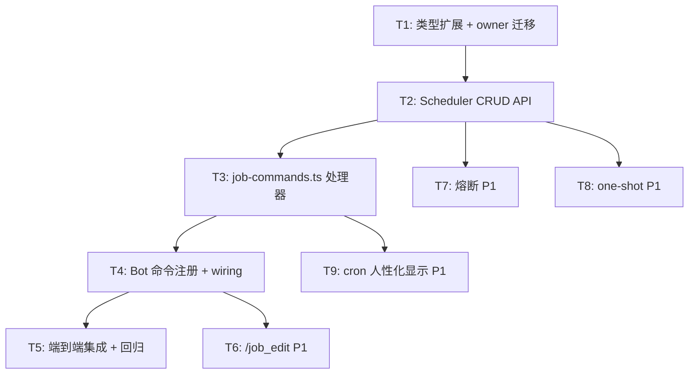

# agent-scheduler - 任务拆分文档

> **任务概述**：v0.1.0 基于已完成的 scheduler 核心（v0.0.1 P0），新增 5 个 P0 任务实现消费者自服务 CRUD——Bot 命令 `/jobs`、`/job_add`、`/job_del`、`/job_run`，Job 归属模型，Scheduler API 扩展。
>
> **关联文档**：
> - L2 技术设计：`features/agent-scheduler/design.md`
> - L2 功能需求：`features/agent-scheduler/requirements.md`
> - 测试文件：`Relay/tests/scheduler.test.ts`、`Relay/tests/job-commands.test.ts`（新增）

---

## 0️⃣ 已完成任务（v0.0.1 交付）

| 任务ID | 任务名称 | 状态 |
|--------|---------|------|
| P0-001 | 定义 ScheduledJob 类型 + cron-jobs.json schema | ✅ 完成 |
| P0-002 | 实现 scheduler.ts 核心（加载、注册、执行、投递） | ✅ 完成 |
| P0-003 | 集成到 index.ts + node-cron 依赖安装 | ✅ 完成 |
| P0-004 | 迁移 OC enabled jobs → cron-jobs.json | ✅ 完成 |

---

## 1️⃣ 任务拆分（v0.1.0 Task Breakdown）

### P0 任务（本次 MVP）

| 任务ID | 任务名称 | 预估工时 | 依赖任务 | 状态 |
|--------|---------|---------|---------|------|
| T1 | ScheduledJob 类型扩展 + owner 迁移 | 2h | 无 | ✅ 完成 |
| T2 | Scheduler CRUD API 扩展 | 4h | T1 | ✅ 完成 |
| T3 | job-commands.ts Bot 命令处理器 | 4h | T2 | ✅ 完成 |
| T4 | Bot 命令注册 + wiring | 2h | T3 | ✅ 完成 |
| T5 | 端到端集成测试 + 回归 | 2h | T4 | ✅ 完成 |

### P1 任务（增强功能）

| 任务ID | 任务名称 | 预估工时 | 依赖任务 | 状态 |
|--------|---------|---------|---------|------|
| T6 | /job_edit 命令 + updateJob API | 3h | T4 | 待开始 |
| T7 | 连续失败熔断 | 3h | T2 | 待开始 |
| T8 | deleteAfterRun 一次性 Job | 2h | T2 | 待开始 |
| T9 | Cron 表达式人性化显示 | 1h | T3 | 待开始 |

---

## 2️⃣ 任务详情（Task Details）

> **T1~T5 已在 L3 完成**；下列 `- [ ]` 为历史 TDD 清单，未逐项改为 `[x]`。回归以 `tests/scheduler.test.ts`、`tests/job-commands.test.ts` 为准。

### T1：ScheduledJob 类型扩展 + owner 迁移

**任务描述**：
- 基于 `design.md §3 数据类型`，在 `src/types.ts` 中为 `ScheduledJob` 新增 `owner: string` 字段
- 基于 `design.md §🔟 向后兼容设计`，在 `loadJobs()` 中实现 v1→v2 迁移逻辑：无 `owner` 的 job 自动填充 `owner: "system"`
- cron-jobs.json version 升级为 2

**输入**：
- `design.md §3`（ScheduledJob 新增 owner）
- `design.md §🔟`（版本迁移逻辑）

**输出**：
- `src/types.ts`：ScheduledJob 新增 owner 字段
- `src/scheduler.ts`：loadJobs() 增加迁移逻辑
- `tests/scheduler.test.ts`：新增迁移测试

**验证标准（TDD）**：
- [ ] Unit Test-T1-01：loadJobs() 读取 v1 JSON（无 owner）→ 所有 job.owner = "system"，JSON 写回 version=2
- [ ] Unit Test-T1-02：loadJobs() 读取 v2 JSON（有 owner）→ 保持不变
- [ ] Unit Test-T1-03：TypeScript 编译 0 错误

---

### T2：Scheduler CRUD API 扩展

**任务描述**：
- 基于 `design.md §3 Scheduler API`，在 `scheduler.ts` 中实现 `listJobs()`、`addJob()`、`removeJob()`、`runJob()` 4 个新方法
- 基于 `design.md §4 CRUD 内存↔JSON 同步`，实现 `persistJobs()` 内部函数（200ms debounce 写回 JSON）
- 扩展 `createScheduler()` 返回的 Scheduler 对象

**输入**：
- `design.md §3`（Scheduler 接口扩展）
- `design.md §4`（persistJobs 同步策略）
- `design.md §6`（Error-006~010 错误处理）

**输出**：
- `src/scheduler.ts`：新增 listJobs/addJob/removeJob/runJob + persistJobs
- `tests/scheduler.test.ts`：新增 CRUD 测试

**验证标准（TDD）**：
- [ ] Unit Test-T2-01：listJobs("aki") → 返回 owner=aki 的 job + owner=system 的 job
- [ ] Unit Test-T2-02：listJobs() 无参数 → 返回全部 job
- [ ] Unit Test-T2-03：addJob(validJob) → jobs 数组新增 1 项，cron task 已注册，JSON 持久化
- [ ] Unit Test-T2-04：addJob(duplicateId) → 抛出错误，不修改现有数据
- [ ] Unit Test-T2-05：addJob(invalidCron) → 抛出错误
- [ ] Unit Test-T2-06：removeJob(id, matchingOwner) → job 被移除，cron task 停止，JSON 更新
- [ ] Unit Test-T2-07：removeJob(id, wrongOwner) → 返回 false，不修改数据
- [ ] Unit Test-T2-08：removeJob(systemJob, anyOwner) → 返回 false（system job 不可通过此接口删除）
- [ ] Unit Test-T2-09：runJob(existingId) → executeJob 被调用，返回 JobResult
- [ ] Unit Test-T2-10：runJob(nonExistentId) → 抛出错误

**完成标准**：
- [ ] 所有 Unit Tests 通过
- [ ] TypeScript 编译 0 错误，0 `any`
- [ ] scheduler.ts 行数 ≤300（超出拆分为 job-store.ts）

---

### T3：job-commands.ts Bot 命令处理器

**任务描述**：
- 基于 `design.md §3 Bot 命令接口`，新建 `src/job-commands.ts`，实现 4 个 handler 函数
- 基于 `design.md §3 /job_add 参数格式`，实现管道分隔参数解析器
- 每个 handler 负责：参数解析 → 权限校验 → 调用 Scheduler API → 格式化输出

**输入**：
- `design.md §3`（Bot 命令接口 + 参数格式）
- `design.md §6`（Error-006~009 错误处理）
- `design.md §9`（命令注册）

**输出**：
- `src/job-commands.ts`（新建）
- `tests/job-commands.test.ts`（新建）

**验证标准（TDD）**：
- [ ] Unit Test-T3-01：handleListJobs("aki", scheduler) → 返回格式化文本，包含 job 名称/cron/状态
- [ ] Unit Test-T3-02：handleListJobs("new-agent", scheduler) → 无自有 job 时仅显示 system job
- [ ] Unit Test-T3-03：handleAddJob 解析合法输入 `0 6 * * * | prompt text` → 调用 scheduler.addJob
- [ ] Unit Test-T3-04：handleAddJob 解析带可选参数 `0 6 * * * | prompt | name=test | timeout=120` → 正确设置字段
- [ ] Unit Test-T3-05：handleAddJob 非法 cron → 返回错误文本，不调用 scheduler
- [ ] Unit Test-T3-06：handleAddJob 缺少 prompt → 返回错误文本
- [ ] Unit Test-T3-07：handleDelJob 成功删除 → 返回"已删除"
- [ ] Unit Test-T3-08：handleDelJob 权限拒绝 → 返回"不属于你"
- [ ] Unit Test-T3-09：handleRunJob 成功 → 返回执行结果摘要
- [ ] Unit Test-T3-10：handleRunJob 目标不存在 → 返回"未找到"

**完成标准**：
- [ ] 所有 Unit Tests 通过
- [ ] job-commands.ts ≤200 行
- [ ] 覆盖率 ≥90%（纯逻辑模块，无外部 IO）

---

### T4：Bot 命令注册 + wiring

**任务描述**：
- 基于 `design.md §9 命令注册`，修改 `command-menu.ts` 添加 4 个新命令
- 基于 `design.md §9 telegram.ts wiring`，修改 `channels/telegram.ts` 的 `createSingleBot()` 添加 4 个 `bot.command()` handler
- 修改 `index.ts`，将 `scheduler` 实例传递给 bot 创建流程

**输入**：
- `design.md §9`（命令注册 + wiring 代码）
- `src/command-menu.ts`（现有命令列表）
- `src/channels/telegram.ts`（现有 bot.command 模式）

**输出**：
- `src/command-menu.ts`：新增 4 个命令
- `src/channels/telegram.ts`：新增 4 个 bot.command handler
- `src/index.ts`：scheduler 注入到 bot 创建流程

**验证标准**：
- [ ] Unit Test-T4-01：getAllMenuCommands() 包含 jobs/job_add/job_del/job_run 4 个命令
- [ ] Integration Test-T4-02：发送 /jobs 命令 → 收到格式化的 job 列表响应
- [ ] Build Test-T4-03：`tsc --noEmit` 0 错误

---

### T5：端到端集成测试 + 回归

**任务描述**：
- 端到端验证完整流程：/job_add → /jobs 可见 → /job_run 执行 → /job_del 删除
- 回归验证：现有 v0.0.1 的 cron 调度、执行、投递功能不受影响
- 验证 v1→v2 迁移：使用旧格式 JSON 启动 → 自动迁移 → CRUD 正常

**验证标准**：
- [ ] Integration Test-T5-01：完整 CRUD 生命周期（add → list → run → del），JSON 持久化一致
- [ ] Integration Test-T5-02：v1 JSON 文件启动 → 自动升级到 v2 → 现有 job 正常调度
- [ ] Regression Test-T5-03：现有 scheduler.test.ts 全部通过（0 regression）
- [ ] Build Test-T5-04：`npm run build` 0 错误
- [ ] Coverage Test-T5-05：scheduler 模块覆盖率 ≥80%，job-commands 模块覆盖率 ≥90%

---

### T6：/job_edit 命令 + updateJob API（P1）

**任务描述**：
- 基于 `design.md §3 Scheduler API` 的 `updateJob()`，实现 job 字段的局部更新
- 新增 `handleEditJob()` handler，解析 `/job_edit <id> <field>=<value>` 参数
- 修改 cron 表达式时需注销旧 task + 注册新 task

**验证标准**：
- [ ] Unit Test-T6-01：updateJob 修改 cron → 旧 task 销毁，新 task 注册
- [ ] Unit Test-T6-02：updateJob 修改 prompt → 仅更新内存 + JSON，不重新注册 cron
- [ ] Unit Test-T6-03：handleEditJob 权限校验 → 只能编辑自己的 job

---

## 3️⃣ 任务依赖（Task Dependencies）

---

## 4️⃣ 完成标准（Definition of Done）

### TDD 要求（测试金字塔）

- **70% Unit Tests**（`tests/scheduler.test.ts` + `tests/job-commands.test.ts`）：mock cron、child_process、grammy
- **20% Integration Tests**：CRUD 生命周期 + v1→v2 迁移 + 回归
- **10% UAT**：实机验证 Bot 命令交互 + 真实 TG 推送

### 代码质量

- `tsc --noEmit` 0 错误，0 `any`
- `scheduler.ts` ≤300 行（超出拆分为 `job-store.ts`）
- `job-commands.ts` ≤200 行
- vitest 覆盖率：scheduler ≥80%，job-commands ≥90%

### UAT 验收场景

1. **Aki 自注册早报任务**：通过 aki-bot 发 `/job_add 0 6 * * * | 执行每日新闻数据采集...` → 成功创建 → `/jobs` 可见
2. **权限隔离**：Ken 通过 ken-bot 发 `/jobs` → 看不到 Aki 的 job
3. **手动触发**：Aki 发 `/job_run <id>` → 任务立即执行
4. **删除任务**：Aki 发 `/job_del <id>` → 任务被删除 → `/jobs` 不再可见
5. **向后兼容**：旧 cron-jobs.json 重启后自动迁移，现有 job 正常调度

---

## 5️⃣ 执行顺序

1. **T1**（2h）→ 类型先行，迁移逻辑
2. **T2**（4h）→ Scheduler 核心 CRUD，TDD 驱动
3. **T3**（4h）→ Bot 命令处理器，纯逻辑
4. **T4**（2h）→ wiring，本机验证启动
5. **T5**（2h）→ 集成 + 回归 + UAT
6. （P0 完成，消费者可自服务）
7. **T6 → T7 → T8 → T9** 按序补充 P1

---

## 6️⃣ 风险识别

**风险1：scheduler.ts 行数超限**
- 影响：新增 4 个 API 后 scheduler.ts 可能超 300 行
- 缓解：如超出，将 persistJobs + CRUD 方法拆分到 `job-store.ts`，scheduler.ts 只保留 cron 调度 + 执行逻辑

**风险2：createSingleBot 签名变更**
- 影响：注入 scheduler 需要修改 createSingleBot 参数，可能影响现有调用
- 缓解：使用 deps 对象模式（`{ pool, router, stateManager, scheduler }`）而非位置参数，降低破坏性

**风险3：并发 CRUD + cron 触发竞争**
- 影响：addJob/removeJob 正在写 JSON 时 cron 触发 executeJob
- 缓解：CRUD 操作是内存优先（先改 Map 再异步持久化），cron 读内存，不读 JSON → 无竞争

**风险4：/job_add prompt 中含管道符**
- 影响：prompt 内容包含 `|` 时解析器误切分
- 缓解：只按前 5 个 token 切分 cron 表达式，第一个 `|` 后到第二个 `|` 之间整体为 prompt

## 7️⃣ Spec 同步（2026-05-02）

- **T1~T5**：与 `src/types.ts`（`ScheduledJob.owner`）、`src/scheduler.ts`（`listJobs`/`addJob`/`removeJob`/`runJob`、v1→v2 迁移）、`src/job-commands.ts`、`channels/telegram.ts` wiring、`tests/scheduler.test.ts`、`tests/job-commands.test.ts` 一致。
- **T6~T9**：仍未实现——`scheduler` 无 `updateJob`；`deleteAfterRun` / `maxConsecutiveErrors` 仅在类型与 `_state.consecutiveErrors` 计数层部分出现，无完整熔断与一次性 job 删除逻辑；T9 未立项 UI。
