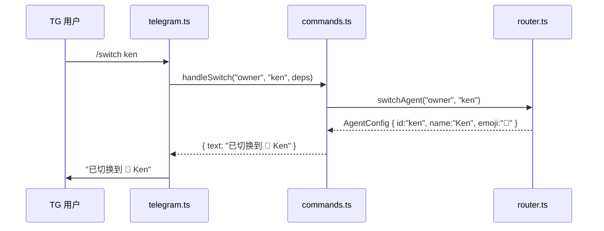
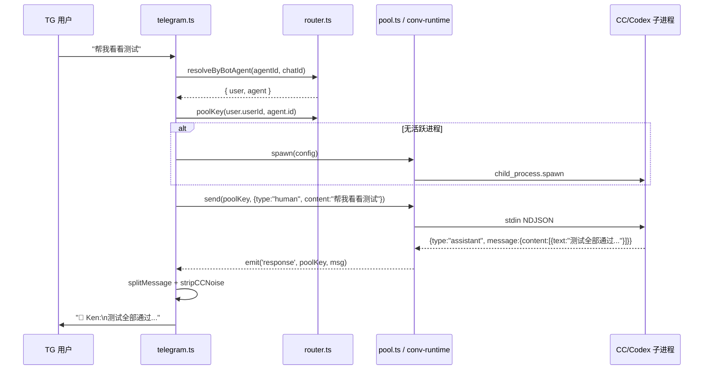
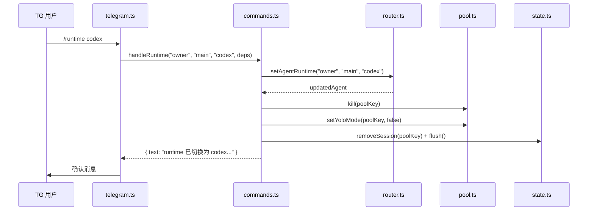
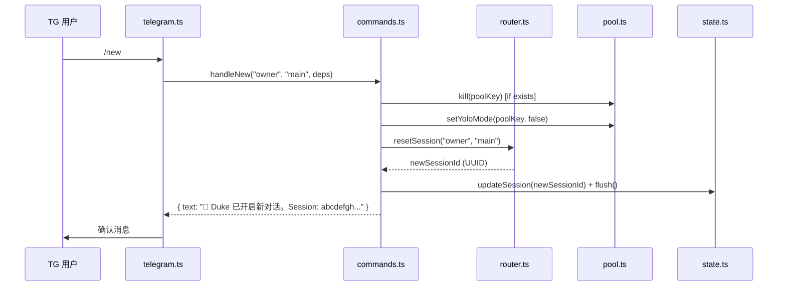

# bot-commands - 技术设计文档

> **设计概述**：升级 Relay 路由模型（chatId→tenant 1:1 变为 user→agents 1:N），为 Telegram Bot 添加命令处理层，使单个用户可以在一个对话中切换多个 AI Agent。v0.5 新增 conversation runtime 切换、YOLO 模式、计划任务等功能。
>
> **关联文档**：
> - L1 项目架构：`project-specs/project-architecture.md`
> - L2 功能需求：`features/bot-commands/requirements.md`
> - L2 任务拆分：`features/bot-commands/tasks.md`
> - 上游模块：`features/cc-process-pool/design.md`、`features/telegram-channel/design.md`

---

## 1. 技术栈（Tech Stack）

**基于 L1 项目架构**：`project-specs/project-architecture.md`

- **运行时**：Node.js >= 18
- **语言**：TypeScript 5.x, strict mode
- **TG Bot 框架**：grammy ^1.41（已安装）
- **进程池**：`src/pool.ts` + `src/conversation-runtime.ts`（已实现）
- **配置**：JSON 文件（relay.json，替代 tenants.json）
- **状态持久化**：`src/state.ts`（StateManager）
- **计划任务**：`src/scheduler.ts`（Scheduler）
- **测试**：vitest
- **新增依赖**：无（grammy 已有 command 处理能力）

---

## 2. 架构设计（Architecture Design）

### 组件划分

```
bot-commands 模块
├── src/types.ts              （扩展：UserConfig, AgentConfig, StateManager, Scheduler 等类型）
├── src/router.ts             （重写：user→agents 路由 + activeAgent 状态管理 + runtime 配置）
├── src/commands.ts            （新增：核心命令处理函数）
├── src/command-menu.ts        （新增：TG 命令菜单注册）
├── src/job-commands.ts        （新增：计划任务命令处理）
├── src/state.ts              （新增：session 状态持久化）
├── src/channels/telegram.ts  （扩展：注册命令 handler + 标识前缀 + 独立 bot 模式）
└── src/index.ts              （更新：relay.json 配置路径）
```

### 模块关系

```mermaid
graph TD
    TG["Telegram API"] -->|long polling| BOT["channels/telegram.ts"]
    BOT -->|command| CMD["commands.ts"]
    BOT -->|job command| JOBCMD["job-commands.ts"]
    BOT -->|text msg| ROUTER["router.ts"]
    CMD -->|resolve/switch| ROUTER
    CMD -->|getStatus| POOL["pool.ts / conversation-runtime.ts"]
    CMD -->|persist state| STATE["state.ts (StateManager)"]
    JOBCMD -->|schedule| SCHED["scheduler.ts"]
    ROUTER -->|AgentConfig| BOT
    BOT -->|send(poolKey, msg)| POOL
    POOL -->|response event| BOT
    BOT -->|prefix + sendMessage| TG
    CONFIG["relay.json"] -->|startup load| ROUTER
    MENU["command-menu.ts"] -->|setMyCommands| TG
```

### 独立 Bot 模式

每个 Agent 可配置独立的 `botToken`，拥有独立的 TG Bot 实例。`createTelegramBots()` 遍历所有配置了 botToken 的 Agent，为每个创建一个 `createSingleBot()` 实例。在独立 bot 模式下：
- /list 和 /switch 命令不可用（返回友好提示）
- /start 显示当前 Agent 的命令列表（而非所有 Agent 列表）
- 所有命令通过 `agentId` 参数自动绑定到当前 bot 对应的 Agent

### Runtime-aware 统一控制面

`commands.ts` 是四个 conversation runtime 共用的命令语义层；渠道层只负责解析与呈现。命令解析当前 runtime 的真源顺序为：live process → persisted session → structured route / preference → legacy runtime。

| 命令 | CC | Codex | CC SDK | Pi |
|---|---|---|---|---|
| `/runtime` | Relay 切换并清理 active session | 同左 | 同左 | 仅受审 canary route |
| `/model` | catalog + 重启/续接 | catalog + 重启/续接 | subscription catalog + 重启/续接 | 原生 discovery / hot switch |
| `/models` | 当前 runtime catalog，有界输出 | 同左 | 当前 subscription catalog | 原生目录，有界输出 |
| `/think` | 不支持 | 不支持 | 不支持 | 原生 reasoning |
| `/compact`, `/context` | 原生命令透传 | 既有非 Pi 透传路径 | 既有非 Pi 透传路径 | 原生 RPC |
| `/stop` | 中断 active turn，保留 session | 同左 | 同左 | 同左 |
| `/new` | 新 session | 新 session/thread | 新 session | 新 session |
| `/restart` | exact persisted binding | exact persisted binding/thread | exact persisted binding | exact persisted binding |
| `/yolo` | 不支持 | session override | 不支持 | 不支持 |

`/model` 不承担隐式跨 runtime 事务。第一层展示四个 runtime，只有当前 runtime 展开接入方式；用户切换 runtime 后再选择 subscription/OpenRouter scope。第二层最多展示 8 个模型，完整目录通过 `/models <关键词>` 检索且最多返回 30 条。这样既避免 Card Kit 元素爆炸，也避免一次模型点击暗中丢弃另一个 runtime 的 session。

飞书所有命令卡片统一经过 `sendFeishuCommandResult()`：构建完整 Card Kit 后递归计算元素数，超过预算直接发送文字；API 拒绝卡片时捕获错误并发送文字兜底。渠道不得绕过该出口直接发送命令卡片。

---

## 3. 接口定义（Interface Definition）

### 类型定义（types.ts 扩展）

```typescript
export interface AgentConfig {
  id: string;                  // OA id, e.g. "main", "ken"
  name: string;                // 显示名, e.g. "Duke", "Ken"
  emoji: string;               // 标识符, e.g. "🎲", "🔧"
  workspace: string;           // CC 工作目录
  sessionId: string;           // CC session UUID
  maxTurns?: number;           // CC --max-turns (default 100)
  allowedTools?: string[];     // CC --allowed-tools
  botToken?: string;           // 独立 bot 模式的 TG Bot Token
  runtime?: ConversationRuntimeId;  // 'cc' | 'codex'
  conversationRuntimePreference?: ConversationRuntimeId[];  // fallback 顺序
  feishu?: { sessionId: string };  // 飞书渠道 sessionId 覆盖
}

export interface UserConfig {
  userId: string;              // 用户 ID, e.g. "owner"
  chatId: string;              // TG chat ID
  defaultAgent: string;        // 默认 agent id
  agents: AgentConfig[];       // 可用 agent 列表
}

export interface RelayConfig {
  users: UserConfig[];
}
```

### CommandRuntime 接口

```typescript
export interface CommandRuntime {
  spawn(config: SpawnConfig & { runtime?: ConversationRuntimeId; conversationRuntimePreference?: ConversationRuntimeId[]; codexThreadId?: string }): Promise<RuntimeProcess>;
  send(tenantId: string, message: StreamJsonMessage): Promise<void>;
  kill(tenantId: string): Promise<void>;
  get(tenantId: string): RuntimeProcess | undefined;
  on(event: 'turn-accepted', handler: (tenantId: string) => void): void;
  on(event: 'response', handler: (tenantId: string, msg: StreamJsonMessage) => void): void;
  on(event: 'exit', handler: (tenantId: string, code: number | null) => void): void;
  on(event: 'error', handler: (tenantId: string, error: Error) => void): void;
  on(event: 'turn-warning', handler: (tenantId: string, currentTurn: number, maxTurns: number) => void): void;
  on(event: 'session-end', handler: (tenantId: string, reason: SessionEndReason) => void): void;
  on(event: 'crash-retry', handler: (tenantId: string) => void): void;
  setYoloMode?(tenantId: string, enabled: boolean): void;
  getYoloMode?(tenantId: string): boolean;
  onRuntimeFallback?(handler: (event: ConversationRuntimeFallbackEvent) => void): void;
}
```

### Function-001：createRouter（重写）

```typescript
interface Router {
  resolveUser(chatId: string): UserConfig | undefined;
  resolveByBotAgent(agentId: string, chatId: string): { user: UserConfig; agent: AgentConfig } | undefined;
  getActiveAgent(userId: string): AgentConfig | undefined;
  switchAgent(userId: string, agentId: string): AgentConfig | undefined;
  poolKey(userId: string, agentId: string): string;
  getAgents(userId: string): AgentConfig[];
  getAllUsers(): UserConfig[];
  getAllAgentBots(): Array<{ agent: AgentConfig; authorizedChatIds: string[] }>;
  resetSession(userId: string, agentId: string): string | undefined;
  setAgentRuntime(userId: string, agentId: string, runtime: ConversationRuntimeId): AgentConfig | undefined;
  getGatewayBindings?(): unknown;
}

function createRouter(configPath: string): Router
```

### Function-002：命令处理函数（commands.ts）

```typescript
interface CommandDeps {
  router: Router;
  runtime: CommandRuntime;
  stateManager?: StateManager;
}

interface CommandResult {
  text: string;
}

// 同步命令
function handleStart(userId: string, agentId: string, deps: CommandDeps): CommandResult;
function handleList(userId: string, deps: CommandDeps): CommandResult;
function handleSwitch(userId: string, agentId: string, deps: CommandDeps): CommandResult;
function handleStatus(userId: string, agentId: string, deps: CommandDeps): CommandResult;
function handleHelp(): CommandResult;
function handleSession(userId: string, agentId: string, deps: CommandDeps): CommandResult;
function handleUsage(userId: string, agentId: string, deps: CommandDeps): CommandResult;

// 异步命令
function handleNew(userId: string, agentId: string, deps: CommandDeps): Promise<CommandResult>;
function handleStop(userId: string, agentId: string, deps: CommandDeps): Promise<CommandResult>;
function handleKill(userId: string, agentId: string, deps: CommandDeps): Promise<CommandResult>;
function handleRestart(userId: string, agentId: string, deps: CommandDeps): Promise<CommandResult>;
function handleRuntime(userId: string, agentId: string, requestedRuntime: string | undefined, deps: CommandDeps): Promise<CommandResult>;
function handleYolo(userId: string, agentId: string, requestedMode: string | undefined, deps: CommandDeps): Promise<CommandResult>;
```

### Function-003：prefixMessage — 标识前缀

```typescript
function prefixMessage(agent: AgentConfig, text: string, isFirstChunk: boolean): string
// isFirstChunk=true → "🎲 Duke:\n{text}"
// isFirstChunk=false → "{text}" (不重复前缀)
```

### Function-004：计划任务命令（job-commands.ts）

```typescript
function handleListJobs(agentId: string, scheduler: Scheduler): string;
function handleAddJob(agentId: string, workspace: string, chatId: string, args: string, scheduler: Scheduler): string;
function handleDelJob(agentId: string, jobId: string, scheduler: Scheduler): string;
function handleRunJob(agentId: string, jobId: string, scheduler: Scheduler): Promise<string>;
```

### Function-005：命令菜单注册（command-menu.ts）

```typescript
function getAllMenuCommands(): MenuCommand[];
function registerCommandMenu(bot: { api: { setMyCommands: (cmds: MenuCommand[]) => Promise<unknown> } }): Promise<void>;
```

---

## 4. 数据模型（Data Model）

### relay.json 配置格式（替代 tenants.json）

```json
{
  "users": [
    {
      "userId": "owner",
      "chatId": "TELEGRAM_CHAT_ID",
      "defaultAgent": "main",
      "agents": [
        {
          "id": "main",
          "name": "Duke",
          "emoji": "🎲",
          "workspace": "/Volumes/workdisk/BBCC/Coevolution/duke-space",
          "sessionId": "UUID_V4",
          "maxTurns": 100,
          "botToken": "TG_BOT_TOKEN",
          "runtime": "cc",
          "conversationRuntimePreference": ["cc", "codex"]
        }
      ]
    }
  ]
}
```

### 内存状态

```typescript
// Router 内部状态
Map<string, UserConfig>           // chatId → UserConfig
Map<string, string>               // userId → activeAgentId（初始 = defaultAgent）
Map<string, AgentConfig>          // `${userId}:${agentId}` → AgentConfig（快速查找）
```

### 持久化状态（StateManager）

```typescript
interface SessionState {
  poolKey: string;
  agentId: string;
  runtime: ConversationRuntimeId;
  sessionId: string;
  codexThreadId?: string;
  wrapRequestedAt?: number;
  recoveryRequiredAt?: number;
  recoveryReason?: SessionRecoveryReason;
  turnCount: number;
  maxTurns: number;
  lastActivity: number;
  status: 'active' | 'recovery-required';
}
```

---

## 5. 数据流（Data Flow）

### Flow-001：/switch 命令流



### Flow-002：文本消息路由到活跃 Agent



### Flow-003：/runtime 切换



### Flow-004：/new 开启新对话



---

## 6. 错误处理（Error Handling）

**Error-001：/switch 无效 Agent ID**
- **触发**：用户输入不存在的 agent id
- **处理**：返回错误文本 + 提示 /list
- **示例**：`未知 Agent: nobody。发送 /list 查看可用列表。`

**Error-002：/switch 缺少参数**
- **触发**：用户发送 `/switch` 不带参数
- **处理**：返回用法提示
- **示例**：`用法: /switch <agent_id>。发送 /list 查看可用 ID。`

**Error-003：/status 无活跃 Agent**
- **触发**：用户未 /switch 且 defaultAgent 未 spawn
- **处理**：显示默认 Agent 信息 + "未启动" 或 "待恢复" 状态

**Error-004：CC spawn 失败（/switch 后首次消息）**
- **处理**：复用 telegram-channel 已有逻辑 — "服务暂时不可用，请稍后重试"

**Error-005：relay.json 格式错误**
- **触发**：配置文件缺少必填字段或 JSON 无效
- **处理**：启动时抛出错误并退出，日志输出具体缺失字段

**Error-006：/stop 非忙碌状态**
- **触发**：Agent 当前空闲
- **处理**：返回 "当前空闲，无需终止"

**Error-007：/runtime 无效值**
- **触发**：用户传入非 cc/codex 的值
- **处理**：返回 "不支持的 runtime。可用值: cc, codex"

**Error-008：/yolo 非 Codex runtime**
- **触发**：当前 Agent runtime 不是 codex
- **处理**：返回 "YOLO 只对 Codex 生效。请先执行 /runtime codex"

---

## 7. 安全设计（Security Design）

- **Agent ID 校验**：/switch 参数必须匹配 `/^[a-z0-9-]+$/`，防止注入
- **用户隔离**：router 按 chatId 查找用户，不同用户无法操作彼此的 Agent
- **进程隔离**：每个 Agent 的 CC 进程在独立 workspace 运行，pool key 含 userId
- **YOLO 模式安全**：仅 session 内存状态，不持久化；Relay 重启或 /new 后自动恢复安全模式
- **计划任务隔离**：job_del 和 job_run 检查任务所有权，不允许操作其他 Agent 的任务

---

## 8. 性能优化（Performance Optimization）

### 性能目标
- **命令响应**：/start、/list、/status、/help ≤ 500ms
- **/switch 响应**：≤ 500ms（仅状态切换，不 spawn）
- **/runtime 切换**：≤ 3s（含进程终止）
- **路由查找**：≤ 1ms（Map 查找）

### 优化策略
- relay.json 启动时一次性加载到多层 Map
- activeAgent 状态保存在内存（Map），/switch 是 O(1) 操作
- 多个 Agent 进程可同时 idle，切换不需 kill/spawn
- pool cleanup timer 统一管理所有 Agent 的 idle 超时

---

## 9. 向后兼容（Backward Compatibility）

### 破坏性变更

**配置格式变更**：tenants.json → relay.json
- **原因**：1:1 chatId→tenant 无法支持 1:N user→agents
- **迁移影响**：v0.1 只有测试租户（大鸟），无需自动迁移工具
- **环境变量**：`TENANTS_JSON_PATH` → `RELAY_CONFIG_PATH`

**Router 接口变更**：
- `resolve(chatId)` → `resolveUser(chatId)` + `getActiveAgent(userId)` + `resolveByBotAgent(agentId, chatId)`
- `getAllTenants()` → `getAllUsers()` + `getAllAgentBots()`

**Pool key 变更**：
- `tenantId` → `${userId}:${agentId}`
- metering 记录的 tenant 字段也随之变更

**新增接口**：
- `resetSession(userId, agentId)` — 生成新 session UUID
- `setAgentRuntime(userId, agentId, runtime)` — 更新 agent 的 runtime 配置

### 受影响模块
- `src/router.ts` — 重写
- `src/channels/telegram.ts` — 扩展（独立 bot 模式）
- `src/index.ts` — 配置路径变更
- `src/metering.ts` — tenant 字段适配（pool key 格式变了）
- `tests/` — 所有涉及 router 的测试需更新
