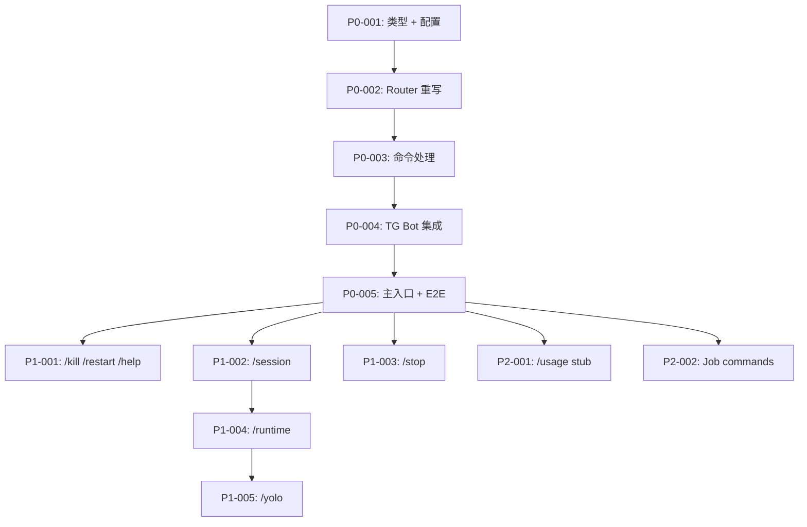

# bot-commands - 任务拆分文档

> **任务概述**：基于 design.md 实现多 OA 路由 + Bot 命令系统，覆盖 **Telegram 与飞书**（命令核心在 `commands.ts`；飞书按钮等见 `feishu-channel` **FR-P1-005**）。含核心命令、runtime / YOLO、计划任务等。
>
> **关联文档**：
> - L2 技术设计：`features/bot-commands/design.md`
> - L2 功能需求：`features/bot-commands/requirements.md`

---

## 1. 任务拆分（Task Breakdown）

### P0 任务（MVP 必需）

| 任务 ID | 任务名称 | 预估工时 | 依赖任务 | 状态 |
|---------|---------|---------|---------|------|
| P0-001 | 类型定义 + 配置格式升级 | 2h | — | [x] 已完成 |
| P0-002 | Router 重写（multi-agent） | 3h | P0-001 | [x] 已完成 |
| P0-003 | 命令处理模块（核心命令） | 3h | P0-002 | [x] 已完成 |
| P0-004 | Telegram Bot 集成（命令 + 标识前缀） | 3h | P0-003 | [x] 已完成 |
| P0-005 | 主入口更新 + 端到端验证 | 2h | P0-004 | [x] 已完成 |

### P1 任务（增强功能）

| 任务 ID | 任务名称 | 预估工时 | 依赖任务 | 状态 |
|---------|---------|---------|---------|------|
| P1-001 | /kill + /restart + /help 命令 | 2h | P0-005 | [x] 已完成 |
| P1-002 | /session 命令 — 查看 session 详细信息 | 2h | P0-005 | [x] 已完成 |
| P1-003 | /stop 命令 — 中断当前 turn | 1h | P0-005 | [x] 已完成 |
| P1-004 | /runtime 命令 — 查看/切换 conversation runtime | 3h | P1-002 | [x] 已完成 |
| P1-005 | /yolo 命令 — Codex YOLO 模式控制 | 2h | P1-004 | [x] 已完成 |

### P2 任务（未来增强）

| 任务 ID | 任务名称 | 预估工时 | 依赖任务 | 状态 |
|---------|---------|---------|---------|------|
| P2-001 | /usage 命令 — 费用统计（stub） | 1h | P0-005 | [x] 已完成 |
| P2-002 | 计划任务命令（/jobs, /job_add, /job_del, /job_run） | 4h | P0-005 | [x] 已完成 |
| P2-003 | 命令菜单注册（command-menu.ts） | 1h | P0-004 | [x] 已完成 |
| P2-004 | /usage 命令 — 完整实现 | 3h | P2-001 | [x] 已完成 |
| P2-005 | Inline 按钮（TG）+ 飞书卡片按钮 — Agent 点选切换 | 5h | P0-005 | [x] 已完成 |
| P2-006 | per-Agent 模型配置（TG+飞书共用 `AgentConfig`） | 3h | P0-005 | [x] 已完成 |

---

## 2. 任务详情（Task Details）

### P0-001：类型定义 + 配置格式升级 [x]

**任务描述**：
- 基于 design.md「3. 接口定义 / 类型定义」，在 `src/types.ts` 新增 `AgentConfig`、`UserConfig`、`RelayConfig` 类型
- 创建 `config/relay.example.json` 示例配置
- 移除旧 `TenantConfig` 引用（design.md「9. 向后兼容」）
- 新增 `StateManager`、`Scheduler`、`ConversationRuntimeId` 等类型

**验证标准（TDD）**：
- [x] **Unit Test-001**：AgentConfig 类型满足必填字段（id, name, emoji, workspace, sessionId）
- [x] **Unit Test-002**：UserConfig 类型含 chatId, defaultAgent, agents
- [x] **Unit Test-003**：relay.example.json 可被 JSON.parse 正确解析

---

### P0-002：Router 重写（multi-agent） [x]

**任务描述**：
- 基于 design.md「3. 接口定义 / Function-001 createRouter」，重写 `src/router.ts`
- 支持 `resolveUser(chatId)`、`resolveByBotAgent(agentId, chatId)`、`getActiveAgent(userId)`、`switchAgent(userId, agentId)`、`poolKey()`、`getAgents()`、`getAllAgentBots()`、`resetSession()`、`setAgentRuntime()`
- 内部维护 `activeAgentMap: Map<string, string>`（userId → agentId）
- 启动时 activeAgent 初始化为 defaultAgent

**验证标准（TDD）**：
- [x] **Unit Test-004**：createRouter 正确加载 relay.json
- [x] **Unit Test-005**：resolveUser(chatId) 返回正确 UserConfig
- [x] **Unit Test-006**：resolveUser(unknown_chatId) 返回 undefined
- [x] **Unit Test-007**：getActiveAgent 初始返回 defaultAgent
- [x] **Unit Test-008**：switchAgent 切换后 getActiveAgent 返回新 agent
- [x] **Unit Test-009**：switchAgent 无效 agentId 返回 undefined
- [x] **Unit Test-010**：poolKey 返回 `${userId}:${agentId}` 格式
- [x] **Unit Test-011**：getAgents 返回用户全部 agent 列表
- [x] **Unit Test-012**：配置文件缺失时抛出明确错误

---

### P0-003：命令处理模块（核心命令） [x]

**任务描述**：
- 基于 design.md「3. 接口定义 / Function-002」，新建 `src/commands.ts`
- 实现 `handleStart`、`handleList`、`handleSwitch`、`handleStatus` 四个 P0 命令
- 每个命令返回 `CommandResult { text: string }`
- 命令支持可选 `agentId` 参数（独立 bot 模式下直接传入）

**验证标准（TDD）**：
- [x] **Unit Test-013**：handleStart 返回欢迎文本 + 命令列表
- [x] **Unit Test-014**：handleList 展示进程状态（idle/busy/未启动）+ 活跃标记
- [x] **Unit Test-015**：handleSwitch("ken") 返回切换确认
- [x] **Unit Test-016**：handleSwitch("nobody") 返回错误提示
- [x] **Unit Test-017**：handleSwitch() 缺少参数返回用法提示
- [x] **Unit Test-018**：handleStatus 展示活跃 Agent 详情（名称、状态、PID）
- [x] **Unit Test-019**：handleStatus 无进程时显示"未启动"或"待恢复"

---

### P0-004：Telegram Bot 集成（命令 + 标识前缀） [x]

**任务描述**：
- 基于 design.md「2. 架构设计」，更新 `src/channels/telegram.ts`
- 实现独立 bot 模式：`createSingleBot()` 为每个 Agent 创建独立 Bot 实例
- 注册 grammy command handlers（/start, /status, /help, /kill, /restart, /new, /stop, /session, /runtime, /yolo, /usage + job commands）
- 注册 /list 和 /switch 为 deprecated（独立 bot 模式下不可用）
- 更新文本消息处理：resolveByBotAgent → pool.send（pool key = `userId:agentId`）
- 添加标识前缀（design.md「3. 接口定义 / Function-003 prefixMessage」）

**验证标准（TDD）**：
- [x] **Unit Test-020**：/start 命令触发 handleStart 并回复
- [x] **Unit Test-021**：文本消息路由到活跃 Agent（pool key = userId:agentId）
- [x] **Unit Test-022**：CC 回复添加 Agent 标识前缀（首条消息）
- [x] **Unit Test-023**：未注册 chatId 收到引导消息
- [x] **Unit Test-024**：多分片回复仅首片有前缀

---

### P0-005：主入口更新 + 端到端验证 [x]

**任务描述**：
- 更新 `src/index.ts`：配置路径 `RELAY_CONFIG_PATH`（替代 `TENANTS_JSON_PATH`）
- 更新 metering 集成：pool key 格式变更适配
- 创建本机 relay.json 配置（真实 workspace 路径）
- 端到端验证

**验证标准（TDD）**：
- [x] **Unit Test-025**：缺少 TELEGRAM_BOT_TOKEN 时抛出错误
- [x] **Unit Test-026**：RELAY_CONFIG_PATH 无效时抛出错误
- [x] **Integration Test-001**：端到端 — TG 发消息 → 收到回复

---

### P1-001：/kill + /restart + /help 命令 [x]

**任务描述**：
- 在 `src/commands.ts` 添加 handleKill、handleRestart、handleHelp
- 在 `src/channels/telegram.ts` 注册对应 command handlers
- handleKill 支持可选 agentId 参数
- handleRestart 以 resume 模式 respawn，使用持久化的 runtime 和 codexThreadId

**验证标准（TDD）**：
- [x] **Unit Test-027**：handleKill 调用 runtime.kill 并返回确认
- [x] **Unit Test-028**：handleRestart 先 kill 再 spawn(resume=true)
- [x] **Unit Test-029**：handleHelp 返回所有命令说明

---

### P1-002：/session 命令 — 查看 session 详细信息 [x]

**任务描述**：
- 在 `src/commands.ts` 添加 handleSession
- 显示 session ID、状态、runtime、工作区路径、运行时长、PID
- 对 Codex runtime 额外显示 threadId
- 支持持久化 session 的待恢复状态展示

**验证标准（TDD）**：
- [x] **Unit Test-030**：handleSession 展示完整 session 信息
- [x] **Unit Test-031**：handleSession 对 Codex runtime 显示 threadId
- [x] **Unit Test-032**：handleSession 无进程但有持久化时显示"待恢复"

---

### P1-003：/stop 命令 — 中断当前 turn [x]

**任务描述**：
- 在 `src/commands.ts` 添加 handleStop
- 仅在 Agent busy 时发送 SIGINT 中断当前 turn
- 非忙碌状态返回提示

**验证标准（TDD）**：
- [x] **Unit Test-033**：handleStop 在 busy 时发送 SIGINT
- [x] **Unit Test-034**：handleStop 在 idle 时返回"当前空闲"
- [x] **Unit Test-035**：handleStop 无进程时返回"未在运行"

---

### P1-004：/runtime 命令 — 查看/切换 conversation runtime [x]

**任务描述**：
- 在 `src/commands.ts` 添加 handleRuntime
- 无参数时显示 configured/active runtime + activeState
- 带参数时切换 runtime：更新 router 配置 + kill 当前进程 + 清理 state + 同步 conversationRuntimePreference
- 支持 cc 和 codex 两个值

**验证标准（TDD）**：
- [x] **Unit Test-036**：handleRuntime 无参数显示当前 runtime 状态
- [x] **Unit Test-037**：handleRuntime("codex") 切换 runtime 并 kill 进程
- [x] **Unit Test-038**：handleRuntime("invalid") 返回错误提示
- [x] **Unit Test-039**：handleRuntime 切换后清理 yolo 和持久化状态

---

### P1-005：/yolo 命令 — Codex YOLO 模式控制 [x]

**任务描述**：
- 在 `src/commands.ts` 添加 handleYolo
- 仅对 Codex runtime 生效
- `status` 显示当前 YOLO 状态 + 作用范围说明
- `on` 开启 --dangerously-bypass-approvals-and-sandbox + 警告
- `off` 关闭，恢复 workspace-write + approval=never

**验证标准（TDD）**：
- [x] **Unit Test-040**：handleYolo status 显示当前状态
- [x] **Unit Test-041**：handleYolo on 开启并返回警告
- [x] **Unit Test-042**：handleYolo off 关闭
- [x] **Unit Test-043**：handleYolo 非 Codex runtime 返回错误
- [x] **Unit Test-044**：handleYolo 无效参数返回用法提示

---

### P2-001：/usage 命令 — 费用统计（stub） [x]

**任务描述**：
- 在 `src/commands.ts` 添加 handleUsage（占位实现）
- 显示"费用统计功能开发中" + 引导查看 metering 日志

**验证标准（TDD）**：
- [x] **Unit Test-045**：handleUsage 返回占位提示文本

---

### P2-002：计划任务命令（/jobs, /job_add, /job_del, /job_run） [x]

**任务描述**：
- 新建 `src/job-commands.ts`
- 实现 handleListJobs（列出计划任务）、handleAddJob（注册任务，解析 cron + prompt + 可选参数）、handleDelJob（删除任务，检查所有权）、handleRunJob（立即执行）
- 在 `src/channels/telegram.ts` 注册 4 个 command handlers
- 任务 ID 格式：`${agentId}-${timestamp_hex}`

**验证标准（TDD）**：
- [x] **Unit Test-046**：handleListJobs 空列表返回"暂无计划任务"
- [x] **Unit Test-047**：handleAddJob 正确解析 cron + prompt + 可选参数
- [x] **Unit Test-048**：handleAddJob 缺少 prompt 返回错误
- [x] **Unit Test-049**：handleDelJob 删除自己的任务成功
- [x] **Unit Test-050**：handleDelJob 删除他人任务返回错误
- [x] **Unit Test-051**：handleRunJob 执行任务并返回结果

---

### P2-003：命令菜单注册（command-menu.ts） [x]

**任务描述**：
- 新建 `src/command-menu.ts`
- 定义 15 个 TG 命令菜单项（start, stop, status, new, session, runtime, yolo, usage, kill, restart, help, jobs, job_add, job_del, job_run）
- 通过 Telegram Bot API `setMyCommands` 注册

**验证标准（TDD）**：
- [x] **Unit Test-052**：getAllMenuCommands 返回 15 个命令
- [x] **Unit Test-053**：registerCommandMenu 调用 setMyCommands

---

### P2-004：/usage 命令 — 完整实现 [x]

**任务描述**：
- `handleUsage` 使用 `metering.summarizeMonthlyUsage(meteringDir, poolKey)`，展示 **UTC 自然月** 聚合（与 `metering.ts` 一致）
- `meteringDir` 缺失时友好提示（不冒充有数据）

**验证标准**：
- [x] **Unit Test**：`tests/commands.test.ts` — `describe('handleUsage')`（未配置目录、零记录、有记录聚合、损坏行警告、poolKey 过滤）

---

### P2-005：Inline（TG）+ 飞书卡片按钮 — Agent 点选切换 [x]

**任务描述**：
- **需求**：`requirements.md` **FR-P2-001**；飞书侧 **`feishu-channel` FR-P1-005**
- **Telegram**：`/list`、`/start` 等输出 inline keyboard，点击即 `switchAgent`（与现规划一致）
- **飞书**：在同等场景下发 Interactive Card **带按钮**，点击回传映射到与 `/switch <agentId>` 相同逻辑（复用 `commands` / `router`）

**验证标准（TDD）**：
- [x] **`commands.ts`**：`resolveInboundRoutingAgent`、`resolveAgentFromPoolKey`、`withAgentPickerUi`、`RELAY_SWITCH_CB_PREFIX`；TG `callback_query:data` 与飞书 `card.action` 收口见 `channels/telegram.ts`、`channels/feishu.ts`
- [x] **Unit**：`tests/commands.test.ts` — `describe('resolveInboundRoutingAgent / … [P2-005]')`；`tests/telegram.test.ts`、`tests/feishu-channel.test.ts` 覆盖交互路径

**依赖**：与 `features/feishu-channel/tasks.md` **P1-005** 协同（已完成）

---

### P2-006：per-Agent 模型配置 — TG 与飞书一致 [x]

**任务描述**：
- **需求**：`requirements.md` **FR-P2-002**；飞书侧验收 **`feishu-channel` FR-P1-006**
- **`relay.json` / `AgentConfig`**：支持 per-Agent 模型字段；`pool.spawn` 传入对应 `--model`
- **飞书**：无单独「飞书模型」；仅验证与 TG 同一配置分支

**验证标准（TDD）**：
- [x] **`types.ts` / `pool.ts`**：`SpawnConfig.ccModel` → `appendModelArg` → `--model`
- [x] **Unit**：`tests/pool.test.ts` — `passes --model to CC when ccModel is set [P2-006]`；spawn 路径与飞书/TG 共用

**依赖**：可与 `features/feishu-channel/tasks.md` **P1-006** 并行（已完成）

---

## 3. 任务依赖（Task Dependencies）

---

## 4. 完成标准（Definition of Done）

### TDD 要求

- **70% Unit Tests**：router、commands、bot handler、类型验证
- **20% Integration Tests**：端到端 TG 消息流转
- **10% E2E**：手动 UAT（TG 发命令 → 收到正确回复）

### 代码质量标准

- TypeScript `strict: true`，零 `any`
- 核心模块覆盖率 >= 80%
- 单文件 <= 300 行
- 生产依赖不新增（grammy 已有）
- 所有 commit 包含 task ID `[P0-00x]`

---

## 5. 执行顺序（Execution Order）

1. **阶段1**（P0-001）：类型定义 + 配置格式，TDD [x]
2. **阶段2**（P0-002）：Router 重写，TDD [x]
3. **阶段3**（P0-003）：核心命令处理模块，TDD [x]
4. **阶段4**（P0-004）：TG Bot 集成 + 标识前缀，TDD [x]
5. **阶段5**（P0-005）：主入口 + E2E 验证 [x]
6. **阶段6**（P1-001）：/kill、/restart、/help [x]
7. **阶段7**（P1-002）：/session [x]
8. **阶段8**（P1-003）：/stop [x]
9. **阶段9**（P1-004）：/runtime [x]
10. **阶段10**（P1-005）：/yolo [x]
11. **阶段11**（P2-001）：/usage stub [x]
12. **阶段12**（P2-002）：Job commands [x]
13. **阶段13**（P2-003）：Command menu [x]
14. **阶段14**（P2-004）：/usage 完整实现 [x]
15. **阶段15**（P2-005 / P2-006）：点选切换 + per-Agent `ccModel`（TG+飞书） [x]

---

## 6. 风险识别（Risk Identification）

### 技术风险

- **风险1：Router 重写影响现有测试**
  - 影响：router.test.ts、bot-handler.test.ts、index.test.ts 需大量更新
  - 缓解：P0-002 中同步重写 router 测试；P0-004 中更新 bot-handler 测试

- **风险2：Pool key 变更影响 metering**
  - 影响：metering 日志的 tenant 字段格式变化（`member-000` → `owner:main`）
  - 缓解：P0-005 中同步更新 metering 适配

- **风险3：多 CC/Codex 进程同时运行内存不足**
  - 影响：本机内存压力（每进程 ~250MB → 多进程 ~3GB+）
  - 缓解：idle timeout 30min 自动清理；实际同时活跃 2-3 个

- **风险4：Codex YOLO 模式安全风险**
  - 影响：跳过审批和沙箱可能导致误操作
  - 缓解：session 内存状态不持久化；用户需显式开启；每次 /new 或重启自动关闭

### 进度风险

- **风险1：端到端验证需要真实 TG bot token**
  - 缓解：使用已有 bot token；Unit Tests 覆盖核心逻辑
