# cc-process-pool - 技术设计文档

> **设计概述**：基于 Node.js `child_process.spawn` 管理 CC 子进程生命周期。支持两种运行模式：pipe 模式（stream-json NDJSON 双向流）和 interactive 模式（PTY bridge + session jsonl 轮询）。提供 spawn/send/kill/auto-restart/idle-cleanup/token-fallback/rate-limit-abort/crash-replay 等生产级弹性能力。
>
> **关联文档**：
> - L1 项目架构：`project-specs/project-architecture.md`
> - L2 功能需求：`features/cc-process-pool/requirements.md`
> - L2 任务拆分：`features/cc-process-pool/tasks.md`

---

## 1. 技术栈（Tech Stack）

### 技术栈引用

**基于 L1 项目架构**：`project-specs/project-architecture.md`

- **运行时**：Node.js >= 18（与 CC 统一技术栈）
- **语言**：TypeScript 5.x，严格模式（`strict: true`）
- **进程管理**：`node:child_process`（spawn）-- Node.js 内置，零依赖
- **流解析**：`node:readline`（逐行读取 NDJSON）-- Node.js 内置，零依赖
- **文件 I/O**：`node:fs`（session jsonl 轮询读取）-- Node.js 内置，零依赖
- **PTY Bridge**：`scripts/claude_pty_bridge.py`（Python 3）-- interactive 模式专用
- **测试框架**：vitest（遵循 project-standards.md）

### 技术选型说明

- 选择 `child_process.spawn`（非 fork/exec）：spawn 支持流式 stdio，适合长时间运行的 NDJSON 通信
- 选择 `readline`（非第三方 NDJSON 库）：stream-json 输出是标准 NDJSON（每行一个 JSON），readline 足够且零依赖
- 不引入进程管理库（如 pm2）：Relay 自身管理进程生命周期更灵活，且减少生产依赖
- PTY bridge 使用 Python 脚本：CC 的 `--bare` 模式需要 PTY 环境，Python `pty` 模块可直接创建

---

## 2. 架构设计（Architecture Design）

### 组件划分

```
cc-process-pool 模块
├── types.ts              （类型定义：CCProcess / ProcessState / SpawnConfig / PoolOptions / SessionEndReason / TokenTier / CCMode）
├── pool.ts               （进程池管理器：spawn / send / kill / cleanup / token-fallback / rate-limit / crash-replay / interactive）
├── stream.ts             （NDJSON 流解析：stdin 写入 / stdout 逐行解析）
├── claude-onboarding.ts  （CC 2.x 启动前置：~/.claude.json onboarding 字段补全 + ANTHROPIC_API_KEY 镜像）
└── scripts/
    └── claude_pty_bridge.py  （PTY bridge：interactive 模式下的 PTY 代理）
```

### 模块关系

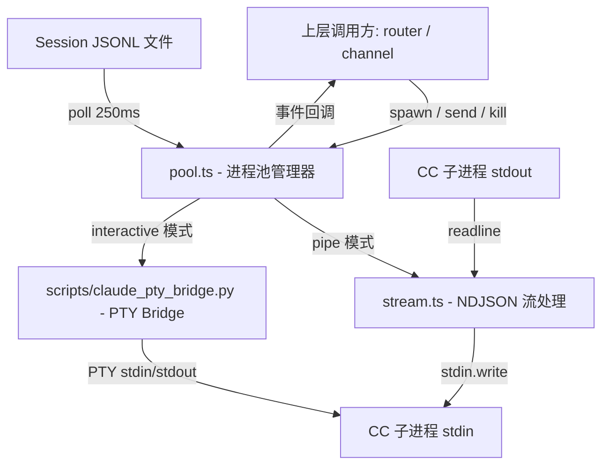

**模块职责说明**：

- **types.ts**：定义所有共享类型。无逻辑，纯类型声明。包括 `CCProcess`、`ProcessState`、`SpawnConfig`、`PoolOptions`、`StreamJsonMessage`、`SessionEndReason`、`TokenTier`、`CCMode`、`PersistedSession` 等
- **pool.ts**：进程池管理器，核心模块。职责：
  - 维护 `Map<tenantId, CCProcess>` 进程注册表
  - 实现双模式 spawn（pipe / interactive）
  - 实现 send/kill 操作，busy 时消息自动入队
  - 管理进程状态机（starting -> ready -> busy -> idle -> dead）
  - 定时器驱动 idle cleanup（每 60 秒扫描）
  - 崩溃检测 + 自动重启（限频：3 次/小时）+ crash replay
  - Token fallback（primary/fallback 自动切换）
  - Rate limit abort（429 恢复窗口 + 强制中止）
  - Busy timeout（activity-based，stdout/stderr 刷新定时器）
  - Interactive 模式完整生命周期（warmup -> submit -> settle -> slash command）
  - Session JSONL 修复（resume 时截断未闭合 tool_use 链）
  - Turn 计数与 80% 预警
  - 结构化 session-end 事件
- **stream.ts**：NDJSON 流处理工具。职责：
  - 将消息对象序列化为 JSON + 换行符，写入 stdin
  - 用 readline 逐行读取 stdout，解析为 JSON 对象
  - 处理 stderr 输出（日志/错误信息）
- **claude_pty_bridge.py**：PTY bridge 脚本。职责：
  - 创建 PTY 并启动 CC `--bare` 模式
  - 将 stdin 转发到 PTY，将 PTY 输出转发到 stdout
- **claude-onboarding.ts**：CC 2.x 启动前置工具（覆盖 onboarding、Auth env 策略、claude.json 可写、workspace/`/root` trust）。职责：
  - `ensureClaudeJsonWritable(home)`：写 `~/.claude.json` 前 best-effort `chattr -i`，防止 immutable 阻断 trust/onboarding 登记
  - `ensureClaudeOnboardingComplete(home)`：幂等补齐 onboarding 关键字段，防止 CC 进入 first-run theme picker
  - `mirrorAnthropicAuthTokenToApiKey(env)`：**删除**子进程 env 的 `ANTHROPIC_API_KEY`（interactive 禁止 API_KEY 注入，避免 custom API key TUI 阻塞）
  - `ensureClaudeProjectRegistered(home, cwd)`：幂等登记 workspace trust；调用方必须传 realpath cwd；spawn args 还需 `--add-dir`
  - `ensureClaudeBareRootTrust(home)`：幂等登记 `projects['/root']`（`CLAUDE_BARE_REGISTRY_CWD`），满足 interactive `/root` trust gate
  - `recordCustomApiKeyAccepted(home, apiKey)`：记录 API key 后缀至 `customApiKeyResponses.accepted`（保留供诊断场景；spawn 主路径 strip API_KEY）
  - `readClaudeOnboardingState(home)` / `tryStatMtimeMs(path)`：调试与单测辅助

---

## 3. 接口定义（Interface Definition）

### 内部函数接口（本模块无对外 API，全部为内部接口）

**Function-001：createPool -- 创建进程池实例**

```typescript
function createPool(options?: PoolOptions): Pool

interface PoolOptions {
  // --- 基础配置 ---
  idleTimeoutMs?: number                      // 空闲超时，默认 30min
  cleanupIntervalMs?: number                  // 清理检查间隔，默认 60s
  maxRestartsPerHour?: number                 // 每租户每小时最大重启次数，默认 3
  killTimeoutMs?: number                      // kill 等待超时，默认 5s

  // --- 模式配置 ---
  ccMode?: CCMode                             // 'print' | 'interactive'，默认自动检测
  busyTimeoutMs?: number                      // busy 超时，默认 10min

  // --- Token fallback ---
  primaryToken?: string                       // CLAUDE_CODE_OAUTH_TOKEN（env fallback）
  fallbackToken?: string                      // CLAUDE_CODE_OAUTH_TOKEN_FALLBACK（env fallback）

  // --- Rate limit ---
  maxRateLimitRetriesPerMessage?: number       // 每消息最大限流重试，默认 0
  rateLimitRestartDelayMs?: number             // 限流重启延迟，默认 30s
  rateLimitAbortTimeoutMs?: number             // 限流中止超时，默认 90s

  // --- Interactive 模式 ---
  maxInteractiveAcceptRetriesPerMessage?: number  // interactive accept 最大重试，默认 1
  interactiveAcceptTimeoutMs?: number             // interactive accept 超时，默认 15s
  interactiveSubmitDelayMs?: number               // interactive submit 延迟，默认 500ms
  interactiveWarmupMs?: number                    // interactive warmup 延迟，默认 5s
  interactiveSlashCommandSettleMs?: number         // slash command settle 时间，默认 30s
}

interface Pool {
  spawn(config: SpawnConfig): Promise<CCProcess>
  send(tenantId: string, message: StreamJsonMessage): Promise<void>
  kill(tenantId: string): Promise<void>
  killAll(): Promise<void>
  get(tenantId: string): CCProcess | undefined
  getAll(): CCProcess[]
  getStatus(): ProcessStatusInfo[]
  on(event: 'response', handler: (tenantId: string, msg: StreamJsonMessage) => void): void
  on(event: 'exit', handler: (tenantId: string, code: number | null) => void): void
  on(event: 'error', handler: (tenantId: string, error: Error) => void): void
  on(event: 'turn-accepted', handler: (tenantId: string) => void): void
  on(event: 'turn-warning', handler: (tenantId: string, currentTurn: number, maxTurns: number) => void): void
  on(event: 'session-end', handler: (tenantId: string, reason: SessionEndReason) => void): void
  on(event: 'crash-retry', handler: (tenantId: string) => void): void
  on(event: 'tool-files', handler: (tenantId: string, filePaths: string[], workspace: string) => void): void
  emitShutdown(): void
  dispose(): void
}
```

**Function-002：spawn -- 为租户启动 CC 子进程**

```typescript
interface SpawnConfig {
  tenantId: string             // 租户 ID，如 "member-000"
  workspace: string            // 工作目录，如 "/opt/PULSE/Tenants/member-000/"
  sessionId: string            // CC session UUID
  maxTurns?: number            // 最大轮次，默认 1000
  allowedTools?: string[]      // 工具白名单
  resume?: boolean             // 是否 resume 已有 session，默认 false
  linuxUser?: string           // v0.3.0: 租户 Linux 用户名（如 "tenant-member-0001"），spawn 时 sudo -u 切换
}

// spawn 行为：
// 1. 检查 tenantId 是否已有活跃进程，若有则抛出错误
// 2. 构建环境变量（剥离 TG token，注入 ANTHROPIC_* 从 settings.json）
// 3. 注入 token fallback：根据 tokenState 写入 CLAUDE_CODE_OAUTH_TOKEN
// 4. mirrorAnthropicAuthTokenToApiKey(env)：interactive 禁止 API_KEY 注入（CONSTRAINT-002 认证）
// 5. 若 config.linuxUser 存在：override env['HOME'] = resolveWorkspacePath(config.workspace)
// 6. ensureClaudeOnboardingComplete(env.HOME)：幂等补齐 onboarding（CONSTRAINT-002）
// 7. ensureClaudeProjectRegistered(env.HOME, realpath(workspace))：workspace trust（CONSTRAINT-002）
// 8. resolveCCMode → 若 interactive：ensureClaudeBareRootTrust(env.HOME) 登记 projects['/root']
// 9. 根据 ccMode 构建启动参数（见下方 spawn 参数表）
// 10. resume 时自动修复 session jsonl（repairSessionJsonl）
// 11. 若 config.linuxUser 存在，spawn 命令改为 sudo -u + /usr/bin/env（见 §7.5）
// 12. child_process.spawn(command, args, { cwd, stdio: ['pipe','pipe','pipe'], env })
// 13. 设置 stdout/stderr/exit 事件处理
// 14. interactive 模式启动 session jsonl watcher
// 15. 等待 pid 分配后状态变为 'ready'
// 16. 返回 CCProcess 对象
// 17. 若 !config.resume（fresh spawn）：restartTracking.delete(tenantId) 清零；crash restart（resume=true）保留计数
//
// 注：步骤 4-8 必须发生在 spawn 之前。这些步骤对所有 CC 2.x spawn 都执行（pipe / interactive
// 都不可省略），因为 CC 2.x 启动前会读取 ~/.claude.json 中的 onboarding 状态、auth 字段和
// projects[cwd] trust 状态，且任何模式下父子进程 env 隔离都成立。
```

**CC Spawn 参数 -- pipe 模式（print）**：

```bash
# 无 linuxUser（原行为）
claude -p \
  --input-format stream-json \
  --output-format stream-json \
  (--session-id <sessionId> | --resume <sessionId>) \
  --max-turns <maxTurns> \
  --dangerously-skip-permissions \
  --verbose

# 有 linuxUser（v0.8.0 隔离模式 + S1 安全修复）
# sudo 默认 env_reset 丢弃所有环境变量；通过 --preserve-env=list 传递 CC 所需变量
# --preserve-env=list 从调用者进程环境读取变量，不嵌入 argv，防止 ps aux 泄露 token
sudo -u tenant-member-0001 \
  --preserve-env=ANTHROPIC_AUTH_TOKEN,CLAUDE_CODE_OAUTH_TOKEN,ANTHROPIC_BASE_URL,ANTHROPIC_API_KEY,HOME,PATH,LANG,TERM,SHELL \
  claude -p \
  --input-format stream-json \
  --output-format stream-json \
  (--session-id <sessionId> | --resume <sessionId>) \
  --max-turns <maxTurns> \
  --dangerously-skip-permissions \
  --verbose
```

session-id vs resume 判断（`claudeSessionIdArgv` + `findExistingSessionFile`）：
- 先查 workspace 编码路径 `$HOME/.claude/projects/{cwd-encoded}/{sessionId}.jsonl`
- 不存在时查 CC `--bare` fallback：`$HOME/.claude/projects/-root/{sessionId}.jsonl`（CC 2.x bare 错记 cwd 为 `/root`）
- 任一存在 → `--resume <sessionId>`；均不存在 → `--session-id <sessionId>`
- **关键约束**：CC 对不存在的 session 文件使用 `--resume` 会立即 exit code 1 崩溃（见 Error-015）

**Interactive session jsonl 路径（watcher）**：
- spawn 时 watcher 初始化到 `resolveInteractiveSessionFilePath()` 返回的 workspace 编码路径（`/root` trust 登记后 CC interactive 通常写此处，`entrypoint: cli`）
- poll 期间 `maybeRelocateInteractiveWatcherPath()`：若 workspace 路径不存在但 `-root/` 存在（legacy print/sdk-cli 会话），自动 relocate watcher 并重置 offset
- `getBareSessionFilePath(sessionId, homeDir)` 仍供 `findExistingSessionFile()` fallback 与 legacy relocate
- print 模式 jsonl 按真实 cwd 写入 workspace 编码目录；未登记 `/root` trust 的旧 interactive 可能仍写 `-root/`

**CC Mode 自动检测**（`resolveCCMode`，详见 FR-P0-016）：
- `RELAY_CC_MODE` / `PoolOptions.ccMode` 全局覆盖（最高）
- `AgentConfig.ccMode` / `SpawnConfig.ccMode` per-agent 覆盖
- 自动判定：`ccModel` 所属 provider 声明 `force_interactive: true` → `interactive`；否则 → `print`

**CC Spawn 参数 -- interactive 模式**：

```bash
# 无 linuxUser（原行为）
python3 scripts/claude_pty_bridge.py claude \
  (--session-id <sessionId> | --resume <sessionId>) \
  --bare \
  --permission-mode bypassPermissions \
  --setting-sources user,project,local \
  [--settings ~/.claude/settings.json]

# 有 linuxUser（v0.8.0 隔离模式 + S1 安全修复）
# sudo 默认 env_reset 丢弃所有环境变量；通过 --preserve-env=list 传递 CC 所需变量
sudo -u tenant-member-0001 \
  --preserve-env=ANTHROPIC_AUTH_TOKEN,CLAUDE_CODE_OAUTH_TOKEN,ANTHROPIC_BASE_URL,ANTHROPIC_API_KEY,HOME,PATH,LANG,TERM,SHELL \
  python3 scripts/claude_pty_bridge.py claude \
  (--session-id <sessionId> | --resume <sessionId>) \
  --bare \
  --permission-mode bypassPermissions \
  --setting-sources user,project,local \
  [--settings ~/.claude/settings.json]
```

**Function-003：send -- 向 CC 子进程发送消息**

```typescript
// send 行为（两种模式）：
//
// pipe 模式：
// 1. 若进程 busy/starting，消息入队（pendingMessages Map）
// 2. 状态变为 'busy'
// 3. 记录 lastInFlight 消息（用于 crash replay）
// 4. 启动 busy timer（activity-based timeout）
// 5. 构建 user envelope：{type:"user", message:{role:"user", content}, ...}
// 6. writeMessage(stdin, envelope)
//
// interactive 模式：
// 1. 若进程 busy/starting，消息入队
// 2. 状态变为 'busy'
// 3. 记录 lastInFlight 消息
// 4. 启动 busy timer
// 5. **图片预处理（interactive 模式）**：
//    a. 检查 content 中是否含 image content blocks 且带 filePath 字段
//    b. 若有 filePath：构建 "用户发了图片：<path>" 文本 prompt（CC Read 工具原生识图）
//    c. 若无 filePath 但有 vision-proxy 配置：走 vision-proxy describeImages() 降级路径
//    d. 替换 content 为纯文本 prompt
// 6. 等待 warmup delay（15s - 已运行时间）
// 7. 将 prompt 按 512B 分块写入 PTY stdin
// 8. 启动 accept timer（15s 超时检测）
// 9. 等 submit delay（500ms）后发送 \r
// 10. 若为 slash command（如 /compact），额外启动 settle timer（30s）
```

**Function-004：kill -- 终止 CC 子进程**

```typescript
// kill 行为：
// 1. 状态变为 'dead'
// 2. 发送 SIGTERM
// 3. 设置 killTimeoutMs 定时器（5s）
// 4. 若超时未退出，发送 SIGKILL
// 5. 从进程注册表中移除
// 6. 清理所有关联资源：interactive watchers、timers、pending queue、in-flight messages
```

**Function-005：parseStreamJson -- NDJSON 行解析**

```typescript
function createStreamReader(
  stdout: Readable,
  onMessage: (msg: StreamJsonMessage) => void,
  onError: (err: Error) => void
): void

// 行为：
// 1. readline.createInterface({ input: stdout })
// 2. 每行 JSON.parse -> onMessage 回调
// 3. JSON.parse 失败 -> onError 回调（不中断流）
```

---

## 4. 数据模型（Data Model）

### 实体定义（内存数据结构，非持久化）

**Entity-001：CCProcess（CC 进程实例）**

```typescript
interface CCProcess {
  tenantId: string             // 租户 ID
  process: ChildProcess        // Node.js 子进程句柄
  sessionId: string            // CC session UUID
  state: ProcessState          // 当前状态
  lastActivity: number         // 最后活动时间戳（Date.now()）
  spawnedAt: number            // 启动时间戳
  restartCount: number         // 当前小时内重启次数
  restartWindowStart: number   // 重启计数窗口起始时间
}

type ProcessState = 'starting' | 'ready' | 'busy' | 'idle' | 'dead'
```

**Entity-002：SessionEndReason（session 结束原因）**

```typescript
type SessionEndReason =
  | { type: 'idle-reclaimed' }
  | { type: 'turns-exhausted'; turnCount: number; maxTurns: number }
  | { type: 'crash-unrecoverable'; exitCode: number }
  | { type: 'rate-limited'; retryCount: number }
  | { type: 'timeout'; timeoutMs: number }
  | { type: 'relay-shutdown' }
```

**Entity-003：TokenTier（token 层级）**

```typescript
type TokenTier = 'primary' | 'fallback'
```

**Entity-004：CCMode（运行模式）**

```typescript
type CCMode = 'print' | 'interactive'
```

### 状态机

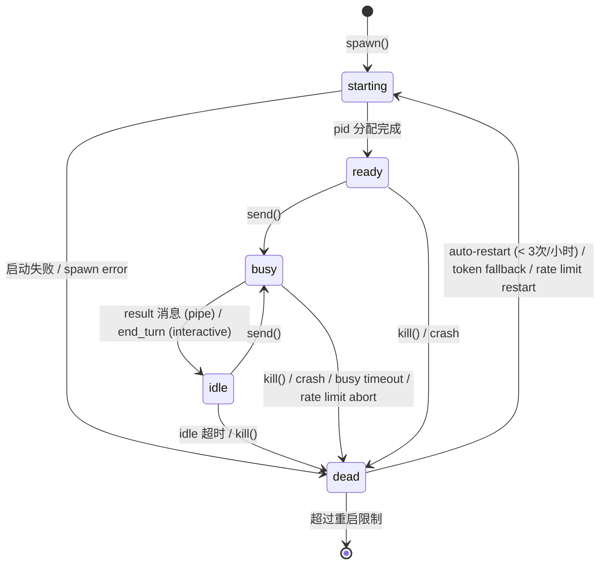

**状态转移规则**：
- `starting -> ready`：CC 子进程 pid 已分配（pipe 模式不等 stdout 输出）
- `ready/idle -> busy`：调用 send() 发送消息（或 drain queue）
- `busy -> idle`：
  - pipe 模式：收到 `type: "result"` 消息
  - interactive 模式：session jsonl 中检测到 `stop_reason: "end_turn"` 的 assistant 记录
- `idle -> dead`：idle 超时（30min）或主动 kill
- `any -> dead`：进程 exit 事件 / 主动 kill / busy timeout / rate limit abort
- `dead -> starting`：自动重启（条件：restartCount < 3 且在同一小时窗口内）/ token fallback / rate limit restart

### 进程池内部状态

```typescript
// 进程注册表
const processes = new Map<string, CCProcess>()

// Spawn 配置缓存（用于 restart）
const spawnConfigs = new Map<string, SpawnConfig>()

// 消息队列（busy 时入队）
const pendingMessages = new Map<string, Array<{ message, resolve, reject }>>()

// In-flight 消息（用于 crash replay）
const lastInFlight = new Map<string, StreamJsonMessage>()

// Token 层级状态
const tokenState = new Map<string, TokenTier>()

// 重启计数（独立于 CCProcess 生命周期）
const restartTracking = new Map<string, { count: number; windowStart: number }>()

// Turn 计数
const turnCounters = new Map<string, { count: number; maxTurns: number; warned: boolean }>()

// 进程模式
const processModes = new Map<string, CCMode>()

// Interactive 模式 session jsonl watcher
const interactiveWatchers = new Map<string, InteractiveSessionWatcher>()

// Rate limit 状态
const rateLimitRetries = new Map<string, number>()
const rateLimitAbortInProgress = new Set<string>()
const rateLimitAbortTimers = new Map<string, ReturnType<typeof setTimeout>>()

// Busy timeout 定时器
const busyTimers = new Map<string, ReturnType<typeof setTimeout>>()

// Interactive CC stdout 缓存（用于 exit 诊断，如 "Session ID already in use" 出现在 stdout；
// 也缓存 429/rate-limit 信号文本供 key pool fallback 决策）
const lastStdoutSignal = new Map<string, string>()

// Key pool 粘性：poolKey → envVarName（同一 Agent 尽量用同一 key，最大化 prompt cache 命中率）
// poolKey 格式：`{tenantId}:{providerName}`（如 `member-0001:openrouter`），避免跨供应商 sticky key 污染
const stickyKeyMap = new Map<string, string>()
// Key pool 跳过：poolKey → Set<envVarName>（429'd key 标记，resolveApiKey 跳过）
const skippedKeysMap = new Map<string, Set<string>>()
```

---

## 5. 数据流（Data Flow）

### Flow-001：Pipe 模式 Spawn + 消息往返

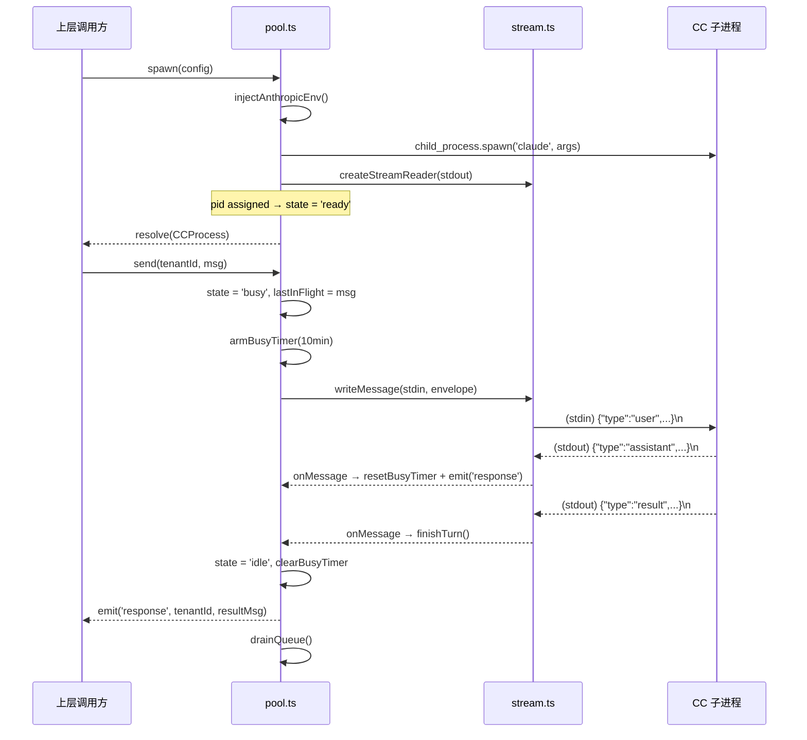

### Flow-002：Interactive 模式 Spawn + 消息往返

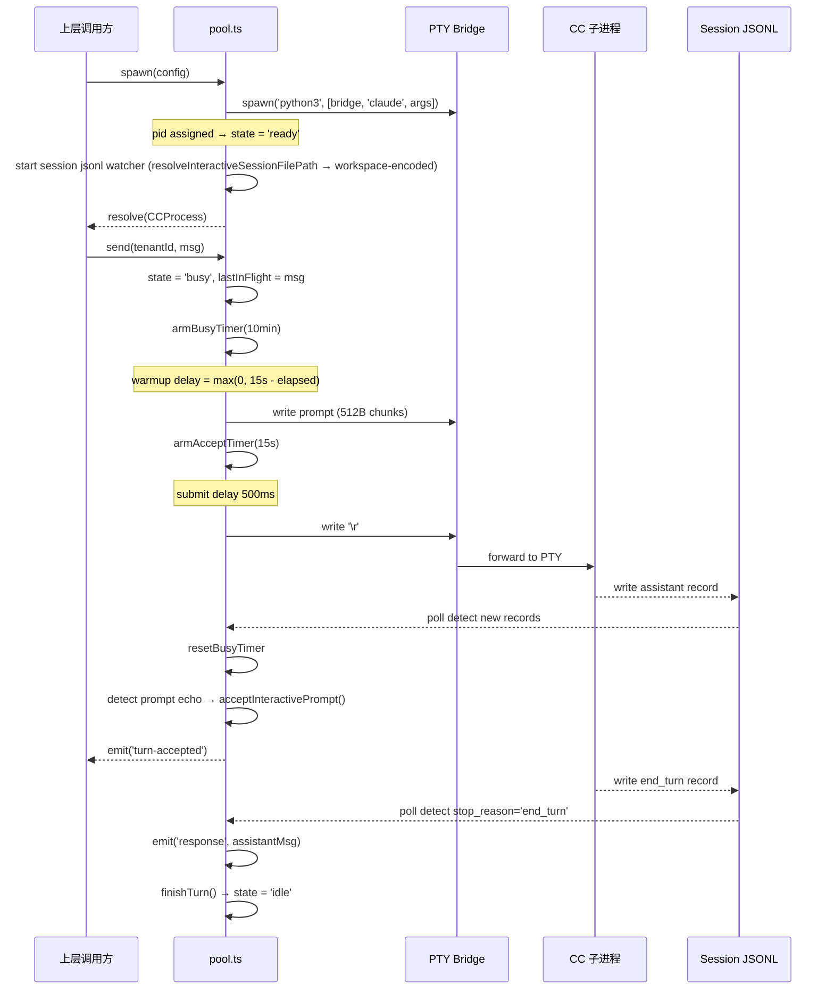

> **thinking-text 拆分场景（bug-20260509-002）**：部分 Anthropic 兼容后端在生成 thinking 时，会把 thinking 与最终 text 写为**两条独立的 assistant 记录**，**每条都自带 `stop_reason: "end_turn"`**：
> 1. 第一条：`content=[thinking-only]`，`stop_reason=end_turn`
> 2. 第二条：`content=[text]`，`stop_reason=end_turn`，`parentUuid` 指向第一条
>
> Pool 在第一条 thinking-only 记录上**不能**调用 `finishTurn`（否则会清掉 `interactivePromptSentAt` / `lastInFlight` 并向 channel emit 空 result，第二条 text 到来时会被 watcher early-return 丢弃）。判定规则：当 record blocks 非空且全部为 `thinking` 类型时，跳过 `finishTurn` 等待下一条记录。Anthropic 原生（thinking+text 在同一 record）和 tool-only turn 不命中该分支，行为保持原样。详见 Error-013。

### Flow-003：崩溃重启 + Crash Replay

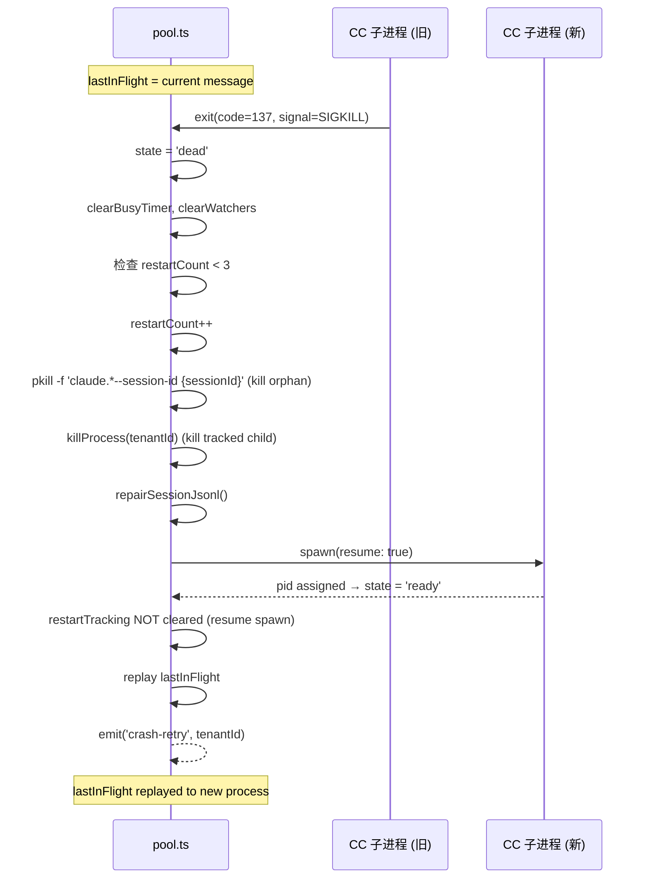

### Flow-004：Token Fallback

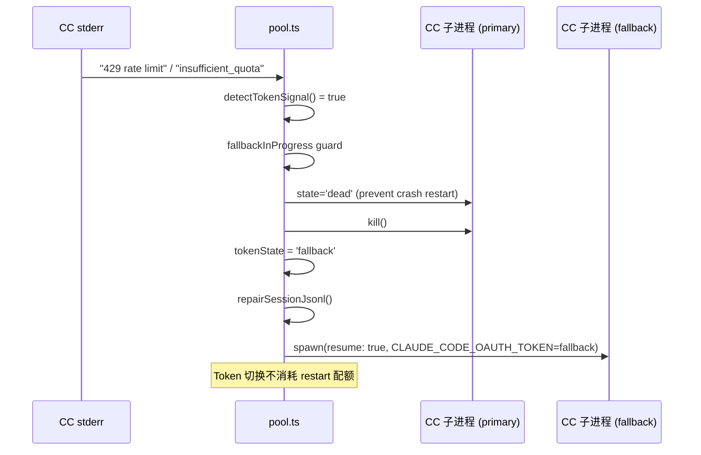

### Flow-005：Rate Limit Abort

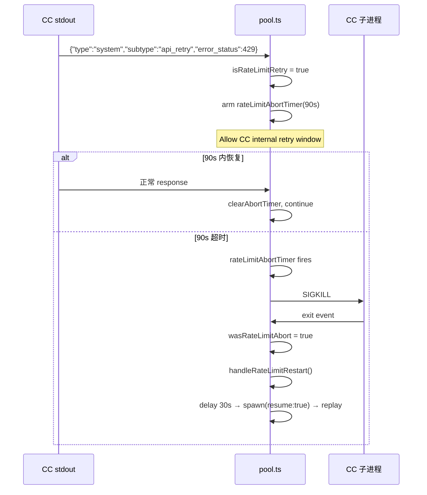

### Flow-006：空闲回收流程

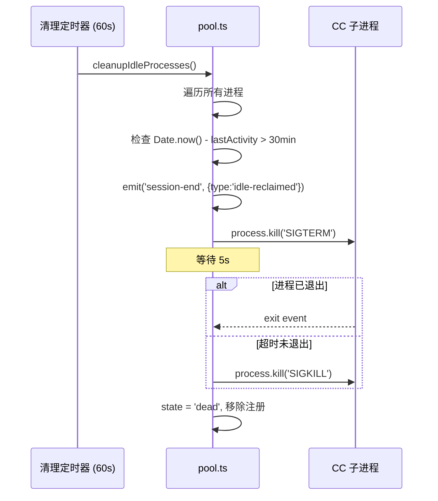

### Flow-007：Busy Timeout

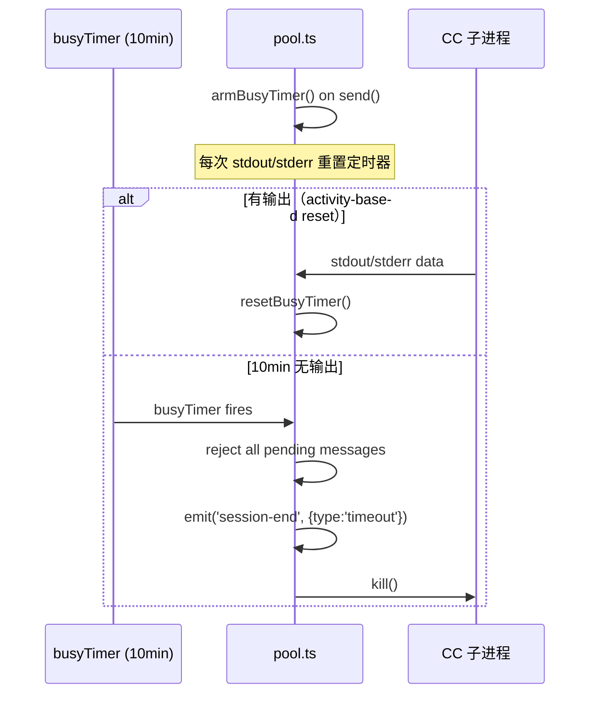

**Flow-005：CC tool-output 文件投递（workspace 内 outbox）**

CC agent 将需要投递给用户的文件写入 **租户 workspace 内** outbox 目录，Pool 在 `finishTurn` 时扫描该目录并 emit 给频道。

```
sequenceDiagram
    participant CC as CC 子进程 (tenant UID)
    participant FS as {workspace}/.relay/outbox/
    participant Pool as pool.ts (pulse)
    participant CH as Channel (feishu.ts)

    Note over FS: 路径: resolveWorkspacePath(workspace)/.relay/outbox/
    Note over FS: 与 workspace 同 owner (tenant-*)，mode 700
    Note over FS: pulse 经 ACL rwx 扫描投递

    Pool->>FS: ensureOutboxDir(tenantId) on spawn
    Pool->>CC: --append-system-prompt (outbox 路径说明)
    CC->>FS: Write/Bash 写入 outbox/
    Note over CC: 租户自管自己的 outbox，不共享 /tmp

    CC->>Pool: finishTurn()
    Pool->>FS: scanOutbox(tenantId) via ACL
    FS-->>Pool: filePaths[]
    Pool->>CH: emit('tool-files', tenantId, filePaths, exactRuntimeWorkspace)
    Note over CH: 投递成功后 rmSync 清理文件

    Pool->>FS: cleanupOutbox(tenantId) on kill (optional)
```

**关键设计约束**：
- **路径 SSOT**：`tenantOutboxDir(tenantId)` → `{resolveWorkspacePath(workspace)}/.relay/outbox/{session}/`（`{session}` 为 pool key 安全化目录名；同一 workspace 的 Telegram / Feishu 会话各用一个子目录，根目录下的无主文件不投递、只告警）；**不再**使用 `/tmp/relay-outbox/{safe-tenant-id}/` 作为生产默认
- **隔离收益**：outbox 落在 workspace `700` 内，租户 CC 自然可读写；其他租户与其他 `tenant-*` 不可访问；无需全局 outbox 目录 ACL
- **Relay 扫描**：`pulse` 用户凭 workspace ACL 读取 outbox；与 session jsonl、prompt 中转（`.relay/prompts/`）同一 trust 模型
- **扫描时机**：`finishTurn()` → `scanToolFileOutbox()`，只扫本会话 outbox 的顶层、非隐藏常规文件
- **事件身份**：`tool-files` 必须携带该 runtime 的 exact workspace，WI-bound session 不得退回 Agent 静态默认 workspace
- **生命周期**：spawn 时 `ensureOutboxDir`；频道独立复验 tenant/workspace ownership 后，只有成功投递的单个 outbox 文件可删除；kill、restart 与 idle reclaim 必须保留尚未确认投递的 outbox 内容，不得递归清空目录
  `@anchor test Relay/tests/pool.test.ts :: "preserves undelivered outbox files when the runtime is killed"`
- **开发 override**：`RELAY_OUTBOX_DIR` 仅用于 macOS 本地或非隔离调试；生产租户路径不得 override 到 workspace 外
- **废弃**：v0.2.x 共享 outbox root（`/tmp/relay-outbox`、`/Volumes/workdisk/tmp/relay-outbox`）— 见 CONSTRAINT-003

### Flow-008：租户隔离 Spawn（v0.3.0 新增）

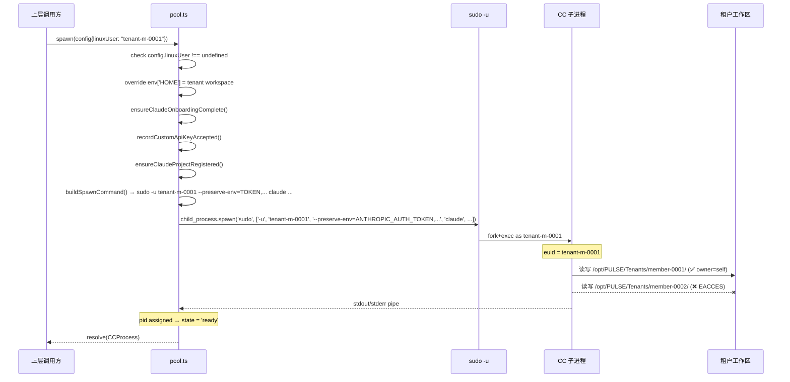

---

## 6. 错误处理（Error Handling）

### 异常场景处理

**Error-001：CC spawn 失败**
- **触发条件**：`claude` 命令不存在、权限不足、workspace 目录不存在
- **处理策略**：捕获 spawn error 事件，状态设为 dead，通过 'error' 事件通知上层
- **日志**：`{level:"error", tenant:tenantId, msg:"CC process for ${tenantId} died during startup"}`

**Error-002：CC 进程非正常退出**
- **触发条件**：exit code !== 0 且 !== 143（SIGTERM）且 !== null，或 signal === 'SIGKILL'
- **处理策略**：
  - 触发 `handleCrashRestart`（限频 3 次/小时）
  - 超限后标记 dead，触发 `session-end(type: crash-unrecoverable)`
  - 重启后自动 replay lastInFlight 消息
- **日志**：`{level:"debug", tenant:tenantId, msg:"CC exited", code, signal, wasState}`

**Error-003：NDJSON 解析失败**
- **触发条件**：stdout 某行不是合法 JSON
- **处理策略**：跳过该行，记录警告日志，不中断流处理。若包含 429/rate.limit 关键字则记录到 lastStdoutSignal
- **日志**：通过 stream.ts 的 onError 回调

**Error-004：stdin 写入失败**
- **触发条件**：进程 stdin 已关闭（进程已退出但状态未更新）
- **处理策略**：捕获 write error，标记进程为 dead，抛出错误给调用方

**Error-005：重复 spawn 同一租户**
- **触发条件**：该 tenantId 已有活跃进程（state !== 'dead'）
- **处理策略**：抛出错误 `Process already exists for tenant ${tenantId}`

**Error-006：Token 限流/配额不足**
- **触发条件**：stderr 包含 `rate limit` / `429` / `401` / `insufficient_quota` / `overloaded`
- **处理策略**：`handleTokenFallback` -- 切换到 fallback token，respawn + resume。不消耗 restart 配额

**Error-007：Rate limit 内部重试超时**
- **触发条件**：CC stdout 出现 api_retry(error_status=429) 且 90s 内未恢复
- **处理策略**：SIGKILL 中止进程，走 `handleRateLimitRestart` 路径，delay 30s 后 restart + replay

**Error-008：Busy timeout**
- **触发条件**：进程 busy 超过 10 分钟（默认）且无 stdout/stderr 输出
- **处理策略**：强制 kill，reject pending queue，触发 `session-end(type: timeout)`

**Error-009：Session 冲突**
- **触发条件**：stderr 或 stdout（经 PTY bridge）包含 `already in use`
- **处理策略**：将 restartCount 设为 maxRestartsPerHour，防止自动重启

**Error-010：Interactive accept 超时**
- **触发条件**：interactive 模式下 prompt 15s 未被 CC session 接受
- **处理策略**：kill + restart + replay，最多重试 maxInteractiveAcceptRetriesPerMessage 次

**Error-011：CC 卡在 first-run theme picker（onboarding wizard）**（bug-20260509-001 RC-1）
- **触发条件**：spawn 时 `~/.claude.json` 中 `hasCompletedOnboarding`/`theme` 等关键字段为 null 或缺失。CC 2.x 启动后会进入 theme 选择 wizard；PTY-bridge 模式下 Relay 写入的 prompt 被 wizard 当作选项消化，CC 永不进入对话循环；session jsonl 也不会出现 user 记录，最终触发 interactive accept timeout（≥90s 超时上限）
- **处理策略**：spawn 前调用 `ensureClaudeOnboardingComplete(env.HOME)` 幂等补齐字段（详见 FR-P0-010）。该函数：
  - 若文件不存在：以 default 内容创建（mode 0o600）
  - 若字段已是有效值：不覆盖、不写文件
  - 若字段为 null/missing：写入默认值（`hasCompletedOnboarding:true` / `theme:'dark'` / `tipsHistory:{}` / `hasIDEOnboardingBeenShown:true` / `customApiKeyResponses:{}` / `shiftEnterKeyBindingInstalled:true`）
  - JSON 解析失败：保留原文件，返回 `{changed:false, error}`，不阻断 spawn
- **日志**：debug 级别记录 `{tenant, msg:"onboarding ensured", path, changed}`

**Error-012：interactive 因 ANTHROPIC_API_KEY 触发 custom API key TUI 阻塞**
- **触发条件**：spawn interactive 时子进程 env 含 `ANTHROPIC_API_KEY`（含旧版 mirror 逻辑或 systemd 误注入）
- **症状**：CC 弹出 "Detected a custom API key … Do you want to use it?" TUI；PTY-bridge 无人按键，永不进入对话
- **处理策略**：spawn 前 `mirrorAnthropicAuthTokenToApiKey(env)` **delete** `ANTHROPIC_API_KEY`；API provider 认证仅保留 `ANTHROPIC_AUTH_TOKEN`
- **配套约束**：CONSTRAINT-002

**Error-013：拆分 thinking-text 导致回复丢失**（bug-20260509-002）
- **触发条件**：interactive 模式下，部分 Anthropic 兼容后端生成 thinking 时，会把 thinking 与最终 text 写为**两条独立的 assistant 记录**，**每条都带 `stop_reason: "end_turn"`**。Anthropic 原生 API 是把 thinking 与 text 放在同一条 assistant 记录的 content 数组中（仅一个 end_turn）
- **症状**：用户消息有「正在打字」反应但永远收不到回复；CC 进程仍存活；session jsonl 中已写入完整回复（连续两条 end_turn assistant 记录），但飞书/TG channel 没有 emit 任何文本
- **故障链**：
  1. 第一条 thinking-only + end_turn 抵达 → `emitInteractiveAssistant` 内部检查 text 为空早返（不 emit）
  2. 旧逻辑无视内容直接 `finishTurn` → 状态 idle、`interactivePromptSentAt` 清空、emit `{type:'result', result:''}` 给 channel
  3. Channel 收到空 result 不发消息，typing reaction 也清掉
  4. 第二条 text + end_turn 抵达 → `handleInteractiveRecord` 检查 `interactivePromptSentAt` 已 null → 直接 return
  5. 真正的 text 回复永远不被 emit
- **处理策略**：在 `handleInteractiveRecord` 的 `end_turn` 分支前增加判定，当 record blocks 非空且全部为 `thinking` 类型时跳过 `finishTurn`，等待下一条记录。其他场景（含 text、含 tool_use、空 blocks）保持原行为，避免对 Anthropic 原生 / tool-only turn / 防 hang 路径产生回归
- **可观测性**：thinking-only defer 不打 warning 日志（属正常路径），但 watcher poll 仍会每次 reset busyTimer，最终 busy timeout（10min）兜底，避免后端只输出 thinking 不输出 text 的极端场景把 turn 卡死

**Error-014：CC `--bare` 模式 CLAUDE.md 不加载（双前置失败）**（bug-20260510-001）
- **触发条件 / 故障链**（两个独立但需同时满足的前置）：
  1. **Trust gate**：spawn 时 `~/.claude.json#projects[<realpath_cwd>]` 不存在或 `hasTrustDialogAccepted` 不为 true。`--bare` 模式 dialog 被静默跳过，cwd 永远没有 entry → CC 视为未受信项目 → 跳过 project settings/tool access 解析
  2. **CLAUDE.md auto-discovery**：`claude --bare --help` 原文「Minimal mode: skip ... auto-memory, ... and **CLAUDE.md auto-discovery**. Explicitly provide context via: ... `--add-dir (CLAUDE.md dirs)`, ...」——`--bare` 硬编码禁用 CLAUDE.md 自动发现；spawn args 不带 `--add-dir <workspace>` 则即便 trust 通过，CC 也不会读 cwd 下的 CLAUDE.md
  3. **大小写陷阱**：登记 trust 用 `config.workspace`（如 `/opt/PULSE/...`），CC 子进程因 Linux `chdir(2)` 经 symlink 解析后 `getcwd()` 返回 realpath（如 `/opt/pulse/...`），key 不一致 → trust gate 仍 miss
- **症状**：租户首次会话能正常往返，但 Agent 回答完全不体现 workspace 身份（用户问「你是谁」时 CC 用通用「Claude Code」作答而非「长征的pulse管理员」）。**仅修 trust 不加 `--add-dir` 时的特征 fingerprint**：CC 能在回复中提到「当前工作目录是 /opt/pulse/Tenants/...，位于 main 分支」，但身份依然通用——说明 cwd 已能进入但 CLAUDE.md 未注入
- **处理策略**（三步合一）：
  1. spawn 前调用 `ensureClaudeProjectRegistered(env.HOME, resolveWorkspacePath(config.workspace))` 幂等登记 trust entry，**必须经 realpath**
  2. spawn args 中追加 `'--add-dir', resolveWorkspacePath(config.workspace)`（CC 官方 CLAUDE.md re-entry 入口）
  3. 登记 entry 默认字段：`hasTrustDialogAccepted: true` / `hasCompletedProjectOnboarding: true` / `hasClaudeMdExternalIncludesApproved: true` / `allowedTools: []` / `mcpContextUris: []` / `mcpServers: {}` 等（详见 `CLAUDE_PROJECT_DEFAULTS`），已有值不覆盖（包括 `hasTrustDialogAccepted: false` 拒绝意图）
- **可观测性**：
  - `~/.claude.json#projects` 中应有 realpath 后的 cwd entry
  - interactive spawn args 中应含 `--add-dir <realpath_workspace>`
  - 首次 spawn 的 session jsonl 第 1-3 条记录中应出现 `{"type":"system",...}` 含 CLAUDE.md 关键内容
  - 用户问「你是谁」回复含「pulse 管理员」/「租户 member-{id}」字样
- **配套约束**：CONSTRAINT-002（项目级 trust + CLAUDE.md 显式加载子条款）

**Error-015：`--resume` 指向不存在的 session 文件导致 CC 崩溃**
- **触发条件**：spawn 时使用 `--resume <sessionId>`，但 session jsonl 文件在磁盘上不存在（首次 spawn 或 session 文件被清理）。CC 收到 `--resume` 后尝试读取 session 文件，失败即 exit code 1 退出，不进入对话循环
- **症状**：CC 进程反复 spawn 后立即退出（exit code 1），触发 crash restart 循环直到 maxRestartsPerHour 耗尽，用户收不到任何回复
- **处理策略**：`claudeSessionIdArgv()` + `findExistingSessionFile()` 在构建 argv 前检查 workspace 编码路径与 `-root/` fallback；磁盘均不存在时使用 `--session-id` 而非 `--resume`
- **日志**：debug 级别记录 `{tenant, msg:"session file not found, using --session-id instead of --resume", sessionId}`

**Error-016：Interactive session jsonl 路径与 watcher 不一致**（2026-06-01，已修正）
- **历史触发条件（PT0-022 初版）**：假设 CC `--bare` **始终**写 `-root/`；watcher 初始化到 workspace 路径 → poll miss
- **2026-06-01 实测修正**：登记 `projects['/root']` 后，CC interactive 写 **workspace 编码路径**（`entrypoint: cli`）；仅 legacy print/sdk-cli 会话仍用 `-root/`
- **当前处理策略**：
  1. spawn 时 watcher 初始化 `resolveInteractiveSessionFilePath()` → workspace 路径
  2. `maybeRelocateInteractiveWatcherPath()` 在 poll 中检测 legacy `-root/` 写入并 relocate
  3. `findExistingSessionFile()` 双路径 lookup 供 `--resume`/repair
- **可观测性**：新 session jsonl 在 `-opt-pulse-.../` 或租户 workspace 编码目录；legacy relocate 日志 `Interactive watcher relocated session jsonl path`

**Error-017：`/root` trust gate 未登记导致 interactive 无 jsonl**（2026-06-01）
- **触发条件**：workspace trust（FR-P0-013）已登记，但 `projects['/root']` 缺失；CC `--bare` interactive 弹出 Quick safety check /root TUI
- **症状**：CC 进程存活但无 session jsonl；用户发消息无回复
- **处理策略**：
  1. interactive spawn 前 `ensureClaudeBareRootTrust(home)`
  2. PTY stdout sniffer：`isRootTrustDialog()` → `tryAutoAcceptRootTrustDialog()` 发送 `\r`
- **可观测性**：`~/.claude.json#projects['/root'].hasTrustDialogAccepted === true`；日志 `Auto-accepted CC /root trust dialog via PTY`

**Error-018：`~/.claude.json` immutable 阻断 trust 登记**（2026-06-01）
- **触发条件**：harden 或误操作对 `~/.claude.json` 执行 `chattr +i`；Relay 写 trust/onboarding 失败
- **症状**：spawn 后仍缺 trust entry；与 Error-017 叠加时无 jsonl
- **处理策略**：每次写前 `ensureClaudeJsonWritable(home)`；harden 脚本 `ensure_claude_json_writable` 部署时批量 `chattr -i`
- **可观测性**：写 claude.json 成功；trust 字段落盘

**Error-019：Session-id 冲突导致无限崩溃循环**（2026-06-02，已修正）
- **触发条件**：CC 进程因 "Session ID already in use" 退出，但该错误出现在 **stdout**（经 PTY bridge），而非 stderr。旧 `sessionInUse` 检查仅查 stderr → 漏检 → 被判为普通崩溃 → handleCrashRestart 以 `resume: true` + 同一 session-id 重试 → 同样失败 → 无限循环
- **症状**：某租户 CC 进程在短时间内崩溃数百次（实测 871 次/18 分钟），`maxRestartsPerHour` 从未触发
- **故障链**：
  1. CC "Session ID already in use" 错误输出到 stdout → `sessionInUse` 检查仅查 stderr → 判定为普通崩溃
  2. handleCrashRestart respawn（resume: true, 同 session-id）→ 旧进程仍存活（kill 未完全生效）→ 同样冲突
  3. `restartTracking.delete` 在每次 spawn 时清零（含 crash restart）→ 计数永远不累积 → `maxRestartsPerHour` 永远达不到
  4. 三者叠加：检测不到 session-in-use + 孤儿进程未清理 + 计数被清零 → 无限循环
- **处理策略**（三合一修复）：
  1. 新增 `lastStdoutRaw` Map 缓存 interactive CC 最近 ~1KB stdout 文本；`sessionInUse` 判定同时检查 stderr 和 `lastStdoutRaw`
  2. `handleCrashRestart` 在重试前先 `pkill -f 'claude.*--session-id {sessionId}'` 杀死孤儿进程
  3. `restartTracking.delete(config.tenantId)` 仅在 fresh spawn（`!config.resume`）时执行；crash restart 走 `resume: true` 不清零
- **可观测性**：session-in-use 正确检测后标记 dead 不再 restart；crash restart 计数正确累积达上限后 stop

**Error-020：Outbox 文件删除 EACCES（pulse 无目录写权限）**（2026-06-02，已修正）
- **触发条件**：tenant CC 在 `{workspace}/.relay/outbox/` 创建文件后，Relay（pulse 用户）执行 `rmSync` 删除该文件。文件删除需要父目录写权限；outbox 目录 `chmod 755` + owner 为 `tenant-*` → `pulse` 不是 owner 也不在 group → 无写权限 → EACCES
- **症状**：outbox 文件投递后无法清理，残留文件持续存在
- **处理策略**：`ensureRelaySubdir()` 创建 `.relay/` 和 `outbox/` 时，除 `chmod(0o755)` 外调用 `setAclForPulse(dir)` 设置 `u:pulse:rwx` ACL。幂等操作，对已有 ACL 条目不重复添加；不支持 ACL 的文件系统静默跳过
- **可观测性**：`getfacl {workspace}/.relay/outbox/` 显示 `user:pulse:rwx`；rmSync 不抛 EACCES

**Error-021：429/rate-limit key pool fallback**（2026-06-03，已实现）
- **触发条件**：provider `api_key_pool` 中某 key 配额耗尽，CC 返回 429。触发路径有三：
  1. **stderr**：CC 在 print 模式输出 `429` / `rate_limit` / `overloaded` 到 stderr → `detectTokenSignal` 匹配 → `clearStickyKey`
  2. **interactive stdout**：CC 在 interactive 模式将 429 显示为 ANSI 文本在 PTY stdout → regex `/429|rate.limit/i` 检测 → `clearStickyKey` + `rateLimitAbortInProgress.add()` + SIGKILL
  3. **crash restart**：进程因非 429 原因 crash 但 root cause 实为 429'd key（如 "Session ID already in use" 场景）→ `handleCrashRestart` 清除 sticky key
- **症状**：单 key 429 后无限重试同一 key（sticky key 不清除）或 crash restart 不换 key
- **处理策略**：
  1. `clearStickyKey(poolKey, failedKeyEnv)` 标记失败 key 为 skipped（`skippedKeysMap`）
  2. `resolveApiKey()` 跳过 skipped key，选中池中下一个可用 key
  3. exit handler 走 `handleRateLimitRestart` → respawn with next key
  4. `finishTurn` 成功时清除 `skippedKeysMap`（配额可能已恢复）
  5. `maxRateLimitRetriesPerMessage = 2`（单条消息最多重试 2 次 key pool fallback）
- **可观测性**：日志 `Sticky key cleared after failure, key marked as skipped`；`Provider env resolved from catalog` 显示 `keyEnvVar` 切换；429 后 respawn 使用不同 key

### 错误日志

**日志格式**（遵循 project-standards.md）：
```json
{
  "ts": "2026-04-29T11:18:00+0800",
  "level": "warn",
  "tenant": "member-000",
  "msg": "CC stderr",
  "stderr": "..."
}
```

---

## 7. 安全设计（Security Design）

### 进程隔离

- 每租户独立 CC 子进程，独立工作目录（`cwd = /opt/PULSE/Tenants/{id}/`）
- 进程间无共享内存/IPC，通信仅通过 pool.ts 中介

### 环境变量安全

- spawn 时自动剥离 `TELEGRAM_BOT_TOKEN`、`BOT_TOKEN_*` 等敏感环境变量
- 从 `~/.claude/settings.json` 注入 `ANTHROPIC_BASE_URL`、`ANTHROPIC_AUTH_TOKEN` 等 API 配置
- Token fallback 通过 `CLAUDE_CODE_OAUTH_TOKEN` / `CLAUDE_CODE_OAUTH_TOKEN_FALLBACK` 管理
- `ANTHROPIC_AUTH_TOKEN` → `ANTHROPIC_API_KEY` 镜像仅写入子进程 env 副本，不污染主进程；不覆盖用户已显式配置的 `ANTHROPIC_API_KEY`

### 权限控制

- pipe 模式：`--dangerously-skip-permissions`（无 TTY 交互）
- interactive 模式：`--permission-mode bypassPermissions`
- 工具白名单：通过 `--allowed-tools` 限制
- Settings 继承：interactive 模式使用 `--setting-sources user,project,local`

### 资源限制

- 进程数硬上限由调用方控制（pool 本身不限制，由 router 层根据可用内存判断）
- 单进程内存约 250MB（CC 运行时开销），12 进程约 3GB（在 4GB 实例上留 1GB 给 OS + Relay）

### 租户文件隔离（v0.3.0 新增）

> **目标**：即使 CC 的 Bash 工具执行任意命令，也无法读写其他租户的工作区目录。隔离由 Linux 内核 UID 权限强制执行。

#### 隔离模型

```
Linux 用户空间
├── pulse                    ← Relay 主进程（PID 1 via systemd）
│   ├── 可读写所有租户目录（通过 ACL）
│   └── spawn 时 sudo -u 切换
├── tenant-member-0001       ← 租户 member-0001 的 CC 进程
│   └── /opt/PULSE/Tenants/member-0001/ (owner: self, mode: 700)
├── tenant-member-0002       ← 租户 member-0002 的 CC 进程
│   └── /opt/PULSE/Tenants/member-0002/ (owner: self, mode: 700)
└── ...
```

#### Spawn 行为变更

```typescript
// pool.ts spawn 核心逻辑（简化）
function buildSpawnCommand(config: SpawnConfig, ccMode: CCMode, env: NodeJS.ProcessEnv): { command: string; args: string[] } {
  const { command, args } = ccMode === 'print'
    ? { command: 'claude', args: buildPrintArgs(config) }
    : { command: 'python3', args: ['scripts/claude_pty_bridge.py', 'claude', ...buildInteractiveArgs(config)] };

  if (config.linuxUser) {
    // S1: 使用 --preserve-env=list 避免 token 出现在 ps aux 命令行
    // sudo 默认 env_reset；--preserve-env=list 从调用者环境传递指定变量，
    // 不嵌入 argv，防止 /proc/<pid>/cmdline 和 ps aux 泄露 ANTHROPIC_AUTH_TOKEN。
    // 弃用方案：/usr/bin/env（argv 可见）；--env-file（部分 sudo 构建不支持）
    const PRESERVED_ENV_KEYS = [
      'ANTHROPIC_AUTH_TOKEN', 'CLAUDE_CODE_OAUTH_TOKEN',
      'ANTHROPIC_BASE_URL', 'ANTHROPIC_API_KEY',
      'HOME', 'PATH', 'LANG', 'TERM', 'SHELL',
      'NODE_EXTRA_CA_CERTS', 'CLAUDE_CODE_MAX_OUTPUT_TOKENS',
    ];
    const preserveList = PRESERVED_ENV_KEYS
      .filter(k => env[k] !== undefined).join(',');
    return {
      command: 'sudo',
      args: [
        '-u', config.linuxUser,
        `--preserve-env=${preserveList}`,
        command, ...args,
      ],
    };
  }
  return { command, args };
}
```

#### 跨租户访问控制

| 操作 | 主体 | 目标 | 权限来源 | 结果 |
|------|------|------|----------|------|
| CC Bash 写其他租户文件 | `tenant-member-0001` | `/opt/PULSE/Tenants/member-0002/` | 内核 UID 检查 | ❌ EACCES |
| CC 读平台树 | `tenant-member-0001` | `/opt/pulse/vultr-pulse-space/` 等 | Phase A `o-rx` | ❌ EACCES |
| CC 列 Tenants 目录 | `tenant-member-0001` | `/opt/pulse/Tenants/` | Phase A `711` | ❌ EACCES |
| CC 读 workspace outbox | `tenant-member-0001` | `{workspace}/.relay/outbox/` | workspace 700 owner | ✅ 允许 |
| Relay 扫描 outbox | `pulse` | `{workspace}/.relay/outbox/` | ACL `u:pulse:rwx` | ✅ 允许 |
| Relay 读租户目录 | `pulse` | `/opt/PULSE/Tenants/member-0001/` | ACL `user:pulse:rwx` | ✅ 允许 |
| Relay 写租户目录 | `pulse` | `/opt/PULSE/Tenants/member-0001/` | ACL `user:pulse:rwx` | ✅ 允许 |

#### Sudoers 配置

Relay 主进程需要 `sudo -u tenant-*` 权限且无需密码。配置 `/etc/sudoers.d/pulse-relay`：

```sudoers
# pulse 用户可以无密码以任何 tenant- 前缀用户执行命令
pulse ALL=(tenant-*) NOPASSWD: ALL
```

#### ACL 配置

每个租户目录需要 ACL 让 `pulse` 用户可以读写（用于 spawn 时 `chdir` 和 Relay 管理）：

```bash
chown -R tenant-{id}:tenant-{id} /opt/PULSE/Tenants/{id}
chmod 700 /opt/PULSE/Tenants/{id}
setfacl -m u:pulse:rwx /opt/PULSE/Tenants/{id}
setfacl -m m::rwx /opt/PULSE/Tenants/{id}   # 关键：chmod 700 设 mask=---，必须显式恢复
```

> **注意**：`chmod 700` 会将 ACL mask 设为 `---`，导致所有 named ACL 条目（如 `user:pulse:rwx`）的有效权限归零。必须在 `setfacl -m u:pulse:rwx` 之后显式设置 `setfacl -m m::rwx`。

#### 环境变量传递

`sudo` 默认启用 `env_reset`，丢弃几乎所有环境变量。CC 需要的关键变量（`CLAUDE_CODE_OAUTH_TOKEN`、`HOME`、`ANTHROPIC_BASE_URL`、`ANTHROPIC_API_KEY`、`PATH` 等）无法通过 Node.js spawn 的 `env` 选项传递。

解决方案：使用 `/usr/bin/env` 作为中间命令。环境变量作为命令行参数传递（`K=V` 格式），`env` 命令将它们注入子进程环境，不受 sudo `env_reset` 影响。

#### HOME 覆盖

当 `config.linuxUser` 存在时，`env['HOME']` 被覆盖为 `resolveWorkspacePath(config.workspace)`。原因：
- `process.env['HOME']` 指向 `/home/pulse`（Relay 主进程的 HOME）
- tenant 用户无权写入 `/home/pulse`
- CC 从 `HOME` 读取 `~/.claude.json`（认证、onboarding、项目 trust）
- CC 将 session 文件写入 `$HOME/.claude/projects/`

#### 限制与约束

- **仅 Linux**：macOS 开发环境不支持此机制（`SpawnConfig.linuxUser` 为 undefined 时走原路径）
- **sudo 开销**：每次 spawn 额外一次 `sudo` fork，约 50ms 延迟（可接受）
- **outbox 位置**：`{workspace}/.relay/outbox/`（FR-P0-019）；租户 CC 自管；Relay 经 ACL 扫描
- **用户清理**：租户注销时需同步删除 Linux 用户（`userdel`）

#### 租户平台隔离加固（v0.4.0 新增，FR-P0-018/020）

> **目标**：租户 CC 不能通过 home/workspace 之外的路径获取平台信息或破坏平台。FR-P0-014 解决**跨租户**；本节解决**租户 vs 平台**。

##### Phase A：文件系统权限（DAC）

运维脚本 `Scripts/harden-tenant-platform-isolation.sh`（幂等）：

| 对象 | 建议 mode | 效果 |
|------|-----------|------|
| `/opt/pulse/vultr-pulse-space/` 等平台树 | `750 pulse:pulse` | tenant 不可读 |
| `/opt/pulse` | `711 pulse:pulse` | 不可列根目录，可 traverse 到已知路径 |
| `/opt/pulse/Tenants` | `711 pulse:pulse` | 不可 `ls` 见 sibling 租户名 |
| `/opt/pulse/Tenants/{id}/` | `700 tenant-*` + ACL pulse | 现有 FR-P0-014/015 |

##### Phase B：bubblewrap 路径沙箱（Linux + linuxUser）

当 `config.linuxUser` 存在时，`buildSpawnCommand()` 在 `sudo -u tenant-*` 内层再包 `bwrap`：

```bash
bwrap \
  --ro-bind /usr /usr \
  --ro-bind /lib /lib \
  --ro-bind /lib64 /lib64 \
  --proc /proc \
  --dev /dev \
  --bind "$WORKSPACE" "$WORKSPACE" \
  --tmpfs /tmp \
  --chdir "$WORKSPACE" \
  --die-with-parent \
  -- claude ...    # 或 python3 claude_pty_bridge.py claude ...
```

- **Allowlist**：仅 `$WORKSPACE`（含 `.relay/outbox/`、`.relay/prompts/`、`$HOME/.claude/`）+ ro 系统库 + 受限 tmp
- **Deny**：未 bind 的路径在命名空间内不可见（平台树、/home/pulse、其他租户）
- **Env**：白名单注入（`HOME`, `PATH`, `ANTHROPIC_*`, 模型别名）；不透传 `RELAY_*`、bot token
- **Optional**：spawn 前 `ulimit -u` / `ulimit -v` 防资源耗尽
- **Skip**：macOS、无 `linuxUser` 的 PULSE 管理员 agent

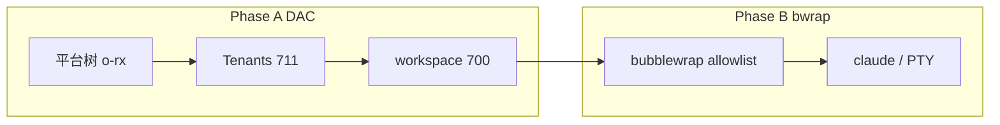

---

## 8. 性能优化（Performance Optimization）

### 性能目标

- **Spawn 延迟**：<= 5 秒（从 spawn 调用到 state === 'ready'）
- **消息写入延迟**：<= 1ms（stdin.write 本身很快，瓶颈在 CC 处理）
- **清理扫描延迟**：<= 10ms（遍历 Map，O(n) 且 n <= 12）
- **Interactive 轮询延迟**：250ms（session jsonl 文件 poll 间隔）

### 优化策略

- 不做预启动（按需 spawn）：初期租户少，预启动浪费内存
- readline 逐行解析而非全量 buffer：内存友好，适合长时间运行
- 定时器用 `setInterval` 而非递归 `setTimeout`：简单可靠，清理时 `clearInterval` 即可
- Activity-based busy timeout：stdout/stderr 输出刷新定时器，避免在 CC 正常工作时误杀
- Interactive 模式 512B 分块写入：避免长 prompt 单次写入 PTY 丢数据
- Session jsonl 增量读取（offset 追踪）：每次 poll 只读新增内容，避免重复解析

### 默认配置参数

| 参数 | 默认值 | 说明 |
|------|--------|------|
| idleTimeoutMs | 30 min | 空闲超时 |
| cleanupIntervalMs | 60 s | 清理扫描间隔 |
| maxRestartsPerHour | 3 | 每小时最大重启次数 |
| killTimeoutMs | 5 s | kill 等待超时 |
| busyTimeoutMs | 10 min | busy 超时 |
| rateLimitAbortTimeoutMs | 90 s | 限流中止等待窗口 |
| rateLimitRestartDelayMs | 30 s | 限流重启延迟 |
| maxRateLimitRetriesPerMessage | 0 | 每消息限流重试上限 |
| interactiveWarmupMs | 15 s | interactive warmup 延迟（CC 初始化约 10s，5s warmup 导致 text+\\r 在 PTY 缓冲区合并被 CC 忽略） |
| interactiveSubmitDelayMs | 500 ms | interactive submit 延迟 |
| interactiveAcceptTimeoutMs | 15 s | interactive accept 超时 |
| interactiveSlashCommandSettleMs | 30 s | slash command settle 时间 |
| maxInteractiveAcceptRetriesPerMessage | 1 | interactive accept 重试上限 |
| sessionPollInterval | 250 ms | session jsonl 轮询间隔 |
| PTY chunk size | 512 B | interactive prompt 分块大小 |

Relay distinguishes a native conversation identity from its current WorkItem runtime binding. `reconcileTerminalConversation` consumes an installed SCL read-only terminal response and atomically retires only the matching binding in Relay state. The prior binding remains historical attribution with the exact observed local revision/digest; it never restores workspace or execution authority. Subsequent spawn uses the unchanged native session and configured conversation workspace, with no active WI usage binding. In-memory projection is restored if durable state save fails. The same adapter is used before Telegram text/media/restart and Feishu ordinary/restart spawn.

Pi 历史版本可能因旧启动器重复使用 `--session-id`，在同一租户下留下同 ID 的多个原生记录。恢复必须逐项校验租户路径和 header identity，以原生 session header timestamp 选择最新一代，通过 `--session` 打开；不得按文件 mtime 猜测，不删除旧记录。多记录缺少有效时间或最新时间并列时保留明确歧义错误。
