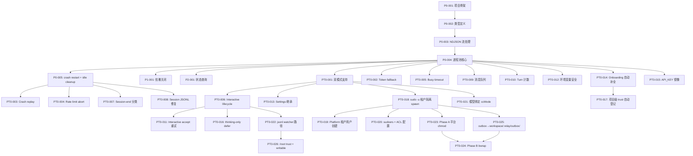

# cc-process-pool - 任务拆分文档

> **任务概述**：基于 design.md 实现 CC 子进程池的完整生命周期管理。所有原始 P0/P1/P2 任务已完成实现。新增 PT0 任务覆盖超出原始 spec 的已实现功能（双模式、token fallback、crash replay、rate limit abort、interactive lifecycle、CC 2.x 启动前置等）。
>
> **关联文档**：
> - L2 技术设计：`features/cc-process-pool/design.md`
> - L2 功能需求：`features/cc-process-pool/requirements.md`
> - 源文件：`src/pool.ts`、`src/types.ts`、`src/stream.ts`、`src/claude-onboarding.ts`
> - 测试文件：`tests/pool.test.ts`、`tests/stream.test.ts`、`tests/claude-onboarding.test.ts`

---

## 1. 任务拆分（Task Breakdown）

### P0 任务（MVP 必需）-- 全部已完成

| 任务 ID | 任务名称 | 预估工时 | 依赖任务 | 负责人 | 状态 |
|---------|---------|---------|---------|--------|------|
| P0-001 | 项目骨架搭建 | 2h | 无 | Ken | [x] 已完成 |
| P0-002 | 类型定义（types.ts） | 2h | P0-001 | Ken | [x] 已完成 |
| P0-003 | NDJSON 流处理（stream.ts） | 4h | P0-002 | Ken | [x] 已完成 |
| P0-004 | 进程池核心（pool.ts）-- spawn/send/kill | 6h | P0-003 | Ken | [x] 已完成 |
| P0-005 | 进程池扩展 -- crash restart + idle cleanup | 4h | P0-004 | Ken | [x] 已完成 |

### P1 任务（增强功能）-- 全部已完成

| 任务 ID | 任务名称 | 预估工时 | 依赖任务 | 负责人 | 状态 |
|---------|---------|---------|---------|--------|------|
| P1-001 | 优雅关闭（graceful shutdown） | 3h | P0-004 | Ken | [x] 已完成 |

### P2 任务（锦上添花）-- 全部已完成

| 任务 ID | 任务名称 | 预估工时 | 依赖任务 | 负责人 | 状态 |
|---------|---------|---------|---------|--------|------|
| P2-001 | 进程状态查询（getStatus） | 2h | P0-004 | Ken | [x] 已完成 |

### PT0 任务（超出原始 spec 的已实现功能）

| 任务 ID | 任务名称 | 预估工时 | 依赖任务 | 负责人 | 状态 |
|---------|---------|---------|---------|--------|------|
| PT0-001 | 双模式支持（pipe + interactive） | 4h | P0-004 | Ken | [x] 已完成 |
| PT0-002 | Token fallback（primary/fallback 切换） | 3h | P0-004 | Ken | [x] 已完成 |
| PT0-003 | Crash replay（in-flight 消息重放） | 3h | P0-005 | Ken | [x] 已完成 |
| PT0-004 | Rate limit abort（429 恢复窗口 + 强制中止） | 3h | P0-005 | Ken | [x] 已完成 |
| PT0-005 | Busy timeout（activity-based 超时） | 2h | P0-004 | Ken | [x] 已完成 |
| PT0-006 | Interactive 模式完整生命周期 | 6h | PT0-001 | Ken | [x] 已完成 |
| PT0-007 | Session-end 事件分类 | 2h | P0-005 | Ken | [x] 已完成 |
| PT0-008 | Session JSONL 修复（repairSessionJsonl） | 3h | P0-005 | Ken | [x] 已完成 |
| PT0-009 | 消息队列（busy 时自动入队） | 2h | P0-004 | Ken | [x] 已完成 |
| PT0-010 | Turn 计数与 80% 预警 | 1h | P0-004 | Ken | [x] 已完成 |
| PT0-011 | Interactive accept 超时重试 | 2h | PT0-006 | Ken | [x] 已完成 |
| PT0-012 | 环境变量安全（token 剥离 + settings 注入） | 2h | P0-004 | Ken | [x] 已完成 |
| PT0-013 | Settings 继承（--setting-sources） | 1h | PT0-001 | Ken | [x] 已完成 |
| PT0-014 | CC onboarding 自动补全（claude-onboarding.ts） | 2h | P0-004 | Ken | [x] 已完成（bug-20260509-001） |
| PT0-015 | `--bare` 模式 ANTHROPIC_API_KEY 镜像 | 1h | P0-004 | Ken | [x] 已完成（bug-20260509-001） |
| PT0-016 | thinking-only end_turn 延迟 finishTurn | 1h | PT0-006 | Ken | [x] 已完成（bug-20260509-002） |
| PT0-017 | CC `--bare` 双前置（trust 登记 + --add-dir，realpath-aware） | 3h | PT0-014 | Ken | [x] 已完成（bug-20260510-001） |
| PT0-018 | sudo -u 租户隔离 spawn 实现 | 4h | PT0-001 | — | [x] 已完成 |
| PT0-019 | Platform 租户用户自动创建 | 3h | PT0-018 | — | [x] 已完成 |
| PT0-020 | sudoers + ACL 配置 | 2h | PT0-018 | — | [x] 已完成 |
| PT0-027 | S1 --preserve-env token 隔离 | 1h | PT0-018 | — | [x] 已完成 |
| PT0-028 | restartTracking 重置防崩溃循环 | 0.5h | PT0-005 | — | [x] 已完成 |
| PT0-029 | Interactive accept timer 通知节流 | 0.5h | PT0-011 | — | [x] 已完成 |
| PT0-030 | Outbox ACL 继承（setAclForPulse） | 0.5h | PT0-025 | — | [x] 已完成 |
| PT0-031 | session-in-use stdout 检测 + crash restart 孤儿清理 + restartTracking resume 保护 | 1h | PT0-005 | — | [x] 已完成 |
| PT0-032 | Key pool sticky/skipped + 429 interactive stdout 检测 + crash restart sticky 清除 + maxRateLimitRetries=2 | 2h | PT0-004 | — | [x] 已完成 |

---

## 2. 任务详情（Task Details）

### P0-001：项目骨架搭建

**任务描述**：
- 初始化 Relay 项目目录结构，按 project-standards.md 定义的目录布局创建文件
- 配置 TypeScript（tsconfig.json）、vitest（vitest.config.ts）、package.json
- 验证 `npx tsc --noEmit` 和 `npx vitest run` 可执行

**验证标准**：
- [x] `npm install` 成功，无报错
- [x] `npx tsc --noEmit` 通过，零错误
- [x] `npx vitest run` 可执行

**完成标准**：
- [x] 项目骨架已搭建，所有配置文件就位
- [x] TypeScript 编译通过
- [x] vitest 测试框架可运行

---

### P0-002：类型定义（types.ts）

**任务描述**：
- 基于 design.md 的数据模型和接口定义，创建 `src/types.ts`
- 定义 `ProcessState`、`CCProcess`、`SpawnConfig`、`PoolOptions`、`StreamJsonMessage`、`CCMode`、`TokenTier`、`SessionEndReason`、`ProcessStatusInfo` 等核心类型
- 纯类型声明，无运行时逻辑

**验证标准**：
- [x] 类型文件可被其他模块正确导入（编译通过即验证）
- [x] `npx tsc --noEmit` 通过

**完成标准**：
- [x] 所有 design.md 定义的类型已声明
- [x] TypeScript 编译通过，零 `any`

---

### P0-003：NDJSON 流处理（stream.ts）

**任务描述**：
- 实现 NDJSON 流读写：`writeMessage(stdin, msg)` 和 `createStreamReader(stdout, onMessage, onError)`
- 用 readline 逐行读取 stdout，解析 JSON

**验证标准**：
- [x] writeMessage 正确序列化 JSON + 换行符
- [x] createStreamReader 正确解析合法 NDJSON 行
- [x] createStreamReader 遇到非法 JSON 行时调用 onError 且不中断流
- [x] writeMessage 对空 stdin（已关闭）抛出错误

**完成标准**：
- [x] stream.ts 实现完成
- [x] 所有 Unit Tests 通过

---

### P0-004：进程池核心（pool.ts）-- spawn / send / kill

**任务描述**：
- 实现 `createPool(options)`、`spawn(config)`、`send(tenantId, msg)`、`kill(tenantId)`、`killAll()`
- 管理状态机 starting -> ready -> busy -> idle -> dead

**验证标准**：
- [x] createPool 返回 Pool 接口实例
- [x] spawn 正确构建 CC 启动参数
- [x] spawn 重复同一 tenantId 抛出错误
- [x] send 更新 lastActivity 时间戳
- [x] kill 先发 SIGTERM，超时后发 SIGKILL
- [x] kill 后进程从注册表中移除
- [x] 状态机转移正确

**完成标准**：
- [x] pool.ts 核心功能实现（spawn/send/kill/killAll）
- [x] 状态机按 design.md 定义运转

---

### P0-005：进程池扩展 -- crash restart + idle cleanup

**任务描述**：
- 实现崩溃自动重启：exit 事件 -> 检查限频（3 次/小时/租户）-> respawn + resume
- 实现空闲清理：setInterval 定时器 -> 扫描 lastActivity -> 超时进程 kill
- 实现 `dispose()`：清除定时器 + killAll

**验证标准**：
- [x] 进程非正常退出后自动 respawn
- [x] 同一租户同一小时内重启次数 > 3 时不再重启，标记 dead
- [x] 重启时携带 `--resume <sessionId>` 参数
- [x] 空闲超时进程被 kill
- [x] 活跃进程不被清理
- [x] dispose() 清除定时器 + 终止所有进程

**完成标准**：
- [x] crash restart 逻辑实现，限频正确
- [x] idle cleanup 定时器工作正常
- [x] dispose 可干净关闭所有资源

---

### P1-001：优雅关闭（graceful shutdown）

**任务描述**：
- 实现 `emitShutdown()` 方法，对所有活跃进程发出 `session-end(type: relay-shutdown)`
- 实现 `killAll()` 并行终止所有进程
- dispose() 中调用 killAll()

**验证标准**：
- [x] emitShutdown 对所有活跃进程触发 session-end(relay-shutdown)
- [x] killAll 并行终止所有进程

**完成标准**：
- [x] 优雅关闭逻辑实现

---

### P2-001：进程状态查询（getStatus）

**任务描述**：
- 实现 `pool.getStatus()` 返回所有进程的摘要信息

**验证标准**：
- [x] getStatus 返回正确的进程摘要数组（tenantId, state, pid, lastActivity, spawnedAt, restartCount）

**完成标准**：
- [x] getStatus 实现

---

### PT0-001：双模式支持（pipe + interactive）

**任务描述**：
- 实现 `CCMode = 'print' | 'interactive'` 双模式
- pipe 模式：`claude -p --input-format stream-json --output-format stream-json`
- interactive 模式：`python3 claude_pty_bridge.py claude --bare --permission-mode bypassPermissions`
- **自动检测**（FR-P0-016）：`ccModel` 所属 provider 声明 `force_interactive: true` → interactive；否则 → print
- 可通过 `ccMode` 选项（Pool/Agent/SpawnConfig）或 `RELAY_CC_MODE` 环境变量覆盖

**实现位置**：`src/pool.ts` -- `resolveCCMode()`、`needsInteractiveMode()`、`buildPrintArgs()`、`buildInteractiveArgs()`、`spawnProcess()`

**验证标准**：
- [x] pipe 模式 spawn 参数正确
- [x] interactive 模式 spawn 参数正确（含 PTY bridge）
- [x] 自动检测逻辑正确
- [x] 手动覆盖生效

**完成标准**：
- [x] 双模式 spawn 均可正常工作

---

### PT0-002：Token fallback（primary/fallback 切换）

**任务描述**：
- 维护 `tokenState: Map<tenantId, TokenTier>` 跟踪每租户当前 token 层级
- 监听 stderr 中的 rate limit / 429 / 401 / insufficient_quota 信号
- 检测到信号时从 primary 切换到 fallback token，respawn + resume
- Token 切换不消耗 restart 配额
- `fallbackInProgress` guard 防止重入

**实现位置**：`src/pool.ts` -- `detectTokenSignal()`、`handleTokenFallback()`、`injectAnthropicEnv()`、spawn 中的 token 注入

**验证标准**：
- [x] stderr 包含限流信号时触发 fallback
- [x] fallback spawn 使用 fallback token
- [x] 不消耗 restart 配额
- [x] 重入保护生效

**完成标准**：
- [x] Token fallback 完整实现

---

### PT0-003：Crash replay（in-flight 消息重放）

**任务描述**：
- 维护 `lastInFlight: Map<tenantId, StreamJsonMessage>` 跟踪每租户当前正在处理的消息
- send 时记录 lastInFlight，finishTurn 时清除
- crash restart / rate limit restart / interactive accept restart 时 replay lastInFlight
- replay 通过 `doSend(newProc, tenantId, lost, { isReplay: true })` 执行

**实现位置**：`src/pool.ts` -- `doSend()`、`handleCrashRestart()`、`handleRateLimitRestart()`、`handleInteractiveAcceptRestart()`

**验证标准**：
- [x] crash 后 replay in-flight 消息
- [x] rate limit 后 replay in-flight 消息
- [x] interactive accept timeout 后 replay in-flight 消息
- [x] 正常完成 turn 后 lastInFlight 被清除

**完成标准**：
- [x] 消息零丢失保证

---

### PT0-004：Rate limit abort（429 恢复窗口 + 强制中止）

**任务描述**：
- 检测 CC stdout 中的 api_retry(error_status=429) 或 rate_limit_event 信号
- 启动 rateLimitAbortTimer（默认 90s），允许 CC 内部重试恢复
- 超时后 SIGKILL 中止进程，走 `handleRateLimitRestart` 路径
- 支持按消息配置最大重试次数（`maxRateLimitRetriesPerMessage`）
- Interactive 模式在 session jsonl 中检测 429（isApiErrorMessage + apiErrorStatus=429）

**实现位置**：`src/pool.ts` -- `setupProcess()` stdout handler、`handleRateLimitRestart()`、`handleInteractiveRecord()`

**验证标准**：
- [x] pipe 模式 429 检测 + abort timer
- [x] interactive 模式 429 检测
- [x] 超时后 SIGKILL
- [x] rate limit restart + replay
- [x] 超过最大重试次数时 emit session-end(rate-limited)

**完成标准**：
- [x] Rate limit abort 完整实现

---

### PT0-005：Busy progress 通知（替代自动 Kill）

**任务描述**：
- send 时启动 busyCheckTimer（setInterval，默认每 10 分钟）
- 每次 interval 到期时 emit `busy-progress` 事件（含 elapsedMs、checkCount、maxChecks、isFinalCheck）
- 通道层（TG/飞书）接收 `busy-progress` 事件并向用户发送状态通知
- **不再**自动终止进程；用户通过 `/stop` 命令主动终止
- 达到 maxBusyChecks（默认 10）次后停止检查，进程继续运行直到自然完成或 `/stop`
- `resetBusyTimer` 改为 no-op（interval 独立运行，不受 CC 输出活动影响）

**实现位置**：`src/pool.ts` -- `armBusyTimer()`、`clearBusyTimer()`、`finishTurn()`、`doSend()`；`src/types.ts` -- `BusyProgressEvent`、`PoolOptions.maxBusyChecks`；通道层 `src/channels/telegram.ts`、`src/channels/feishu.ts`

**验证标准**：
- [x] send 时启动 busyCheckTimer（setInterval）
- [x] interval 到期时 emit busy-progress 事件
- [x] 通道层接收 busy-progress 并发送状态通知
- [x] 进程不被自动终止
- [x] 达到 maxBusyChecks 后停止 interval

**完成标准**：
- [x] Busy progress 通知完整实现（commit e559e8e）

---

### PT0-006：Interactive 模式完整生命周期

**任务描述**：
- 实现 warmup -> submit -> settle -> slash command 完整生命周期
- warmup：spawn 后等待 5s（减去已运行时间），让 CC session 初始化
- submit：512B 分块写入 prompt -> 500ms delay -> 发送 \r
- accept 检测：轮询 session jsonl，检测 user echo 与原始 prompt 匹配
- slash command：检测 `/compact` 等，跳过 accept 检测，额外 30s settle 时间
- Session jsonl watcher：250ms 间隔 poll，增量读取（offset 追踪）

**实现位置**：`src/pool.ts` -- `markInteractivePromptSent()`、`writeInteractivePrompt()`、`pollInteractiveSession()`、`handleInteractiveRecord()`、`acceptInteractivePrompt()`、`InteractiveSessionWatcher`

**验证标准**：
- [x] warmup delay 正确
- [x] 512B 分块写入
- [x] submit delay 后发送 \r
- [x] session jsonl 轮询正常
- [x] user echo accept 检测
- [x] slash command 检测与 settle
- [x] assistant 响应 emit

**完成标准**：
- [x] Interactive 生命周期完整实现

---

### PT0-007：Session-end 事件分类

**任务描述**：
- 定义 `SessionEndReason` 联合类型，覆盖 6 种结束原因
- 在各场景触发对应类型的 session-end 事件

**实现位置**：`src/types.ts` -- `SessionEndReason`；`src/pool.ts` 各触发点

**验证标准**：
- [x] idle-reclaimed：idle cleanup 时触发
- [x] turns-exhausted：exit code=0 且 turnCount >= maxTurns
- [x] crash-unrecoverable：超过重启限制
- [x] rate-limited：rate limit 超过重试限制
- [x] timeout：busy timeout / interactive accept timeout
- [x] relay-shutdown：emitShutdown() 时

**完成标准**：
- [x] 所有 session-end 类型均实现

---

### PT0-008：Session JSONL 修复（repairSessionJsonl）

**任务描述**：
- resume 时自动修复 session jsonl，截断未闭合的 tool_use 链
- 扫描 jsonl 找到所有 tool_use（assistant）和 tool_result（user），匹配 ID
- 未匹配的 tool_use 回溯到触发它的 user message，截断之后所有内容
- 防止 CC 在 resume 时卡在失败的 tool_use 上

**实现位置**：`src/pool.ts` -- `repairSessionJsonl()`

**验证标准**：
- [x] 正确识别未闭合 tool_use
- [x] 回溯到触发 user message
- [x] 截断后续内容
- [x] 无未闭合链时不修改文件

**完成标准**：
- [x] Session repair 逻辑实现

---

### PT0-009：消息队列（busy 时自动入队）

**任务描述**：
- 当 CC 进程处于 busy 或 starting 状态时，新消息自动入队而非抛出错误
- 当进程回到 idle 状态时（finishTurn）自动排空队列（drainQueue）
- 队列项包含 message、resolve、reject，用于 Promise 化

**实现位置**：`src/pool.ts` -- `pendingMessages` Map、`sendMessage()`、`drainQueue()`

**验证标准**：
- [x] busy 时消息入队
- [x] idle 时自动 drain
- [x] kill 时 reject 所有 queued messages

**完成标准**：
- [x] 消息队列完整实现

---

### PT0-010：Turn 计数与 80% 预警

**任务描述**：
- 跟踪每进程的 turn 计数
- pipe 模式：收到 `type: "assistant"` 时 count++
- interactive 模式：收到 `stop_reason: "end_turn"` 时 count++
- 达到 maxTurns 的 80% 时 emit `turn-warning`
- exit code=0 且 turnCount >= maxTurns 时 emit `session-end(type: turns-exhausted)`

**实现位置**：`src/pool.ts` -- `turnCounters` Map、`setupProcess()` assistant handler、`handleInteractiveRecord()`、exit handler

**验证标准**：
- [x] turn 计数正确
- [x] 80% 预警 emit
- [x] turns-exhausted 检测

**完成标准**：
- [x] Turn 计数与预警实现

---

### PT0-011：Interactive accept 超时重试

**任务描述**：
- interactive 模式下 prompt 发出后启动 accept timer（默认 15s）
- 超时未接受则 kill + restart + replay
- 最多重试 `maxInteractiveAcceptRetriesPerMessage` 次（默认 1 次）
- 超过重试次数 emit session-end(type: timeout)

**实现位置**：`src/pool.ts` -- `armInteractiveAcceptTimer()`、`handleInteractiveAcceptRestart()`

**验证标准**：
- [x] accept timeout 检测
- [x] restart + replay
- [x] 重试限制
- [x] 超限 session-end

**完成标准**：
- [x] Interactive accept 重试实现

---

### PT0-012：环境变量安全（token 剥离 + settings 注入）

**任务描述**：
- spawn 时自动剥离 `TELEGRAM_BOT_TOKEN`、`BOT_TOKEN_*` 等敏感环境变量
- 从 `~/.claude/settings.json` 读取 `ANTHROPIC_BASE_URL`、`ANTHROPIC_AUTH_TOKEN` 等（若 env 中缺失）
- 也注入 model mapping 变量（`ANTHROPIC_DEFAULT_HAIKU_MODEL` 等）

**实现位置**：`src/pool.ts` -- `injectAnthropicEnv()`、spawn 中的 env 清理

**验证标准**：
- [x] TG token 被剥离
- [x] ANTHROPIC_* 从 settings.json 注入
- [x] model mapping 注入

**完成标准**：
- [x] 环境变量安全实现

---

### PT0-013：Settings 继承（--setting-sources）

**任务描述**：
- interactive 模式使用 `--setting-sources user,project,local` 确保 CC 继承用户/项目/本地配置
- 自动检测 `~/.claude/settings.json` 路径并通过 `--settings` 传递

**实现位置**：`src/pool.ts` -- `buildInteractiveArgs()`、`resolveClaudeSettingsPath()`

**验证标准**：
- [x] --setting-sources 参数正确
- [x] --settings 路径自动检测

**完成标准**：
- [x] Settings 继承实现

---

### PT0-014：CC onboarding 自动补全

**任务描述**（对应 FR-P0-010 / Error-011 / CONSTRAINT-002）：
- 新增模块 `src/claude-onboarding.ts`，导出 `ensureClaudeOnboardingComplete(home: string | undefined): ClaudeOnboardingResult`
- 在每次 spawn 前调用，幂等补齐 `~/.claude.json` 中以下字段（仅当为 null/missing 时写入默认值）：
  - `hasCompletedOnboarding: true`
  - `theme: 'dark'`
  - `tipsHistory: {}`
  - `hasIDEOnboardingBeenShown: true`
  - `customApiKeyResponses: {}`
  - `shiftEnterKeyBindingInstalled: true`
- 文件不存在则以 mode 0o600 创建；JSON 解析失败保留原文件、返回错误但不抛出，不阻断 spawn
- 修复后 CC 2.x 启动不会进入 first-run theme picker

**实现位置**：`src/claude-onboarding.ts` -- `ensureClaudeOnboardingComplete()` / `readClaudeOnboardingState()` / `tryStatMtimeMs()`；`src/pool.ts` -- `spawnProcess()` 调用点（步骤 5）

**测试位置**：`tests/claude-onboarding.test.ts`（10 用例）

**验证标准**：
- [x] 文件缺失时创建合法 onboarding 状态
- [x] 字段已为有效值时不修改 mtime
- [x] 字段为 null/missing 时写入默认值
- [x] JSON 解析失败时返回 `{changed:false, error}` 不抛出
- [x] HOME 为空时安全返回（不写文件）
- [x] PTY 复刻：onboarding 完成后 CC 不再出现 "Welcome to Claude Code" / theme 选项 wizard 输出

**完成标准**：
- [x] claude-onboarding.ts 实现完成
- [x] 10 用例 unit test 全部通过
- [x] bug-20260509-001 在生产环境复盘后未再触发 first-run wizard 路径

**追溯**：bug-20260509-001（commit `db96914`）

---

### PT0-015：`--bare` 模式 ANTHROPIC_API_KEY 镜像

**任务描述**（对应 FR-P0-011 / Error-012 / CONSTRAINT-002）：
- 新增 `mirrorAnthropicAuthTokenToApiKey(env: NodeJS.ProcessEnv): void`，导出自 `src/claude-onboarding.ts`
- 在 spawn 前调用（先于 onboarding 补全）：
  - 若子进程 env 已含 `ANTHROPIC_API_KEY`：保持不变
  - 若仅含 `ANTHROPIC_AUTH_TOKEN`：把值镜像到 `ANTHROPIC_API_KEY`
  - 仅修改子进程 env 副本，不修改 `process.env`
- 修复后 CC 2.1.97 `--bare` 模式不再报告 `apiKeySource: "none"`

**实现位置**：`src/claude-onboarding.ts` -- `mirrorAnthropicAuthTokenToApiKey()`；`src/pool.ts` -- `spawnProcess()` 调用点（步骤 4）

**测试位置**：`tests/claude-onboarding.test.ts`

**验证标准**：
- [x] 仅有 `ANTHROPIC_AUTH_TOKEN` 时镜像到 `ANTHROPIC_API_KEY`
- [x] 已存在 `ANTHROPIC_API_KEY` 时不覆盖
- [x] 两者都缺失时不报错（no-op）
- [x] 不修改主进程 env

**完成标准**：
- [x] mirrorAnthropicAuthTokenToApiKey 实现完成
- [x] unit test 全部通过

**追溯**：bug-20260509-001（commit `db96914`）

---

### PT0-016：thinking-only end_turn 延迟 finishTurn

**任务描述**（对应 FR-P0-012 / AC-P0-012 / Error-013）：
- 在 `handleInteractiveRecord` 的 `stop_reason === 'end_turn' || 'stop_sequence'` 分支前增加判定：
  - 当 record blocks **非空且全部为 `thinking` 类型**时，**跳过 `finishTurn`**，直接 return 等待下一条记录
  - 其他情形（含 text / 含 tool_use / 空 blocks）保持原 finishTurn 行为
- 该判定保证后端拆分 thinking-text 为两条独立 end_turn 记录时不会丢失最终回复，同时不影响 Anthropic 原生场景（thinking+text 同条 record）/ tool-only turn / 防 hang 路径

**实现位置**：`src/pool.ts` -- `handleInteractiveRecord()` 第 ~798-815 行（`emitInteractiveAssistant` 之后、`finishTurn` 之前）

**测试位置**：`tests/pool.test.ts`：
- `defers interactive finishTurn on a thinking-only end_turn record (split response)`
- `finishes interactive turn when thinking and text share a single end_turn record`（Anthropic 原生回归保护）
- `finishes interactive turn on end_turn even when content array is empty`（防 hang 回归保护）
- 既有 `finishes interactive turn on end_turn even when there is no assistant text (tool-only)`（已存在）

**验证标准**：
- [x] thinking-only + end_turn 后 pool 状态保持 `busy`、未 emit `'response'`
- [x] 紧跟的 text + end_turn 触发 emit `'response'`（含 final 文本）+ 状态变 `idle`
- [x] thinking+text 同条 record 一次 finishTurn（Anthropic 兼容）
- [x] tool-only end_turn 一次 finishTurn（既有行为不退化）
- [x] 空 content end_turn 一次 finishTurn（防 hang）
- [x] 不影响 print 模式路径

**完成标准**：
- [x] handleInteractiveRecord 判定实现完成
- [x] 全量 540 测试通过（基线 537 + 新增 3）

**追溯**：bug-20260509-002（commit `9ccf0be`）

---

### PT0-017：CC `--bare` 双前置（trust 登记 + --add-dir，realpath-aware）

**任务描述**（对应 FR-P0-013 / AC-P0-013 / Error-014 / CONSTRAINT-002 项目级 trust + CLAUDE.md 显式声明）：

CC `--bare` 模式同时禁用 (1) 项目级 trust dialog (2) CLAUDE.md auto-discovery，必须**双前置**才能加载租户 CLAUDE.md。本任务覆盖 3 个子改动：

**子任务 1**：在 `src/claude-onboarding.ts` 新增 `ensureClaudeProjectRegistered(home, cwd)`，导出 `CLAUDE_PROJECT_DEFAULTS` 常量
- 函数行为：
  - `~/.claude.json` 不存在：创建文件并写入 `projects[cwd]` 完整 entry（mode 0o600）
  - 文件存在但 `projects` map 不存在或非 object：补 map
  - `projects[cwd]` 不存在：创建 entry 并写入 CLAUDE_PROJECT_DEFAULTS
  - `projects[cwd]` 存在但缺关键字段：补缺失字段，已有值（包括 `hasTrustDialogAccepted: false` 显式拒绝）一律保留
  - `projects[cwd]` 完整：mtime 不变、`changed: false`
  - JSON 损坏 / HOME 缺失 / cwd 缺失：返回 `{changed: false[, error]}`，不抛错、不阻断 spawn
- 关键默认字段：`hasTrustDialogAccepted: true` / `hasCompletedProjectOnboarding: true` / `hasClaudeMdExternalIncludesApproved: true` / `allowedTools: []` / `mcpServers: {}` 等（与现有 `/opt/pulse` entry 形态对齐）

**子任务 2**：在 `src/pool.ts` `spawnProcess` 步骤 6 调用 `ensureClaudeProjectRegistered(env.HOME, resolveWorkspacePath(config.workspace))` —— **必须经 realpath**，因为 Linux `chdir(2)` 解析 symlink 后子进程 `getcwd()` 返回 realpath；登记 key 与子进程查询 key 必须一致

**子任务 3**：在 `src/pool.ts` `buildInteractiveArgs` 中追加 `'--add-dir', resolveWorkspacePath(config.workspace)` —— CC 官方 CLAUDE.md re-entry 入口（`claude --bare --help` 原文）；只补 trust 不加 `--add-dir` 时 CC 能进 cwd 但不读 CLAUDE.md（fingerprint：回复含 cwd/git 信息但身份依旧通用）

**实现位置**：
- `src/claude-onboarding.ts` -- `ensureClaudeProjectRegistered()` / `CLAUDE_PROJECT_DEFAULTS`
- `src/pool.ts` -- `spawnProcess()` 调用点（步骤 6，realpath-aware）
- `src/pool.ts` -- `buildInteractiveArgs()` 追加 `--add-dir <realpath_workspace>`

**测试位置**：
- `tests/claude-onboarding.test.ts`（7 个 unit 用例）：
  - `creates ~/.claude.json with projects[cwd] entry when file is missing`
  - `adds projects[cwd] without touching existing projects entries`
  - `fills missing fields when entry exists but is partial`
  - `does NOT overwrite hasTrustDialogAccepted=false (user-explicit reject)`
  - `is a no-op when projects[cwd] entry is fully populated`
  - `does not throw when ~/.claude.json is corrupted JSON`
  - `returns gracefully when home or cwd is empty/undefined`
- `tests/pool.test.ts`（1 个 unit 用例）：
  - `passes --add-dir <workspace> in interactive bare mode (CLAUDE.md re-enable)`

**验证标准**：
- [x] 8 个 unit test 用例全部通过（7 onboarding + 1 pool）
- [x] 全量 548 测试通过（基线 540 + 新增 8）
- [x] 不覆盖用户已设值（`hasTrustDialogAccepted: false` 拒绝意图保留）
- [x] 大小写一致：trust 登记 key 与 CC 子进程 `getcwd()` 一致（均经 realpath）
- [x] spawn args 含 `--add-dir <realpath_workspace>`
- [ ] 服务端集成：member-0002 强制启动 new session 后 session jsonl 头部出现 system 消息含 CLAUDE.md 内容、用户问「你是谁」回复中含「长征的pulse管理员 / 租户 member-0002」字样（待用户复测）

**追溯**：bug-20260510-001（commits `4596e4f`、`6de2f5e`、待补 add-dir 提交）

---

### PT0-018：sudo -u 租户隔离 spawn 实现

**任务描述**（对应 FR-P0-014 / AC-P0-014）：
- 在 `src/types.ts` 的 `SpawnConfig` 接口中新增 `linuxUser?: string` 字段
- 在 `src/pool.ts` 的 `spawnProcess()` 中，当 `config.linuxUser` 存在时，将 spawn 命令改为 `sudo -u {linuxUser} --preserve-env=list claude`：
  - `sudo` 默认 `env_reset` 丢弃所有环境变量
  - 使用 `--preserve-env=list` 从调用者环境传递指定变量（ANTHROPIC_AUTH_TOKEN 等），**不嵌入命令行 argv**（S1 安全修复）
  - 弃用 `/usr/bin/env`（argv 可见 token）和 `--env-file`（部分 sudo 构建不支持）
  - pipe 模式：`sudo -u {user} --preserve-env=TOKEN,... claude -p ...`
  - interactive 模式：`sudo -u {user} --preserve-env=TOKEN,... python3 scripts/claude_pty_bridge.py claude ...`
- 当 `config.linuxUser` 存在时，覆盖 `env['HOME']` 为 tenant workspace（CC 需从 HOME 读取 `~/.claude.json`）
- 当 `config.linuxUser` 不存在时，保持原 spawn 行为不变（兼容 macOS 开发和非隔离部署）
- 从 `relay.json` agent 配置中读取 `linuxUser` 字段，传入 SpawnConfig
- spawn 前调用 `recordCustomApiKeyAccepted(env.HOME, env.ANTHROPIC_API_KEY)` 防止 CC 卡在 API key 确认提示

**实现位置**：
- `src/types.ts` -- `SpawnConfig.linuxUser`、`AgentConfig.linuxUser`
- `src/pool.ts` -- spawn 逻辑中 sudo + /usr/bin/env 前缀、HOME override、recordCustomApiKeyAccepted 调用
- `src/claude-onboarding.ts` -- `recordCustomApiKeyAccepted()` 新增函数
- `src/channels/feishu.ts` / `src/channels/telegram.ts` / `src/commands.ts` -- linuxUser 传递

**测试位置**：`tests/pool.test.ts`（3 个 sudo spawn 测试）

**验证标准**：
- [x] SpawnConfig 类型含 `linuxUser?: string`
- [x] linuxUser 存在时 spawn 命令为 `sudo -u {user} /usr/bin/env K=V...`
- [x] linuxUser 不存在时 spawn 命令不变
- [x] pipe 模式和 interactive 模式均正确处理
- [x] relay.json 中 `"linuxUser"` 字段正确传递到 SpawnConfig
- [x] HOME 覆盖为 tenant workspace
- [x] API key 接受状态记录到 ~/.claude.json

**完成标准**：
- [x] 代码实现完成
- [x] Unit test 通过（3 个新测试 + 57 全量通过）
- [x] 集成测试通过：bbpulse 上 member-0001 CC 进程以 tenant-member-0001 身份运行，认证成功，跨租户文件隔离有效

---

### PT0-019：Platform 租户用户自动创建

**任务描述**（对应 FR-P0-015 / AC-P0-015）：
- 在 Platform provisioning 流程中新增 Linux 用户创建步骤
- 创建用户：`useradd -r -m -d /opt/PULSE/Tenants/{tenantId} -s /bin/bash tenant-{tenantId}`
- 设置目录权限：`chown -R tenant-{tenantId}:tenant-{tenantId}` + `chmod 700`
- 设置 ACL：`setfacl -m u:pulse:rwx` + **`setfacl -m m::rwx`**（`chmod 700` 设置 mask=`---`，必须显式恢复 mask 才能激活 ACL 条目）
- 幂等：用户已存在时跳过 useradd，仅检查/修复权限
- relay.json agent 配置中新增 `"linuxUser": "tenant-{tenantId}"` 字段

**实现位置**：
- Platform `src/tenant-linux-user.ts` -- `ensureTenantLinuxUser()` 函数
- Platform `src/provision.ts` -- 调用 ensureTenantLinuxUser
- Platform `src/tenant-materialize.ts` -- 调用 ensureTenantLinuxUser

**测试位置**：`tests/tenant-linux-user.test.ts`（3 个测试，forceLinux 模式）

**验证标准**：
- [x] 新租户开通时 Linux 用户被创建
- [x] 用户 home 目录正确、权限 700、owner 正确
- [x] ACL 条目 `user:pulse:rwx` 生效（mask=rwx，effective=rwx）
- [x] 重复执行不报错（幂等）
- [x] relay.json 中 linuxUser 字段正确

**完成标准**：
- [x] unit test 通过（3 个测试 + 170 全量通过）
- [x] bbpulse 上验证用户存在、权限正确、ACL mask 有效

---

### PT0-020：sudoers + ACL 配置

**任务描述**：
- 在 bbpulse 服务器上配置 sudoers 规则，允许 `pulse` 用户无密码 sudo 到 `tenant-*` 用户
- 配置文件：`/etc/sudoers.d/pulse-relay`
- 配置内容：`pulse ALL=(tenant-*) NOPASSWD: ALL`
- 确保 ACL 工具（`acl` 包）已安装
- 编写部署脚本，确保新服务器部署时自动配置

**实现位置**：
- `Scripts/setup-tenant-isolation.sh`（67 行：安装 acl 包、创建 sudoers.d 文件、验证语法）

**验证标准**：
- [x] `sudo -u tenant-member-0001 whoami` 返回 `tenant-member-0001`（无需密码）
- [x] `pulse` 用户无法 sudo 到非 tenant- 前缀用户
- [x] `visudo -c` 验证 sudoers 语法正确

**完成标准**：
- [x] sudoers 配置脚本就绪
- [x] bbpulse 上实际部署验证通过

---

### PT0-021：模型绑定 CC 模式（resolveCCMode / needsInteractiveMode）

**任务描述**（对应 FR-P0-016 / AC-P0-016）：
- `needsInteractiveMode(ccModel)` 读取模型目录中该模型所属 provider 的 `force_interactive`
- `resolveCCMode(spawnMode?, ccModel?)` 优先级：全局 ccMode → SpawnConfig.ccMode → provider `force_interactive` → 默认 print
- spawn 时传入 `config.ccModel` 参与判定

**实现位置**：`src/pool.ts` -- `resolveCCMode()`、`needsInteractiveMode()`、`spawnProcess()` 调用点

**测试位置**：`tests/pool.test.ts`（force_interactive、claude print、agent ccMode 覆盖）

**验证标准**：
- [x] provider `force_interactive: true` → interactive
- [x] ccModel `claude-*` → print
- [x] Agent `ccMode: "print"` 覆盖目录判定

**完成标准**：
- [x] 模型绑定 ccMode 实现完成

---

### PT0-022：Interactive session jsonl watcher 路径解析（workspace 优先）

**任务描述**（对应 FR-P0-017 / AC-P0-017 / Error-016）：
- `resolveInteractiveSessionFilePath()`：优先 workspace 编码路径，fallback `-root/`
- `maybeRelocateInteractiveWatcherPath()`：poll 中检测 legacy `-root/` 写入并 relocate watcher
- `getBareSessionFilePath(sessionId, homeDir?)` 保留供 fallback
- `findExistingSessionFile()` 双路径 lookup 供 `--resume`/repair
- **注**：PT0-022 初版假设 interactive 始终写 `-root/`；2026-06-01 实测在 `/root` trust 登记后写 workspace 路径，由 PT0-026 + 本任务修正

**实现位置**：`src/pool.ts`

**测试位置**：`tests/pool.test.ts`

**验证标准**：
- [x] 新 session watcher 初始化 workspace 编码路径
- [x] jsonl 写入 workspace 路径后 turn-accepted / assistant 正常
- [x] legacy `-root/` 路径自动 relocate

**完成标准**：
- [x] resolveInteractiveSessionFilePath + relocate 实现完成

**追溯**：d35ef2f

---

### PT0-026：`/root` trust gate + claude.json 可写 + PTY sniffer

**任务描述**（对应 FR-P0-021 / AC-P0-021 / Error-017 / Error-018）：
- `ensureClaudeBareRootTrust(home)` + `CLAUDE_BARE_REGISTRY_CWD = '/root'`（`claude-onboarding.ts`）
- `ensureClaudeJsonWritable(home)`：写前 `chattr -i`（所有 claude.json 写路径调用）
- interactive spawn 前调用 `ensureClaudeBareRootTrust`
- PTY sniffer：`isRootTrustDialog()` + `tryAutoAcceptRootTrustDialog()` 自动 `\r`
- harden 脚本 `ensure_claude_json_writable` 部署时清理 immutable

**实现位置**：`src/claude-onboarding.ts`、`src/pool.ts`、`Scripts/harden-tenant-platform-isolation.sh`

**测试位置**：`tests/claude-onboarding.test.ts`、`tests/pool.test.ts`

**验证标准**：
- [x] `projects['/root'].hasTrustDialogAccepted === true` after spawn prep
- [x] bbpulse 2026-06-01 feishu 短消息往返正常（session jsonl workspace 路径，entrypoint cli）

**完成标准**：
- [x] /root trust + writable + sniffer 实现完成

**追溯**：d581a26、d35ef2f

---

### PT0-023：Phase A 平台权限加固（DAC）

**任务描述**（对应 FR-P0-018 / AC-P0-018 / CONSTRAINT-003 Phase A）：
- 新增 `Scripts/harden-tenant-platform-isolation.sh`（幂等）：
  - 平台树 `chmod -R o-rx`（vultr-pulse-space、local-pulse-space、Bigbird、data、Doc 等 → `750 pulse:pulse`）
  - `/opt/pulse` → `711`；`/opt/pulse/Tenants` → `711`
  - `ensure_claude_json_writable`：pulse/租户 HOME 下 `~/.claude.json` 清除 `chattr +i`（PT0-026 / FR-P0-021）
  - 不修改各租户 workspace `700` + ACL（由 `ensureTenantLinuxUser` 维护）
- 新增 `Scripts/tenant-isolation-probe.sh`：以 `tenant-member-*` 运行 AC-P0-018 探测项
- 文档：runbook 注明一次性部署 + 新平台目录创建时同步 chmod

**实现位置**：`Scripts/harden-tenant-platform-isolation.sh`、`Scripts/tenant-isolation-probe.sh`

**验证标准**：
- [x] 脚本 + probe 实现；runbook §6.1 文档
- [x] probe：平台 MEMORY/pricing/CLAUDE.md denied（deploy run 26741120351）
- [x] probe：`ls Tenants` denied；跨租户 cat denied（member-0002 未 provision → SKIP）
- [x] workspace 内正常读写、outbox 投递不受影响

**完成标准**：
- [x] 代码 + 文档（`Scripts/*.sh`、`ops-doc/pulse-operations.md` §6.1）
- [x] bbpulse 执行脚本 + probe 全绿（commit `e6f73eb`，2026-06-01）

---

### PT0-024：Phase B bubblewrap 路径沙箱

**任务描述**（对应 FR-P0-020 / AC-P0-020 / CONSTRAINT-003 Phase B）：
- `pool.ts`：`linuxUser` 存在时 spawn 链外包 `bwrap`（allowlist 见 design §7.5）
- Env 白名单：仅 CC 必需变量；剥离 `RELAY_*`、bot token、平台 OAuth
- 可选：`ulimit` 进程数/内存
- 部署：`bubblewrap` 包加入服务器依赖清单
- macOS / 无 `linuxUser` → 跳过（与 PT0-018 一致）

**实现位置**：`src/pool.ts` — `buildSpawnCommand()` / 新 helper `wrapTenantSandbox()`

**测试位置**：`tests/pool.test.ts` — spawn argv 含 bwrap；allowlist 路径断言

**验证标准**：
- [ ] Linux 租户 spawn argv 含 bwrap + workspace bind
- [ ] 租户 Bash 无法访问未 bind 平台路径（integration probe）
- [ ] 正常对话 + workspace 工具 + outbox 投递仍成功

**完成标准**：
- [ ] Phase B 上线 + probe 通过

---

### PT0-025：Outbox 迁入 workspace `.relay/outbox/`

**任务描述**（对应 FR-P0-019 / AC-P0-019 / Flow-005 重写）：
- 改造 `tenantOutboxDir(tenantId)`：
  - 默认：`join(resolveWorkspacePath(workspace), '.relay', 'outbox')`
  - 移除生产默认 `/tmp/relay-outbox/{safe-tenant-id}/`
  - `RELAY_OUTBOX_DIR` 仅 dev override（文档标注废弃生产用途）
- `ensureOutboxDir`：创建 `{workspace}/.relay/outbox/`（mode 随 workspace）
- `buildFileDeliverySystemPrompt`：更新路径文案；workspace 沙箱描述与 FR-P0-019 一致
- 长 prompt 临时文件：优先 `{workspace}/.relay/prompts/`（与 outbox 同域）
- 迁移：bbpulse 上废弃 `/tmp/relay-outbox/` 中遗留文件（如有）
- 更新 feishu/TG 频道：`tool-files` 投递逻辑不变，仅路径来源变化

**实现位置**：`src/pool.ts` — `tenantOutboxDir`、`resolveOutboxRoot`（删除或限 dev）、prompt 路径

**测试位置**：`tests/pool.test.ts` — outbox 路径解析；spawn system prompt 含 workspace outbox

**验证标准**：
- [ ] outbox 路径在 workspace 700 内
- [ ] 租户 CC 可写；其他 tenant 不可读
- [ ] Relay scan + 飞书投递 E2E 通过
- [ ] 无 `/tmp/relay-outbox` 生产依赖

**完成标准**：
- [ ] 代码 + 测试 + bbpulse 验证

---

## 3. 任务依赖（Task Dependencies）

### 依赖关系图

---

### PT0-027：S1 --preserve-env token 隔离

**任务描述**（对应 FR-P0-022）：
- 将 `spawnProcess()` 中 `sudo -u {linuxUser} /usr/bin/env KEY=VALUE...` 改为 `sudo -u {linuxUser} --preserve-env=list`
- `--preserve-env=list` 从调用者进程环境读取变量，不嵌入 argv，防止 `ps aux` 和 `/proc/<pid>/cmdline` 泄露 ANTHROPIC_AUTH_TOKEN
- Allowlist：ANTHROPIC_AUTH_TOKEN, CLAUDE_CODE_OAUTH_TOKEN, ANTHROPIC_BASE_URL, ANTHROPIC_API_KEY, HOME, PATH, LANG, TERM, SHELL, NODE_EXTRA_CA_CERTS, CLAUDE_CODE_MAX_OUTPUT_TOKENS
- 弃用方案：`/usr/bin/env`（argv 可见 token）；`--env-file`（部分 sudo 构建不支持，如 AlmaLinux 9 的 sudo 1.9.15p5）

**实现位置**：`src/pool.ts` — `spawnProcess()` sudo args 构建

**验证标准**：
- [x] spawn args 含 `--preserve-env=` 前缀
- [x] preserve list 包含 ANTHROPIC_AUTH_TOKEN 和 HOME
- [x] `ps aux` 不显示 ANTHROPIC_AUTH_TOKEN 值
- [x] CC 子进程可通过 env 正常读取 token

**完成标准**：
- [x] pool.test.ts 66/66 通过
- [x] bbpulse 验证 `ps aux | grep ANTHROPIC` 无结果

**追溯**：0d740c6

---

### PT0-028：restartTracking 重置防崩溃循环

**任务描述**：
- `emitShutdown()` 中调用 `restartTracking.clear()` 清空所有重启计数
- `spawnProcess()` 成功返回前调用 `restartTracking.delete(config.tenantId)` 重置该租户计数
- 防止 Relay 部署重启后 notifyResumed 恢复的会话因旧计数快速达到 `maxRestartsPerHour` 被误标记为 `crash-unrecoverable`

**实现位置**：`src/pool.ts` — `emitShutdown()`、`spawnProcess()` 末尾

**验证标准**：
- [x] emitShutdown 后 restartTracking 为空
- [x] spawn 成功后该租户 restartTracking 被删除
- [x] Relay 重启后 notifyResumed 不会因旧计数立即 crash-unrecoverable

**完成标准**：
- [x] 代码实现完成
- [x] bbpulse 验证 relay 重启后会话正常恢复

**追溯**：430abab

---

### PT0-029：Interactive accept timer 通知节流

**任务描述**：
- interactive 模式下 accept 超时检测的 `busy-progress` 事件仅在首次检查（`count === 1`）和最终检查（`isFinalCheck`）时 emit
- 避免每 5 分钟重复发送通知骚扰用户（默认 `interactiveAcceptTimeoutMs = 300_000`，`maxBusyChecks = 10`）
- 常规 busy timeout（`armBusyTimer`）仍每次检查都 emit

**实现位置**：`src/pool.ts` — `armInteractiveAcceptTimer()` 内 onTimeout 回调

**验证标准**：
- [x] accept timer 首次检查 emit busy-progress
- [x] accept timer 中间检查不 emit busy-progress（仅 console.log）
- [x] accept timer 最终检查 emit busy-progress
- [x] 常规 busy timer 每次检查都 emit

**完成标准**：
- [x] 代码实现完成
- [x] 用户不再收到每 5 分钟重复的「正在等待 CC 接受」通知

**追溯**：430abab

---

### PT0-032：Key pool sticky/skipped + 429 interactive stdout 检测 + crash restart sticky 清除 + maxRateLimitRetries=2

**任务描述**（对应 FR-P0-024 / Error-021）：
- **Key pool sticky/skipped**：`resolveApiKey(poolKey, provider)` 从 provider.api_key_pool 按顺序选择可用 key，建立 stickyKeyMap（poolKey→envVarName）粘性；429 时标记 skippedKeysMap（poolKey→Set<envVarName>），下次 spawn 自动跳过已耗尽 key
- **429 interactive stdout 检测**：CC interactive 模式下 429 表现为 PTY stdout 中的 ANSI 文本（非 stderr），通过 regex `/429|rate.limit/i.test(preview)` 检测；检测到后走 handleRateLimitRestart 路径
- **Crash restart sticky 清除**：`handleCrashRestart()` 开头清除 stickyKeyMap，因为 crash 可能由未检测到的 429 引起（如 interactive 模式 "Session ID already in use" 根因可能是配额错误）
- **maxRateLimitRetriesPerMessage=2**：允许每条消息最多 2 次 429 重试（之前为 0，即不重试），使 key pool fallback 有机会生效

**实现位置**：`src/pool.ts` — `resolveApiKey()`、`stickyKeyMap`、`skippedKeysMap`、`clearStickyKey()`、`handleRateLimitRestart()`、`handleCrashRestart()`、`finishTurn()`（skippedKeysMap.delete）、interactive stdout regex 检测

**验证标准**：
- [x] resolveApiKey 按池顺序选 key，建立粘性
- [x] 429 时标记 skipped key，下次 spawn 自动跳过
- [x] interactive stdout 429 检测 + handleRateLimitRestart
- [x] handleCrashRestart 清除 sticky key
- [x] maxRateLimitRetries=2 允许 key pool fallback 生效
- [x] finishTurn 清除 skippedKeysMap

**完成标准**：
- [x] 代码实现完成
- [x] bbpulse 验证：eric:pulse:feishu 首个 key 429 后自动换用池中下一个 key，成功回复

**追溯**：a7ad3c9

---

## 4. 完成标准（Definition of Done）

### 当前状态：全部完成

所有 P0/P1/P2/PT0 任务均已实现于 `src/pool.ts`（~1350 行）、`src/types.ts`、`src/stream.ts`、`src/claude-onboarding.ts`。

### 代码质量标准

- TypeScript `strict: true`
- 零外部生产依赖（仅 Node.js 内置模块 + PTY bridge Python 脚本）
- 所有已完成功能标记为 [x]

### 未来优化方向（不在当前 spec 范围内）

- pool.ts 已超过 300 行（~1350 行），未来可考虑按职责拆分为子模块
- Interactive 模式逻辑可抽取为独立模块（interactive.ts）
- Session repair 逻辑可抽取为独立模块（session-repair.ts）
- Context window hard-wrap 自动恢复（`recoveryRequiredAt` 已在 types.ts 定义但未在 pool.ts 中实现）
- 进程健康检查 heartbeat（v0.2 运维工具阶段）
