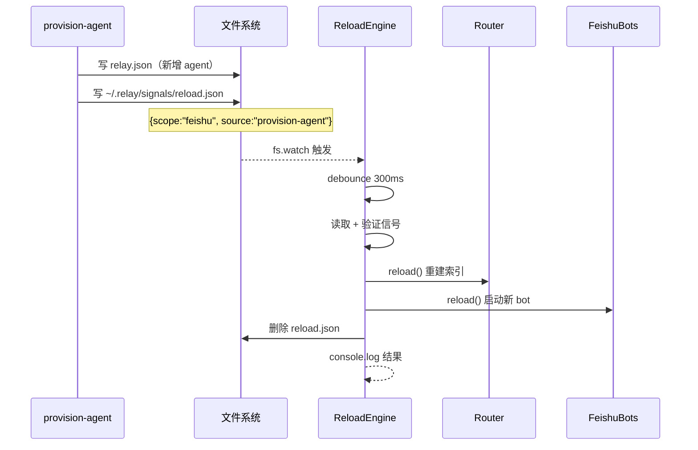
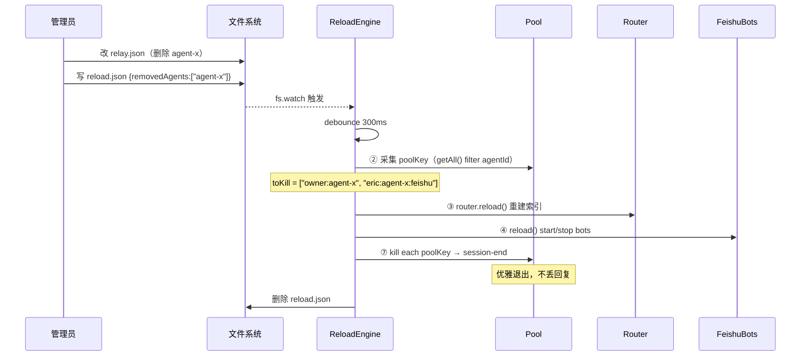

# config-hot-reload - 技术设计文档

> **2026-08-17 node-placement addendum**：placement 模式不采用下文 P2 Telegram 延后或增量 helper 设计，而采用 `features/node-placement/design.md` 的 preflight、running-job fence、TG/Feishu exact registry 与 inactive listener 语义。下文保留为 legacy 非 placement 设计背景。

> **设计概述**：信号文件驱动的配置热更新引擎。Relay 启动时创建信号文件 watcher，外部系统写入信号后触发定向 reload。/reload 命令和 HTTP API 是信号文件的上层封装。

---

## 1️⃣ 架构设计

### 1.1 组件关系

```
                        ┌──────────────────┐
                        │  Signal File     │
                        │  reload.json     │
                        └────────┬─────────┘
                                 │ fs.watch
                                 ▼
┌──────────┐  写信号  ┌──────────────────────┐  调用  ┌──────────────┐
│/reload   │────────▶│  Reload Engine       │──────▶│ router       │
│命令      │         │  (src/reload-engine)  │       │ feishuBots   │
├──────────┤         │                      │       │ scheduler    │
│HTTP API  │────────▶│  debounce + validate │       │ pool (kill)  │
│/internal │         │  scope dispatch       │       └──────────────┘
│/reload   │         └──────────────────────┘
├──────────┤                  │
│provision │──────────────────┘ 直接写信号文件
│-agent    │
└──────────┘
```

### 1.2 信号文件格式

```json
{
  "scope": "all" | "router" | "feishu" | "scheduler",
  "removedAgents": ["agent-id-1"],
  "source": "provision-agent" | "/reload" | "http-api",
  "timestamp": "2026-06-12T14:00:00+0800"
}
```

- `scope`（必需）：reload 范围
- `removedAgents`（可选）：被删除的 Agent ID 列表，用于优雅停 pool 进程
- `source`（可选）：触发来源，用于日志
- `timestamp`（可选）：写入时间

### 1.3 文件路径

```
~/.relay/
├── relay.json              # 主配置（不改监听方式）
├── signals/
│   └── reload.json         # reload 信号
├── state.json              # session 状态
└── agent-models/           # 模型覆盖
```

---

## 2️⃣ 核心模块

### 2.1 ReloadEngine（新增 `src/reload-engine.ts`）

```typescript
export interface ReloadSignal {
  scope: 'all' | 'router' | 'feishu' | 'scheduler' | 'telegram';
  removedAgents?: string[];
  source?: string;
  timestamp?: string;
}

export interface ReloadResult {
  scope: string;
  addedBots: string[];      # 新启动的 bot agentId
  removedBots: string[];    # 已停止的 bot agentId
  killedPools: string[];    # 被优雅停的 pool poolKey（可能多个）
  durationMs: number;
  error?: string;
}

export interface ReloadEngineDeps {
  router: Router;
  feishuBots: FeishuBotInstance;
  scheduler: Scheduler;
  pool: Pool;
  signalDir: string;        # ~/.relay/signals/
}

export interface ReloadEngine {
  start(): void;            # 启动 watcher
  stop(): void;             # 停止 watcher
  reload(signal: ReloadSignal): Promise<ReloadResult>;  # 程序化触发
}
```

**关键行为**：

1. **start()**：`mkdirSync(signalDir, {recursive:true})` → `fs.watch(signalDir)` 监听 `reload.json`
2. 检测到文件 → 读取 → 验证 JSON 完整性 → debounce 300ms → 执行 reload → 删除信号文件
3. **reload(signal)**：加 mutex 锁，防止并发。如已在 reload 中，新信号跳过（写方可重试）

**reload 顺序（关键）**：

删除 Agent 时必须先从 pool 采集 poolKey，再 router.reload()。否则旧索引被清除后无法找到 poolKey。

```
reload(signal)
  │
  ├─ ① mutex 检查（已在 reload 中 → 跳过并 return）
  │
  ├─ ② 采集被删 Agent 的 poolKey
  │     对 removedAgents 中每个 agentId：
  │       pool.getAll().filter(p => p.poolKey 含 agentId)
  │     记录到 toKill 列表
  │
  ├─ ③ scope 含 "router" 或 "all"
  │     router.reload()          # 重建索引（此时旧 agent 从索引消失）
  │
  ├─ ④ scope 含 "feishu" 或 "all"
  │     feishuBots.reload()      # 启动新增 bot + 停止已删 bot
  │
  ├─ ⑤ scope 含 "scheduler" 或 "all"
  │     scheduler.reload()
  │
  ├─ ⑥ scope 含 "telegram" 或 "all"
  │     (P2 延后) tgBots.reload()
  │
  └─ ⑦ 优雅停 pool
        对 toKill 中每个 poolKey：pool.kill(poolKey) → session-end
  │
  └─ ⑧ 释放 mutex
```

### 2.3 飞书 Bot 停止逻辑（新增）

当前 `FeishuBotInstance` 接口有 `start()` 和 `reload()`，需要新增 `stopAgent(agentId: string)`：

```typescript
interface FeishuBotInstance {
  start(): Promise<void>;
  stop(): Promise<void>;
  reload(): Promise<{ added: string[]; removed: string[]; total: number }>;  # 扩展：返回 removed
  stopAgent(agentId: string): Promise<void>;  # 新增
  notifyResumed(): Promise<void>;
}
```

`stopAgent` 做的事：
1. 找到 `liveBots` 中对应 agentId 的 bot 实例
2. 断开 WebSocket 连接（`wsClient.disconnect()`）
3. 清理 pool listeners
4. 从 `liveBots` Map 中移除

---

## 3️⃣ /reload 命令集成

在 `feishu.ts handleCommand` 的 switch 中新增：

```typescript
case 'reload': {
  const scopeArg = text.slice(1).split(/\s+/)[1]?.trim() || 'all';
  // 写入信号文件
  await writeReloadSignal(ctx.signalDir, { scope: scopeArg, source: '/reload' });
  // 直接调用 reloadEngine.reload() 并等待结果（不需要等 watcher）
  const result = await ctx.reloadEngine.reload({ scope: scopeArg, source: '/reload' });
  await ctx.sendTextMessage(openId, formatReloadResult(result));
  return;
}
```

权限：仅限管理员（通过 agent config 或 userId 判断）。

**已知限制：删自身 bot**。如果管理员通过 agent-x 发 `/reload`，而 reload 范围包含删除 agent-x，则 `reload()` 执行完成后 bot 已停止，无法回复结果卡片。规避：在 `stopAgent` 之前先发送回复，或接受回复丢失（console.log 仍记录结果）。

---

## 4️⃣ HTTP API 扩展

现有 `POST /internal/agents/reload` 改造：

```typescript
// 之前：只调 feishuBots.reload()
// 之后：接受 JSON body { scope?, removedAgents? }，调 reloadEngine.reload()
```

向后兼容：body 为空时默认 `scope: "feishu"`（与当前行为一致）。

---

## 5️⃣ Mutex 设计

`reloadEngine` 内部维护一个 `isReloading: boolean` 标志：

- `reload(signal)` 被调用时检查 `isReloading`
- 如已为 `true`：跳过本次，返回 `{ scope, error: 'reload-in-progress' }`
- 写信号方可根据返回值重试（或忽略，watcher 会捕捉下一次变更）

同时：watcher 检测到信号文件时，也走 `reload()` 入口，自动受 mutex 保护。

---

## 6️⃣ 数据流

### 6.1 provision-agent 自动生效流程



### 6.2 删除 Agent 流程



---

## 7️⃣ 错误处理

| 场景 | 处理 |
|------|------|
| 信号文件不是合法 JSON | 忽略，不触发 reload，console.warn |
| reload 过程中 router.reload() 失败 | 记录错误，继续后续步骤（best-effort） |
| bot 启动失败 | 记录到 ReloadResult.error，不阻塞其他 bot |
| pool.kill 失败 | 记录错误，进程最终会被 idle timeout 回收 |
| 信号文件写入中（半截） | debounce 300ms + JSON.parse 验证，不完整则跳过 |
| 多次快速写入 | debounce 合并为一次执行 |
| reload 进行中又来新信号 | mutex 跳过，返回 `reload-in-progress`，写方可重试 |

---

## 8️⃣ 需要改的文件

| 文件 | 改动 |
|------|------|
| **新增** `src/reload-engine.ts` | 信号文件监听 + debounce + scope 分发 |
| `src/channels/feishu.ts` | `FeishuBotInstance` 新增 `stopAgent()`；`handleCommand` 新增 `/reload` case |
| `src/http-server.ts` | `/internal/agents/reload` 改造为调 `reloadEngine` |
| `src/index.ts` | 创建 `ReloadEngine` 实例，注入到 deps |
| `src/types.ts` | `ReloadEngine` 接口（或在 reload-engine.ts 中定义） |
