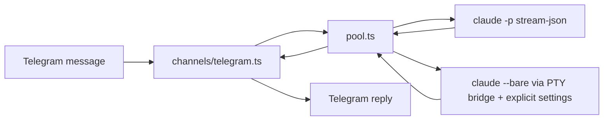
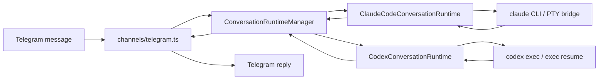
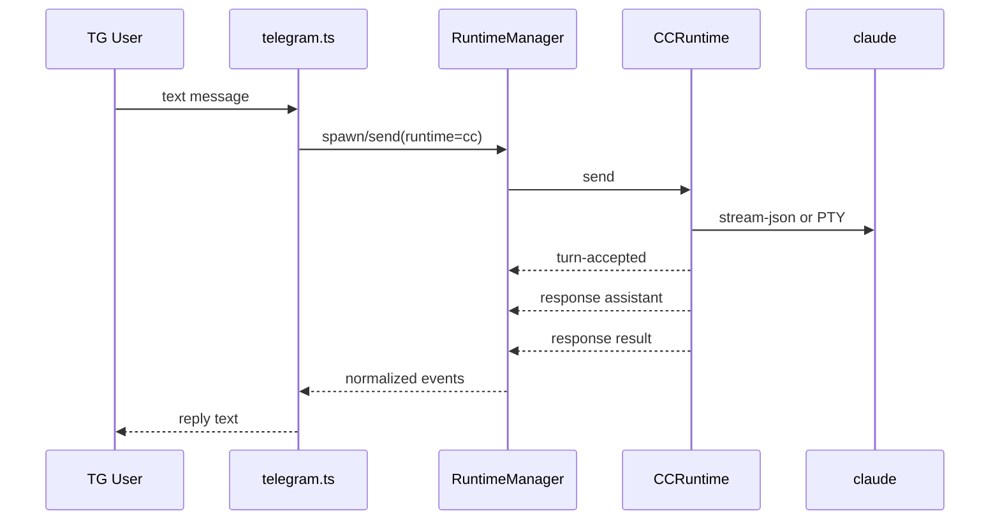
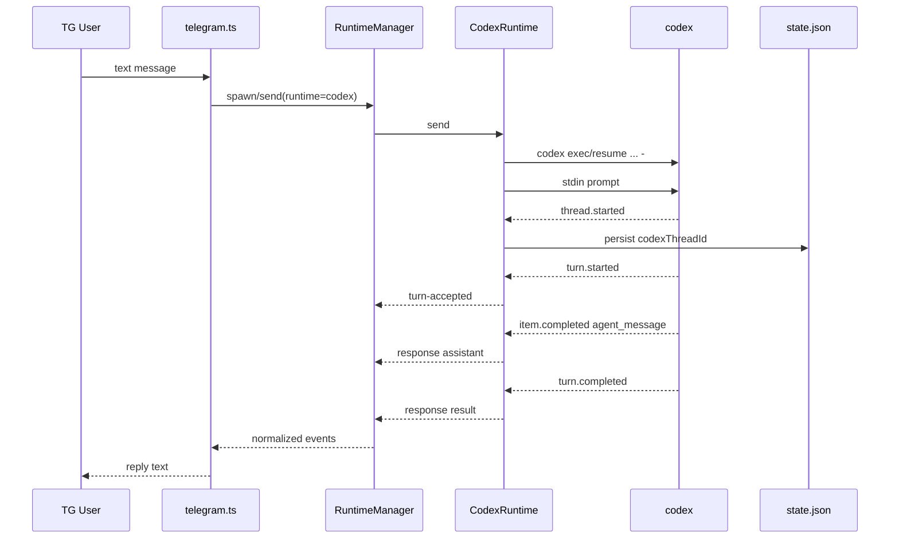

# conversation-runtime - Design

> 设计概述：基于 Relay 现有 Node.js + TypeScript + `child_process.spawn` 架构，在 TG 在线对话层引入 conversation runtime contract；CC 保持默认实现，Codex 以每 turn 子进程 + `thread_id` resume 实现可选运行时。

## 1. 技术栈

基于 `specs/project-specs/project-architecture.md` 定义的技术栈：

- 运行时：Node.js ≥ 18
- 语言：TypeScript 5.x strict mode
- 进程执行：`child_process.spawn`
- Telegram：grammy long polling
- 状态存储：现有 JSON state manager
- 测试：vitest

本功能不新增生产依赖。Codex runtime 通过本机 `codex` CLI 调用；CC runtime 继续通过 `claude` CLI 和 PTY bridge 调用。

## 2. 架构设计

### 2.1 当前问题

当前 Telegram 主链路为：



`pool.ts` 同时承担：

- CC spawn/resume/kill
- CC print/interactive 协议
- busy/idle/dead 状态机
- pending queue
- in-flight replay
- rate-limit/token fallback
- session jsonl repair
- TG 事件发射

因此不能把 Codex 直接加成 `ccMode` 的第三个分支。Codex CLI 是每 turn `exec/resume` 模型，不是长驻 stdin/stdout 进程。

### 2.2 目标架构



### 2.3 模块职责

- `channels/telegram.ts`
  - 保持渠道适配职责：认证、下载 TG 文件、调用 runtime manager、转发 assistant/result/error。
  - 不判断 `claude` 或 `codex` 命令参数。
  - 暴露受控 `/runtime` 命令：无参数时显示配置 runtime 与 active session runtime；参数仅接受 `cc`/`codex`，设置时调用命令层持久化并清理当前 active session。
  - 不拦截 CC 可处理的恢复类 slash command；`/compact` 必须透传到 conversation runtime。
  - 当会话已被标记为 context-full/recovery-required 时，普通会话可由 `/new` 开启新 session 并从旧日志接续；活动 WI 仍由 SCL 绑定守卫拒绝直接换会话。历史 `/wrap` 不再是前置。
  - Telegram 入口负责给出恢复提示；真正的 WI 换会话权限由 `handleNew` 的 SCL 绑定守卫裁决。Relay Codex runtime 使用 `codex exec`，不能依赖 Codex TUI hooks。
- `conversation-runtime.ts`（新模块）
  - 定义 `ConversationRuntimeId`、`ConversationRuntimeAdapter`、统一事件类型。
  - 提供 runtime manager，按 agent config 选择 adapter。
  - 在汇总 CC `response(result)` 时评估 **上下文软告警**（仅限 `adapter.id === 'cc'`）：读取用量 → 解析模型 id → `model-context.resolveContextWindowLimit` → 与 `RELAY_CONTEXT_SOFT_WARN` 比较 → `emit('context-soft-warning', …)`；去重键 `tenantId:sessionId:limit`。
- `model-context.ts`
  - `extractResultModelId`、`resolveConfiguredCcModelEnv`、`resolveContextWindowLimit`、`readDefaultContextLimit`；内置前缀表 + `RELAY_MODEL_CONTEXT_LIMITS` JSON 覆盖。
  - `pool.ts` 中 `--model` 选用的 `RELAY_CLAUDE_MODEL` / `CLAUDE_CODE_MODEL` 与本模块 `resolveConfiguredCcModelEnv()` 对齐，避免告警与 spawn 模型不一致。
- `channels/telegram.ts` / `channels/feishu.ts`
  - 订阅 `onContextSoftWarning`，向用户发送中文提示；百分比使用 `formatContextSoftWarningPercent(ratio)`（不封顶）。
- `cc-conversation-runtime.ts` 或兼容 façade
  - P0 可先包装现有 `pool.ts` CC 行为，做到对 TG 表面无行为变化。
  - 后续再把 `pool.ts` 内部拆成独立 CC adapter。
  - CC interactive 保留 PTY bridge 与 `--bare` 稳定性，但必须显式传入 Claude settings source，避免 TG session 丢失用户/项目/local 配置层。
  - CC interactive slash command 不依赖普通 user jsonl echo 判定接收；所有 `/command` 进入后立即 accepted，避免 slash command 因不写普通 user record 被 accept timeout/replay 卡死。
  - `/compact` 这类可能无 assistant 输出的恢复命令走有限 settle 生命周期；历史 `/wrap` 入口仍按长任务 slash command 等待真实 assistant/end_turn 或 busy timeout，不再参与新 UAT 门。
  - 已爆窗 session 不依赖旧 runtime 自我总结；`recoveryRequiredAt` 只记录恢复事实，旧 session/jsonl 由新 session 或外部 agent 后续读取总结。
- `codex-conversation-runtime.ts`（新模块）
  - 每个 turn spawn Codex CLI。
  - 管理 `poolKey -> threadId` 映射。
  - 解析 Codex JSONL stdout，输出统一 assistant/result/error 事件。
- `types.ts`
  - 扩展 `AgentConfig.runtime?: ConversationRuntimeId`。
  - 扩展 `AgentConfig.conversationRuntimePreference?: ConversationRuntimeId[]`，仅用于 TG conversation fallback，不复用 scheduler batch `runtimePreference`。
  - 保留 `sessionId`，Codex 下可作为初始 logical session key；真实 Codex thread id 写入 state。
- `router.ts`
  - 提供当前用户当前 Agent 的 runtime 持久化更新；只写 `runtime` 字段，不改 token/chatId/workspace/sessionId。
- `state.ts`
  - 扩展 persisted session 字段，支持 runtime 与 `threadId`。

## 3. 接口定义

### 3.1 类型定义

```ts
export type ConversationRuntimeId = 'cc' | 'codex';

export type ConversationProcessState = 'starting' | 'ready' | 'busy' | 'idle' | 'dead';

export interface ConversationSpawnConfig {
  tenantId: string;
  runtime?: ConversationRuntimeId;
  conversationRuntimePreference?: ConversationRuntimeId[];
  workspace: string;
  sessionId: string;
  codexThreadId?: string;
  maxTurns?: number;
  allowedTools?: string[];
  resume?: boolean;
}

export interface ConversationMessage {
  type: 'human';
  content: string | unknown[];
  attachments?: ConversationAttachment[];
}

export interface ConversationAttachment {
  kind: 'image';
  path: string;
  mediaType?: string;
  cleanup?: boolean;
}

export interface ConversationProcess {
  tenantId: string;
  runtime: ConversationRuntimeId;
  state: ConversationProcessState;
  sessionId: string;
  codexThreadId?: string;
  lastActivity: number;
  spawnedAt: number;
  restartCount: number;
  restartWindowStart: number;
}
```

### 3.2 Adapter contract

```ts
export interface ConversationRuntimeAdapter {
  readonly id: ConversationRuntimeId;
  spawn(config: ConversationSpawnConfig): Promise<ConversationProcess>;
  send(tenantId: string, message: ConversationMessage): Promise<void>;
  kill(tenantId: string): Promise<void>;
  get(tenantId: string): ConversationProcess | undefined;
  getAll(): ConversationProcess[];
  dispose(): void;
  emitShutdown(): void;
  on(event: 'turn-accepted', handler: (tenantId: string) => void): void;
  on(event: 'response', handler: (tenantId: string, msg: StreamJsonMessage) => void): void;
  on(event: 'exit', handler: (tenantId: string, code: number | null) => void): void;
  on(event: 'error', handler: (tenantId: string, error: Error) => void): void;
  on(event: 'turn-warning', handler: (tenantId: string, currentTurn: number, maxTurns: number) => void): void;
  on(event: 'session-end', handler: (tenantId: string, reason: SessionEndReason) => void): void;
  on(event: 'crash-retry', handler: (tenantId: string) => void): void;
}
```

P0 兼容策略：`ConversationRuntimeAdapter` 事件签名与现有 `Pool` 接口保持同构，使 `telegram.ts` 可以最小改动接入。

### 3.3 Runtime manager

```ts
export interface ConversationRuntimeManager extends ConversationRuntimeAdapter {
  register(adapter: ConversationRuntimeAdapter): void;
  resolveRuntime(config: AgentConfig): ConversationRuntimeId;
  resolveRuntimePreference(config: AgentConfig): ConversationRuntimeId[];
  onRuntimeFallback(handler: (event: ConversationRuntimeFallbackEvent) => void): void;
  onContextSoftWarning(handler: (event: ContextSoftWarningEvent) => void): void;
}
```

行为：

1. `spawn(config)` 缺省按 `config.runtime ?? 'cc'` 分派；若配置 `conversationRuntimePreference`，则按该数组顺序尝试。
2. `send(tenantId, message)` 根据 `tenantId -> runtimeId` 路由。
3. 订阅各 adapter 事件并重新 emit，TG channel 只监听 manager。
4. `kill/get/getAll/getStatus` 聚合所有 adapter 状态。
5. P2-001 最小 fallback 仅在 adapter `spawn()` 抛错时尝试下一 runtime；成功 fallback 后 emit `runtime-fallback`，并把 `tenantId -> runtimeId` 记录为最终 runtime。

### 3.4 Agent config

```ts
export interface AgentConfig {
  id: string;
  name: string;
  emoji: string;
  botToken: string;
  workspace: string;
  sessionId: string;
  maxTurns?: number;
  allowedTools?: string[];
  runtime?: ConversationRuntimeId; // default: 'cc'
  conversationRuntimePreference?: ConversationRuntimeId[]; // TG conversation fallback order
}
```

`runtime` 缺省必须等价于当前行为。`conversationRuntimePreference` 只影响 Telegram 在线会话，不影响 scheduler batch `runtimePreference`。

### 3.5 Context soft warning（CC only）

**事件**（`types.ts`）：

```ts
export interface ContextSoftWarningEvent {
  tenantId: string;
  sessionId: string;
  runtime: ConversationRuntimeId;
  currentSize: number;
  limit: number;
  ratio: number;
  modelId?: string;
}
```

- `currentSize`：`input_tokens + cache_read_input_tokens`（`result.usage`）。
- `limit`：模型感知上下文预算（软参考线，非强制 API 上限）。
- `ratio`：`currentSize / limit`（UI 可显示 >1）。
- `modelId`：用于选 `limit` 的字符串（来自 result 或 env 回退）。

**环境变量**：

| 变量 | 含义 |
|------|------|
| `RELAY_CONTEXT_SOFT_WARN` | 触发比例，默认 `0.8` |
| `RELAY_MODEL_CONTEXT_LIMITS` | JSON `{"model-id": number, ...}`，key 小写匹配 |
| `RELAY_CONTEXT_LIMIT_DEFAULT` | 无模型/无内置匹配时的上限 |
| `RELAY_CLAUDE_MODEL` / `CLAUDE_CODE_MODEL` | result 无 `model` 时的模型提示 |

**Manager API**：`onContextSoftWarning` 与 `onRuntimeFallback` 并列；`ConversationRuntimeManager` 类型定义中应同时列出二者（若接口片段未展示，以 `src/conversation-runtime.ts` 为准）。

### 3.5.1 Agent 自发 rollover：上下文提示与会话更换

**提示**（`src/context-rollover-hint.ts`，`ContextRolloverHints`）：runtime manager 按 `租户:sessionId` 记录上下文占用与压缩次数。占用取 CC `result.context_window.used_percentage`；没有时取最近一条 assistant 的 `input + cache_creation + cache_read` 除以 `result.modelUsage[*].contextWindow`。每个 `system/compact_boundary` 计一次压缩。占用达到 `RELAY_ROLLOVER_HINT_RATIO`（默认 `0.6`）或压缩达到 `RELAY_ROLLOVER_HINT_COMPACTIONS`（默认 `2`）后，下一条普通人类消息（非斜杠命令、非 `[Host …]` 控制、非 control 可见性）末尾附一次 Host 上下文提示，人类输入证明随消息保留。提示不另起回合，也不代替 Agent 判断；同一会话只提示一次，`kill` 清除记录。Codex 与 Pi 不报告这两项事实，暂不提示。

**会话更换**（`src/agent-rollover-request.ts`）：Agent 先 `checkpoint`，再经 `pulse_work_item` 执行 `request_rollover`。内核提交后在 `<human_inputs 同级>/native-session-handovers/agent-requests/<ref>.json` 留一份私有通知（`harness.agent-rollover-request/v1`：ref、wi、request_id、tenant、source_native_id）。Relay 的 30 秒会话交接巡检先读这些通知：会话属于本 Relay、没有待完成的交接、当前活进程就是通知里的源会话且空闲时，以通知 ref 和 `origin:'agent'` 进入与 `/wi rollover` 相同的 `rolloverNativeSession`；源会话忙则等下一轮。Relay 重启或进程退出后源会话没有活实例（或实例已死）时，只要本机持久化会话的 sessionId 或 codexThreadId 仍是通知里的源会话，同样进入该流程：先记下待交接计划，按原始请求恢复的路径以 recovery 意图拉起源会话，再由内核在 prepare 时复查前提；持久化会话已不是源会话则删除通知、不启动。后继已持有 WI、源会话已换成别的会话，或内核拒绝（非可重试错误）时删除通知；内核拒绝时清掉待交接计划，源会话照常继续。通知只决定换哪个会话，不授予权限。

`@anchor test Relay/tests/context-rollover-hint.test.ts :: "hints once when CC reports the context nearly full"`
`@anchor test Relay/tests/agent-rollover-request.test.ts :: "starts an idle current source once and retires the notice after the successor holds the WI"`
`@anchor test Relay/tests/native-session-rollover.test.ts :: "a core refusal of the request clears the plan and leaves the source conversation running"`
`@anchor test Relay/tests/agent-rollover-request.test.ts :: "starts the rollover when a Relay restart leaves the idle persisted source with %s"`
`@anchor test Relay/tests/agent-rollover-request.test.ts :: "with no instance, a persisted session that names another source is retired without a start"`
`@anchor test Relay/tests/native-session-rollover.test.ts :: "after a Relay restart leaves the persisted source with %s, recovers it and runs the fenced handover"`
`@anchor test Relay/tests/native-session-rollover.test.ts :: "a persisted session that no longer names the source starts nothing"`

### 3.5.2 `/wi switch` 与 Agent 自主切换

**人类 `/wi switch WI`**（`src/native-wi-switch.ts`）：一个对话、多个原生会话、每个会话一个 WI。会话忙、有待完成的轮换、WI 进入或未落定的切换时拒绝，不做改动。先在当前会话调内核 `relay-channel` 的 leave：内核答 `no_switch`（目标是当前 WI 的子 WI，执行权已在本会话）时原样回复并结束，不记检查点、不换会话；已在目标会话时答无需切换。leave 结果未知时按同一 ref 再调最多 3 次，读回已提交就继续，仍未知则不换会话并回复错误码。之后保存当前会话单元到 `workItemSessions[离开的 WI]`；在替换会话之前把 `pendingWiSwitch {ref, target, origin, dest, resumed, left, agent?, at, phase?}` 落盘，`dest` 是目标 WI 的原会话单元或新生成的会话单元。再换成 `dest`，在新会话调 enter（结果未知按同一 ref 再调，共 3 次）。enter 成功则保存 `workItemSessions[目标]`，记录推进到 `phase: 'entered'`；enter 被拒则回到 `origin` 并清除记录。enter 仍未知时，以同一目标会话调 `readback`（内核答 `channel.<ref>` 是否已提交，共 3 次）：已提交按成功处理，未提交回到 `origin` 并清除记录，读回仍未知则回到 `origin`、保留记录，答复说明 Relay 会继续读回。

**接续提示**（`deliverSwitchContinuation`）：记录处于 `entered` 时，先以幂等键 `operation_v1_wi_switch_<ref>` 把接续提示交给进入的会话（人类切换带人类原输入，Agent 切换与恢复用 Host 文本：恢复原会话为“切回”，新会话为“接手”），再发聊天回复；运行时接纳（`onAccepted`）这条提示后才清除记录。在此之前 Relay 退出，记录留在盘上，巡检以同一幂等键重新投递。同一进程内同一记录只投递一次；投递失败时在聊天说明并留待下一轮。

**未落定的切换**（`settleInterruptedSwitch`、`settleWiSwitch`）：交接巡检先处理带 `pendingWiSwitch` 的会话（Relay 重启后，或 enter 结果未知后）。记录未进入 `entered` 时：会话忙则等下一轮；无实例则按持久化会话拉起。以当前会话调 `readback`，读回期间不占对话获取槽；读回后在槽内重核记录（同一 ref 与时间）、原生进程身份、忙闲和最新人类输入，任一变化（例如读回期间入站消息拉起并开始了新回合）都不替换、不停进程，记录留待下一轮。重核通过后：已提交就把对话落定到记录的 `dest`（就是当初进入的身份，内核对同一 ref 只认它），写 `workItemSessions[目标]`，记录推进到 `entered`；未提交就回到 `origin`、清除记录；读回未知什么都不改，下一轮再读。记录处于 `entered` 时，按上段投递接续提示，无实例先拉起。结果发到对话聊天，Agent 发起的加“Agent 自主切换：”前缀。

**核心通道失败**（`runNativeChannel`、`readNativeChannel`）：子进程超时 120 秒、输出超过 8 MB、非零退出或输出不是 JSON 时，Relay 日志记一条 `Native channel core diagnostic`（阶段、ref、错误码、退出码、信号、stdout 字节数、stderr 末 5 行，每行至多 300 字符）；读不到答复时结果为 `unknown`，错误码依次为 `native_channel_output_overflow`、`native_channel_timeout`、`native_channel_exit_<码>`、`native_channel_signal_<信号>`、`native_channel_result_unknown`。

**切换记录与会话替换**：记录只适用于它记下的会话：未进入 `entered` 时是 `origin` 或 `dest`，`entered` 时只是 `dest`。读回、落定和投递接续提示前都核对持久化会话与活进程（`switchRecordCurrent`），不符就作废记录（`abandonWiSwitch`）：清除记录，日志记一条 `WI switch record abandoned`（原因、ref、target、离开的 WI、阶段、origin/dest/当前 sessionId），聊天说明作废并提示 `/wi status <target>` 核对执行权，不停进程、不改当前会话、不发接续提示。人类 `/reset` 与 `/new` 替换会话时直接作废记录（原因 `/reset`、`/new`）；切换正在替换会话（`switchInProgress`）时二者拒绝并提示稍后再试。会话轮换（人类 `/wi rollover`、Agent 的 `request_rollover`、待完成轮换的恢复）在切换进行中或留有记录时等待或拒绝。作废后 Agent 的切换通知因源会话已不是当前会话而被删除。

**Agent 自主切换**（`src/agent-switch-request.ts`、`runAgentSwitch`）：Agent 在所持 WI 上先 `checkpoint`，再经 `pulse_work_item` 执行 `request_switch {target, summary}`，然后结束回合。内核提交后在 `<human_inputs 同级>/native-session-handovers/agent-switches/<ref>.json` 留私有通知（`harness.agent-switch-request/v1`：ref、wi、target、request_id、tenant、source_native_id）。会话交接巡检（每 30 秒，并在每个回合结束 2 秒后）读这些通知：会话属于本 Relay、没有进行中的切换、轮换或 WI 进入，且当前会话（活进程，或无实例时持久化的 sessionId/codexThreadId）就是通知里的源会话并空闲时，以通知 ref 走与人类 `/wi switch` 相同的 `switchWorkItem`；无实例时先拉起源会话。切换生效时按上述接续提示规则投递，结果以“Agent 自主切换：……”发到该对话的聊天。会话带任一阶段的 `pendingWiSwitch` 时通知只等待、不删除，先由上一段读回或投递；读回结果为未提交、回到源会话后，通知从头再执行。一次执行落定（成功、被拒、无需切换）且没有留下本通知的记录时删除通知；leave 结果未知、留有本通知的记录或执行中抛错时保留到下一轮。会话没有记录且源会话已不是当前会话时删除通知、不执行。

`@anchor test Relay/tests/native-wi-switch.test.ts :: "a target that is a child of the held WI is answered before anything changes"`
`@anchor test Relay/tests/native-wi-switch.test.ts :: "reads an unknown leave back with the same reference and continues once it is committed"`
`@anchor test Relay/tests/native-wi-switch.test.ts :: "a leave that stays unknown changes nothing and names its cause"`
`@anchor test Relay/tests/native-wi-switch.test.ts :: "a switch records the unit it left and the target identity until its continuation is due"`
`@anchor test Relay/tests/native-wi-switch.test.ts :: "an unknown enter that reads back as committed completes; as absent it returns and clears"`
`@anchor test Relay/tests/wi-switch-recovery.test.ts :: "enter committed, then Relay stopped before saving it: the restart settles on the same target session"`
`@anchor test Relay/tests/wi-switch-recovery.test.ts :: "Relay stopped after replacing the session but before enter: the restart returns to the source"`
`@anchor test Relay/tests/wi-switch-recovery.test.ts :: "a readback that stays unknown changes nothing; a later pass settles it"`
`@anchor test Relay/tests/wi-switch-recovery.test.ts :: "a turn that starts while the readback runs is never killed; the record waits for a later pass"`
`@anchor test Relay/tests/wi-switch-recovery.test.ts :: "a restart after enter settled but before its continuation was admitted delivers it again, then retires the notice"`
`@anchor test Relay/tests/commands.test.ts :: "/reset drops the record (%s) with an audit line; the pass then neither hands over nor replaces the new session"`
`@anchor test Relay/tests/commands.test.ts :: "a record left on a session it does not name (%s) is abandoned, the current session untouched and the notice retired"`
`@anchor test Relay/tests/commands.test.ts :: "/reset and /new wait while a switch is replacing the session"`
`@anchor test Relay/tests/agent-rollover-request.test.ts :: "waits while an unfinished /wi switch owns the conversation"`
`@anchor test Relay/tests/native-work-item-command.test.ts :: "logs the cause and answers unknown with a readable code: %s"`
`@anchor test Relay/tests/agent-switch-request.test.ts :: "runs an idle current source once and retires the notice"`
`@anchor test Relay/tests/agent-switch-request.test.ts :: "waits while the conversation has an unsettled switch, then runs once it returned to the source"`
`@anchor test Relay/tests/agent-switch-request.test.ts :: "enters a new session, tells the chat and hands the Agent its continuation"`
`@anchor test Relay/tests/agent-switch-request.test.ts :: "returns to the target's own session when it has one"`

### 3.6 Persisted state

```ts
export interface PersistedSession {
  poolKey: string;
  agentId: string;
  runtime?: ConversationRuntimeId; // default cc for old state files
  sessionId: string;
  codexThreadId?: string;
  wrapRequestedAt?: number;
  recoveryRequiredAt?: number;
  recoveryReason?: 'context-window-limit' | 'compact-failed' | 'wrap-cannot-run';
  turnCount: number;
  maxTurns: number;
  lastActivity: number;
  status: 'active' | 'idle-reclaimed' | 'turns-exhausted' | 'crashed' | 'recovery-required';
}
```

兼容规则：

- 旧 state 缺少 `runtime` 时视为 `cc`。
- Codex 首轮成功拿到 `thread_id` 后写入 `codexThreadId`。
- `recoveryRequiredAt/recoveryReason` 记录旧 session 的 context 满载或 compact 失败，不携带旧 session 内容。2026-09-29 后普通会话 `/new` 无需 `/wrap`；活动或待接续 WI 仍需正式 rollover/recovery。
- Relay 重启后，Codex runtime 用 `codexThreadId` resume。

## 4. Codex Runtime Design

### 4.0 Hook Boundary

Codex TUI hooks and Relay Codex runtime are different trust surfaces.

Local audit on 2026-04-26 with Codex CLI 0.125.0:

- Interactive TUI command `codex --no-alt-screen ... "close this session"`
  executed `UserPromptSubmit` and blocked through the shared `/wrap` guard.
- Non-interactive `codex exec ... "close this session"` and
  `codex exec ... /new` did not trigger the project hook path; they started a
  Codex turn.

That historical hook observation does not govern the current `/new` contract.
The Relay entrance must preserve the independent SCL binding guard before
replacing an active WI session. Project `.codex/hooks.json` is useful for direct
Codex TUI use, but it is not a safety boundary for Telegram Codex turns.

### 4.1 CLI command

首轮：

```bash
codex -a never -s workspace-write -C <workspace> \
  exec --skip-git-repo-check --json \
  --output-last-message <tmpfile> -
```

续轮：

```bash
codex -a never -s workspace-write -C <workspace> \
  exec resume <thread_id> --skip-git-repo-check --json \
  --output-last-message <tmpfile> -
```

图片（P1）：

```bash
codex -a never -s workspace-write -C <workspace> \
  exec --skip-git-repo-check --json \
  --output-last-message <tmpfile> \
  -i <image-file> -- -
```

参数说明：

- prompt 通过 stdin 写入，避免长文本放 argv。
- `-a never` 避免 Codex 在 Relay 无人值守场景中等待交互确认。
- `-s workspace-write` 与 batch adapter 现状一致。
- `--json` 用于结构化解析事件。
- `--output-last-message` 作为最终回复兜底来源。

### 4.2 JSONL event parser

实验确认的 stdout 事件：

```json
{"type":"thread.started","thread_id":"019dc2b0-0d14-7503-9c11-e0402310fa9e"}
{"type":"turn.started"}
{"type":"item.completed","item":{"id":"item_0","type":"agent_message","text":"CODEX_TG_EXPERIMENT_OK"}}
{"type":"turn.completed","usage":{"input_tokens":14058,"cached_input_tokens":11648,"output_tokens":12,"reasoning_output_tokens":0}}
```

错误事件：

```json
{"type":"error","message":"..."}
{"type":"turn.failed","error":{"message":"..."}}
```

解析规则：

- `thread.started.thread_id`：如果当前 tenant 没有 `codexThreadId`，保存并持久化。
- `turn.started`：emit `turn-accepted`，启动 TG typing。
- `item.completed.item.type === "agent_message"`：emit `response(assistant)`。
- `turn.completed`：emit `response(result)` 并将 state 置为 idle。
- `error` 或 `turn.failed`：记录 error，turn 失败。

### 4.3 Stderr handling

实验中 Codex exitCode=0 时可能输出：

```text
failed to record rollout items: thread ... not found
```

但实际 session jsonl 可持续写入，`resume <thread_id>` 多轮有效。因此：

- exitCode=0 且无 JSONL `error/turn.failed` 时，该 stderr 不视为失败。
- exitCode!=0 或出现 JSONL `error/turn.failed` 时，stderr 作为诊断字段写日志。

### 4.4 Session behavior

Codex adapter 不维护长驻 child process。每个 tenant 的 logical process 是一份内存状态：

- `ready/idle`：无子进程运行，可接收下一条消息。
- `busy`：一个 Codex child process 正在执行；后续消息排队。
- `dead`：不可继续，下一条消息可重新 spawn。

每个 turn 完成后 child process 自然退出，但 logical process 保持 `idle`。

### 4.5 Text conversion

P0 只支持文本：

- `content: string`：原样写入 stdin。
- `content: Array<{type:'text', text:string}>`：合并为文本。
- 其他 block：P0 返回明确错误，提示该 runtime 暂不支持该消息类型。

## 5. 数据流

### 5.1 CC 默认路径



### 5.2 Codex text path



### 5.3 P2 spawn fallback（最小实现）

P2-001 第一切片实现 TG conversation 的 spawn failure fallback：

- 配置字段使用 `conversationRuntimePreference?: ConversationRuntimeId[]`，不复用 scheduler batch 的 `runtimePreference`，避免 batch runtime 与在线会话 lifecycle 混淆。
- `telegram.ts` 只把 preference 传给 runtime manager；fallback 判定、adapter 切换、state 迁移留在 manager/adapter 层。
- fallback 仅在 adapter `spawn()` 抛错且尚未产生 assistant 输出时触发；本切片不处理 turn-level fatal error、timeout 或已发送 assistant 后失败。
- fallback 必须向 TG 用户发送一次明确提示，例如“Codex 当前不可用，已切换到 CC 重试本轮”，并在日志记录 from/to runtime、reason、poolKey、attempt index。
- state 只记录最终接管 runtime：Codex `threadId` 不带入 CC；CC `sessionId` 不作为 Codex `threadId`。
- token/auth 清理规则不变，fallback 日志和提示不得包含 bot token、Codex auth token、Claude token。

测试计划：

- Unit：preference 解析，缺省仍为 `['cc']`；未知 runtime 拒绝启动并给出可观测错误。
- Unit：Codex spawn error fallback 到 CC，manager route table 更新到 CC。
- Integration：TG 本轮未产生 assistant 时 fallback，只发送一次 fallback notice 和一次最终 assistant。
- Unit/Integration：Codex 已产生 assistant 后再失败时不 fallback，只走现有 session-end/error 提示。
- State：fallback 后 persisted session runtime 与最终 runtime 一致，thread/session 字段不串线。
- Security：fallback notice、`/session`、日志 error head 不含 token/auth/key/secret。

## 6. 错误处理

| 场景 | 检测 | 处理 |
|---|---|---|
| Codex binary missing | spawn error `ENOENT`/`EACCES` | state=dead, emit error, reject/clear in-flight |
| Unsupported message block | non-text content in P0 | emit error + session-end timeout/error style user message |
| CLI JSONL error | `type=error` | capture errorHead, emit error, state=idle/dead by exitCode |
| Turn failed | `type=turn.failed` | emit session-end or error, no assistant/result success |
| Timeout (Codex) | no Codex stdout JSONL line or stderr data for the idle timeout window | SIGTERM, after 5s SIGKILL, emit session-end timeout |
| Busy Progress (CC) | CC busy > busyTimeoutMs | emit busy-progress event, notify user; no auto-kill; user /stop to terminate |
| Exit 0 with stderr rollout warning | stderr contains rollout warning only | log debug/warn, treat as success if turn.completed/assistant exists |
| Exit 0 without assistant text | no assistant and last-message empty | emit result empty + warn; TG may send no-output fallback |

日志字段：

```ts
{
  ts: string,
  level: 'debug' | 'info' | 'warn' | 'error',
  tenant: string,
  runtime: 'codex',
  threadId?: string,
  msg: string,
  exitCode?: number,
  errorHead?: string,
  durationMs?: number
}
```

## 7. 安全设计

- 环境变量清理沿用 CC pool：删除 `TELEGRAM_BOT_TOKEN` 与 `BOT_TOKEN_*`。
- Codex 子进程不注入 `CLAUDE_CODE_OAUTH_TOKEN` 或 `CLAUDE_CODE_OAUTH_TOKEN_FALLBACK`。
- Codex 默认 sandbox 为 `workspace-write`，cwd 绑定 Agent workspace。
- 图片临时文件放在 `mkdtemp(tmpdir(), 'relay-codex-')`，turn 结束后清理。
- 日志不得输出完整 prompt、bot token、Codex auth token。

## 8. 性能与可维护性

- Codex 每 turn 子进程实测文本 wall time 约 5-6 秒，图片约 8 秒；TG typing 从 `turn.started` 开始。
- 不为 Codex 设计长驻 PTY，避免复制 TUI 协议复杂度。
- `ConversationRuntimeAdapter` 与现有 `Pool` 事件同构，减少 TG channel 改动面。
- P0 允许 `CCRuntime` 先作为现有 `pool.ts` façade，后续再内部拆分，降低生产回归风险。

## 9. 实验记录

2026-04-25 本机实验：

- `codex-cli 0.125.0`
- `codex exec --json --output-last-message` 成功返回 `thread.started`、`item.completed`、`turn.completed`。
- `codex exec resume <thread_id>` 连续 4 轮有效，能记住上一轮 marker。
- stdin prompt `-` 可用，适合 TG 长文本。
- 非法 model 返回 exitCode=1，JSONL 有 `error` 与 `turn.failed`。
- 图片 `-i <file> -- <prompt>` 可用；无 `--` 时 prompt 会被 CLI 解析吞掉。
- exitCode=0 时 stderr 可能出现 rollout 记录警告，但不影响 resume。
