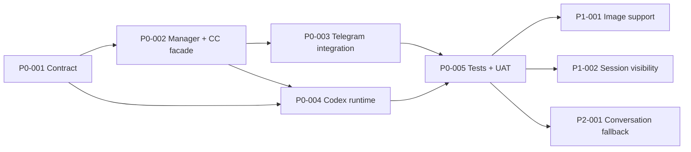

# conversation-runtime - Tasks

> 任务概述：基于 `design.md` 实现 TG 在线会话 runtime 抽象，先保证 CC 默认路径无行为回退，再接入 Codex 文本会话 runtime。

## 1. 任务拆分

### P0 任务

| 任务ID | 任务名称 | 预估工时 | 依赖任务 | 负责人 | 状态 |
|---|---|---:|---|---|---|
| P0-001 | 定义 conversation runtime 类型与 contract | 3h | 无 | Pulse | 完成 |
| P0-002 | 实现 runtime manager 与 CC façade | 6h | P0-001 | Pulse | 完成 |
| P0-003 | 改造 Telegram channel 接入 runtime manager | 5h | P0-002 | Pulse | 完成 |
| P0-004 | 实现 Codex 文本 runtime adapter | 8h | P0-001, P0-002 | Pulse | 完成 |
| P0-005 | 补 P0 测试与本地 UAT | 6h | P0-003, P0-004 | Pulse | 完成 |

### P1 任务

| 任务ID | 任务名称 | 预估工时 | 依赖任务 | 负责人 | 状态 |
|---|---|---:|---|---|---|
| P1-001 | Codex 图片附件支持 | 5h | P0-004, P0-005 | Pulse | 完成 |
| P1-002 | `/session` runtime 状态可见 | 3h | P0-002, P0-004 | Pulse | 完成 |
| P1-003 | CC 上下文软告警（模型感知，TG/飞书） | 4h | P0-002 | Pulse | 完成 |

### P2 任务

| 任务ID | 任务名称 | 预估工时 | 依赖任务 | 负责人 | 状态 |
|---|---|---:|---|---|---|
| P2-001 | TG conversation runtimePreference/fallback | 8h | P0 全部 | Pulse | 完成 |

## 2. 任务详情

### P0-001：定义 conversation runtime 类型与 contract

**任务描述**：

- 基于 `design.md` 的“3.1 类型定义”和“3.2 Adapter contract”，新增 conversation runtime 类型、process state、message、attachment、adapter 接口。
- 扩展 `types.ts` 的 `AgentConfig`，增加 `runtime?: 'cc' | 'codex'`，缺省为 `cc`。
- 扩展 persisted session 类型，支持 `runtime` 与 `codexThreadId`，旧 state 默认视为 `cc`。

**输入**：

- `specs/features/conversation-runtime/design.md` §3.1、§3.2、§3.4、§3.6
- `src/types.ts`

**输出**：

- `src/types.ts` 或新 `src/conversation-runtime.ts` 类型定义。
- 兼容旧 `AgentConfig` 和旧 `PersistedSession` 的类型/迁移逻辑。

**验证标准（TDD 要求）**：

- Unit Test：旧 agent config 未配置 runtime 时解析为 `cc`。
- Unit Test：旧 persisted session 未配置 runtime 时解析为 `cc`。
- Typecheck：`npm run typecheck` 通过，避免 `any`。

**完成标准**：

- contract 能覆盖当前 `Pool` 事件签名。
- 未触碰 CC spawn 行为。

### P0-002：实现 runtime manager 与 CC façade

**任务描述**：

- 基于 `design.md` 的“2.2 目标架构”和“3.3 Runtime manager”，实现 `ConversationRuntimeManager`。
- 将现有 `createPool()` 返回对象作为 `cc` adapter façade 注册到 manager，保持现有 CC 行为。
- manager 聚合 adapter 事件并按 `tenantId -> runtimeId` 路由 `send/kill/get/getStatus`。

**输入**：

- `design.md` §2.2、§2.3、§3.3
- 现有 `src/pool.ts`
- 现有 `src/index.ts`

**输出**：

- 新模块：`src/conversation-runtime.ts` 或 `src/conversation-runtime-manager.ts`
- `src/index.ts` 中创建 manager，并注册 CC adapter。

**验证标准（TDD 要求）**：

- Unit Test：manager 能注册多个 adapter，并把 `spawn/send/kill` 路由到正确 adapter。
- Unit Test：adapter 事件经过 manager 重新 emit，事件参数不变。
- Integration Test：未配置 runtime 的 Agent 仍调用 CC adapter。

**完成标准**：

- 现有 `pool.test.ts`、`telegram.test.ts` 通过。
- CC 默认路径没有新增 child process 或 CLI 参数变化。

**2026-04-25 进展（第一切片）**：

- 已新增 `src/conversation-runtime.ts`，实现 `ConversationRuntimeManager`、`createPoolConversationAdapter()`、默认 `runtime=cc` 解析。
- 已补 `tests/conversation-runtime.test.ts` 覆盖 adapter 注册、spawn/send 路由、事件重发、未注册 runtime 报错、CC pool façade。
- 当时尚未把 `src/index.ts` / `channels/telegram.ts` 的生产入口接到 manager；该缺口已由第二切片补齐。

**2026-04-25 验证**：

- `npm test -- --run tests/conversation-runtime.test.ts tests/state.test.ts`：16 passed。
- `npm run typecheck`：通过。
- `npm run build`：通过。
- `HOME=/tmp npm test -- --run tests/conversation-runtime.test.ts tests/state.test.ts tests/pool.test.ts tests/telegram.test.ts tests/token-fallback.test.ts`：64 passed。
- `HOME=/tmp npm test`：18 files / 221 tests passed。

**2026-04-25 进展（第二切片）**：

- `src/index.ts` 生产入口创建 `ConversationRuntimeManager`，并将现有 CC pool 通过 `createPoolConversationAdapter()` 注册为默认 `cc` adapter。
- `src/channels/telegram.ts` 改为依赖 runtime-compatible interface；text/photo/voice/audio/document 消息和 runtime 事件监听均通过该接口，默认 `runtime=cc` 时仍走原 CC pool façade。
- `src/commands.ts` 改为依赖 runtime-compatible interface；`/new`、`/kill`、`/restart`、`/status`、`/session` 不再直接依赖 `Pool` 类型。
- `state.ts` 的 `updateSession()` 对新写入 session 也默认补 `runtime: "cc"`；Telegram 和 `/new` 写 state 时显式记录 agent runtime，默认 `cc`。
- 未实现 Codex adapter，未接生产 Codex，未做生产 Relay 重启。

**2026-04-25 验证（第二切片）**：

- `npm run typecheck`：通过。
- `npm test -- --run tests/conversation-runtime.test.ts tests/state.test.ts tests/commands.test.ts tests/telegram.test.ts tests/bot-handler.test.ts`：5 files / 63 tests passed。
- `npm run build`：通过。
- `HOME=/tmp npm test -- --run tests/index.test.ts tests/pool.test.ts tests/token-fallback.test.ts`：3 files / 37 tests passed。使用 `HOME=/tmp` 是为了隔离 interactive pool 测试对 `$HOME/.claude/projects` 的写入。
- `HOME=/tmp npm test`：18 files / 223 tests passed。使用 `HOME=/tmp` 是自动化回归隔离，不代表真实 TG UAT。

### P0-003：改造 Telegram channel 接入 runtime manager

**任务描述**：

- 基于 `design.md` 的“2.3 模块职责”和“5.1 CC 默认路径”，把 `channels/telegram.ts` 从直接依赖 CC pool 改为依赖 conversation runtime manager。
- 文本、语音转写后的文本、图片/document 的 P0 行为必须保持：CC runtime 下按旧路径发送。
- `turn-accepted`、`response`、`session-end`、`error` 监听逻辑尽量复用。

**输入**：

- `design.md` §2.3、§5.1
- `src/channels/telegram.ts`
- `src/commands.ts`

**输出**：

- `telegram.ts` 使用 manager 的 `spawn/send/get/on` 接口。
- `/restart`、`/kill` 等命令通过 manager 操作 active runtime。

**验证标准（TDD 要求）**：

- Integration Test：TG text -> manager -> CC adapter -> assistant/result -> TG reply。
- Regression Test：现有文本、photo、voice/document 在 CC runtime 下测试通过。
- Unit Test：`runtime=codex` 的 agent spawn config 传递到 manager。

**完成标准**：

- `telegram.ts` 不直接构造 `claude` 或 `codex` 参数。
- 现有 TG 行为测试 100% 通过。

**2026-04-25 进展**：

- 已完成最小安全部分：Telegram channel 与 commands 已改为通过 runtime-compatible interface 工作，生产入口已接 `ConversationRuntimeManager` + CC adapter。
- 默认 CC 路径的 text/photo/voice/audio/document send、typing、assistant/result/session-end/error 监听保持沿用原事件语义。
- Codex runtime adapter 已接入生产入口的 manager 注册；Telegram spawn 会传递 persisted `codexThreadId`，支持 Relay 重启后 Codex resume。
- P0 文本链路测试已覆盖 Codex mocked TG/manager integration；P1 附件仍排除。

### P0-004：实现 Codex 文本 runtime adapter

**任务描述**：

- 基于 `design.md` 的“4. Codex Runtime Design”和“5.2 Codex text path”，实现 `CodexConversationRuntime`。
- 每 turn spawn Codex CLI；首轮 `codex exec`，续轮 `codex exec resume <thread_id>`。
- prompt 通过 stdin 传入；解析 JSONL stdout；`--output-last-message` 作为兜底。
- 维护 `poolKey -> process state/threadId/pending queue/in-flight`。

**输入**：

- `design.md` §4.1、§4.2、§4.3、§4.4、§4.5
- 实验记录 §9

**输出**：

- 新模块：`src/codex-conversation-runtime.ts`
- JSONL parser 与 command builder。
- state 持久化 hook：首轮保存 `codexThreadId`。

**验证标准（TDD 要求）**：

- Unit Test：首轮 command args 符合 `codex -a never -s workspace-write -C <workspace> exec ... -`。
- Unit Test：续轮 command args 使用 `exec resume <thread_id>`。
- Unit Test：JSONL `thread.started` 保存 thread id。
- Unit Test：JSONL `item.completed agent_message` emit assistant。
- Unit Test：JSONL `turn.completed` emit result 并置 idle。
- Unit Test：JSONL `error/turn.failed` 分类为失败，不静默吞掉。
- Unit Test：exitCode=0 + rollout stderr warning 不判失败。
- Fake Timer Test：无活动超过 idle timeout 后 SIGTERM，5 秒后 SIGKILL；assistant/stdout 活动会刷新 idle timeout。

**完成标准**：

- 满足 `requirements.md` AC-P0-002 至 AC-P0-006。
- 不影响 CC adapter 测试。

**2026-04-25 进展**：

- 新增 `src/codex-conversation-runtime.ts`，实现 `createCodexConversationRuntime()`。
- CLI command builder 符合文本 P0 设计：首轮 `codex -a never -s workspace-write -C <workspace> exec --skip-git-repo-check --json --output-last-message <tmpfile> -`；续轮追加 `resume <thread_id>`。
- prompt 通过 stdin 写入；P0 只接受 string 或 text block，非文本 block 明确报错。
- JSONL parser 覆盖 `thread.started`、`turn.started`、`item.completed agent_message`、`turn.completed`、`error`、`turn.failed`。
- 首轮获得 `thread_id` 后更新 logical process；若 stateManager 中已有 session，则写回 `codexThreadId` 并 flush。
- 每个 poolKey 单 in-flight turn；busy 时后续消息 FIFO queue，前一 turn 完成后续轮自动用保存的 thread id resume。
- 无 Codex stdout JSONL line 或 stderr data 超过 idle timeout 后先 SIGTERM，grace 期后 SIGKILL；timeout 发 `session-end timeout`。持续 assistant/stdout 活动不会被固定 wall-clock timeout 误杀。
- `error/turn.failed` 发 `error`、`session-end crash` 与非零 `exit`，避免 exitCode=0 时用户侧静默。
- `exitCode=0` 且只有 rollout stderr warning 时不判失败；若没有 assistant JSONL，会用 `--output-last-message` 文件兜底发 assistant。
- `src/index.ts` 已导出并注册 Codex adapter；`startRelay()` 只在临时/测试配置启用 Codex runtime，不改变默认 Agent 的 `runtime=cc` 语义。

**2026-04-25 bugfix：Codex 长 turn active timeout**

- 真实 TG Pulse 任务暴露：Codex 在持续发送 assistant progress 的情况下，仍被 600s 固定 timeout 中止；用户同时收到 timeout 通知与 generic crash 通知。
- 修复：Codex conversation runtime timeout 改为 activity-based idle timeout；stdout JSONL line 与 stderr data 刷新 idle timer。
- 修复：TG channel 收到 timeout `session-end` 后，抑制同一 poolKey 的下一次 generic non-zero `exit` 通知，避免“超时”和“系统开小差”双通知。
- 验证：`tests/codex-conversation-runtime.test.ts` 覆盖 assistant activity 刷新 idle timeout；`tests/telegram.test.ts` 覆盖 timeout 后不发送 generic crash notice。

**2026-04-25 bugfix：CC TG context compaction/settings 继承**

- 真实 TG Emi 会话暴露：CC interactive TG session 返回 `API Error: The model has reached its context window limit`，表现为没有继承本机 CC 的自动压缩/配置能力。
- 根因：CC interactive path 使用 `claude --bare`；该模式跳过 auto-memory、hooks、plugin sync、keychain reads、`CLAUDE.md` auto-discovery。Relay 之前只注入 ANTHROPIC env，没有向 `--bare` session 显式传入 Claude settings source。
- 修复：CC interactive spawn args 保留 PTY bridge 与 `--bare`，同时传入 `--setting-sources user,project,local`；当 `~/.claude/settings.json` 存在时传 `--settings <path>`，只传路径，不把 settings JSON 或 token 放入进程参数。
- 修复：TG 不再把 `/compact` 注册为 unsupported command；该命令按普通文本透传到 CC runtime，作为 context-limit 附近的手动恢复入口。
- 验证：`tests/pool.test.ts` 覆盖 interactive `--bare` settings source 参数且不泄漏 JSON 内容；`tests/telegram.test.ts` 覆盖 `/compact` 透传。

**2026-04-26 bugfix follow-up：CC interactive slash command lifecycle**

- 真实 TG UAT 暴露：`/compact` 已透传且 settings args 正确，但 CC interactive pool 仍按普通文本等待 session jsonl 中出现同样 user text；Claude slash command 不一定写入普通 user jsonl，导致 accept timeout、重启 replay，后续 marker 被卡在 queue。
- 修复：CC interactive pool 对 `/compact` 使用 slash-command 生命周期：立即判定 accepted，不走普通 prompt echo accept timer；写入 PTY 后保留有限 settle 窗口，到期 `finishTurn()` 并 drain queue。若 slash command 自身产生正常 assistant/result jsonl，仍可提前按既有路径 finish。
- 验证：`tests/pool.test.ts` 覆盖 `/compact` 没有 user jsonl echo 时不 replay、不 kill，并能 drain queued next message。

**2026-04-26 bugfix follow-up：CC interactive slash command generalization**

- 真实 TG Amanda 会话暴露：`/wrap` 作为 CC slash command 同样不会稳定写入普通 user jsonl；旧代码只特判 `/compact`，导致 `/wrap` 再次触发 interactive accept timeout、重启 replay，并给用户发送限流/超时提示。
- 修复：CC interactive pool 将所有形如 `/command` 的输入立即判定为 accepted，不再依赖普通 user echo。仅 `/compact` 使用有限 settle 后自动 `finishTurn()`；`/wrap` 等长任务 slash command 等待真实 assistant/end_turn 或 busy timeout，避免假完成后继续 drain queue。
- 验证：`HOME=/tmp npx vitest run tests/pool.test.ts tests/telegram.test.ts` -> 2 files / 57 tests passed；`npm run typecheck`；`npm run build`；`HOME=/tmp npm test` -> 20 files / 269 tests passed。

**2026-05-29 行为改造：CC runtime busy timeout → busy-progress 通知**

- 背景：CC 进程经常执行超过 10 分钟（深度分析、大量代码生成），自动 kill 中断了合法任务。
- 改造：`armBusyTimer` 从 `setTimeout`+kill 改为 `setInterval`+emit `busy-progress` 事件。每 `busyTimeoutMs`（默认 600s）emit 一次通知，通道层（TG/飞书）向用户发送运行状态。最多通知 `maxBusyChecks`（默认 10）次，达到上限后停止检查。用户随时可发 `/stop` 终止。
- 新增类型：`BusyProgressEvent`（types.ts）；新增接口签名：`Pool.on('busy-progress', ...)`、`CommandRuntime.on('busy-progress', ...)`、`ConversationRuntimeAdapter.on('busy-progress', ...)`。
- 移除：busy timeout 触发 `session-end(type: timeout)` 的路径（`timeout` 类型仍可由 interactive accept timeout 触发）。
- `resetBusyTimer` 改为 no-op（interval 独立运行，不受 CC 输出活动影响）。
- 验证：`tests/pool.test.ts` — 51 tests passed。

**2026-04-26 bugfix follow-up：context-full hard-wrap recovery**

- 真实 TG Emi 会话暴露：上下文已满时 `/wrap` 无法在旧 CC session 内执行；若 `/new` 仍要求先 `/wrap`，用户会被困在不可恢复的旧 session。
- 修复：TG channel 观测到 assistant 文本中的 context window limit / compact failed 后，将 poolKey 标记为 `recoveryRequiredAt/recoveryReason`。
- 修复：recovery-required session 收到 `/wrap` 时，不再发送给旧 runtime，而是在 TG 层记录 `wrapRequestedAt` + recovery metadata，并回复 hard-wrap 降级说明。
- 修复：recovery-required session 收到 `/new` 时，自动记录 hard-wrap recovery evidence 后放行；正常未 wrap session 的 `/new` 仍被 wrap guard 阻断。
- 验证：`tests/telegram.test.ts` 覆盖正常 `/wrap` 仍走 runtime、context-full `/wrap` out-of-band hard-wrap、context-full `/new` 放行、普通未 wrap `/new` 继续阻断。

**2026-04-26 audit follow-up：Codex hook boundary**

- 重新审核共享 `/wrap` skill、Codex project hooks 与 Relay Telegram Codex runtime 后确认：Codex interactive TUI hook 生效，但 `codex exec` 不触发同一 hook 边界。
- 真实 TUI 探针：`codex --no-alt-screen ... "close this session"` 执行 `UserPromptSubmit`，在没有 `/wrap` evidence 时被 shared wrap guard 阻断。
- 非交互探针：`codex exec ... "close this session"` 与 `codex exec ... /new` 会启动/完成 Codex turn，没有被 `UserPromptSubmit` / `Stop` hook 阻断。
- 结论：Telegram Codex runtime 必须在 `channels/telegram.ts` human entrance 执行 `/wrap` / `/new` guard；`.codex/hooks.json` 只保护直接 Codex TUI，不作为 Relay `codex exec` 的安全边界。
- Codex CLI 登录/启动警告 `could not update PATH: Operation not permitted` 是受限环境下 PATH 更新失败，不是 hook 失效证据；hook 健康必须用 close-like TUI prompt 探针验证。
- 验证：`HOME=/tmp npx vitest run tests/codex-conversation-runtime.test.ts tests/conversation-runtime.test.ts tests/telegram.test.ts tests/session-wrap-guard.test.ts tests/commands.test.ts` -> 5 files / 77 tests passed；`npm run typecheck`；`npm run build`。

**2026-04-25 验证**：

- `npm run typecheck`：通过。
- `npm test -- --run tests/codex-conversation-runtime.test.ts`：1 file / 10 tests passed。
- `npm test -- --run tests/codex-conversation-runtime.test.ts tests/conversation-runtime.test.ts tests/state.test.ts tests/commands.test.ts tests/telegram.test.ts tests/bot-handler.test.ts`：6 files / 73 tests passed。
- `npm run build`：通过。
- `HOME=/tmp npm test -- --run tests/codex-conversation-runtime.test.ts tests/conversation-runtime.test.ts tests/state.test.ts tests/commands.test.ts tests/telegram.test.ts tests/bot-handler.test.ts tests/index.test.ts tests/pool.test.ts tests/token-fallback.test.ts`：9 files / 110 tests passed。`HOME=/tmp` 用于隔离 interactive pool 测试对 `$HOME/.claude/projects` 的写入。

### P0-005：补 P0 测试与本地 UAT

**任务描述**：

- 基于 `requirements.md` 的“3. 验收标准”，补全 P0 自动化测试和真实 CLI 最小 UAT。
- UAT 不要求接生产 TG bot，可用测试 bot 或直接 manager harness 触发。

**输入**：

- `requirements.md` AC-P0-001 至 AC-P0-006
- `design.md` §9 实验记录

**输出**：

- `tests/conversation-runtime.test.ts`
- `tests/codex-conversation-runtime.test.ts`
- 必要的 `telegram.test.ts`/`commands.test.ts` 更新
- UAT 记录写入 memo 或 spec 更新区

**验证标准（TDD 要求）**：

- Unit Tests：contract、manager、Codex parser、command builder。
- Integration Tests：Telegram text flow 与 Codex mocked CLI flow。
- E2E/UAT：本机 Codex CLI 连续 2 轮 resume 成功。

**完成标准**：

- `npm test` 通过。
- `npm run typecheck` 通过。
- `npm run build` 通过。
- 本机 UAT 记录包含 thread id、turn count、结果文本、耗时。

**2026-04-25 进展**：

- 新增 `tests/codex-conversation-runtime.test.ts`，覆盖 command builder、JSONL parser 行为、thread id 保存、assistant/result/error、timeout SIGTERM/SIGKILL、FIFO queue/in-flight、Codex mocked TG/manager integration。
- P0 相关回归已覆盖 CC 默认路径、state migration、commands、telegram helper、bot handler、pool/token fallback。
- 真实 TG UAT 使用真实 TG bot token 但未写入 repo/config/spec/memo；token 仅通过临时进程环境注入。临时 harness 文件已删除。
- 真实 TG UAT 首次尝试 blocked：Telegram Bot API `getMe` 成功，但 bot 尚未与目标 chat 建立会话，`sendMessage` 返回 HTTP 400。用户向 bot 发消息后已解除。
- 本机 Codex CLI 两轮 resume UAT 已通过：临时 harness 连续发送 2 turn，第二轮成功回忆第一轮 marker。
- 真实 TG 出站 UAT 已通过：临时 harness 用 `CodexConversationRuntime` 跑真实 Codex turn，assistant 返回 `CODEX_TG_EXPERIMENT_OK`，并通过真实 Telegram bot 成功发送到目标 chat。

**2026-04-25 验证**：

- `npm run typecheck`：通过。
- `npm run build`：通过。
- P0 targeted tests：已通过，见 P0-004 验证。
- 全量 `HOME=/tmp npm test`：19 files / 233 tests passed。`HOME=/tmp` 用于隔离 interactive pool 测试对 `$HOME/.claude/projects` 的写入。
- 本机 Codex CLI 两轮 resume UAT：`threadIdPrefix=019dc337`，`turnCount=2`，`markerSeen=true`。
- 真实 TG 出站 UAT：`assistantText=CODEX_TG_EXPERIMENT_OK`，`threadIdPrefix=019dc334`。

### P1-001：Codex 图片附件支持

**任务描述**：

- 基于 `design.md` 的“4.1 CLI command”和 `requirements.md` FR-P1-001，支持 TG photo 在 Codex runtime 下落临时文件并传入 `-i <file> -- -`。
- 临时文件必须清理。

**输入**：

- `design.md` §4.1
- `requirements.md` AC-P1-001
- `telegram.ts` photo/document download helper

**输出**：

- `ConversationAttachment` 到 Codex `-i` 参数的转换。
- 临时文件 cleanup 逻辑。

**验证标准（TDD 要求）**：

- Unit Test：图片参数必须包含 `-i <path> -- -`。
- Integration Test：TG photo + caption 转为 Codex attachment + stdin prompt。
- Cleanup Test：turn 结束后临时文件删除。

**完成标准**：

- 图片路径不泄漏到用户回复。
- Unsupported document/PDF 有明确提示。

**2026-04-25 进展（P1 切片）**：

- `CodexConversationRuntime` 支持从 message attachment 生成 `codex exec ... -i <path> -- -` 参数，caption/prompt 仍通过 stdin 写入。
- `telegram.ts` 的 TG photo handler 在 `runtime=codex` 时下载图片到临时文件并发送 attachment；`runtime=cc` 时保持原 base64 image content block，不改变 CC 图片行为。
- Codex turn finalize 后对标记 `cleanup=true` 的临时图片文件做 best-effort 删除。
- 本切片不扩展 PDF/document；document handler 仍走既有 CC block/text-file 路径，Codex 非文本 block 继续明确报错。

**2026-04-25 验证（P1-001）**：

- `tests/codex-conversation-runtime.test.ts` 覆盖 command args 包含 `-i <path> -- -`、stdin prompt、turn 后临时文件删除。
- `tests/codex-conversation-runtime.test.ts` 覆盖 `/kill` 时清理 in-flight 与 queued image attachments，避免临时文件泄漏。
- `tests/telegram.test.ts` 覆盖 TG photo + caption 转为 Codex attachment + stdin prompt，并覆盖 CC 图片 block 形态不变。
- 主身复核：真实 Codex image attachment UAT 通过，`assistantText=CODEX_IMAGE_ATTACHMENT_OK`，`threadIdPrefix=019dc345`，`imageCleanup=true`。

### P1-002：`/session` runtime 状态可见

**任务描述**：

- 基于 `design.md` 的“3.1 类型定义”和 `requirements.md` FR-P1-002，扩展 session/status 命令输出 runtime 信息。

**输入**：

- `src/commands.ts`
- `ConversationProcess`

**输出**：

- `/session` 显示 runtime、sessionId 或 threadId、state、lastActivity。

**验证标准（TDD 要求）**：

- Unit Test：CC session 输出 `runtime=cc`。
- Unit Test：Codex session 输出 `runtime=codex` 与 thread id 前 8 位。
- Security Test：输出不含 bot token、auth token。

**完成标准**：

- 用户能从 TG 命令确认当前 Agent 使用哪个 runtime。

**2026-04-25 进展（P1 切片）**：

- `/session` 输出新增 `runtime=<cc|codex>`、`sessionId=...`、`state=...`、`lastActivity=...`。
- Codex runtime 额外显示 `threadId=<前8位>...`；无 thread 时显示 `N/A`。
- 输出不包含 `botToken`、`TELEGRAM_BOT_TOKEN`、`BOT_TOKEN_*` 或 auth token。

**2026-04-25 验证（P1-002）**：

- `tests/commands.test.ts` 覆盖 CC session 输出 `runtime=cc/sessionId/state/lastActivity`。
- `tests/commands.test.ts` 覆盖 Codex session 输出 `runtime=codex`、thread id 前 8 位、state/lastActivity，且不含 bot token/token 字样。

### P1-003：TG `/runtime` 受控切换

**任务描述**：

- 新增 Telegram `/runtime` 命令，支持查看与设置当前 TG 用户当前 Agent 的 conversation runtime。

**输出**：

- `/runtime` 显示 `configured=<cc|codex>`、`active=<cc|codex|none>` 与 active session state。
- `/runtime cc` / `/runtime codex` 将当前 Agent `runtime` 写回 `relay.json`，并把 TG conversation `conversationRuntimePreference` 同步为单元素 `[runtime]`，kill 当前 active process，并删除该 poolKey persisted session，避免复用旧 runtime/thread 或旧 fallback 顺序。
- 非法参数明确拒绝；不改 `runtimePreference`、token、chatId、workspace、sessionId，不做 Agent 切换或远程同步。

**2026-04-26 验证（P1-003）**：

- `npm test -- --run tests/commands.test.ts tests/telegram.test.ts tests/command-menu.test.ts`：3 files / 62 tests passed。
- `npm run typecheck`
- `npm run build`

### P2-001：TG conversation runtimePreference/fallback

**任务描述**：

- 基于 `requirements.md` FR-P2-001，设计并实现 TG conversation runtime fallback。
- 该任务必须等 P0 稳定后重新开小 spec 或修订本 spec。
- 2026-04-25 评估结论：本轮只修订 spec/design 和测试计划，不实现生产 fallback。原因是 fallback 会改变 TG conversation 的错误语义、state/runtime 归属、用户提示与重复回复边界，且会改 runtime selection/Telegram channel 生产入口；按 `spec-driven-engineering` v0.2.2 生产入口规则属于 high-risk，需要单独切片和真实 UAT。
- 2026-04-25 P2 最小切片：实现 `conversationRuntimePreference?: ConversationRuntimeId[]` 配置与 spawn failure fallback。边界限定为首选 runtime 在 `spawn()` 阶段失败且本轮尚未产生 assistant 输出时，manager 按 preference 尝试下一 runtime；Telegram 用户收到 1 次 fallback notice；state 最终记录实际 runtime。暂不处理 turn 已开始、已发送 assistant、timeout 或 turn-level fatal error 后的 fallback。

**验证标准（TDD 要求）**：

- Unit Test：Codex unavailable 时按 preference 切 runtime。
- Unit Test：preference routing order 以 `conversationRuntimePreference` 为准，不复用 scheduler `runtimePreference`。
- Integration Test：fallback 后 TG 用户收到一次明确提示而非重复回复。
- State Test：fallback 后 persisted session 记录最终 runtime，且 Codex `threadId` 不被错误带入 CC。
- Security Test：fallback 错误提示与日志不泄漏 bot/auth token。
- Boundary Test：已发送 assistant 后失败不 fallback。

**完成标准**：

- manager spawn fallback、TG notice、state runtime 写入、spec 同步与 targeted tests 均完成。
- 不重启生产 Relay；真实 TG UAT 使用临时 harness 完成。

**2026-04-25 进展（P2 切片）**：

- 新增 `conversationRuntimePreference?: ConversationRuntimeId[]`，作为 TG conversation runtime fallback order；明确不复用 scheduler `runtimePreference`。
- `ConversationRuntimeManager.spawn()` 按 preference 顺序尝试 adapter；只在前一个 runtime 的 `spawn()` 失败且尚未产生 assistant 输出时 fallback。
- fallback 成功后发 `runtime-fallback` event，reason 做 token/auth/key/secret 脱敏；Telegram channel 对用户发送 1 次明确 fallback notice。
- Telegram active session 持久化记录最终实际 runtime；fallback 到 `cc` 时不携带 Codex `threadId`。
- 明确不支持 turn-level fallback：如果已开始 turn、已发送 assistant、timeout 或 turn-level fatal error，本切片不切换 runtime，避免重复回复或状态漂移。
- 未重启生产 Relay，未修改真实 `/opt/PULSE/data/relay.json`，未使用真实 TG token 做 fallback UAT。

**2026-04-25 验证（P2-001）**：

- `npm run typecheck`：通过。
- `npm test -- --run ...` 首次在 sandbox 下因 `pool.test.ts` 写真实 `$HOME/.claude/projects` 被拒绝；按既有环境约束改用 `HOME=/tmp` 隔离后通过。
- `HOME=/tmp npm test -- --run tests/codex-conversation-runtime.test.ts tests/conversation-runtime.test.ts tests/telegram.test.ts tests/bot-handler.test.ts tests/commands.test.ts tests/state.test.ts tests/index.test.ts tests/pool.test.ts tests/token-fallback.test.ts`：9 files / 121 tests passed。
- `npm run build`：通过。
- `HOME=/tmp npm test`：19 files / 244 tests passed。
- 敏感凭据检查：本轮源代码、测试、spec 与 Pulse 记录未匹配到真实 bot token。

**2026-04-25 真实 UAT（P2 fallback）**：

- 方法：临时 `/tmp` harness 使用当前 `dist/index.js` 的 `createTelegramBots` + `ConversationRuntimeManager`，注册故意 `spawn()` 失败的 fake Codex adapter 与受控 fake CC adapter；通过 grammY `handleUpdate()` 注入一条伪 inbound update，但实际 `ctx.reply` / fallback notice 走真实 Telegram Bot API 发到真实 chat。
- 边界：未启动 long polling，未重启生产 Relay，未修改 `/opt/PULSE/data/relay.json` 或生产 cron/job 配置；bot token 只通过 stdin 传入临时 harness，未写入 repo/spec/memo。
- 证据：fallback notice count = 1；assistant reply count = 1；final runtime = `cc`；`codexThreadIdPresent=false`；敏感值泄漏检查 `leaked=false`。
- 用户可见消息：收到 `codex 当前不可用，已切换到 cc 重试本轮` fallback notice；随后收到 `UAT_CC_ASSISTANT_OK P2_FALLBACK_UAT`，证明后续 assistant 回复来自 CC adapter。
- 临时文件：`/tmp/pulse-conversation-fallback-uat.mjs` 已删除。

**2026-04-25 dark deploy**：

- 生产配置 `/Users/owner/.relay/relay.json` 未启用 Codex canary 或 `conversationRuntimePreference`；所有 agent 仍为 `runtime=cc`，因此本次只上线代码，不改变默认用户行为。
- 首次重启后发现生产 stderr 出现 `MaxListenersExceededWarning`：13 个 bot 对同一个 conversation runtime manager 注册监听器，属于预期 fan-out，但会污染告警。
- 已修复：`ConversationRuntimeManager` 内部 emitter 设置 unlimited listeners；修复后通过 `npm run typecheck`、targeted tests 4 files / 60 tests、`npm run build`、`HOME=/tmp npm test` 19 files / 244 tests。
- 已再次重启本机 Relay：launchd `com.pulse.relay` PID `21797`，`LastExitStatus=0`。
- 启动验证：`All 13 bots started (long polling)`、`Scheduler loaded 10 jobs`、10 个 cron registered、per-owner delivery routing initialized；新 PID 未新增 listener warning。
- 当前上线状态：默认 CC 路径已 dark deploy；Codex canary 与 P2 production fallback 尚未配置启用。

**2026-04-25 production canary（Pulse agent）**：

- 备份生产配置与 state：`/Users/owner/.relay/relay.json.bak-20260425-151046`、`/Users/owner/.relay/state.json.bak-20260425-151046`。
- 只修改生产 `pulse` agent：新增 `runtime: "codex"`；未启用 `conversationRuntimePreference`，未改 token/chatId/其他 agent。
- 重启本机 Relay：launchd `com.pulse.relay` PID `24582`，`LastExitStatus=0`。
- 启动验证：`All 13 bots started (long polling)`、`Scheduler loaded 10 jobs`、10 个 cron registered、per-owner delivery routing initialized。
- 文本 UAT：向生产 Pulse bot 发送 `CANARY_CODEX_TEXT_OK`，日志出现 `runtime response` assistant + result；state 写入 `runtime=codex` 与 `codexThreadId=019dc385...`。
- Resume UAT：第二条消息询问上一条 marker，TG 侧确认 Pulse 只回复 `CANARY_CODEX_TEXT_OK`；state 继续使用同一个 `codexThreadId=019dc385...`。
- `/session` UAT：TG 输出 `runtime=codex`、`threadId=019dc385...`、`PID: N/A`；`PID: N/A` 符合 Codex 每 turn 子进程模型。
- 图片 UAT：向生产 Pulse bot 发送图片 + caption `CANARY_CODEX_IMAGE_OK`，日志出现 assistant + result；state 仍为 `runtime=codex`，同一 thread；临时 `relay-tg-photo-*` 目录未残留。TG 侧回复内容待人工确认。
- TG 侧确认图片回复为 `CANARY_CODEX_IMAGE_OK`。
- P2 production fallback canary：备份 `/Users/owner/.relay/relay.json` 与 `state.json` 到 `.bak-20260425-153019` 后，只给 `pulse` agent 增加 `conversationRuntimePreference: ["codex", "cc"]`，保持 `runtime: "codex"`。
- 重启本机 Relay 后 PID `27948`，`LastExitStatus=0`；启动日志确认 13 bots、10 cron、per-owner delivery routing。
- Fallback preference 正常路径 UAT：发送 `CANARY_FALLBACK_CONFIG_OK` 后，Pulse 继续在同一个 `codexThreadId=019dc385...` 上返回 assistant + result；未触发 fallback notice，未出现错误。
- 当前状态：Pulse agent 已启用 Codex canary + spawn-failure fallback preference；其他 agent 不变。

## 3. 任务依赖

## 4. 完成标准

### TDD 要求

- Unit Tests：contract、routing、command builder、JSONL parser、error classifier、timeout。
- Integration Tests：TG text flow、manager event forwarding、Codex mocked CLI resume。
- E2E/UAT：真实 Codex CLI 连续多轮 resume；CC 默认 TG flow 回归。

### 代码质量标准

- 遵循 `project-standards.md`：TypeScript strict、结构化日志、named export。
- 核心模块测试覆盖目标 ≥ 80%。
- 不新增生产依赖。
- 不引入 `any`；若第三方 JSONL 事件必须用 unknown + type guard。

### 部署标准

- `npm test` 通过。
- `npm run typecheck` 通过。
- `npm run build` 通过。
- 本机 Relay 重启或测试实例启动后，CC 默认 Agent 与 Codex 测试 Agent 均可完成 1 条文本 TG turn。

## 5. 执行顺序

1. P0-001：先立 contract，锁定类型边界。
2. P0-002：manager + CC façade，先证明旧行为可被包住。
3. P0-003：TG channel 接 manager，跑通 CC regression。
4. P0-004：实现 Codex adapter，单独测 parser/command/timeout。
5. P0-005：集成测试 + 本地 UAT。
6. P1/P2：在 P0 稳定后再做图片、状态可见和 fallback。
7. P1-003：上下文软告警与 `requirements.md` FR-P1-004 / `design.md` §3.5 对齐。

## 6. 风险识别

| 风险 | 影响 | 缓解 |
|---|---|---|
| 重构 `pool.ts` 导致 CC 生产回退 | 高 | P0 使用 CC façade 包装现有 pool，先不拆内部 |
| Codex CLI 事件格式变化 | 中 | parser 对未知事件忽略；以 `--output-last-message` 兜底 |
| Codex stderr rollout warning 被误判失败 | 中 | 按 design.md §4.3：exit 0 且无 JSONL error 不判失败 |
| TG 附件协议与 Codex CLI 不一致 | 中 | P0 仅文本；P1 单独做图片 |
| 每 turn 子进程延迟高于 CC 长驻进程 | 中 | typing 从 `turn.started` 开始；P0 验收目标放宽到 12 秒 |
| State migration 破坏旧 session | 高 | 旧 state 缺 runtime 默认 `cc`；新增字段可选 |
| Codex auth/rate-limit 信号分类不足 | 中 | P0 先记录 error/turn.failed，不做 conversation fallback |
| 模型窗口与内置表不一致 | 低 | 使用 `RELAY_MODEL_CONTEXT_LIMITS` 精确配置 |

## 7. Spec 同步记录（150-spec-sync）

### SYNC-001（2026-05-02）：CC 上下文软告警 L3→L2

**Drift 根因**：实现已包含 `model-context.ts`、按模型解析 `limit`、TG/飞书未封顶百分比与 `cache_read` 用量口径，L2 `requirements/design/tasks` 未描述。

**代码锚点**：

- `src/model-context.ts` — `extractResultModelId`、`resolveContextWindowLimit`、`readDefaultContextLimit`
- `src/conversation-runtime.ts` — `evaluateContextSoftWarning`、`readContextSoftWarnRatio`、`formatContextSoftWarningPercent`
- `src/types.ts` — `ContextSoftWarningEvent.modelId`
- `src/channels/telegram.ts`、`src/channels/feishu.ts` — `onContextSoftWarning` 用户文案
- `src/pool.ts` — `resolveConfiguredCcModelEnv`（与告警回退共用模型 env）
- `tests/conversation-runtime.test.ts`、`tests/model-context.test.ts`

**Spec 更新**：

- `requirements.md` v0.1.0：新增 FR-P1-004、AC-P1-003
- `design.md` v0.1.0：§2.3 模块职责、`ConversationRuntimeManager` 片段含 `onContextSoftWarning`；§3.5 Context soft warning；Persisted state 顺延为 §3.6
- `tasks.md`：P1 表新增 P1-003 行；本 SYNC 记录

**验证**：`npm run build`；`npm test -- --run tests/conversation-runtime.test.ts tests/model-context.test.ts`
