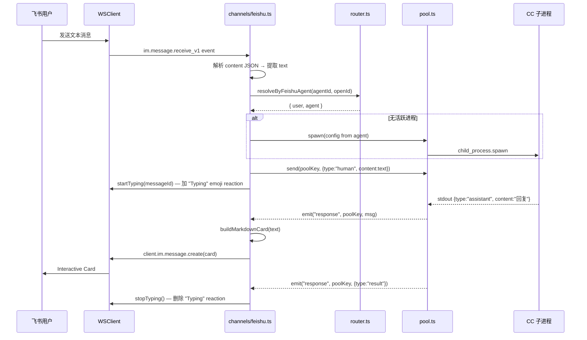
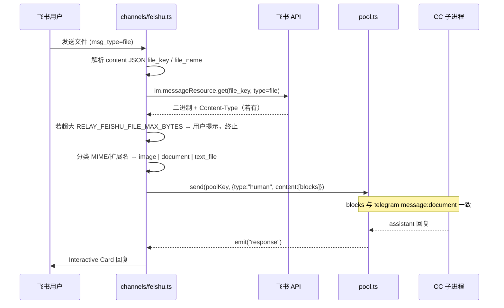
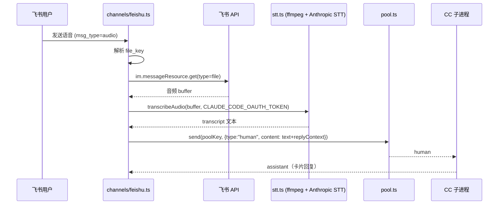
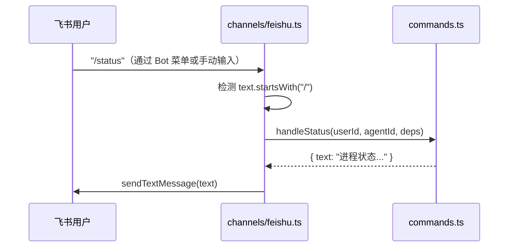
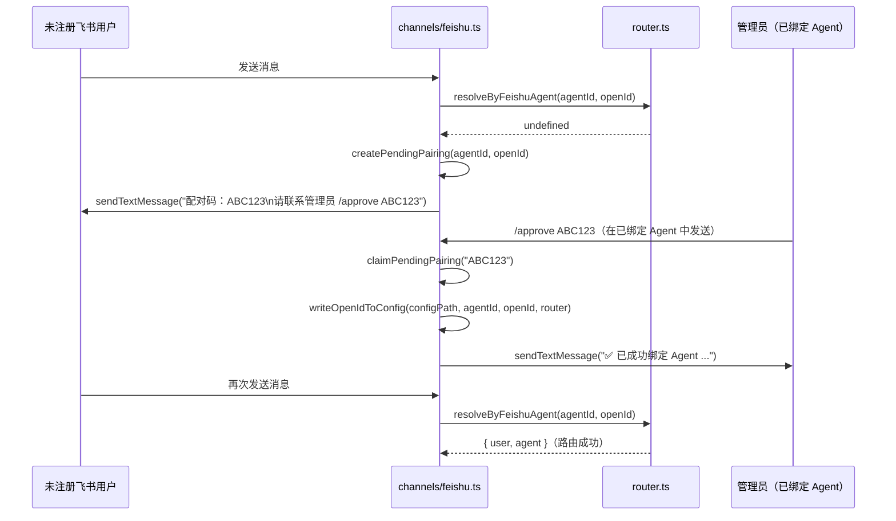

# feishu-channel - 技术设计文档

> **设计概述**：基于 `@larksuiteoapi/node-sdk` 的 `WSClient` 实现 WebSocket 长连接，接收飞书消息事件，通过 router 模块将 open_id 映射到租户配置，集成 cc-process-pool 完成端到端消息转发，以 Interactive Card 形式回复。
>
> **关联文档**：
> - L1 项目架构：`project-specs/project-architecture.md`
> - L2 功能需求：`features/feishu-channel/requirements.md`
> - L2 任务拆分：`features/feishu-channel/tasks.md`
> - 上游模块：`features/cc-process-pool/design.md`、`features/telegram-channel/design.md`
> - 参考实现：OpenClaw feishu plugin（`send.ts`、`streaming-card.ts`、`typing.ts`）；**入站文件下载**可对照 `extensions/feishu/src/media.ts`（`downloadMessageResourceFeishu`）与 `bot-content.ts`（`parseMediaKeys` / `toMessageResourceType`），Relay 侧不落盘、不经过插件 `saveMediaBuffer`，直接组装 CC block；**Streaming Card** 协议对照 `streaming-card.ts`（Relay 实现于 `src/feishu-streaming-card.ts`，无 OpenClaw SSRF 封装，使用受控 `fetch`）

---

## 1️⃣ 技术栈（Tech Stack）

**基于 L1 项目架构**：`project-specs/project-architecture.md`

- **运行时**：Node.js ≥ 18
- **语言**：TypeScript 5.x, strict mode
- **飞书 SDK**：`@larksuiteoapi/node-sdk ^1.59` — L1 指定选型，官方 SDK，支持 WebSocket 模式
- **进程池**：`src/pool.ts`（cc-process-pool 模块，已实现）
- **命令系统**：`src/commands.ts`（已实现，飞书复用）
- **配置**：relay.json（v2 格式，向后兼容 v1）
- **测试**：vitest

**选型说明**：
- WebSocket 模式：无需公网 URL / SSL / challenge 验证，Lark SDK 内建自动重连
- Interactive Card：飞书 raw text 不渲染 Markdown，Card Schema 2.0 的 markdown 元素支持代码块、表格、链接等
- WSClient 是本模块唯一新增的生产依赖（cumulative: 2, limit: ≤ 5）

---

## 2️⃣ 架构设计（Architecture Design）

### 组件划分

```
feishu-channel 模块
├── channels/feishu.ts    （飞书适配：WSClient 连接、消息收发、卡片构建、配对流程）
├── router.ts             （扩展：open_id 路由 + channel 字段支持）
├── types.ts              （扩展：feishu 配置类型 + v1/v2 兼容）
├── commands.ts           （无改动：复用现有命令 handler）
└── index.ts              （扩展：启动时同时启动 TG bots + 飞书 WSClient）
```

### 模块关系

```mermaid
graph TD
    FS["飞书 WebSocket"] -->|im.message.receive_v1| FEISHU["channels/feishu.ts"]
    FEISHU -->|openId| ROUTER["router.ts"]
    ROUTER -->|UserConfig + AgentConfig| FEISHU
    FEISHU -->|send(poolKey, msg)| POOL["pool.ts (已实现)"]
    POOL -->|response event| FEISHU
    FEISHU -->|sendInteractiveCard| FS
    CONFIG["relay.json"] -->|startup load| ROUTER
```

**模块职责**：

- **channels/feishu.ts**：
  - 创建 Lark Client + WSClient 实例（每 Agent 一个）
  - 注册 `im.message.receive_v1` 事件处理器
  - 接收消息 → 解析消息类型 → 调用 router 查找租户 → typing indicator → 调用 pool.send → 监听 response → 构建卡片发送
  - 构建 Interactive Card（Schema 2.0，body.elements 格式）
  - 处理图片与 **file 类型消息**（`im.messageResource.get`，`type=image|file` → base64 / UTF-8 文本 → CC content block；与 `telegram.ts` document 分支对齐）
  - **Streaming 回复**：`turn-accepted` 直接以共享 `▶️ 已收到，开始处理…` 创建第一张 Card Kit 卡片，避免先显示 `Thinking` 或等待后续内容更新；`pool` 多条 `assistant` 时更新同一张卡片；`result` 时 flush 完整 RichDoc Markdown，在卡片末尾加入共享 `✅ 本轮回复已生成` presentation marker 后 PATCH 关闭 `streaming_mode`（`src/feishu-streaming-card.ts`，由 `wirePoolEvents` 注入 `FeishuStreamingCardSink`）。标记不进入权威 answer state 或 reply-context cache。CardKit keepalive 只以新 sequence/uuid 重放当前可见帧，不附加耗时、工具名或工具参数；可见活动仅来自共享 `TurnActivityCounter` 里程碑。不为普通回答追加复制 control
  - **卡片交互回调**：注册 `card.action.trigger` 事件；菜单、问答、确认等业务按钮正常分发。`relay_copy` / `relay_copy_code` 解析仅为已发旧卡保留兼容，新回答卡不再生成这些 callback
  - Typing indicator（reaction-based，在用户消息上加 "Typing" emoji，回复完成后删除）
  - 命令分发（`/` 开头文本 → commands.ts handler）
  - Agent 配对流程：未注册用户 → 生成 6 位配对码；`/approve` 命令 → 写入 openId 到 relay.json + 更新内存索引

- **router.ts（扩展）**：
  - 新增 `openId → UserConfig` 查找（同时索引 agent 级 + user 级 openId）
  - 新增 `resolveByFeishuAgent(agentId, openId)` 方法
  - 新增 `indexFeishuOpenId(agentId, openId)` 方法（配对流程运行时更新索引）
  - 支持 `channel` 字段识别 Agent 渠道类型
  - `getAllFeishuBots()` 收集 authorizedOpenIds 时优先取 agent 级 openId
  - v1/v2 配置格式兼容

- **types.ts（扩展）**：
  - 新增 `FeishuAgentCredentials` 类型
  - `AgentConfig` 新增可选 `channel`、`feishu`、`feishuOpenId` 字段
  - `AgentConfig.botToken` 改为可选（飞书 Agent 不需要）
  - `AgentConfig.sessionId` 改为可选（飞书 Agent 使用 `feishu.sessionId`）
  - `UserConfig` 新增可选 `feishuOpenId` 字段
  - `UserConfig.chatId` 改为可选（飞书用户不需要 TG chatId）

- **index.ts（扩展）**：
  - `startRelay()` 中同时启动 TG bots 和飞书 WSClient
  - 飞书 WSClient 从 router 配置中发现 feishu 类型 Agent 并自动创建

---

## 3️⃣ 接口定义（Interface Definition）

### 配置模型

```typescript
// --- v2 配置（向后兼容 v1）---

interface UserConfig {
  userId: string;
  chatId?: string;            // TG chat ID（TG 渠道必填，飞书用户不需要）
  feishuOpenId?: string;      // 飞书 open_id（多租户场景：多用户共享同一 Bot 时使用）
  defaultAgent: string;
  agents: AgentConfig[];
}

interface AgentConfig {
  id: string;
  name: string;
  emoji: string;
  workspace: string;
  maxTurns?: number;
  allowedTools?: string[];
  // --- 渠道绑定（v2 新增，单渠道约束）---
  channel?: 'telegram' | 'feishu';   // 缺省 = telegram（v1 兼容）
  botToken?: string;                  // TG bot token（TG 渠道必填）
  sessionId?: string;                 // TG session（TG 渠道使用；飞书使用 feishu.sessionId）
  feishu?: {
    appId: string;
    appSecret: string;
    sessionId: string;
  };
  feishuOpenId?: string;              // 飞书 open_id（per-app：同一用户在不同飞书 Bot 里 openId 不同）
}
```

**v1 兼容规则**：
- `channel` 缺失 → 视为 `"telegram"`
- `botToken` 存在于顶层 → 视为 telegram 渠道（不强制移到 telegram 块）
- `feishu` 块存在 + `channel === "feishu"` → 飞书渠道
- 同时有 `botToken` 和 `feishu` 块 → 启动报错
- 飞书 Agent 的 openId：优先使用 `agent.feishuOpenId`（per-app），fallback 到 `user.feishuOpenId`（多租户共享 Bot）
- `botToken`、`chatId`、`sessionId` 为可选字段：TG 渠道必填，飞书渠道不需要

### 内部函数接口

**Function-001：createFeishuBots — 创建所有飞书 Bot**

```typescript
interface FeishuBotDeps {
  pool: Pool;
  router: Router;
  stateManager?: StateManager;
  configPath: string;           // relay.json 路径（配对流程写入 openId）
}

interface FeishuBotInstance {
  start(): Promise<void>;
  stop(): void;
}

function createFeishuBots(deps: FeishuBotDeps): FeishuBotInstance
```

**Function-002：buildMarkdownCard — 构建 Interactive Card**

```typescript
interface CardOptions {
  header?: { title: string; template?: string };
  note?: string;
}

function buildMarkdownCard(text: string, options?: CardOptions): Record<string, unknown>
// 返回 Schema 2.0 Interactive Card JSON（body.elements 格式）
// 不传 header 时无标题栏（私聊场景），传 header 时显示标题栏（群聊场景）
// 普通回答不追加整答或代码块复制按钮；trailingElements 仅供真正的业务交互卡使用
// Schema 2.0 button 直入 elements，不使用已废弃的 tag:'action' 包裹
```

**Function-002b：Typing Indicator — 输入状态指示**

```typescript
// MessageHandlerContext 中新增：
startTyping?: (messageId: string) => void;  // 在用户消息上加 "Typing" emoji reaction
stopTyping?: () => void;                     // 回复完成后删除 reaction
// 使用 im.messageReaction.create/delete，参照 OpenClaw typing.ts 实现
// 非关键功能：失败时静默忽略（rate limit、权限等）
```

`MessageHandlerContext` 另含 **`downloadFileResource`**（file/audio 入站下载）、**`transcribeInboundAudio`**（audio → STT，默认 `transcribeAudio` + `CLAUDE_CODE_OAUTH_TOKEN`），见 Function-004b 与 Flow-006。

**Function-003：splitCardText — 长文本分片**

```typescript
function splitCardText(text: string, maxLength?: number): string[]
// maxLength defaults to 4000（飞书卡片性能友好上限）
// 复用 TG splitMessage 的段落优先分割逻辑
```

**Function-004：downloadFeishuImage — 下载飞书图片**

```typescript
async function downloadFeishuImage(
  client: Client,
  messageId: string,
  imageKey: string,
): Promise<{ base64: string; mediaType: string }>
// 内部复用 downloadFeishuMessageResource(..., type: "image")；Content-Type 优先于 image/jpeg 缺省
```

**Function-004b：downloadFeishuMessageResource / 入站 file — 消息资源下载**

```typescript
async function downloadFeishuMessageResource(
  client: Client,
  messageId: string,
  fileKey: string,
  resourceType: "image" | "file",
): Promise<{ buffer: Buffer; contentType?: string }>
// readFeishuDownloadBuffer：兼容 Buffer / Stream / writeFile 等 SDK 返回形态
// MessageHandlerContext.downloadFileResource：生产环境绑定 type=file；单测可 mock
```

### Router 扩展接口

```typescript
interface Router {
  // ... 现有方法 ...

  /** Find user by feishu openId for a specific agent. */
  resolveByFeishuAgent(agentId: string, openId: string): { user: UserConfig; agent: AgentConfig } | undefined;

  /** Get all feishu-type agents across all users. */
  getAllFeishuBots(): Array<{ agent: AgentConfig; authorizedOpenIds: string[] }>;

  /** Dynamically index a feishu openId for an agent (used by pairing flow). */
  indexFeishuOpenId(agentId: string, openId: string): boolean;
}
```

### 配对流程接口

**Function-005：Pairing State Management — 配对状态管理**

```typescript
interface PendingPairing {
  code: string;         // 6 位配对码（排除 I/O/0/1）
  agentId: string;
  openId: string;
  createdAt: number;    // Date.now()，5 分钟过期
}

// 模块级 pendingPairings Map（进程内共享，所有 bot 实例可互相 approve）
function createPendingPairing(agentId: string, openId: string): string;
function claimPendingPairing(code: string): PendingPairing | undefined;
// 自动清理：60s interval，移除 >5min 的 pending pairing
```

**Function-006：writeOpenIdToConfig — 写入 openId 到配置文件**

```typescript
function writeOpenIdToConfig(
  configPath: string,
  agentId: string,
  openId: string,
  router: Router,
): void
// 读取 relay.json → 找到对应 agent → 设置 feishuOpenId → 写回磁盘
// 同时调用 router.indexFeishuOpenId 更新内存索引
```

---

## 4️⃣ 数据模型（Data Model）

### relay.json 示例（混合渠道 + per-agent openId）

```json
{
  "users": [
    {
      "userId": "owner",
      "chatId": "123456",
      "defaultAgent": "main",
      "agents": [{
        "id": "main",
        "name": "Duke",
        "emoji": "🎲",
        "botToken": "123456:ABCxxx",
        "workspace": "/opt/PULSE/Tenants/member-000/",
        "sessionId": "uuid-duke-tg",
        "maxTurns": 1000,
        "allowedTools": ["Read", "Write", "Edit", "Glob", "Grep", "Bash"]
      }]
    },
    {
      "userId": "eric",
      "defaultAgent": "artificer",
      "agents": [
        {
          "id": "artificer",
          "name": "Artificer",
          "emoji": "🔧",
          "channel": "feishu",
          "workspace": "/opt/PULSE/Tenants/member-001/",
          "feishu": { "appId": "cli_a1", "appSecret": "s1", "sessionId": "uuid-artificer" },
          "feishuOpenId": "ou_artificer_app"
        },
        {
          "id": "gardener",
          "name": "Gardener",
          "emoji": "🌱",
          "channel": "feishu",
          "workspace": "/opt/PULSE/Tenants/member-001/",
          "feishu": { "appId": "cli_a2", "appSecret": "s2", "sessionId": "uuid-gardener" },
          "feishuOpenId": "ou_gardener_app"
        }
      ]
    }
  ]
}
```

> **注意**：飞书 openId 是 per-app 分配的。同一用户 `eric` 在不同飞书 Bot（appId 不同）中会获得不同的 openId。因此多 Agent 场景下必须使用 `AgentConfig.feishuOpenId`（per-app）。服务器多租户场景中多个用户共享同一 Bot 时，可使用 `UserConfig.feishuOpenId`（per-user）。

### Interactive Card Schema 2.0 格式

```json
{
  "schema": "2.0",
  "config": { "width_mode": "fill" },
  "body": {
    "elements": [{
      "tag": "markdown",
      "content": "你好！有什么可以帮你的？\n```python\nprint('hello')\n```"
    }]
  }
}
```

> **注意**：Schema 2.0 的 elements 放在 `body` 内，不是根级。header 仅在显式传入时添加（群聊/多 Bot 场景），私聊默认无标题栏。普通回答保持单一 Markdown 内容面；CardKit 没有代码块级 action slot 或 clipboard behavior。确需业务交互的卡片仍可把 Schema 2.0 button 直接放入 `elements`。

---

## 5️⃣ 数据流（Data Flow）

### Flow-001：端到端文本消息流转



### Flow-002：图片消息流转

```mermaid
sequenceDiagram
    participant User as 飞书用户
    participant Feishu as channels/feishu.ts
    participant Lark as 飞书 API
    participant FS as 文件系统
    participant Pool as pool.ts
    participant CC as CC 子进程

    User->>Feishu: 发送图片消息 (msg_type=image)
    Feishu->>Lark: im.messageResource.get(image_key)
    Lark-->>Feishu: 图片 buffer
    Feishu->>Feishu: Buffer → base64

    Note over Feishu,FS: 图片保存到临时文件（CC Read 工具原生识图）
    Feishu->>FS: writeFileSync(RELAY_IMAGE_DIR/<timestamp>-<uuid>.jpg, Buffer.from(base64))
    FS-->>Feishu: filePath

    Feishu->>Pool: send(poolKey, {type:"human", content:[
      {type:"image", source:{type:"base64", media_type, data}, filePath: "/tmp/relay-images/xxx.jpg"}
    ]})

    Note over Pool: pool.ts interactive send: 检测 filePath → 构建 "用户发了图片：<path>" 文本
    Pool->>CC: PTY write prompt（CC 使用 Read 工具查看图片）

    CC-->>Pool: {type:"assistant", content:"图片分析结果"}
    Pool-->>Feishu: emit("response")

    Feishu->>User: Interactive Card 回复
```

> **图片保存机制**：飞书 channel 在 `channels/feishu.ts` 中将图片 base64 解码后保存至 `RELAY_IMAGE_DIR`（`/tmp/relay-images/`，自动 `mkdirSync`），文件名格式 `<timestamp>-<uuid-prefix>.<ext>`。`filePath` 字段附加到 image content block 上，供 pool.ts interactive send 路径识别并构建文本 prompt。CC 使用内置 Read 工具直接查看图片文件，无需额外 API 调用。若 `filePath` 缺失，降级走 vision-proxy 辅助视觉模型路径。

### Flow-005：文件消息（PDF / 文档）流转



> **说明**：v1 仅处理 **顶层** `msg_type=file`。`video` / `media` / ~~`audio`~~（已单独见 Flow-006）、富文本内嵌附件可后续增量。

### Flow-006：语音消息（audio）流转



> **说明**：不入站把 raw 音频 base64 塞给 CC；与 Telegram `message:voice` / `message:audio` 行为对齐。

### Flow-003：命令处理



### Flow-004：未注册用户配对流程



**Flow-008：Runtime tool-output 文件投递（workspace 内 outbox）**

CC/Pi agent 只有将明确要交付的文件写入租户 workspace 内 `{workspace}/.relay/outbox/`，Relay 才会在 turn 终态统一扫描并通过飞书发送。普通 workspace `write/edit` 不是投递意图。

```
sequenceDiagram
    participant Runtime as CC/Pi runtime
    participant Outbox as {workspace}/.relay/outbox/
    participant Pool as pool.ts / pi-conversation-runtime.ts
    participant CR as conversation-runtime.ts
    participant FS as feishu.ts
    participant Lark as 飞书 API

    Runtime->>Outbox: 显式写入待交付文件（cp/mv/create）
    Runtime->>Pool: finishTurn()/agent_settled
    Pool->>Outbox: scanOutbox(tenantId, workspace)
    Outbox-->>Pool: filePaths[]

    Pool->>CR: emit('tool-files', tenantId, filePaths, workspace)
    CR->>CR: relayEvents 转发 tool-files + exact runtime workspace
    CR->>FS: emitter.emit('tool-files')
    FS->>FS: isFeishuDeliveryPoolKey + poolKeyToOpenId 校验
    FS->>FS: deliverToolFiles()
    loop 每个 filePath
        FS->>FS: validateToolFileOutboxPath(tenant, workspace, filePath)
        FS->>FS: checkFileForDelivery(filePath)
        alt 图片文件 (.jpg/.png/.gif/.webp 等)
            FS->>Lark: im.image.create(image_type='message', image=stream)
            Lark-->>FS: image_key
            FS->>Lark: im.message.create(msg_type='image', {image_key})
        else 音频文件 (.opus/.ogg)
            FS->>Lark: im.file.create(file_type='opus', file=stream)
            Lark-->>FS: file_key
            FS->>Lark: im.message.create(msg_type='audio', {file_key})
        else 其他文件 (含 mp4/mov)
            Note over FS: mp4/mov 以 file_type='stream' 上传
            Note over FS: 避免API 230055(im.video.create不可用)
            FS->>Lark: im.file.create(file_type='stream', file=stream)
            Lark-->>FS: file_key
            FS->>Lark: im.message.create(msg_type='file', {file_key})
        end
        FS->>Outbox: rmSync(filePath) 投递成功后清理
        Lark-->>User: 文件消息
    end
```

**约束**：
- 图片 ≤ 10MB（飞书 im.image.create 限制）
- 其他文件 ≤ 30MB（飞书 im.file.create 限制）
- mp4/mov 以 `file_type='stream'` + `msg_type='file'` 投递（`im.video.create` 不可用，直接用 `file_type='mp4'` 会触发 API 230055）
- opus/ogg 以 `file_type='opus'` + `msg_type='audio'` 投递
- 普通 workspace 文件、隐藏文件、子目录、outbox 外路径与 realpath 逃逸一律不投递、不删除
- Pi 仅在 `agent_settled` 后扫描一次，多个中间 `write/edit` 不产生重复附件
- `tool-files` 事件必须携带产出该文件的 exact runtime workspace；不能退回 Agent 静态默认 workspace
- 飞书消费端不信任 `tool-files` 文件路径，必须按事件 tenant/workspace 复验 outbox ownership 后才可上传和清理
- 非阻塞：投递失败不影响主文本回复，失败时 sendTextMessage 通知用户
- wirePoolEvents 签名新增 `client?: FeishuMessageClient` 参数

---

## 6️⃣ 错误处理（Error Handling）

**Error-001：飞书凭证无效**
- **触发条件**：appId 或 appSecret 错误，WSClient 连接失败
- **处理策略**：启动时日志明确报错，跳过该 Agent 不阻塞其他 Agent/TG bot 启动
- **日志**：`{level:"error", agent:agentId, msg:"Feishu WSClient connection failed", error}`

**Error-002：CC 进程 spawn 失败**
- **触发条件**：pool.spawn() 抛出错误
- **处理策略**：向飞书用户发送"服务暂时不可用，请稍后重试"文本消息
- **日志**：`{level:"error", agent:agentId, msg:"Failed to spawn CC process"}`

**Error-003：飞书 API 发送失败**
- **触发条件**：`client.im.message.create` 失败
- **处理策略**：记录错误日志，不重试
- **日志**：`{level:"warn", agent:agentId, msg:"Failed to send Feishu message", error}`

**Error-004：图片下载失败**
- **触发条件**：`im.messageResource.get` 失败
- **处理策略**：回复"图片处理失败，请稍后重试"
- **日志**：`{level:"error", agent:agentId, msg:"Failed to download Feishu image"}`

**Error-006：文件下载失败 / 超限 / 类型不支持**
- **触发条件**：`im.messageResource.get`（`type=file`）失败；解码缓冲区超过 `RELAY_FEISHU_FILE_MAX_BYTES`；MIME 与扩展名均无法归入 image/PDF/text
- **处理策略**：向用户发送对应中文提示（与 TG 文档拒绝文案风格一致）；记录 `Failed to download Feishu file` 或 `unsupported file type` 类日志

**Error-007：飞书音频 / STT 失败**
- **触发条件**：音频下载失败、超过 `RELAY_FEISHU_FILE_MAX_BYTES`、`transcribeAudio` 抛错或返回空文本
- **处理策略**：中文提示（与 TG「未能识别语音」/「音频处理失败」一致）；日志 `Failed to process Feishu audio`

**Error-005：配置校验失败**
- **触发条件**：Agent 同时有 telegram 和 feishu 块，或 channel 字段与渠道块不一致
- **处理策略**：启动时抛出错误并退出
- **日志**：`{level:"error", agent:agentId, msg:"Agent can only bind one channel"}`
- **注意**：飞书 Agent 缺少 feishuOpenId 不再阻塞启动——可通过 FR-P0-009 配对流程在运行时绑定

---

## 7️⃣ 安全设计（Security Design）

- **凭证管理**：appId / appSecret 在 relay.json 中配置，relay.json 不进 git
- **租户隔离**：router 确保 open_id 只能路由到对应租户的 workspace 和 CC 进程
- **单渠道约束**：启动时校验每个 Agent 只绑定一种渠道，防止配置错误
- **WebSocket 鉴权**：Lark SDK 自动处理 token 刷新和鉴权，Rely 不接触原始凭证

---

## 8️⃣ 与 TG 渠道的差异对照

| 方面 | Telegram | 飞书 |
|------|----------|------|
| SDK | grammy ^1.41 | @larksuiteoapi/node-sdk ^1.59 |
| 连接模式 | Long Polling | WebSocket |
| 消息格式 | 纯文本 / Markdown | JSON（text/interactive） |
| 回复格式 | 纯文本（客户端渲染 Markdown） | Interactive Card Schema 2.0 |
| 长文本限制 | 4096 字符硬限 | 无硬限，~4000 字符性能上限 |
| 用户标识 | chat_id（数字） | open_id（字符串 ou_xxx） |
| 命令机制 | bot.command() 注册 | Bot 菜单配置 + 文本解析 `/`（含 `/approve` 配对命令） |
| 图片 | file_id → getFile API → base64 | image_key → messageResource API → base64 |
| Typing | sendChatAction | messageReaction（"Typing" emoji，加/删） |
| poolKey | userId:agentId | userId:agentId（相同格式，单渠道保证唯一） |
| 响应路由 | poolKeyToChatId Map | poolKeyToOpenId Map |

---

## 9️⃣ 性能优化（Performance Optimization）

### 性能目标
- **消息处理延迟**：router.resolve ≤ 1ms（Map 查找）
- **卡片发送延迟**：受飞书 API 延迟影响（~200-500ms），不可控
- **WebSocket 重连**：Lark SDK 内建指数退避重连，≤ 30 秒恢复

### 优化策略
- WSClient 事件处理中不阻塞事件循环——pool.send 是异步的
- 卡片构建是纯内存操作，无 I/O
- 图片下载使用飞书 API 的流式返回，避免大 buffer 一次性加载
