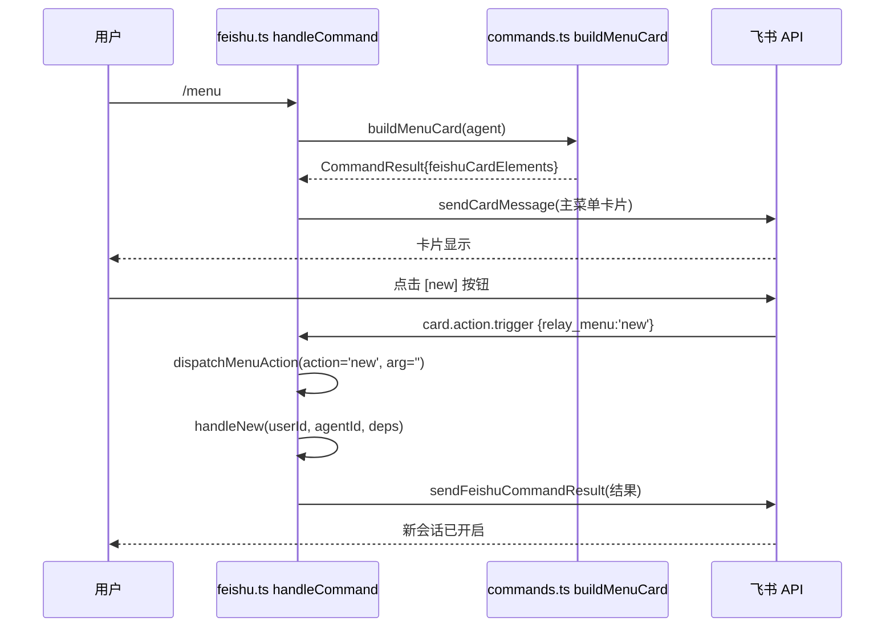
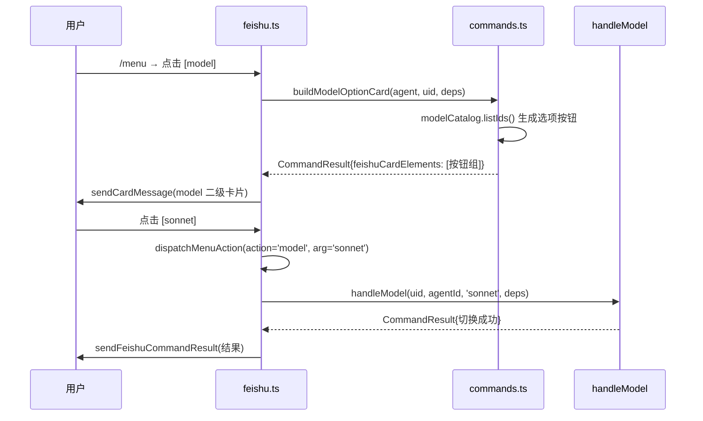

# feishu-command-menu - 技术设计文档

> **设计概述**：在飞书 bot 现有的卡片渲染管道（`CommandResult.feishuCardElements` → `buildMarkdownCard` → `sendCardMessage`）和卡片回调入口（`handleFeishuCardAction`）之上，新增一层"菜单按钮"协议。`/menu` 构建分组主菜单卡片（按钮横排）；带参数命令的按钮展开二级选项卡片；所有按钮点击复用现有 `handleXxx` 命令处理函数，不新增命令语义。

---

## 1️⃣ 架构设计

### 1.1 组件关系

```
┌──────────────┐   /menu    ┌──────────────────┐
│  飞书用户    │───────────▶│  handleCommand   │  case 'menu'
│              │            │  (feishu.ts)     │
│              │            └────────┬─────────┘
│              │                     │ buildMenuCard()
│              │                     ▼
│              │            ┌──────────────────┐
│              │◀───────────│  主菜单卡片      │  4 分组（column_set 横排）
│              │  sendCard  │  (feishuCardEl)  │
│              │            └──────────────────┘
│              │                     │
│              │   点击按钮  ▼ card.action.trigger
│              │            ┌──────────────────┐
│              │───────────▶│ handleFeishu     │  value.relay_menu
│              │            │ CardAction       │
│              │            └────────┬─────────┘
│              │                     │ dispatchMenuAction()
│              │                     ▼
│              │     ┌──────────────────────────────────┐
│              │     │ action 无 arg (一级)             │ action 有 arg (二级)
│              │     ├──────────────────────────────────┼─────────────────────┤
│              │     │ new/reset/stop/kill/restart      │ model+arg           │
│              │     │ status/session/usage             │ runtime+arg         │
│              │     │   → handleXxx() 复用             │ yolo+arg            │
│              │     │ model/runtime/yolo               │   → handleXxx(arg)  │
│              │     │   → buildXxxOptionCard() 二级    │                     │
│              │     └──────────────────────────────────┴─────────────────────┘
│              │                     │
│              │◀────────────────────┘  CommandResult → sendFeishuCommandResult
└──────────────┘
```

### 1.2 按钮 value 协议

复用飞书 Schema 2.0 button `behaviors[].value`，新增 `relay_menu`（action）+ `relay_menu_arg`（可选参数）两个字段，与已有 `relay_copy`/`relay_switch`/`relay_ask_answer` 并列，统一 `relay_` 前缀：

```typescript
// 一级按钮（主菜单 → 直接动作 或 展开二级）
{ relay_menu: 'new' | 'reset' | 'stop' | 'kill' | 'restart' }   // 动作
{ relay_menu: 'status' | 'session' | 'usage' }                  // 查询
{ relay_menu: 'model' | 'runtime' | 'yolo' }                    // 展开二级

// 二级按钮（选项卡片 → 执行带参切换）
{ relay_menu: 'model',   relay_menu_arg: '<modelId>' | 'auto' | 'default' }
{ relay_menu: 'runtime', relay_menu_arg: 'cc' | 'codex' }
{ relay_menu: 'yolo',    relay_menu_arg: 'on' | 'off' | 'status' }
```

**协议规则**：
- `relay_menu` 存在 → 菜单动作分发
- 有 `relay_menu_arg` → 二级选项，执行带参命令
- 无 `relay_menu_arg` → 一级按钮；若 action 属于动作/查询组则直接执行，若属于配置组则展开二级卡片
- `relay_switch` 仍属现有 Agent 切换回调（TG inlineKeyboard 路径），本 feature 飞书菜单**不使用**（飞书固定 bot 模式 `/list` `/switch` 已禁用）

### 1.3 按钮元素结构（Schema 2.0）

```typescript
{
  tag: 'button',
  text: { tag: 'plain_text', content: '<label>' },
  type: 'default' | 'primary' | 'danger',  // danger 用于 reset 等激进操作
  width: 'default',
  behaviors: [{ type: 'callback', value: { relay_menu: '<action>', relay_menu_arg?: '<arg>' } }]
}
```

---

## 2️⃣ 核心模块

### 2.1 菜单卡片构建（新增于 `src/commands.ts`）

新增构建函数，返回 `CommandResult`（含 `feishuCardElements`），由 `sendFeishuCommandResult` 统一渲染：

```typescript
/** 主菜单卡片：4 分组，每组按钮用 column_set 横排 */
export function buildMenuCard(agent: AgentConfig): CommandResult;

/** model 二级：modelCatalog 选项 + auto + default */
export function buildModelOptionCard(
  agent: AgentConfig, userId: string, deps: CommandDeps
): CommandResult;

/** runtime 二级：cc / codex */
export function buildRuntimeOptionCard(agent: AgentConfig): CommandResult;

/** yolo 二级：on / off / status（仅 Codex 可用） */
export function buildYoloOptionCard(agent: AgentConfig): CommandResult;
```

**主菜单结构示例**（`buildMenuCard` 输出的 `feishuCardElements`，用 `column_set` 让每组按钮横排紧凑）：

```
[hr]
[markdown] 🗂 会话
[column_set]
  [column: button new]  [column: button reset(danger)]
[hr]
[markdown] ⚡ 进程
[column_set]
  [column: button stop]  [column: button kill]  [column: button restart]
[hr]
[markdown] 🔍 查看
[column_set]
  [column: button status]  [column: button session]  [column: button usage]
[hr]
[markdown] ⚙️ 配置
[column_set]
  [column: button runtime]  [column: button model]  [column: button yolo]
```

- `reset` 按钮用 `type: 'danger'`（红色）与 `new` 视觉区分，降低误点
- 每组按钮放一个 `column_set`，每个按钮独占一列（`width: 'auto'`），实现横排
- 卡片头部用 agent emoji+name 作 header（`buildMarkdownCard` 的 `options.header`）

### 2.2 回调分发（新增于 `src/channels/feishu.ts`）

`handleFeishuCardAction` 在现有 `relay_copy`/`relay_ask_answer`/`relay_switch` 分支**之前**插入 `relay_menu` 分支：

```typescript
const relayMenu = typeof value?.relay_menu === 'string' ? value.relay_menu : '';
const relayMenuArg = typeof value?.relay_menu_arg === 'string' ? value.relay_menu_arg : '';
if (relayMenu && openId) {
  await dispatchMenuAction(ctx, openId, relayMenu, relayMenuArg);
  return;
}
// ... 已有 relay_copy / relay_ask_answer / relay_switch 分支不变
```

`dispatchMenuAction` 内部：

```
dispatchMenuAction(ctx, openId, action, arg):
  resolved = ctx.router.resolveByFeishuAgent(ctx.agent.id, openId)
  if !resolved: 回复"无法解析用户"，return

  commandDeps = {
    router: scopedFeishuCommandRouter(ctx.router, ctx.agent),
    runtime: ctx.pool,
    stateManager: ctx.stateManager,
    meteringDir: ctx.meteringDir,
    modelCatalog: ctx.modelCatalog,        # ⚠️ 必须补——现有回调 commandDeps 缺此项
    inboundChannel: 'feishu',
  }

  ── 有 arg（二级选项，执行切换） ──
  if arg:
    result =
      action=='model'   ? handleModel(uid, agentId, arg, deps)
    : action=='runtime' ? handleRuntime(uid, agentId, arg, deps)
    : action=='yolo'    ? handleYolo(uid, agentId, arg, deps)
    : { text: '未知操作' }
    → sendFeishuCommandResult(result)
    return

  ── 无 arg（一级按钮） ──
  动作组:
    new/reset/stop/kill/restart → 对应 handleXxx() → sendFeishuCommandResult
  查询组:
    status/session/usage → 对应 handleXxx() → sendFeishuCommandResult
  配置组（展开二级）:
    model   → buildModelOptionCard()   → sendCardMessage
    runtime → buildRuntimeOptionCard() → sendCardMessage
    yolo    → buildYoloOptionCard()    → sendCardMessage
```

> **关键**：现有 `handleFeishuCardAction` 的 commandDeps（`feishu.ts:1034`）**没有** modelCatalog，dispatchMenuAction 必须自行构造含 modelCatalog 的 commandDeps（从 `ctx.modelCatalog` 取，ctx 已有此字段，`feishu.ts:739`），否则 model 相关按钮全部失效。

### 2.3 `/menu` 命令注册（`handleCommand` switch）

```typescript
case 'menu': {
  const card = buildMenuCard(agent);
  await ctx.sendCardMessage(openId, buildMarkdownCard(card.text, {
    header: { title: `${agent.emoji} ${agent.name} 菜单` },
    trailingElements: card.feishuCardElements,
  }));
  return;
}
```

---

## 3️⃣ 二级卡片设计

### 3.1 model 二级卡片

```
header: ⚙️ 模型选择
[column_set] [button claude-sonnet-4-6]  [button claude-opus-4-6]  [button claude-haiku-4-5]
[column_set] [button auto]  [button default]
[note] 点击即切换，下一条消息生效
```

选项来源：`deps.modelCatalog.listIds()`，每个生成 `{ relay_menu: 'model', relay_menu_arg: m.id }`。额外加 `auto`、`default` 两按钮。catalog 为空时仅 auto+default + 提示。

### 3.2 runtime 二级卡片

```
header: ⚙️ Runtime 选择
[column_set] [button CC]  [button Codex]
```

两按钮：`{ relay_menu:'runtime', relay_menu_arg:'cc' }`、`{ relay_menu:'runtime', relay_menu_arg:'codex' }`。

### 3.3 yolo 二级卡片

```
header: ⚙️ YOLO 模式（仅 Codex）
[column_set] [button 开启]  [button 关闭]  [button 查看状态]
```

三按钮：`relay_menu_arg:'on'` / `'off'` / `'status'`。`buildYoloOptionCard` 在 note 标注当前 runtime（非 Codex 时提示先切 Codex）。

---

## 4️⃣ 数据流

### 4.1 /menu 唤起 + 动作执行



### 4.2 model 二级卡片切换



---

## 5️⃣ 权限与安全

- **权限沿用**：`dispatchMenuAction` 通过 `ctx.router.resolveByFeishuAgent(agent.id, openId)` 解析用户，与文本命令 `/new` 走同一解析逻辑。所有 `handleXxx` 内部的权限校验（如 kill 需要的归属校验）原样生效，按钮不绕过。
- **openId 校验**：按钮回调的 openId 来自飞书 `event.operator.open_id`，不可伪造（飞书签名校验已在入站处理）。
- **无越权**：菜单按钮不引入任何文本命令不具备的能力。

---

## 6️⃣ 错误处理

| 场景 | 处理 |
|------|------|
| 点击按钮时用户已无活跃 Agent | `resolveByFeishuAgent` 返回 null → 回复"无法解析用户/无活跃 Agent" |
| modelCatalog 为空（deps 未注入） | `buildModelOptionCard` 回退到 `auto`+`default` 两按钮 + 提示"模型目录未就绪" |
| yolo 在非 Codex runtime 下点击 on/off | `handleYolo` 已有校验，返回"当前 runtime=x，YOLO 只对 Codex 生效" |
| 按钮回调重复点击 | 复用 handleXxx 幂等性（如 `/new` 重复执行安全） |
| 未知 action/arg | 回复"未知操作"，console.warn 记录原始 value |
| 菜单/二级卡片发出后用户切换了配置 | 旧卡片选项不变（已知行为，不主动更新已发卡片） |

---

## 7️⃣ 需要改的文件

| 文件 | 改动 |
|------|------|
| **`src/commands.ts`** | 新增 `buildMenuCard` / `buildModelOptionCard` / `buildRuntimeOptionCard` / `buildYoloOptionCard`；`handleHelp` 文本补一行 `/menu — 打开命令菜单` |
| **`src/channels/feishu.ts`** | `handleCommand` switch 新增 `case 'menu'`；`handleFeishuCardAction` 新增 `relay_menu` 分支；新增 `dispatchMenuAction` 函数（含 modelCatalog 注入） |
| **`src/types.ts`** | 无（CommandResult.feishuCardElements 已存在，复用） |

**不需要改**：pool.ts、telegram.ts、http-server.ts、provision.ts。

---

## 8️⃣ 与 bot-commands 的关系

- **bot-commands**（上游）：定义命令语义（有哪些命令、做什么），是 SSOT
- **feishu-command-menu**（本 feature）：定义命令的飞书 UI 触达方式，**只复用不新增**命令语义
- handleNew/handleStop/handleModel/handleRuntime/handleYolo/handleStatus/handleSession/handleUsage/handleReset/handleKill/handleRestart 全部直接复用，零修改
- **switch/list 不纳入菜单**：飞书 `handleCommand` 对 `/list` `/switch` 已禁用（固定 bot 模式），菜单保持一致不引入
- 若未来 bot-commands 新增命令，菜单卡片按需追加按钮即可（在 `buildMenuCard` 加按钮 + `dispatchMenuAction` 加 case）
