# Research: Relay Permission Passthrough

> Created: 2026-06-10
> Completed: 2026-06-10
> Source: 2026-06-09 Tuesday Partner Meeting (see `08_会议记录/2026/2026-06-09_例会纪要.md`)
> Status: **research complete**
> Relates to: MVS.md (AskUserQuestion spec)

## Background

Relay currently runs CC with `--dangerously-skip-permissions` (yolo mode). This works for internal use but is **wrong for tenants** — it grants full system access without any user consent. Owner explicitly stated this must be fixed.

### The Problem

When CC runs in a real terminal and encounters a permission request (file deletion, command execution, etc.), it displays a confirmation prompt and waits for user input (Y/N). But Relay launches CC with `-p` (pipe/headless mode):

- **With `--dangerously-skip-permissions`**: All permission requests auto-approved → sandbox violations silently denied (no prompt, no approval) → operations fail without user visibility
- **Without `--dangerously-skip-permissions`**: CC waits for interactive input that never comes → process hangs

What Owner wants: permission requests should **pass through** to Feishu/TG as interactive UI elements (buttons, selectors). User clicks → Relay sends choice back to CC → CC continues.

### Existing Spec

`MVS.md` already covers `AskUserQuestion` (CC's built-in choice/selection tool). This research covers the **broader scope** raised in the 6/9 meeting: ALL permission and interaction requests, not just AskUserQuestion.

---

## Executive Summary

| 维度 | 结论 |
|------|------|
| **TG 工具权限透传（Bash/Write 等）** | 可行，但**不能**在现有 `-p`/stream-json 架构上实现；须走 Anthropic **Channels API**（交互式 CC + MCP channel 子进程） |
| **飞书工具权限透传** | 技术上与 TG 等价（按钮 Y/N 可行），但 Channels 架构改造成本相同；飞书 API 无本质 blocker |
| **AskUserQuestion 透传** | `-p` 模式下 CC **不会挂起等待**外部应答（2026-05-23 探针已证实）；须改为 **A' 方案**（点选 → 新文字 prompt），不能回注 `tool_result` 续接同一 turn |
| **OpenClaw 参考** | **未解决**此问题；社区方案一律 `--dangerously-skip-permissions` 或 `--allowedTools` 白名单 |
| **推荐路径** | 分阶段：① 租户去 yolo（policy 层）→ ② AskUserQuestion A'（飞书卡片）→ ③ 长期评估 Channels API 或等 CC 在 `-p` 暴露 `permission_request` |

---

## Q1: How does OpenClaw solve this?

### 结论：OpenClaw **没有**实现 permission passthrough

调研了 OpenClaw 生态及 Relay 归档资料，未发现「捕获 CC 权限弹窗 → 渲染到 IM → 回传 verdict」的通用实现。

| 方案 | 做法 | 是否 passthrough |
|------|------|------------------|
| **OpenClaw-Claude Bridge** ([adfdev/openclaw-claude-bridge](https://github.com/adfdev/openclaw-claude-bridge)) | `claude -p` + `--tools ""` 禁用 CC 原生工具 + `--dangerously-skip-permissions`；工具调用全走 OpenClaw 侧 | ❌ CC 权限层被绕过 |
| **OpenClaw CC Plugin** ([openclawdir](https://openclawdir.com/plugins/claude-hou0wu)) | `claude -p --output-format stream-json`，解析 NDJSON 文本/tool call，无权限 UI | ❌ |
| **ClaudeClaw 架构文章** ([Medium](https://medium.com/@mcraddock/building-claudeclaw-an-openclaw-style-autonomous-agent-system-on-claude-code-fe0d7814ac2e)) | Gateway 用 `-p` + `--allowedTools` 按 channel 限制工具；权限靠白名单而非用户确认 | ❌ |
| **Relay 自身 interactive 模式** | PTY bridge + stdout sniffer，仅 auto-accept **启动期**对话框（Bypass Permissions、`/root` trust），见 `pool.ts:1132-1165` | ❌ 运行时 Bash/Write 权限弹窗未透传 |

OpenClaw 的通用模式是：**headless = 无 TTY = 必须 skip permissions 或 pre-approve tools**。与 Owner 要的「用户逐条确认」目标相反。

### OpenClaw 如何「检测」CC 状态？

- **stdout/stderr 监控**：仅用于 bootstrap 对话框（Relay 已有 `interactivePtySniffer`），不覆盖运行时 tool permission
- **stream-json**：可解析 `tool_use` / `text` delta，但**不含** permission dialog 事件（见 Q3）
- **JSONL 文件轮询**：interactive 模式用 session jsonl 判断 prompt 是否被 CC 接受（`pool.ts` watcher），与权限无关

**可泛化性**：OpenClaw 路线**不可**泛化到「所有 CC 交互式 prompt」，只能泛化到「Agent 级工具白名单 + yolo」。

---

## Q2: Anthropic's official TG module

### 存在，开源，且 Owner 用过的就是这套

| 项 | 详情 |
|----|------|
| **仓库** | [anthropics/claude-plugins-official/external_plugins/telegram](https://github.com/anthropics/claude-plugins-official/tree/main/external_plugins/telegram) |
| **启动方式** | `claude --channels plugin:telegram@claude-plugins-official`（**非** `-p`） |
| **架构** | CC 交互式 session + MCP channel 子进程（`server.ts`）经 stdio 与 CC 通信 |
| **权限 relay** | PR [#833](https://github.com/anthropics/claude-plugins-official/pull/833)（2026-03-23 merged）+ PR [#945](https://github.com/anthropics/claude-plugins-official/pull/945)（inline buttons） |
| **CC 版本** | ≥ v2.1.81；GrowthBook flag `tengu_harbor_permissions` |
| **账号** | 需 claude.ai OAuth；纯 API key 不支持 Channels |

### Permission passthrough 机制（官方、可复刻）

**不是**解析 stream-json，而是 CC **Channels 扩展 MCP 通知**：

```
CC 本地 permission dialog 打开
    ↓
notifications/claude/channel/permission_request
    { request_id, tool_name, description, input_preview }
    ↓
Channel server → TG InlineKeyboard [✅ Allow] [❌ Deny]
    ↓
用户点击 / 回复 "yes abcde"
    ↓
notifications/claude/channel/permission
    { request_id, behavior: "allow"|"deny" }
    ↓
CC 关闭 dialog，继续或拒绝 tool call
```

源码锚点（`server.ts`）：

- 声明 capability：`'claude/channel/permission': {}`
- 出站 handler：`permission_request` → `bot.api.sendMessage` + InlineKeyboard
- 入站：`callback_query:data` 匹配 `perm:allow:<id>` / `perm:deny:<id>` → `mcp.notification({ method: 'notifications/claude/channel/permission', ... })`
- 文本兜底：`/^\s*(y|yes|n|no)\s+([a-km-z]{5})\s*$/i`
- 安全：`access.allowFrom` 白名单；群组 deliberately 排除

### 与 Relay 的根本差异

| | Anthropic TG Plugin | Relay |
|--|---------------------|-------|
| CC 模式 | 交互式 + Channels | `-p` stream-json 或 PTY `--bare` |
| 进程模型 | 1 user : 1 CC session : 1 MCP channel | 1 tenant : 1 CC 长驻进程 : 0 channel |
| 权限协议 | MCP notification（结构化） | `--dangerously-skip-permissions` |
| 多租户 | 官方插件明确 **single-user** | 必须 multi-tenant |

Owner 在 TG 上见过 permission 按钮，是因为当时跑的是 **Channels 交互式 CC**，不是 Relay 当前的 `-p` pool。

---

## Q3: Technical detection mechanism

### 核心发现：CC 有两类完全不同的「等用户输入」

| 类型 | 例子 | `-p`/stream-json 可见性 | 检测方式 |
|------|------|---------------------------|----------|
| **A. CLI 运行时权限** | Bash、Write、Edit、网络 | ❌ **不 emit** `permission_request`；prompt 只写 TTY | 仅 Channels API 或 PTY 读屏（脆弱） |
| **B. Agent 工具 AskUserQuestion** | 多选题 | ✅ `tool_use` 出现在 stream-json | 拦截 `name==='AskUserQuestion'`，但 CC **不同步等待**应答 |

社区与 Anthropic 文档一致（[ccdb #210](https://github.com/ebibibi/claude-code-discord-bridge/issues/210)、[tunaFlow #178](https://github.com/hang-in/tunaFlow/issues/178)）：

> `-p` 模式 by design 不发出 permission 事件；需要 approval 的工具会被**立即拒绝**或（若未 skip）**挂起等 TTY**。

### 各候选机制评估

| # | 机制 | 工具权限 (A) | AskUserQuestion (B) | 稳定性 | Relay 现状 |
|---|------|-------------|---------------------|--------|-----------|
| 1 | stdout 模式匹配 | 理论可行（PTY） | 不适用 | 🔴 脆弱，CC UI 变即破 | interactive 模式仅用于 bootstrap 对话框 |
| 2 | JSONL 事件 | ❌ 无 permission 事件类型 | ✅ 可见 tool_use | 🟡 B 稳定 | print 模式可读 jsonl |
| 3 | stream-json | ❌ 无 permission 事件 | ✅ tool_use 块 | 🟡 | 当前主路径 |
| 4 | AskUserQuestion tool_use | 不适用 | ✅ 可检测 | 🟡 但无法续 turn | `--disallowed-tools AskUserQuestion` 已启用 |
| 5 | 其他 tool_use | Bash 等走 permission 层，不是独立「问答工具」 | — | — | 无 passthrough |

### CC `--permission-mode` 行为（租户安全相关）

| 模式 | headless 行为 |
|------|---------------|
| `bypassPermissions` / `--dangerously-skip-permissions` | 全自动批准（当前 Relay） |
| `acceptEdits` | 自动批准文件写 + 常见 fs 命令；**其他 Bash/网络仍须 allow 规则** |
| `dontAsk` | 未 allow 的一律拒绝（不 hang） |
| default（无 skip） | interactive 等 TTY → Relay `-p` 会 **hang** |

**租户短期止血**：去掉 `--dangerously-skip-permissions`，改用 `acceptEdits` 或 `dontAsk` + 显式 `permissions.allow` / `--allowed-tools`，不会 hang，但未 allow 的操作会 fail-fast 而非弹 UI。

---

## Q4: Feishu vs TG capability gap

### TG

- InlineKeyboard：成熟先例（Anthropic 官方 + Relay `/switch` grammy callback）
- callback_data ≤ 64 bytes（Relay 已有 `SWITCH_CB_PREFIX` 约束经验）
- **结论：TG 完全能承载 Y/N 权限按钮**

### 飞书

| 交互 | 支持 | Relay 先例 |
|------|------|-----------|
| 单按钮 Y/N | ✅ `tag: button` + `behaviors[].type: callback` | `relay_copy`、`relay_switch`（`feishu.ts:811-856`） |
| 单选（每 option 一按钮） | ✅ | `/switch` agent picker（`commands.ts:withAgentPickerUi`） |
| 多选 + 提交 | ✅ 表单容器 + `multi_select` + submit → `form_value` | 无先例，API 支持（[飞书文档](https://open.feishu.cn/document/feishu-cards/card-json-v2-components/interactive-components/multi-select-dropdown-menu)） |
| 卡片更新（已选/禁用） | 🟡 `token` 30 分钟有效、最多更新 2 次 | MVS 已识别此约束 |

**结论：飞书无根本能力缺口**。Y/N 与单选与 TG 等价；多选需表单容器，复杂度高于 TG inline keyboard，但可行。

### 飞书 fallback（若不做完整 passthrough）

1. **Policy 层**：`dontAsk` + 租户级 `permissions.allow` 规则（文件路径见 tenant settings）
2. **AskUserQuestion**：A' 文字复述（`decision-2026-05-23` 已拍板 B 先行；A' 为后续切片）
3. **权限被拒时**：CC 失败信息透传 + 提示用户用自然语言授权「请允许执行 xxx」——体验差但零架构改动

---

## Q5: Codex as reference

Codex 的多端 parity 来自**统一的 approval 子系统**，而非 IM 解析 stdout：

| 机制 | 说明 |
|------|------|
| **PermissionRequest hooks** | Codex 0.x 新增；外部脚本可 programmatically allow/deny（[PR #17563](https://github.com/openai/codex/pull/17563)） |
| **CLI / App / IDE** | 同一套 sandbox + `approval_policy`（on-request / untrusted / never） |
| **TeleCodex 等 bridge** | 默认 `approval_policy=never` + `sandbox=workspace-write`；headless 自动化，**不是**逐条 permission UI |
| **Relay 对 Codex** | `codex exec -a never -s workspace-write`；`/yolo` → `--dangerously-bypass-approvals-and-sandbox`（维护开关，非用户 approval flow） |

**可借鉴模式**：

1. **结构化 approval 事件 + 外部 verdict 回注** — 对应 CC Channels `permission_request` / `permission`（Codex hooks 同类思路）
2. **分 channel 工具策略** — OpenClaw/Codex 的 per-channel `--allowedTools` / sandbox profile
3. **不把 headless yolo 当产品能力** — Relay MEMORY 已记录 Codex approval bridge 为长期项

Codex 的「手机点批准」体验来自 **App 原生 UI + 同一 approval 总线**，不是 `-p` 解析；与 CC Channels 路线同构。

---

## Deliverables

### 1. Findings

| 来源 | Permission passthrough 实现 |
|------|----------------------------|
| **Anthropic 官方 TG** | Channels MCP：`permission_request` → TG 按钮 → `permission` verdict；CC **交互式**运行 |
| **OpenClaw 生态** | 未实现；`-p` + skip permissions 或 allowedTools 白名单 |
| **Relay 当前** | print/interactive 均 `--dangerously-skip-permissions`；AskUserQuestion 被 `--disallowed-tools` 禁用 |
| **CC `-p` 协议** | 无 `permission_request` stream-json 事件；upstream 能力缺口 |
| **AskUserQuestion** | stream-json 可检测 tool_use，但 CC 在 `-p` 下同步自答 `is_error` 并 end_turn（session `8d7bf541` 实证） |

### 2. Feasibility

| 场景 | TG | 飞书 |
|------|-----|------|
| 工具权限 Y/N passthrough | ✅ 可行（需 Channels 架构或等 CC 扩展 `-p`） | ✅ 可行（同上） |
| AskUserQuestion 卡片 | ✅ 可行（A' 文字回注，非 tool_result） | ✅ 可行（A'；MVS 目标通道） |
| **在现有 Relay `-p` pool 上直接做工具权限 UI** | ❌ 不可行 | ❌ 不可行 |

### 3. Recommended technical approach

**分三阶段，避免一次性 architectural refactor：**

#### Phase 0 — 租户安全（立即，不改 IM UI）

- 对租户 Agent **移除** `--dangerously-skip-permissions`
- 改用 `--permission-mode acceptEdits`（或 `dontAsk`）+ tenant/workspace 级 `permissions.allow` 规则
- 保留 Pulse 基础设施 Agent 的 yolo（已有 `codexYoloDefault` 先例，可对称 `ccYoloDefault`）
- 行为：未预批操作 **fail-fast + 错误可见**，而非 silent deny 或 hang

#### Phase 1 — AskUserQuestion（MVS 修正版 A'）

- 启用 AskUserQuestion（去掉 `--disallowed-tools` 对该工具的全局禁用，或仅对实现了 A' 的 channel 放开）
- 拦截 `tool_use` → 飞书交互卡片 → 用户点选 → **`pool.send` 发送结构化文字 prompt**（非 `tool_result`）
- 依据：`vultr-pulse-space/memo/decision-2026-05-23-askuserquestion-feishu.md` 探针结论
- TG 对齐放在飞书 UAT 之后（MVS 边界不变）

#### Phase 2 — 完整工具权限 passthrough（战略项）

**推荐：CC Channels API 集成**（对齐 Anthropic 官方 TG 实现）

```
Relay 进程
├── 现有 pool（-p，批量/GLM/interactive 保留）
└── 新 ChannelBridge（每 tenant 或每 session）
      ├── 启动 claude --channels server:relay-feishu|relay-telegram
      ├── MCP server 声明 claude/channel + claude/channel/permission
      ├── 出站 permission_request → IM 卡片/按钮
      └── 入站 callback → notifications/.../permission
```

**备选（不推荐）**：PTY stdout 正则匹配 permission prompt → 模拟按键。脆弱、难测、与 CC 国际化/UI 变更强耦合。

**备选（等待 upstream）**：Anthropic 在 `-p`/stream-json 增加 `permission_request` 事件 + stdin verdict——可让 Relay 在现有 pool 上实现 TG 式按钮；目前无公开 roadmap。

### 4. Effort estimate

| 切片 | 范围 | 量级 | 风险 |
|------|------|------|------|
| **Phase 0** 租户去 yolo + permission policy | `pool.ts` spawn args、tenant config、文档 | **Small（2–4 天）** | 低；可能暴露此前被 silent deny 的操作 |
| **Phase 1** AskUserQuestion A' 飞书卡片 | feishu channel、state、busy timer | **Medium（1–2 周）** | 中；MVS 若仍按 tool_result 实现会失败 |
| **Phase 1b** TG AskUserQuestion 对齐 | telegram callback + 卡片 | **Small（3–5 天）** | 低 |
| **Phase 2** Channels API 权限 relay（单通道 POC） | 新 MCP server、spawn 模型、与 pool 共存 | **Large（3–5 周）** | 高；OAuth、multi-tenant、与 GLM interactive 模式共存 |
| **Phase 2** 双通道生产化 + 租户隔离 | 在上述基础上 | **Large+（6–8 周）** | 高 |

### 5. Scope alignment with MVS.md

| MVS 假设 | 调研结论 | 建议 |
|----------|----------|------|
| tool_result 回注续接同一 CC turn | ❌ CC 2.1.143 探针已否定 | **改写 MVS 为 A'**（新 user 文字 prompt） |
| 仅覆盖 AskUserQuestion | ✅ 正确切片边界 | 工具权限属 Phase 2，不塞进 MVS |
| 不做 TG | ✅ 合理 sequencing | 权限 relay 若做，TG 应优先于飞书（Owner 已验证 TG Channels） |
| `--disallowed-tools AskUserQuestion` 与 MVS「支持 AskUserQuestion」矛盾 | 当前代码仍 disallow | Phase 1 实施时按 channel 有条件放开 |
| busy timer 挂起 | 仍需要（A' 等待用户点选） | 保留，但回注载体改为 text 非 tool_result |

**MVS 不够宽**：它只解决 **AskUserQuestion（类型 B）**，不覆盖 **Bash/Write 等 CLI 权限（类型 A）**。6/9 会议诉求需要 **Phase 0 + Phase 2** 补充。

---

## Architecture comparison

```mermaid
flowchart TB
  subgraph current [Relay 现状 -p mode]
    U1[用户 TG/飞书] --> R1[Relay pool]
    R1 -->|spawn| CC1["claude -p stream-json<br/>--dangerously-skip-permissions"]
    CC1 -->|tool_use text| R1
    CC1 -.->|permission dialog| TTY1[TTY 无读者 → hang 或 skip]
  end

  subgraph official [Anthropic 官方 TG Channels]
    U2[用户 TG] --> MCP[telegram MCP server]
    MCP <-->|stdio MCP| CC2[claude 交互式 session]
    CC2 -->|permission_request| MCP
    MCP -->|Allow/Deny 按钮| U2
    MCP -->|permission verdict| CC2
  end

  subgraph phase1 [Relay Phase 1 A-prime]
    U3[用户 飞书] --> R3[Relay feishu channel]
    R3 -->|spawn| CC3["claude -p<br/>no skip / acceptEdits"]
    CC3 -->|AskUserQuestion tool_use| R3
    R3 -->|交互卡片| U3
    U3 -->|点选| R3
    R3 -->|新文字 user prompt| CC3
  end
```



---

## Constraints checklist

- [x] Research only — no code changes
- [x] Focus on CC as runtime; Codex patterns as reference
- [x] TG priority for permission relay; Feishu best-effort
- [x] Must not break existing Relay functionality → 分阶段 + Phase 0 仅改租户 spawn policy

---

## References

- [Anthropic claude-plugins-official/telegram](https://github.com/anthropics/claude-plugins-official/tree/main/external_plugins/telegram) — `server.ts` permission relay
- [PR #833 permission-relay](https://github.com/anthropics/claude-plugins-official/pull/833)
- [PR #945 inline buttons](https://github.com/anthropics/claude-plugins-official/pull/945)
- [CC Channels reference — Relay permission prompts](https://code.claude.com/docs/en/channels-reference)
- [ccdb #210 — `-p` never emits permission_request](https://github.com/ebibibi/claude-code-discord-bridge/issues/210)
- [tunaFlow #178 — stream-json has no permission event](https://github.com/hang-in/tunaFlow/issues/178)
- [CC headless docs — permission-mode / allowedTools](https://code.claude.com/docs/en/headless)
- [Codex PermissionRequest hooks](https://developers.openai.com/codex/hooks)
- Relay: `pool.ts:1027-1068` spawn args, `pool.ts:103-109` AskUserQuestion disallow
- Relay: `vultr-pulse-space/memo/decision-2026-05-23-askuserquestion-feishu.md` — A' vs tool_result
- Relay: `feishu.ts:811-856` — 现有 `card.action.trigger` 先例

---

## Recommended next actions

1. **产品决策**：确认 Phase 0（租户去 yolo）是否立即排期 — 零 UI 但能消除「无 consent 全权限」风险
2. **修正 MVS.md**：按 A' 方案更新回注契约；标注与 `decision-2026-05-23` 对齐
3. **Phase 2 spike**（可选）：在 dev 机用 `claude --channels` + 最小 MCP server 验证 multi-tenant 可行性（OAuth、进程模型）
4. **Upstream tracking**：向 Anthropic 反馈「`-p` stream-json 需要 permission_request + stdin verdict」以解锁 headless bridge 场景
