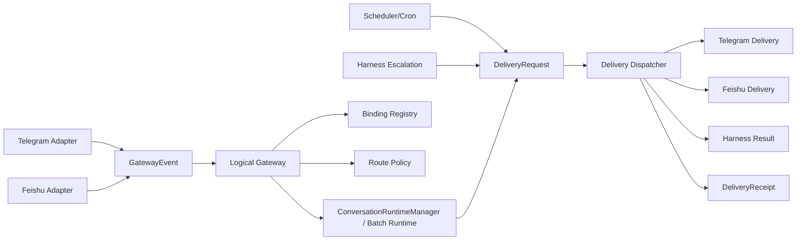

# logical-gateway - 技术设计文档

> **设计概述**：在 Relay 进程内新增逻辑 Gateway contract，把 channel adapter、router、conversation runtime、scheduler delivery、Harness escalation 之间的隐式耦合改为显式事件、路由和投递收据。第一阶段是内部模块边界，不新增生产依赖，不拆独立服务。

---

## 1. 目标架构



### 边界

- Channel adapter 负责平台 SDK、消息解析、附件下载、渠道渲染。
- Logical Gateway 负责 address binding、route policy、principal/agent/workspace/runtime decision。
- Runtime manager 负责 CC/Codex spawn/send/fallback，不由 channel adapter 选择 CLI 细节。
- Delivery dispatcher 负责发送与 receipt，不把 API failure 静默吞掉。
- Harness 是 S2 治理/审计消费者，不拥有 TG/飞书 SDK。

---

## 2. 核心类型

> 以下类型与 `src/types.ts` 实际定义保持一致。

```ts
// --- Runtime ---
export type ConversationRuntimeId = 'cc' | 'codex';

// --- Logical Gateway Contracts (v1.1 internal view) ---

export type GatewayChannel = 'telegram' | 'feishu' | 'harness' | 'system';
export type PrincipalType = 'human' | 'agent' | 'system';
export type ChannelAddressKind =
  | 'telegram_chat'
  | 'feishu_open_id'
  | 'feishu_chat_id'
  | 'harness_target'
  | 'system';

export interface Principal {
  id: string;
  type: PrincipalType;
  tenantId: string;
  displayName?: string;
}

export interface ChannelAddress {
  channel: GatewayChannel;
  kind: ChannelAddressKind;
  value: string;
  botId?: string;
  appId?: string;
}

export interface ChannelBinding {
  id: string;
  address: ChannelAddress;
  principalId: string;
  tenantId: string;
  workspaceId: string;
  defaultAgentId: string;
  allowedAgentIds: string[];
  defaultRuntimePreference?: ConversationRuntimeId[];
  auditTags?: string[];
}

export type ChannelBindingStatus = 'active' | 'pending' | 'revoked';

export interface ChannelBindingRecord {
  id: string;
  address: ChannelAddress;
  principalId: string;
  tenantId: string;
  defaultAgentId: string;
  allowedAgentIds: string[];
  status: ChannelBindingStatus;
  createdAt: string;
  approvedAt?: string;
  approvedBy?: string;
  defaultRuntimePreference?: ConversationRuntimeId[];
  auditTags?: string[];
}

export interface GatewayEvent {
  id: string;
  createdAt: string;
  channel: GatewayChannel;
  address: ChannelAddress;
  text?: string;
  command?: string;
  attachments?: unknown[];
  raw?: unknown;
}

export interface RoutePolicyResult {
  principal: Principal;
  binding: ChannelBinding;
  agentId: string;
  workspace: string;
  sessionId: string;
  runtimePreference: ConversationRuntimeId[];
  conversationKey: string;
  audit: {
    correlationId: string;
    source: 's1-inbound' | 's2-job' | 's2-escalation';
  };
}

export type DeliveryStatus = 'sent' | 'failed' | 'skipped';

export interface DeliveryRequest {
  id: string;
  correlationId: string;
  channel: GatewayChannel;
  address: ChannelAddress;
  payload:
    | { kind: 'text'; text: string }
    | { kind: 'document'; path: string; caption?: string }
    | { kind: 'card'; markdown: string; title?: string; card?: Record<string, unknown> }
    | { kind: 'escalation'; title: string; body: string };
}

export interface DeliveryReceipt {
  id: string;
  requestId: string;
  correlationId: string;
  status: DeliveryStatus;
  channel: GatewayChannel;
  address: ChannelAddress;
  externalMessageId?: string;
  attempts: number;
  error?: string;
  deliveredAt?: string;
}
```

---

## 3. 第一阶段实现切片

### Slice 1：只读 Binding View

从现有 `relay.json` 构造只读 `ChannelBinding` view，不立即迁移配置格式：

- 旧 `user.chatId` -> `ChannelAddress{channel:"telegram", kind:"telegram_chat"}`
- 旧 `user.feishuOpenId` 或 `agent.feishuOpenId` -> `ChannelAddress{channel:"feishu", kind:"feishu_open_id", appId}`
- 旧 `agent.runtime/conversationRuntimePreference` -> binding default runtime preference

这个切片不得改变生产路由行为，只增加统一 view 和测试。

### Slice 2：Inbound Route Facade

新增 Gateway route facade，让 TG/飞书 channel 先调用：

```ts
resolveInboundRoute(input: InboundRouteInput): InboundRouteResolution

// 其中：
interface InboundRouteInput {
  users: UserConfig[];
  bindings?: ChannelBindingRecord[];
  event: GatewayEvent;
  targetAgentId: string;
}

type InboundRouteResolution =
  | { status: 'ok'; route: RoutePolicyResult }
  | { status: 'pairing_required'; address: ChannelAddress; reason: 'unbound-address' }
  | { status: 'access_denied'; address: ChannelAddress; reason: 'agent-not-allowed' | 'agent-not-found' };
```

channel handler 仍保留自己的渲染和命令入口，但不再直接解释”谁能访问哪个 Agent”。`resolveInboundRoute` 内部调用 `createGatewayBindingViewFromUsers`，优先匹配 explicit active binding，回退到 legacy-derived binding。

### Slice 3：Delivery Dispatcher

把 TG document/text、飞书 card/text、Harness escalation 抽为 typed delivery 函数：

```ts
deliverTelegramText(request: DeliveryRequest, bot: Bot, retries?: number): Promise<DeliveryReceipt>
deliverTelegramDocument(request: DeliveryRequest, bot: Bot, retries?: number): Promise<DeliveryReceipt>
deliverFeishuText(request: DeliveryRequest, client: FeishuMessageClient): Promise<DeliveryReceipt>
deliverFeishuCard(request: DeliveryRequest, client: FeishuMessageClient): Promise<DeliveryReceipt>
```

- TG delivery 支持 429 flood retry：`withRetry()` 检测 429/flood 错误并按 `retry_after` 延迟重试（默认 `retries=1`）。
- Feishu delivery 直接调用 SDK，返回原始 card shape（`kind='card'` payload 支持 `card?: Record<string, unknown>` 自定义 card 结构）。
- 所有函数校验 channel/payload.kind 匹配，不匹配时返回 `status=failed`。
- Scheduler/Harness 调用方必须读取 receipt。`status=failed` 时，不得把整体任务静默标记为 ok。

### Slice 4：Runtime Preference Pass-through

TG/飞书 inbound 的 spawn config 从 `RoutePolicyResult.runtimePreference` 获取 preference，再交给 `ConversationRuntimeManager`。channel adapter 不做 fallback 选择。

---

## 4. 状态与兼容

第一阶段不新增数据库。binding registry 支持两种来源：

1. **Explicit binding**（`relay.json.bindings[]`）：由 `/approve` 写入或人工配置，包含 `status`（`active`/`pending`/`revoked`）、`approvedAt`、`approvedBy`、`auditTags`。`createGatewayBindingView()` 优先加载 `active` explicit binding；`pending`/`revoked` 会压制同 address 的 legacy fallback。
2. **Legacy-derived binding**：从旧 `user.chatId`、`agent.feishuOpenId` 等字段自动派生。当同 address 有 active explicit binding 时，legacy-derived binding 被跳过。

兼容规则：

- 未声明 Gateway binding 的旧 TG agent 继续按旧 `chatId` 路由。
- 飞书 per-app open_id 继续优先 agent 级字段。
- 同一 logical agent 可同时有 TG `botToken` 与飞书 credentials，Gateway 为同一 `main` agent 派生 TG + Feishu address binding；`duke-feishu` 已迁入 `main`，不再作为独立 agent 存在。
- Dual-channel Feishu 使用 channel-scoped tenant（`owner:main:feishu`），避免 Feishu response 被 TG chat mapping 消费。
- 任何 delivery dispatcher failure 必须保留可读 error，不写入 secret/token。
- Feishu `/approve` 已改为写 active `bindings[]` record，包含 `principalId`、`tenantId`、`defaultAgentId`、`allowedAgentIds`、`approvedAt`、`approvedBy`、`auditTags`；真实新增 binding UAT 因当前没有可触发的未绑定飞书用户场景而延期；legacy fallback 继续保留。

### gateway.ts 核心函数

| 函数 | 签名 | 说明 |
|------|------|------|
| `normalizeTelegramChatAddress` | `(chatId, botId?) => ChannelAddress` | TG chat address 标准化 |
| `normalizeFeishuOpenIdAddress` | `(openId, appId, botId?) => ChannelAddress` | 飞书 open_id address 标准化 |
| `channelAddressKey` | `(address) => string` | 按 `channel:kind:appId:botId:value` 生成唯一键 |
| `createGatewayBindingView` | `(config) => GatewayBindingView` | 从 RelayConfig 构建 binding view（explicit + legacy） |
| `createGatewayBindingViewFromUsers` | `(users, explicitBindings?) => GatewayBindingView` | 从 UserConfig[] + optional explicit bindings 构建 |
| `resolveInboundRoute` | `(input) => InboundRouteResolution` | 路由决策 + 访问控制 |

### delivery.ts 核心函数

| 函数 | 签名 | 说明 |
|------|------|------|
| `deliverTelegramText` | `(request, bot, retries?) => Promise<DeliveryReceipt>` | TG text 消息投递（支持 429 retry） |
| `deliverTelegramDocument` | `(request, bot, retries?) => Promise<DeliveryReceipt>` | TG 文档投递（支持 429 retry） |
| `deliverFeishuText` | `(request, client) => Promise<DeliveryReceipt>` | 飞书 text 消息投递 |
| `deliverFeishuCard` | `(request, client) => Promise<DeliveryReceipt>` | 飞书 interactive card 投递（支持自定义 card 结构） |

---

## 5. 当前生产链路盘点

### TG inbound -> Gateway route -> runtime -> delivery

1. `channels/telegram.ts` 先用 legacy router 按 botId + chatId 解析授权用户与 agent。
2. 授权成功后调用 `resolveInboundRoute()`，以 `router.getGatewayBindings()` + legacy-derived fallback 生成 `RoutePolicyResult`。
3. route facade 返回的 `runtimePreference` 传给 `ConversationRuntimeManager`；facade drift 只 warning 并回落旧行为。
4. poolKey 仍由 router 生成，TG response mapping 仍绑定原 TG chatId。
5. outbound delivery 走 Telegram adapter 或 scheduler delivery dispatcher，delivery failure 返回 `DeliveryReceipt.status=failed`。

### Feishu Duke dual-channel -> scoped tenant

1. Duke `main` 同时拥有 TG bot token 与 Feishu credentials；Gateway 为同一 logical agent 派生 TG + Feishu address binding。
2. Feishu inbound 先按 botId + openId 走 router 授权，再用 Gateway route facade 取 runtime preference。
3. dual-channel Feishu 不复用 TG 的 `owner:main` poolKey，而使用 `owner:main:feishu` scoped tenant，避免 Feishu response 被 TG chat mapping 消费。
4. Feishu response mapping 从 active explicit bindings 和 legacy openId fallback 建立；card/text outbound 通过 `deliverFeishuCard()` / `deliverFeishuText()` 返回 receipt。

### Scheduler -> runtime -> delivery receipt

1. Cron、TG `/job_run`、CLI manual run 都收敛到 `scheduler.runJob()` / `executeJob()`。
2. `runtime.ts` 负责 batch runtime fallback；scheduler 不复制 CC/Codex 执行逻辑。
3. execution 成功后按 `job.delivery.mode` 处理 `announce`、`telegram_document`、`harness_escalation` 或 `none`。
4. `JobResult` 拆分 `executionStatus` 与 `deliveryStatus`；execution ok 但 delivery failed 时，聚合 `status=error`，并保留错误或 receipt。

### Harness escalation -> delivery receipt

1. Relay scheduler 的 `harness_escalation` delivery mode 调用 harness CLI emit escalation event。
2. Harness 拥有 S2 event store、push status、failed escalation listing/retry；Relay 只消费 CLI 退出结果和日志。
3. Gateway contract 的 delivery semantics 要求 escalation push 失败不能静默；失败必须能在 harness failed events 中查询和重试。

---

## 6. 测试策略

- Unit：address normalization、binding view、policy allow/deny、runtime preference resolution。
- Channel integration：TG 与飞书 channel 通过 fake gateway route result 调用 runtime manager。
- Scheduler regression：execution ok + delivery failed 不再返回整体静默 ok。
- Real UAT：TG、飞书、cron/Harness 各一条 canary 路径产生 correlation id 和 receipt。

---

## 7. 非目标

- 不在 v0.0.1 切片拆独立 Gateway service。
- 不在第一阶段迁移所有配置到新 schema。
- 不把 channel rendering 抽象到完全一致；TG text/document 与飞书 card 保留各自 adapter。
- 不把 Harness 变成 channel gateway。
