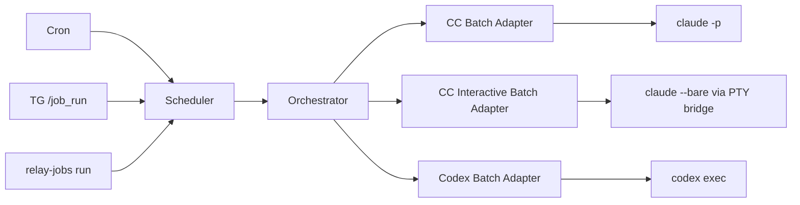

# runtime-fallback - Design

## 1. 技术栈

基于 `specs/project-specs/project-architecture.md` 定义的技术栈：Node.js ≥ 18 + TypeScript + `child_process.spawn`。本功能不新增任何生产依赖，只在现有 CLI 执行层之上增加 runtime adapter/orchestrator。

## 2. 架构设计

本功能提供 **batch runtime orchestration**。截至 2026-04-25，所有 batch job 触发入口必须通过 `scheduler.ts` 调用本 orchestrator；`relay-jobs.ts run` 不再允许复制 runtime 执行逻辑。



职责划分：

- `runtime.ts`
  - `BatchRuntimeAdapter`: 封装单个 runtime 的 CLI 调用与故障分类
  - `BatchRuntimeOrchestrator`: 决定尝试顺序、cooldown、fallback
- `scheduler.ts`
  - 只负责 job 生命周期、交付与日志
  - 不再直接判断“该不该切 runtime”
- `scripts/relay-jobs.ts`
  - 只负责 CLI 表面
  - `run` 必须通过 `scheduler.runJob()` 进入 orchestrator
  - 禁止保留独立 `cc` / `cc-interactive` / `codex` runtime loop

## 3. 接口定义

### 3.1 `runtime.ts`

```ts
type RuntimeId = 'cc' | 'cc-interactive' | 'codex';

interface BatchRunInput {
  workspace: string;
  prompt: string;
  timeoutMs: number;
}

interface BatchRunResult {
  runtime: RuntimeId;
  stdout: string;
  stderr: string;
  exitCode: number;
  durationMs: number;
  timedOut: boolean;
  spawnErrorCode?: string;
  attemptedRuntimes?: RuntimeId[];
}

interface BatchRuntimeAdapter {
  id: RuntimeId;
  run(input: BatchRunInput): Promise<BatchRunResult>;
  classifyFailure(result: BatchRunResult): RuntimeFailure | null;
}
```

### 3.2 `scheduler.ts`

- `SchedulerOptions.runtimePolicy`
  - `primary?: RuntimeId`
  - `fallbacks?: RuntimeId[]`
  - `cooldownMs?: number`
- `ScheduledJob.agent.runtimePreference?: RuntimeId[]`
- `JobResult.runtime?: RuntimeId`
- `JobResult.attemptedRuntimes?: RuntimeId[]`

## 4. 数据流

### 场景 A：CC 正常执行

1. scheduler 触发 job
2. orchestrator 选择 `cc`
3. CC adapter 返回 `exitCode=0`
4. scheduler 交付结果

### 场景 B：CC 不可用或被限流，回退到后续 runtime

1. scheduler 触发 job
2. orchestrator 先尝试 `cc`
3. `cc.classifyFailure()` 识别为 runtime-level failure，包括 binary/startup/auth/quota/rate-limit/timeout
4. orchestrator 标记 CC 进入 cooldown
5. orchestrator 按顺序尝试 `cc-interactive`、`codex`
6. 后续 runtime 成功后返回完整 `attemptedRuntimes`
7. scheduler 记录 fallback 日志并交付结果

### 场景 C：普通任务失败

1. scheduler 触发 job
2. orchestrator 尝试 `cc`
3. `cc` 非零退出，但 `classifyFailure()` 返回 `null`
4. orchestrator 立即返回该结果，不切换 runtime
5. scheduler 生成 `status=error`

## 5. 错误处理

### 5.1 触发 fallback 的错误

- spawn `ENOENT` / `EACCES`
- timeout
- stderr/stdout 中包含：
  - `rate limit` / `rate_limit` / `429` / `overloaded`
  - `401` / `unauthorized` / `oauth` / `not logged in`
  - `insufficient_quota` / `quota exceeded`
  - `unknown option` / `unrecognized option` / `unexpected argument`
  - `incomplete turn`（`cc-interactive` JSONL 停在非终态 assistant turn）

Rate-limit 语义（2026-04-25 修订）：

- batch runtime 的 `rate-limit` 不再 fail-fast。
- 当前 runtime 会进入 cooldown，然后继续尝试后续 runtime。
- 这样默认链路可实现 `cc -> cc-interactive -> codex`，与 PULSE S1 执行可信目标一致。

### 5.2 不触发 fallback 的错误

- runtime 正常启动但 job 业务失败
- prompt 本身导致的非零退出
- scheduler overlap protection

### 5.3 PTY submit contract

`cc-interactive` batch adapter 的当前 submit 语义：

- warmup：5s，让 `claude --bare` 完成初始化。
- prompt 写入：512B 分块写入 PTY，块间短暂停顿，避免大 prompt 单次写入丢数据。
- submit：prompt 写完后延迟 500ms 写入 `\r`。
- 退出：不因首个 JSONL 输出主动杀进程，等待 CC 自然退出；timeout 是唯一兜底。
- 成功判定：只有 prompt 发出后出现终态 assistant turn 才算成功；终态定义为 `stop_reason=end_turn|stop_sequence` 且有文本，或 JSONL `result` 记录。若进程 exit 0 但最后停在 `tool_use` / tool_result 之后无终态答复，adapter 返回非零并触发 runtime fallback。

TG long-lived interactive path 已在 2026-04-25 对齐基础 submit 参数：默认 warmup 5s、submit delay 500ms、prompt 512B 分块写入。两条路径仍分别实现，后续可继续抽共享 helper。

### 5.3.1 Session JSONL path contract

`cc-interactive` batch adapter 与 `pool.ts` 均先对 workspace 做 `realpathSync()`，再按 Claude 项目目录规则编码：

```text
realpath(workspace).replace(/[/.]/g, '-')
```

原因：如果 job workspace 是 symlink，Claude 实际写入 realpath 编码目录；batch runtime 必须从同一路径读取 JSONL，否则会出现 exit 0 但 output 为空的静默失败形态。

### 5.4 CLI convergence contract

`relay-jobs run` 不是 runtime fallback 的实现者。默认请常驻 Relay 经 `POST /internal/jobs/run` 调用其 `scheduler.runJob(id)`。`run --local` 必须：

1. 创建 scheduler manual-run 实例：`registerCronTasks=false`、`deliveryEnabled=false`。
2. 调用 `scheduler.runJob(id)`。
3. 打印 `JobResult.output` 和 runtime metadata。

两者都不直接 spawn `claude`、`python3`、`codex`。

## 6. 安全设计

- 继续沿用当前 CLI 执行前的环境清洗：
  - 删除 `TELEGRAM_BOT_TOKEN`
  - 删除 `BOT_TOKEN_*`
- Codex batch 调用只在指定 workspace 下执行，不额外开放目录。

## 7. 性能与可维护性

- 正常路径只执行 1 个 runtime，不引入额外延迟。
- fallback 状态只保存在内存；进程重启后回到默认 primary-first。
- `spawnCC()` 保留，用于兼容现有测试与局部调用；新逻辑通过 orchestrator 驱动。
