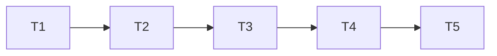

# runtime-fallback - Tasks

## 1. 任务拆分

| ID | 优先级 | 任务 | 预估 | 依赖 |
|---|---|---|---:|---|
| T1 | P0 | 定义 runtime 类型与 batch adapter/orchestrator 接口 | 1h | - |
| T2 | P0 | 实现 CC/Codex batch adapter 与 cooldown fallback 策略 | 2h | T1 |
| T3 | P0 | 将 scheduler 接入 orchestrator，并补充结果/日志字段 | 2h | T2 |
| T4 | P0 | 补 runtime/scheduler 测试，覆盖 fallback 与非误判 | 2h | T3 |
| T5 | P0 | 补 L2 规格与实现同步检查 | 1h | T4 |

## 2. 任务详情

### T1: runtime 抽象

- 基于 `design.md` 的“3.1 runtime.ts”实现 `RuntimeId`、`BatchRunInput`、`BatchRunResult`、`BatchRuntimeAdapter`。
- 输出：`src/runtime.ts` 基础类型与 orchestrator 框架；`src/types.ts` 扩展 scheduler/job 类型。
- 验证：新增 unit tests 验证 orchestrator 的选择逻辑。

### T2: runtime adapter + fallback

- 基于 `design.md` 的“2. 架构设计 / 5. 错误处理”实现：
  - `cc` batch adapter
  - `codex` batch adapter
  - runtime failure 分类
  - cooldown + sticky-until-healthy
- 输出：可复用的 batch runtime 执行模块。
- 验证：unit tests 覆盖 binary-missing、cooldown、task error non-fallback。

### T3: scheduler 接线

- 基于 `design.md` 的“3.2 scheduler.ts”：
  - `SchedulerOptions.runtimePolicy`
  - `ScheduledJob.agent.runtimePreference`
  - `JobResult.runtime / attemptedRuntimes`
  - scheduler 改走 orchestrator，不直接写死 `claude -p`
- 输出：`src/scheduler.ts`
- 验证：集成测试覆盖显式 `cc -> codex` fallback 成功链路；平台默认不再先撞 CC。

### T4: 回归测试

- 新增 `tests/runtime.test.ts`
- 更新 `tests/scheduler.test.ts`
- 重点覆盖：
  - primary runtime unavailable → fallback success
  - task failure → no fallback
  - cooldown 生效
- 完成标准：新增测试通过，且不破坏现有 scheduler 用例。

### T5: 文档同步

- 补 `specs/features/runtime-fallback/` 三件套
- 确认实现范围与文档一致：本轮仅 scheduler batch 路径，不含 TG 长会话

## 3. 任务依赖

## 4. 完成标准

- 所有新增测试通过
- `npm test` 与 `npm run typecheck` 通过
- `scheduler.ts` 不再直接决定 runtime fallback 策略
- job 结果可见最终 runtime 与尝试链路

## 5. 执行顺序

1. 先抽 runtime 模块
2. 再接 scheduler
3. 最后补测试与文档

## 6. 风险识别

- 风险：Codex CLI 输出格式与 CC 不同
  - 缓解：本轮只走 `codex exec --output-last-message` 的 batch 路径，不碰交互协议
- 风险：把普通任务失败误判成 runtime 故障
  - 缓解：failure classifier 只识别 runtime-level 信号，业务失败默认不 fallback
- 风险：cooldown 策略导致长时间不回切 primary
  - 缓解：默认 5 分钟 cooldown，且支持手动 `markHealthy`
