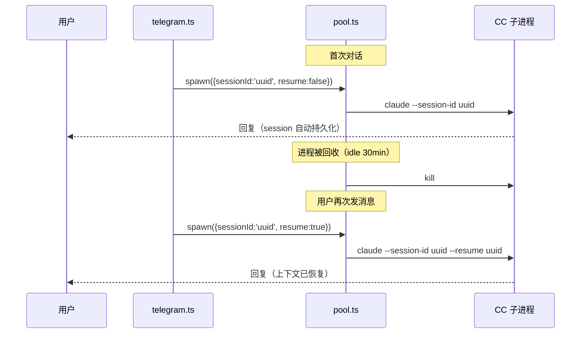
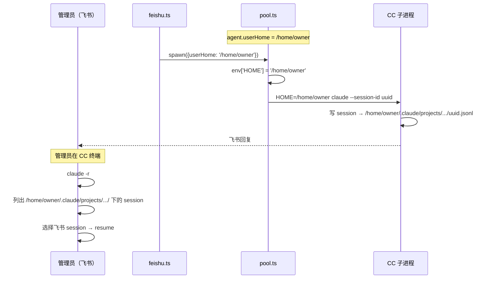

# session-management - 技术设计文档

> **设计概述**：session 管理完全依赖 CC 原生能力（`--session-id` + `--resume`）。Relay 的职责仅是在 spawn 时正确传参，在 crash restart / idle cleanup 后自动带上 `--resume`。核心逻辑已在 cc-process-pool 中实现。
>
> **关联文档**：
> - L1 项目架构：`project-specs/project-architecture.md`
> - 上游设计：`features/cc-process-pool/design.md`

---

## 1️⃣ 技术栈

**基于 L1 项目架构**：`project-specs/project-architecture.md`

- 无新增依赖。session 功能完全由 CC CLI 提供

## 2️⃣ 架构设计

**已实现覆盖**：

session 管理的三个关键行为已在 cc-process-pool 中实现：

1. **spawn 时传 `--session-id`**：`pool.ts buildArgs()` 已包含
2. **crash restart 时传 `--resume`**：`pool.ts handleCrashRestart()` 已包含
3. **idle cleanup 后再 spawn 时传 `--resume`**：telegram.ts message handler 中 `proc.state === 'dead'` 分支已设置 `resume: true`

**本 feature 的增量工作**：

- 验证上述逻辑的正确性（集成测试）
- 确保 pool.getStatus() 包含 sessionId 信息（已实现）

### 跨渠道 session 访问（userHome）

**问题**：非 linuxUser agent 的 CC 进程继承 Relay 进程的 HOME（`/home/pulse`），session JSONL 文件存储在 Relay 用户目录下。管理员无法通过 `claude -r` 在自己的终端发现这些 session。

**方案**：在 `AgentConfig` 和 `SpawnConfig` 中新增 `userHome?: string` 字段，spawn CC 时注入到 `env['HOME']`，使 session 文件存储到真实用户的 `~/.claude/projects/` 下。

**关键约束**：
- `userHome` 仅用于非 `linuxUser` agent（`linuxUser` 场景已有独立的 HOME 注入，PT0-018）
- 优先级：`linuxUser` > `userHome` > 继承进程 HOME
- 涉及 `tenantHome` 计算的地方（session 文件路径解析）需同步使用 `userHome` 作为 fallback

## 3️⃣ 接口定义

无新增接口。复用 cc-process-pool 的 SpawnConfig.sessionId 和 SpawnConfig.resume。

**新增字段**：

| 接口 | 字段 | 类型 | 说明 |
|------|------|------|------|
| `AgentConfig` | `userHome` | `string?` | 非 linuxUser agent 的 HOME 目录 |
| `SpawnConfig` | `userHome` | `string?` | 传递到 pool.ts spawnProcess |
| `ProvisionRequest` | `userHome` | `string?` | provision CLI 传入 |

## 4️⃣ 数据流



### 跨渠道 session 数据流



**HOME 注入优先级**（`pool.ts spawnProcess`）：

```
linuxUser 存在 → HOME = resolveWorkspacePath(workspace)
userHome 存在  → HOME = userHome
都不存在       → HOME = 继承 Relay 进程 HOME
```

---

## 5️⃣ 错误处理

- **resume 失败**（session 文件损坏）：CC 会自动降级为新对话，Relay 无需特殊处理
- **userHome 路径不存在**：CC 进程启动时会自动创建 `~/.claude/` 目录结构，无需预处理
