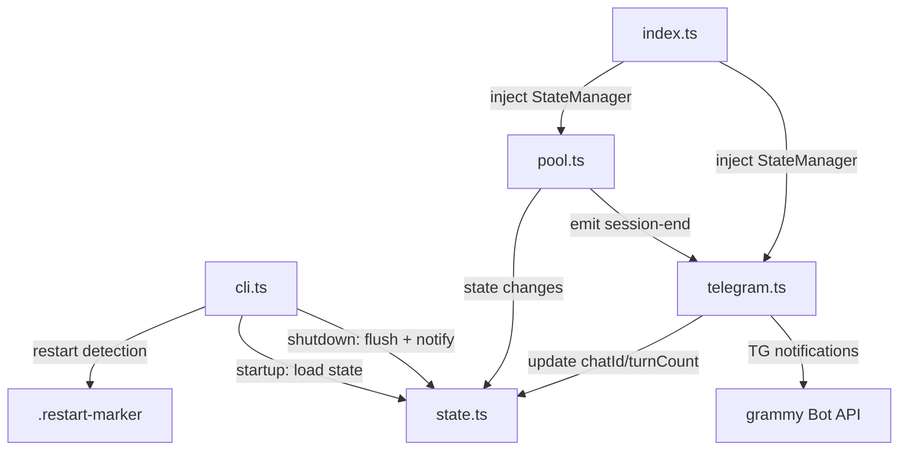
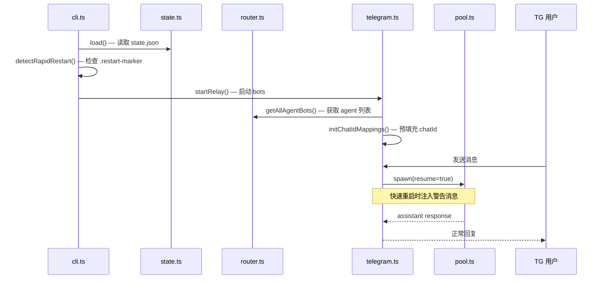
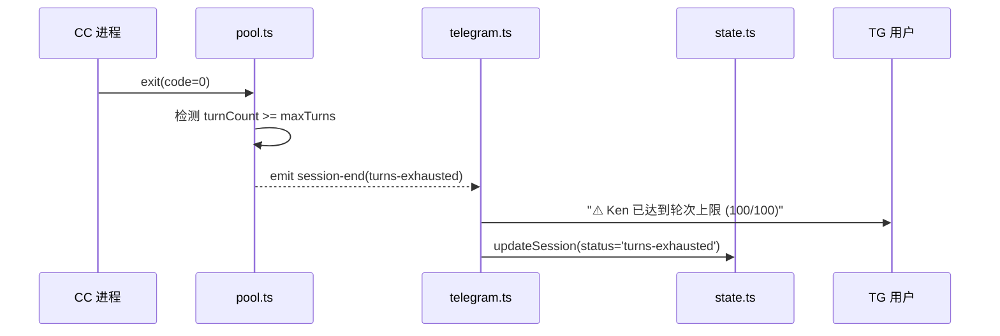
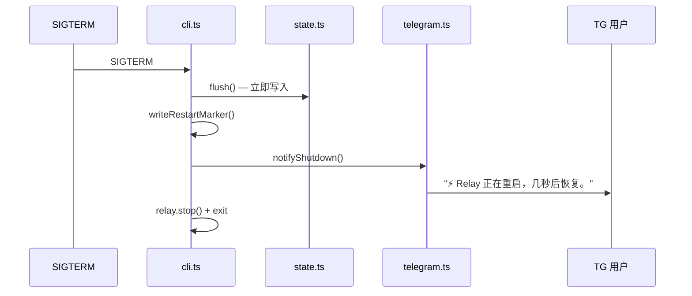

# session-resilience - 技术设计文档

> **设计概述**：通过新增 state.ts 持久化模块、Pool session-end 事件、优雅关闭通知、自重启检测四个技术手段，实现 Relay session 的跨重启恢复和生命周期可见性。
>
> **关联文档**：
> - L1项目架构：`project-specs/project-architecture.md`
> - L2功能需求：`features/session-resilience/requirements.md`
> - L2任务拆分：`features/session-resilience/tasks.md`

---

## 1️⃣ 技术栈（Tech Stack）

**基于L1项目架构**：`project-specs/project-architecture.md`

- **运行时**：Node.js ≥ 18
- **语言**：TypeScript 5.x（strict: true）
- **测试**：vitest
- **数据存储**：JSON 文件（`~/.relay/state.json`）
- **文件操作**：node:fs（writeFileSync + renameSync 原子写入）

---

## 2️⃣ 架构设计（Architecture Design）

### 组件划分

```
session-resilience 模块
├── state.ts（状态持久化层 — 读写 state.json）
├── pool.ts 增强（session-end 事件发射）
├── telegram.ts 增强（chatId 预填充 + 生命周期通知）
├── cli.ts 增强（优雅关闭 + 自重启检测）
└── types.ts 增强（新接口定义）
```

### 模块关系



**模块职责说明**：
- **state.ts**：管理 `~/.relay/state.json` 的读/写/更新/flush。提供 StateManager 接口，防抖 2s 写入，原子文件替换。
- **pool.ts 增强**：在 idle cleanup、crash、turns 耗尽、进程退出等场景 emit `session-end` 事件，携带 `SessionEndReason`。
- **telegram.ts 增强**：启动时从 router 预填充 `poolKeyToChatId`；监听 `session-end` 事件发送 TG 通知；每次消息交互更新 state。
- **cli.ts 增强**：shutdown 时 flush state + 发送 TG 通知 + 写 restart-marker；startup 时读 state + 检测快速重启。

---

## 3️⃣ 接口定义（Interface Definition）

### 内部函数接口

**Function-001：createStateManager**

```typescript
function createStateManager(statePath: string): StateManager

interface StateManager {
  /** Load state from disk. Returns empty state if file missing/corrupt. */
  load(): PersistedState;
  /** Get session by poolKey */
  getSession(poolKey: string): PersistedSession | undefined;
  /** Update session (partial merge). Triggers debounced write. */
  updateSession(poolKey: string, update: Partial<PersistedSession>): void;
  /** Remove session entry. */
  removeSession(poolKey: string): void;
  /** Get all sessions. */
  getAllSessions(): Record<string, PersistedSession>;
  /** Immediately write to disk (no debounce). For shutdown. */
  flush(): void;
  /** Cancel pending debounced write. For cleanup. */
  dispose(): void;
}
```

**Function-002：detectRapidRestart**

```typescript
function detectRapidRestart(markerPath: string): boolean
// Returns true if .restart-marker exists and was written < 10s ago.

function writeRestartMarker(markerPath: string): void
// Writes current timestamp to .restart-marker.
```

**Function-003：initChatIdMappings**

```typescript
function initChatIdMappings(
  router: Router,
  agent: AgentConfig,
  poolKeyToChatId: Map<string, string>
): void
// Pre-populates poolKeyToChatId from router config for all users
// that have this agent configured.
```

---

## 4️⃣ 数据模型（Data Model）

### Entity-001：PersistedState

```typescript
interface PersistedState {
  version: 1;
  updatedAt: string; // ISO 8601
  sessions: Record<string, PersistedSession>;
}
```

### Entity-002：PersistedSession

| 字段名 | 类型 | 说明 |
|--------|------|------|
| poolKey | string | 租户标识，如 "owner:ken" |
| agentId | string | Agent ID，如 "ken" |
| sessionId | string | CC session UUID |
| turnCount | number | 已消耗的 turns |
| maxTurns | number | 最大 turns 限制 |
| lastActivity | number | 最后活动时间戳 (Date.now()) |
| status | string | 'active' \| 'idle-reclaimed' \| 'turns-exhausted' \| 'crashed' |

### Entity-003：SessionEndReason

```typescript
type SessionEndReason =
  | { type: 'idle-reclaimed' }
  | { type: 'turns-exhausted'; turnCount: number; maxTurns: number }
  | { type: 'crash'; exitCode: number }
  | { type: 'crash-unrecoverable'; exitCode: number }
  | { type: 'relay-shutdown' };
```

### 状态文件示例

```json
{
  "version": 1,
  "updatedAt": "2026-04-09T11:30:00.000Z",
  "sessions": {
    "owner:ken": {
      "poolKey": "owner:ken",
      "agentId": "ken",
      "sessionId": "7ddc8262-7194-48b6-8bee-770b4b882fbd",
      "turnCount": 42,
      "maxTurns": 100,
      "lastActivity": 1744176600000,
      "status": "active"
    }
  }
}
```

---

## 5️⃣ 数据流（Data Flow）

### 场景1：Relay 重启恢复



### 场景2：Turns 耗尽通知



### 场景3：优雅关闭



---

## 6️⃣ 错误处理（Error Handling）

| 场景 | 处理策略 |
|------|---------|
| state.json 不存在 | load() 返回空 state，正常启动 |
| state.json JSON 损坏 | load() catch JSON.parse 错误，返回空 state，日志 warn |
| state.json 写入失败 | flush() catch 错误，日志 error，不阻塞运行 |
| TG 通知发送失败 | catch + 日志 warn，不阻塞关闭流程 |
| .restart-marker 读写失败 | catch + 日志 warn，跳过自重启检测 |
| 原子写入 rename 失败 | 回退到直接 writeFileSync |

---

## 7️⃣ 安全设计（Security Design）

- state.json 不存储 botToken、chatId 等敏感信息（chatId 从 relay.json 获取）
- state.json 使用 0600 权限创建
- 原子写入防止中途断电导致的文件损坏

---

## 8️⃣ 性能优化（Performance Optimization）

- **防抖写入**：2s debounce 合并高频状态更新，减少磁盘 I/O
- **内存缓存**：StateManager 内部维护 sessions Map，读操作不触发磁盘 I/O
- **chatId 预填充**：O(N) 复杂度（N=agents），仅启动时执行一次
- **shutdown 通知并发**：Promise.allSettled 并发发送所有通知，3s 超时兜底
