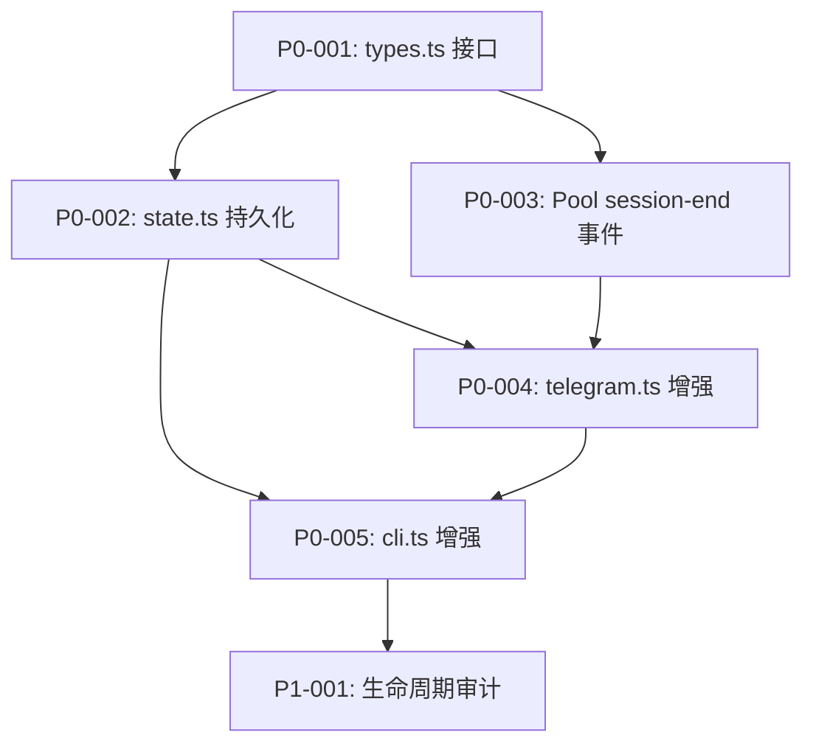

# session-resilience - 任务拆分文档

> **任务概述**：基于 design.md 实现 session 状态持久化、生命周期事件通知、优雅关闭和自重启保护，共 6 个任务。
>
> **L3 状态（2026-05-02）**：`state.ts`、`pool` `session-end`、`telegram.ts`/`feishu.ts` 生命周期通知、`cli.ts` SIGTERM/SIGINT、`restart-detect.ts` 已存在。

> **关联文档**：
> - L2技术设计：`features/session-resilience/design.md`
> - L2功能需求：`features/session-resilience/requirements.md`
> - TDD测试文件：`tests/state.test.ts`, `tests/pool.test.ts`, `tests/bot-handler.test.ts`

## 1️⃣ 任务拆分（Task Breakdown）

### P0任务（MVP必需）

| 任务ID | 任务名称 | 预估工时 | 依赖任务 | 负责人 | 状态 |
|--------|---------|---------|---------|--------|------|
| P0-001 | 新增 types.ts 接口定义 | 1h | 无 | Ken | ✅ 完成 |
| P0-002 | 实现 state.ts 持久化模块 | 4h | P0-001 | Ken | ✅ 完成 |
| P0-003 | Pool 新增 session-end 事件 | 3h | P0-001 | Ken | ✅ 完成 |
| P0-004 | telegram.ts chatId 预填充 + 生命周期通知 | 4h | P0-002, P0-003 | Ken | ✅ 完成 |
| P0-005 | cli.ts 优雅关闭 + 自重启检测 | 3h | P0-002, P0-004 | Ken | ✅ 完成 |

### P1任务（增强功能）

| 任务ID | 任务名称 | 预估工时 | 依赖任务 | 负责人 | 状态 |
|--------|---------|---------|---------|--------|------|
| P1-001 | Session 生命周期审计与端到端验证 | 2h | P0-005 | Ken | 待开始 |

---

## 2️⃣ 任务详情（Task Details）

> **P0 已在 L3 完成**；下列 checkbox 为历史清单。验证见 `tests/state.test.ts`、`tests/pool.test.ts`、`src/cli.ts`。

### P0-001：新增 types.ts 接口定义

**任务描述**：
- 基于 design.md 的 "4️⃣ 数据模型"，在 `src/types.ts` 中新增 `PersistedState`、`PersistedSession`、`SessionEndReason`、`StateManager` 接口。
- 在 `Pool` 接口中新增 `session-end` 事件签名。

**输入**：
- design.md 的 Entity-001/002/003 定义
- design.md 的 Function-001 StateManager 接口

**输出**：
- `src/types.ts`：新增 4 个接口/类型 + 1 个 Pool 事件签名

**验证标准（TDD要求）**：
- [ ] **Type Check**：`tsc --noEmit` 编译通过，无类型错误
- [ ] **现有测试**：85 个测试全部通过（接口新增不应破坏）

**完成标准**：
- [ ] 所有新接口已定义，类型严格（无 any）
- [ ] 现有测试不受影响

---

### P0-002：实现 state.ts 持久化模块

**任务描述**：
- 基于 design.md 的 "3️⃣ 接口定义/Function-001" 和 "4️⃣ 数据模型/Entity-001"，创建 `src/state.ts`，实现 `createStateManager()` 工厂函数。
- 功能包括：load（容错）、getSession、updateSession（防抖 2s）、removeSession、getAllSessions、flush（立即写入）、dispose。
- 原子写入：write 到临时文件 → renameSync 替换。

**输入**：
- design.md 的 StateManager 接口
- design.md 的 PersistedState 数据结构

**输出**：
- `src/state.ts`：StateManager 实现（≤150 行）
- `tests/state.test.ts`：完整测试覆盖

**验证标准（TDD要求）**：
- [ ] **Unit Test-001**：load() — 文件不存在时返回空 state（version=1, sessions={}）
- [ ] **Unit Test-002**：load() — 有效 JSON 正确解析
- [ ] **Unit Test-003**：load() — 损坏 JSON 返回空 state + 日志 warn
- [ ] **Unit Test-004**：updateSession() — 正确合并 partial 更新
- [ ] **Unit Test-005**：updateSession() — 触发防抖写入（2s 后文件更新）
- [ ] **Unit Test-006**：flush() — 立即写入，不等防抖
- [ ] **Unit Test-007**：原子写入 — 写入期间进程退出不产生损坏文件
- [ ] **Unit Test-008**：removeSession() — 删除指定 session
- [ ] **Unit Test-009**：getAllSessions() — 返回所有 session
- [x] **Unit Test-010**：dispose() — 取消 pending timer（state.test.ts 已覆盖）
- [ ] **Unit Test-011**：多次快速 updateSession() — 防抖合并为 1 次写入

**完成标准**：
- [ ] state.ts ≤ 150 行
- [ ] 测试覆盖率 ≥ 80%
- [ ] 现有 85 个测试通过

---

### P0-003：Pool 新增 session-end 事件

**任务描述**：
- 基于 design.md 的 "3️⃣ 接口定义" 和 requirements.md 的 FR-P0-003，修改 `src/pool.ts`：
  - idle cleanup（`cleanupIdleProcesses()`）：杀进程前 emit `session-end` with `{ type: 'idle-reclaimed' }`
  - crash 不可恢复（`handleCrashRestart()` 超限）：emit `session-end` with `{ type: 'crash-unrecoverable', exitCode }`
  - turns 耗尽（exit handler，code=0 且 turnCount >= maxTurns）：emit `session-end` with `{ type: 'turns-exhausted', turnCount, maxTurns }`
  - crash 自动恢复成功：emit `session-end` with `{ type: 'crash', exitCode }`（表示已恢复，仅通知）
- 暴露 `getTurnCounter(tenantId)` 方法（供 telegram.ts 读取 turn 数据）。

**输入**：
- design.md 的 SessionEndReason 类型
- 当前 pool.ts 的 cleanupIdleProcesses (line 180), handleCrashRestart (line 145), exit handler (line 109)

**输出**：
- `src/pool.ts`：修改 4 处 emit 点 + 新增 getTurnCounter 方法
- `tests/pool.test.ts`：新增 session-end 事件测试

**验证标准（TDD要求）**：
- [ ] **Unit Test-012**：idle cleanup emit `session-end` with `idle-reclaimed`
- [ ] **Unit Test-013**：exit code=0 且 turns 满 emit `session-end` with `turns-exhausted`
- [ ] **Unit Test-014**：crash 超过 maxRestartsPerHour emit `crash-unrecoverable`
- [ ] **Unit Test-015**：crash 自动恢复成功 emit `crash` with exitCode
- [ ] **Unit Test-016**：getTurnCounter() 返回正确的 turn 数据
- [ ] **Unit Test-017**：exit code=143（SIGTERM idle cleanup）不 emit crash 类型
- [ ] **Unit Test-018**：normal exit code=0 且 turns 未满不 emit turns-exhausted
- [ ] **Unit Test-019**：现有 pool 测试全部通过（无回归）

**完成标准**：
- [ ] 4 个 emit 点全部实现
- [ ] getTurnCounter 方法已暴露
- [ ] 新增 + 现有 pool 测试全部通过

---

### P0-004：telegram.ts chatId 预填充 + 生命周期通知

**任务描述**：
- 基于 design.md 的 "3️⃣ 接口定义/Function-003" 和 "5️⃣ 数据流/场景2"，修改 `src/channels/telegram.ts`：
  - **chatId 预填充**：在 `createSingleBot()` 中，启动时调用 `initChatIdMappings()` 从 router 预填充 `poolKeyToChatId`。
  - **session-end 监听**：监听 pool 的 `session-end` 事件，根据 reason 类型发送对应的 TG 通知消息。
  - **StateManager 集成**：接收 `StateManager` 作为 deps，在消息收发时更新 state。
- 将 `StateManager` 加入 `TelegramBotDeps` 接口。

**输入**：
- design.md 的生命周期通知策略表
- 当前 telegram.ts 的 poolKeyToChatId Map (line 219)
- 当前 telegram.ts 的 pool.on 事件监听 (lines 221-290)

**输出**：
- `src/channels/telegram.ts`：chatId 预填充 + session-end 监听 + state 更新
- `tests/bot-handler.test.ts`：新增测试

**验证标准（TDD要求）**：
- [ ] **Unit Test-020**：启动后 poolKeyToChatId 已包含所有 user-agent 的 chatId
- [ ] **Unit Test-021**：turns-exhausted → sendMessage 被调用，消息包含轮次数字
- [ ] **Unit Test-022**：crash-unrecoverable → sendMessage 被调用，消息提示发消息重试
- [ ] **Unit Test-023**：idle-reclaimed → sendMessage 不被调用
- [ ] **Unit Test-024**：crash 自动恢复 → sendMessage 被调用，消息提示已恢复
- [ ] **Unit Test-025**：消息收到时 stateManager.updateSession 被调用

**完成标准**：
- [ ] chatId 预填充逻辑实现
- [ ] 5 种 session-end 场景的通知逻辑实现
- [ ] StateManager 集成
- [ ] 新增 + 现有 bot-handler 测试全部通过

---

### P0-005：cli.ts 优雅关闭 + 自重启检测

**任务描述**：
- 基于 design.md 的 "5️⃣ 数据流/场景3" 和 requirements.md 的 FR-P0-004：
  - **优雅关闭**：修改 `shutdown()` 为 async，关闭前 (1) flush state.json，(2) 调用 `notifyShutdown()` 向所有活跃 chatId 发 TG 通知，(3) 写 restart-marker，(4) stop + exit。
  - **自重启检测**：启动时调用 `detectRapidRestart()`，若检测到快速重启，在 state 中标记需要注入警告的 session。
  - **notifyShutdown**：需要 `startRelay()` 返回 bot 通知能力。修改 index.ts 的 `startRelay()` 返回 `{ stop, notifyShutdown }`.

**输入**：
- design.md 的 Function-002 detectRapidRestart / writeRestartMarker
- 当前 cli.ts 的 shutdown() (line 68)
- 当前 index.ts 的 startRelay() (line 19)

**输出**：
- `src/cli.ts`：async shutdown + restart detection
- `src/index.ts`：startRelay 返回 notifyShutdown 方法 + 接收 StateManager
- `tests/cli.test.ts`：新建测试文件

**验证标准（TDD要求）**：
- [ ] **Unit Test-026**：shutdown() flush state.json 被调用
- [ ] **Unit Test-027**：shutdown() 写 restart-marker
- [ ] **Unit Test-028**：detectRapidRestart() — marker < 10s 返回 true
- [ ] **Unit Test-029**：detectRapidRestart() — marker > 10s 返回 false
- [ ] **Unit Test-030**：detectRapidRestart() — marker 不存在返回 false

**完成标准**：
- [ ] 优雅关闭流程实现（flush → notify → marker → stop → exit）
- [ ] 自重启检测实现
- [ ] notifyShutdown 方法可用
- [ ] 新建 cli.test.ts 通过

---

### P1-001：Session 生命周期审计与端到端验证

**任务描述**：
- 基于 requirements.md 的 FR-P1-001 和 AC-P1-001，审计所有 session 退出路径：
  - 验证 idle cleanup 不改变 sessionId
  - 验证 crash restart 使用相同 sessionId
  - 验证 turns 耗尽后 resume 使用相同 sessionId
  - 验证仅 `/new` 命令改变 sessionId
- 编写端到端场景测试验证 session 持续性。

**输入**：
- requirements.md 的 Session 生命周期规则
- P0-001~P0-005 的实现

**输出**：
- `tests/lifecycle.test.ts`：新增端到端场景测试

**验证标准（TDD要求）**：
- [ ] **E2E Test-001**：idle 超时 → 用户发消息 → spawn args 包含原 sessionId + --resume
- [ ] **E2E Test-002**：crash → 自动 restart → spawn args 包含原 sessionId
- [ ] **E2E Test-003**：/new → spawn args 包含新 sessionId（不同于原来）
- [ ] **E2E Test-004**：turns 耗尽 → 用户发消息 → spawn args 包含原 sessionId

**完成标准**：
- [ ] 所有退出路径审计完成
- [ ] 端到端测试通过
- [ ] session 身份仅 /new 可终结的不变式已验证

---

## 3️⃣ 任务依赖（Task Dependencies）

---

## 4️⃣ 完成标准（Definition of Done）

### TDD要求

**测试金字塔架构**：
- **70% Unit Tests**（~22 个，覆盖 state.ts / pool events / telegram notifications / cli restart detection）
- **20% Integration Tests**（~6 个，覆盖 state + pool + telegram 协作）
- **10% E2E Tests**（~4 个，覆盖 session 生命周期端到端场景）

### 代码质量标准

- **测试覆盖率**：state.ts ≥ 80%，pool.ts 新增代码 ≥ 80%
- **单文件限制**：state.ts ≤ 150 行
- **类型安全**：strict: true，零 any
- **现有测试**：85 个全部通过（零回归）

---

## 5️⃣ 执行顺序（Execution Order）

| 阶段 | 任务 | 说明 |
|------|------|------|
| Phase 1 | P0-001 | 类型定义（基础，无风险） |
| Phase 2 | P0-002 + P0-003（可并行） | 独立模块，互不依赖 |
| Phase 3 | P0-004 | 整合 state + pool events 到 telegram |
| Phase 4 | P0-005 | 整合 state + telegram 到 cli |
| Phase 5 | P1-001 | 审计 + E2E 验证 |

---

## 6️⃣ 风险识别（Risk Identification）

| 风险 | 影响 | 缓解策略 |
|------|------|---------|
| state.json 写入竞态 | 数据丢失 | 原子写入（temp + rename），单线程 Node.js 无并发问题 |
| TG 通知发送超时阻塞关闭 | 关闭延迟 | Promise.allSettled + 3s 超时兜底 |
| 自重启检测误报 | 不必要的警告注入 | 10s 阈值足够宽松；仅注入警告，不阻断功能 |
| turns 耗尽检测遗漏 | 用户无通知 | exit handler 同时检查 code=0 + turnCount >= maxTurns 双条件 |
