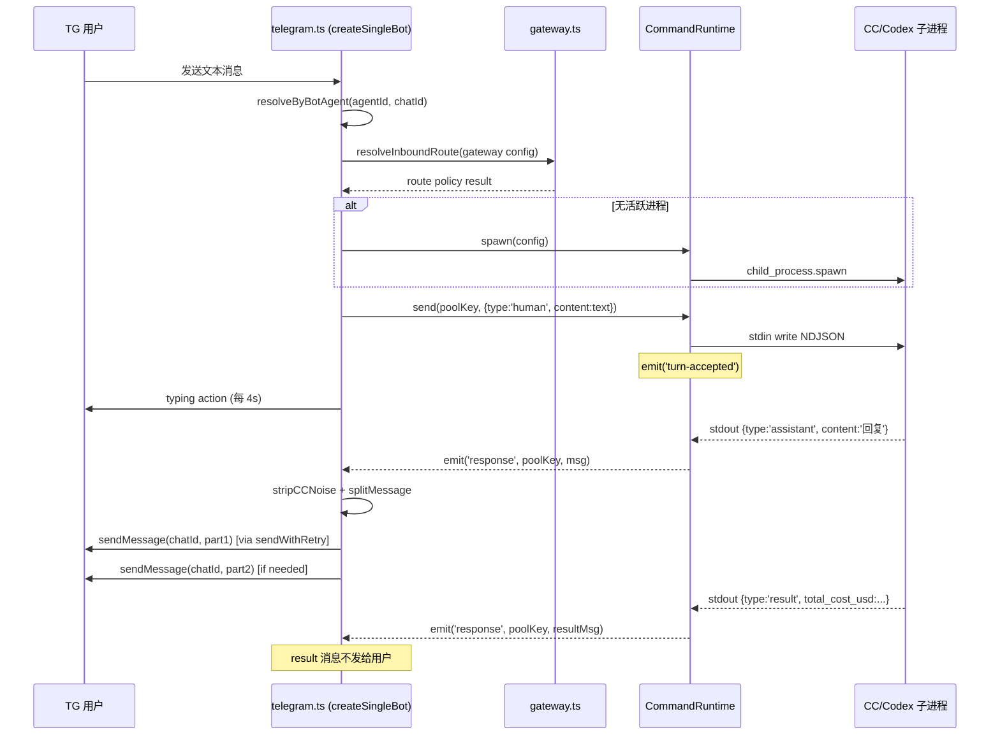
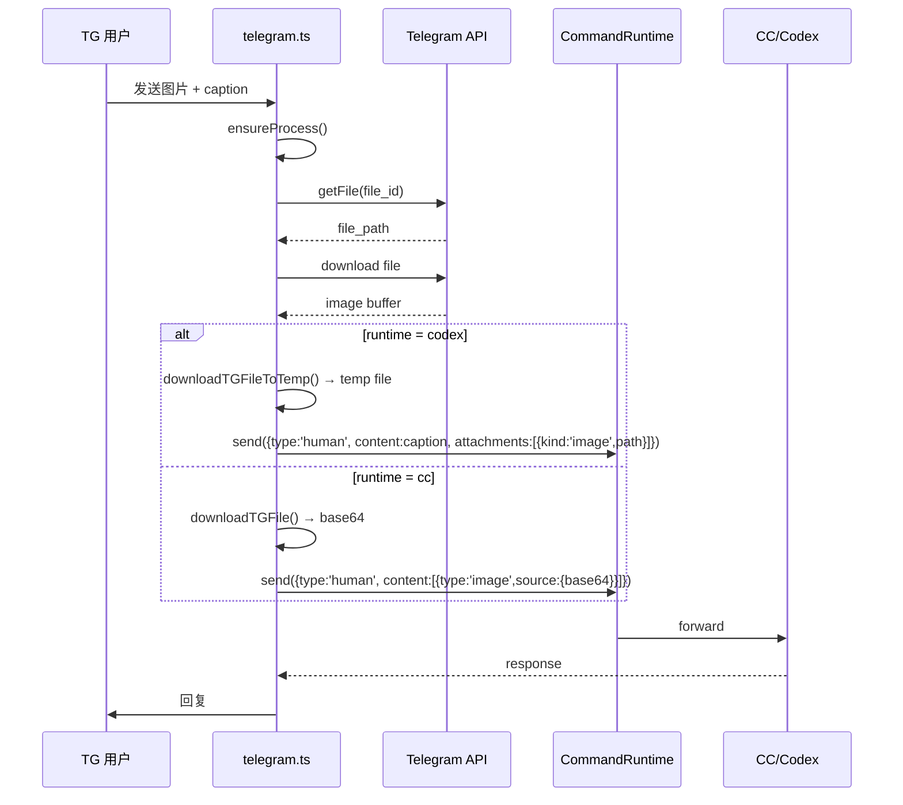
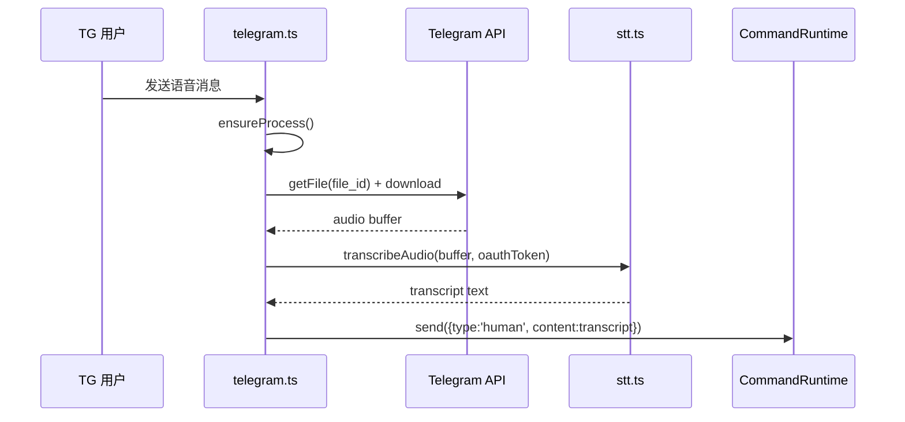
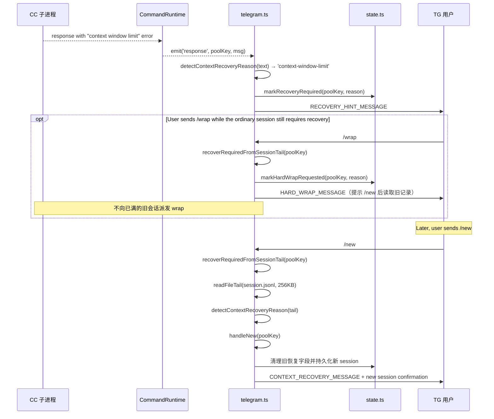

# telegram-channel - 技术设计文档

> **设计概述**：基于 grammy 框架实现 Telegram Bot 消息收发，支持独立 bot 模式（每个 Agent 独立 Bot 实例），集成 CommandRuntime 完成端到端消息转发。跨 runtime 的过程与终态先经共享 rendering 状态机归并，再由渠道无关 RichDoc compiler 解析、安全化和语义切分；Telegram adapter 只映射 Rich Message HTML / legacy Rich HTML / conservative HTML / plain text 并负责 send/edit、限流合并和终态投递。`/model`、`/think` 继续复用共享命令选项并渲染为原生 inline keyboard。
>
> **关联文档**：
> - L1 项目架构：`project-specs/project-architecture.md`
> - L2 功能需求：`features/telegram-channel/requirements.md`
> - L2 任务拆分：`features/telegram-channel/tasks.md`
> - 上游模块：`features/cc-process-pool/design.md`
> - 跨通道渲染契约：`channel-rendering-contract.md`

---

## 1. 技术栈（Tech Stack）

**基于 L1 项目架构**：`project-specs/project-architecture.md`

- **运行时**：Node.js >= 18
- **语言**：TypeScript 5.x, strict mode
- **TG Bot 框架**：grammy ^1.41 — 支持 long polling + 多 bot 实例
- **进程池**：`src/pool.ts` + `src/conversation-runtime.ts`（CommandRuntime）
- **状态持久化**：`src/state.ts`（StateManager）
- **语音转录**：`src/stt.ts`（transcribeAudio）
- **Session wrap guard**：`src/session-wrap-guard.ts`
- **配置**：JSON 文件（relay.json）
- **测试**：vitest

---

## 2. 架构设计（Architecture Design）

### 组件划分

```
telegram-channel 模块
├── channels/telegram.ts       （TG Bot 适配：多 bot 实例、消息收发、媒体处理、recovery）
├── channel-rendering.ts       （跨 runtime/channel 的语义归并与 event 幂等）
├── rich-doc.ts                （共享 Markdown AST、sanitizer、splitter、plain fallback）
├── channel-rich-rendering.ts  （渠道 renderer、capability/rollout profile）
├── stt.ts                     （语音转录：transcribeAudio）
├── session-wrap-guard.ts      （/wrap 生命周期管理）
├── router.ts                  （路由：chatId → UserConfig + AgentConfig）
├── state.ts                   （session 状态持久化）
├── gateway.ts                 （路由策略验证）
└── index.ts                   （组装入口）
```

### 模块关系

```mermaid
graph TD
    TG["Telegram API"] -->|long polling| BOT["channels/telegram.ts"]
    BOT -->|resolveByBotAgent| ROUTER["router.ts"]
    ROUTER -->|UserConfig + AgentConfig| BOT
    BOT -->|resolveInboundRoute| GW["gateway.ts"]
    BOT -->|send(poolKey, msg)| RT["CommandRuntime"]
    RT -->|response event| BOT
    BOT -->|status/delta/snapshot/commentary/final| RENDER["ChannelTurnRenderingState"]
    RENDER -->|complete authoritative frame| RICHDOC["RichDoc compiler + semantic splitter"]
    RICHDOC -->|Rich Message HTML / legacy HTML / safe HTML / plain| BOT
    BOT -->|sendWithRetry| TG
    BOT -->|transcribeAudio| STT["stt.ts"]
    BOT -->|wrap guard| WRAP["session-wrap-guard.ts"]
    BOT -->|readFileTail| SESSION["~/.claude/projects/"]
    BOT -->|persist state| STATE["state.ts"]
    CONFIG["relay.json"] -->|startup load| ROUTER
    MENU["command-menu.ts"] -->|setMyCommands| TG
```

### 独立 Bot 模式

`createTelegramBots()` 遍历 router 中所有配置了 botToken 的 Agent，为每个 Agent 创建独立的 `createSingleBot()` 实例：

```typescript
export function createTelegramBots(deps: TelegramBotDeps): TelegramBotInstance {
  const agentBots = router.getAllAgentBots();
  const instances = agentBots.map(({ agent, authorizedChatIds }) =>
    createSingleBot(agent, new Set(authorizedChatIds), deps)
  );
  return { start, stop };
}
```

每个 `createSingleBot()` 包含完整的命令注册、消息处理、response 路由和事件监听。通过 `poolKey.endsWith(`:${agent.id}`)` 过滤事件，确保每个 bot 只处理自己的 Agent 事件。

---

## 3. 接口定义（Interface Definition）

### TelegramBotDeps 接口

```typescript
export interface TelegramBotDeps {
  runtime: CommandRuntime;
  router: Router;
  stateManager?: StateManager;
  scheduler?: Scheduler;
}
```

### Function-001：createTelegramBots — 创建多 Bot 实例

```typescript
function createTelegramBots(deps: TelegramBotDeps): TelegramBotInstance
```

内部调用 `createSingleBot(agent, authorizedChatIds, deps)` 为每个 Agent 创建独立 Bot。

### Function-002：createSingleBot — 创建单个 Bot

```typescript
function createSingleBot(
  agent: AgentConfig,
  authorizedChatIds: Set<string>,
  deps: TelegramBotDeps,
): TelegramBotInstance
```

包含：命令注册（15+ commands）、消息处理（text/photo/voice/audio/document）、事件监听（response/exit/error/crash-retry/session-end/turn-warning/turn-accepted/runtimeFallback）、typing indicator 管理、recovery 状态管理。

### Function-003：splitMessage — 长文本分片

```typescript
function splitMessage(text: string, maxLength?: number): string[]
// Legacy/command plain-text splitter. Rich assistant answers use splitRichDoc()
// with the active measured-unit capability profile instead of treating 4096 as
// an unqualified platform hard limit.
```

### Function-004：prefixMessage — Agent 标识前缀

```typescript
function prefixMessage(agent: AgentConfig, text: string, isFirstChunk: boolean): string
// isFirstChunk=true → "emoji name:\n{text}"
// isFirstChunk=false → "{text}"
```

### Function-005：sendWithRetry — 429 重试发送

```typescript
async function sendWithRetry(bot: Bot, chatId: number, text: string, retries?: number): Promise<void>
// retries defaults to 1
// On 429: parse retry_after, sleep, retry
// On other errors: throw immediately
```

### Function-006：stripCCNoise — CC 内部诊断清理

```typescript
function stripCCNoise(text: string): string
// Filters out CC internal diagnostic patterns:
// - OAuth polling timeout messages
// - "Key already in use" messages
// - apiKeySource lines
// Returns cleaned text, or empty string if entire text is noise
```

### Function-007：detectContextRecoveryReason — Context 恢复原因检测

```typescript
function detectContextRecoveryReason(text: string): SessionRecoveryReason | undefined
// Detects 'compact-failed' and 'context-window-limit' reasons
```

### Function-008：buildRuntimePhotoMessage — 构建图片消息

```typescript
function buildRuntimePhotoMessage(input: RuntimePhotoInput): StreamJsonMessage
// For Codex: { type: 'human', content: string, attachments: [{ kind: 'image', path, ... }] }
// For CC: { type: 'human', content: [{ type: 'image', source: { type: 'base64', ... } }, ...] }
```

### Function-009：createTelegramRenderingSink — 单回合演进消息

```typescript
function createTelegramRenderingSink(bot: Bot, options?: TelegramRenderingSinkOptions): TelegramRenderingSink
```

每个 `poolKey` 在 `begin()` 时创建 tenant/session/turn/channel scoped 的
`ChannelTurnRenderingState`。`status/activity/delta/snapshot/commentary/final` 只产出语义帧；
每帧从完整 snapshot 重新编译。Telegram RichDoc 开启且独立的 Rich Message rollout
命中时，adapter 以 `sendRichMessage({rich_message:{html}})` 建立首个中间帧，以
`editMessageText.rich_message` 更新；表格映射为 `<table bordered striped compact>`，每列
只使用已验证的 left/center/right 对齐。Rich HTML 会折叠源码空白，因此标题、段落、
列表、分隔线和段内换行必须分别映射为 `h1`–`h6`、`p`、`ul/ol/li`、`hr` 和 `br`，
不得依赖 payload 中的裸换行维持版式。Rich Message 关闭或确定性拒绝时，继续使用
`sendMessage(parse_mode=HTML)` / `editMessageText`。edit 失败或 flood limit 只丢弃本次
transport update、保留一个最新 pending frame。新路径终态先把完整 final 作为聊天底部
唯一权威消息发送，尽力删除较早的进度消息，再发送一条新的底部完成标记；进度删除失败
不阻止该标记。ambiguous final send 不跨格式重试并把仍存在的进度消息改为失败
标记。definite capability/format error 按 Rich Message HTML → legacy Rich HTML →
conservative HTML → plain text 退化。重复 final/result 是 no-op，终态清空 active
body/event ids。

Telegram adapter 只呈现 Relay 能直接确认的回合状态，不推断业务任务是否完成。用户可见状态使用稳定且互不混淆的标记：接受回合为 `▶️ 已收到，开始处理…`；工具活动由 Telegram 与飞书共用的 `TurnActivityCounter` 从 accepted-turn 边界计数，在第 1、5、10 步及之后每 20 步显示 `⏳ 仍在工作，已推进 N 个执行步骤…`，回合外事件忽略、每个新回合从 0 重置；自动重试为 `🔄 遇到暂时问题，正在自动重试…`；final 正文成功投递后为 `✅ 本轮回复已生成`，投递失败为 `⚠️ 最终回复投递失败，请重试。`。同一状态不得随机更换 Emoji；成功标记不得包含“最终内容如下”等位置说明。

`RELAY_TELEGRAM_RICH_MESSAGE_MODE=legacy|off|shadow|canary|on` 与
`RELAY_TELEGRAM_RICH_MESSAGE_CANARY_PERCENT` 控制新 envelope，默认 off，且只有 RichDoc
路径已命中时才生效。HTML 始终来自共享安全化 AST，`skip_entity_detection=true` 防止被
降为纯文本的危险 URL 再被客户端自动识别为可执行链接。Bot API Rich Message 当前最多
20 个表格列；超限表格在同一安全文档内降为 `<pre>`，不发送已知非法 payload。现有
grammY runtime raw API 是动态代理，因此无需 SDK 升级。

### Function-010：Telegram menu callback state — 原生模型选项

共享命令层的 `feishuCardElements` 只允许转换四类受审动作：`runtime`、`model_scope`、
`model`、`think`。Telegram callback data 为 `rm:<opaque-token>`，不携带 model id；
option state 按 chat/user/agent scope 存于当前 Relay 内存，容量 128、TTL 10 分钟、一次消费。
重启、过期、重放或 scope 不匹配时只提示重新发送 `/model` 或 `/think`。

### 内部辅助函数

```typescript
// 确保进程存活，spawn if needed
async function ensureProcess(chatId: string, resolved: { user: UserConfig }, route?: RoutePolicyResult): Promise<string | null>

// 下载 TG 文件为 base64
async function downloadTGFile(fileId: string, fallbackMime: string): Promise<{ base64: string; mediaType: string }>

// 下载 TG 文件到临时目录
async function downloadTGFileToTemp(fileId: string, fallbackMime: string): Promise<{ path: string; mediaType: string; cleanupRoot: string }>

// 下载 TG 文件为 raw buffer
async function downloadTGFileRaw(fileId: string): Promise<Buffer>

// 读取 CC session jsonl 文件尾部
function readFileTail(path: string, maxBytes: number): string

// 获取 CC session 文件路径
function getClaudeSessionFilePath(workspace: string, sessionId: string): string
```

---

## 4. 数据模型（Data Model）

### 内存状态（per bot instance）

```typescript
// chatId 映射（poolKey → chatId），用于 response 路由
Map<string, string> poolKeyToChatId

// /wrap 请求时间（poolKey → timestamp）
Map<string, number> poolKeyWrapRequestedAt

// recovery 标记时间（poolKey → timestamp）
Map<string, number> poolKeyRecoveryRequiredAt

// 回合渲染状态（poolKey → rendering/messageId/finalSent/serialized chain）
Map<string, TelegramTurnRenderState> renderingStates

// 短期原生按钮状态（opaque token → scoped command action）
Map<string, TelegramMenuCallback> menuCallbacks

// suppress generic exit notice（poolKey → timeout timer）
Map<string, NodeJS.Timeout> suppressGenericExitNotice

// typing indicator 管理（poolKey → interval timer）
Map<string, ReturnType<typeof setInterval>> typingIntervals
```

### 持久化状态（via StateManager）

```typescript
interface SessionState {
  poolKey: string;
  agentId: string;
  runtime: ConversationRuntimeId;
  sessionId: string;
  codexThreadId?: string;
  wrapRequestedAt?: number;
  recoveryRequiredAt?: number;
  recoveryReason?: SessionRecoveryReason;
  turnCount: number;
  maxTurns: number;
  lastActivity: number;
  status: 'active' | 'recovery-required';
}
```

`wrapRequestedAt` 是历史兼容字段，只表示明确请求进入发送流程，不证明归档成功，也不再允许或阻止 `/new`。旧入口仍在 runtime `send()` 前记录，最终阻断回复或发送失败会清除它；`/new` 重置时清除旧字段。普通会话 `/new` 直接换会话，活动或待接续 WI 由 `handleNew` 的 SCL 绑定守卫拒绝。`recoveryRequiredAt` 单独标记 context 满载或 compact 失败，普通会话可由 `/new` 从旧日志接续。

### CC Session 文件路径

```
~/.claude/projects/<cwd-encoded>/<sessionId>.jsonl
```

其中 `cwdEncoded` 是 workspace 路径的 `[/.]` → `-` 编码。

---

## 5. 数据流（Data Flow）

### Flow-001：端到端文本消息流转



### Flow-002：图片消息流转



### Flow-003：语音消息流转



### Flow-004：Context recovery（普通会话）



---

## 6. 错误处理（Error Handling）

**Error-001：Bot token 无效**
- **触发条件**：Agent 的 botToken 未配置或无效
- **处理策略**：跳过该 Agent 的 bot 创建（warn 日志）

**Error-002：relay.json 不存在或格式错误**
- **触发条件**：配置文件路径无效或 JSON 解析失败
- **处理策略**：启动时抛出错误并退出

**Error-003：CC 进程 spawn 失败**
- **触发条件**：调用 runtime.spawn() 抛出错误
- **处理策略**：向 TG 用户发送"服务暂时不可用，请稍后重试"

**Error-004：TG API 发送失败（非 429）**
- **触发条件**：bot.api.sendMessage 失败
- **处理策略**：记录 warn 日志，不重试

**Error-005：TG API 429 FloodWait**
- **触发条件**：bot.api.sendMessage 返回 429
- **处理策略**：解析 retry_after，等待后重试 1 次

**Error-006：语音转录失败**
- **触发条件**：transcribeAudio 抛出错误或返回空
- **处理策略**：返回"未能识别语音内容，请重试"或"语音处理失败"

**Error-007：图片/文件下载失败**
- **触发条件**：TG API getFile 或 download 失败
- **处理策略**：返回"图片处理失败"或"文件处理失败"

**Error-008：Session context 满 / compact 失败**
- **触发条件**：CC response 包含 context-window-limit 或 compact-failed
- **处理策略**：标记 recovery-required，提示普通会话直接 `/new`；读取旧 session tail 并在新会话提示接续，活动 WI 仍走 SCL rollover 或 recovery

---

## 7. 安全设计（Security Design）

- **Token 管理**：TG Bot token 通过 relay.json 配置（不进 git）；CC OAuth token 通过环境变量 `CLAUDE_CODE_OAUTH_TOKEN` 获取
- **用户隔离**：router 确保 chatId 只能访问自己注册的 Agent workspace
- **Gateway 路由验证**：所有消息通过 resolveInboundRoute 二次验证
- **媒体类型白名单**：document handler 仅处理 image/*、application/pdf、text/* 三种 MIME 类型
- **临时文件清理**：Codex 图片使用 mkdtempSync 创建临时目录，通过 cleanupRoot 标记清理

---

## 8. 性能优化（Performance Optimization）

### 性能目标
- **消息处理延迟**：router.resolve ≤ 1ms（Map 查找）
- **TG API 延迟**：sendMessage 受 TG 服务器延迟影响（~100-500ms）
- **429 重试**：按 retry_after 等待，避免无谓轮询
- **Session tail 读取**：仅读取最后 256KB，避免大文件全量读取

### 优化策略
- relay.json 启动时一次性加载到内存 Map，不做 file I/O on every message
- 不缓存 CC 回复——直接 stream 转发，降低内存占用
- Typing indicator 每 4 秒刷新（TG action 5 秒过期）
- Session tail 使用 readSync + offset 定位，不加载整个文件
- DNS IPv4 优先（`dns.setDefaultResultOrder('ipv4first')`），避免 TG API IPv6 连接问题
- suppressGenericExitNotice 30 秒超时自动清理，防止内存泄漏
