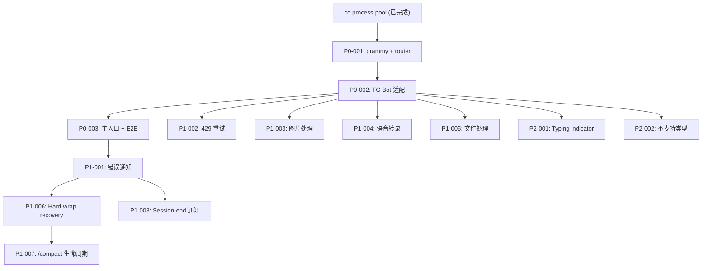

# telegram-channel - 任务拆分文档

> **任务概述**：基于 design.md 实现 Telegram Bot 消息收发 + 多 Agent 路由，集成 CommandRuntime 完成端到端通路。覆盖文本、图片、语音、文件消息处理，以及 hard-wrap recovery、session tail、typing indicator 等完善的错误恢复和会话管理。
>
> **关联文档**：
> - L2 技术设计：`features/telegram-channel/design.md`
> - L2 功能需求：`features/telegram-channel/requirements.md`
> - 测试文件：`tests/router.test.ts`、`tests/telegram.test.ts`

---

## 1. 任务拆分（Task Breakdown）

### P0 任务（MVP 必需）

| 任务 ID | 任务名称 | 预估工时 | 依赖任务 | 状态 |
|---------|---------|---------|---------|------|
| P0-001 | 安装 grammy + 路由器 | 3h | cc-process-pool 完成 | [x] 已完成 |
| P0-002 | Telegram Bot 适配 + 长文本分片 | 4h | P0-001 | [x] 已完成 |
| P0-003 | 主入口组装 + 端到端验证 | 3h | P0-002 | [x] 已完成 |

### P1 任务（增强功能）

| 任务 ID | 任务名称 | 预估工时 | 依赖任务 | 状态 |
|---------|---------|---------|---------|------|
| P1-001 | 错误通知（CC 崩溃 → TG 用户提示） | 2h | P0-003 | [x] 已完成 |
| P1-002 | 429 错误重试机制 | 2h | P0-002 | [x] 已完成 |
| P1-003 | 图片消息处理 | 3h | P0-002 | [x] 已完成 |
| P1-004 | 语音转录（STT via CC） | 3h | P0-002 | [x] 已完成 |
| P1-005 | 文件/文档处理 | 2h | P0-002 | [x] 已完成 |
| P1-006 | Hard-wrap recovery + session tail | 4h | P1-001 | [x] 已完成 |
| P1-007 | /compact 生命周期管理（session-wrap-guard） | 3h | P1-006 | [x] 已完成 |
| P1-008 | Session-end + runtime fallback 通知 | 2h | P1-001 | [x] 已完成 |
| P1-009 | 共享回合渲染、可见进度与唯一终态 | 5h | P0-002 | [x] 已完成 |
| P1-010 | `/model`、`/think` 原生 inline keyboard | 3h | P0-002 | [x] 已完成 |

### P2 任务（未来增强）

| 任务 ID | 任务名称 | 预估工时 | 依赖任务 | 状态 |
|---------|---------|---------|---------|------|
| P2-001 | Typing indicator | 1h | P0-002 | [x] 已完成 |
| P2-002 | 不支持的消息类型处理 | 1h | P0-002 | [x] 已完成 |

---

## 2. 任务详情（Task Details）

### P0-001：安装 grammy + 路由器 [x]

**任务描述**：
- 安装 grammy 生产依赖
- 实现 router.ts（支持 resolveByBotAgent, getAllAgentBots 等新接口）
- 实现 splitMessage 工具函数

**验证标准（TDD 要求）**：
- [x] **Unit Test-001**：createRouter 正确加载 relay.json
- [x] **Unit Test-002**：resolveByBotAgent(agentId, chatId) 返回正确结果
- [x] **Unit Test-003**：resolveByBotAgent 未知 chatId 返回 undefined
- [x] **Unit Test-004**：splitMessage 短文本返回单元素数组
- [x] **Unit Test-005**：splitMessage 长文本按段落分割，每片 <= 4096 字符
- [x] **Unit Test-006**：splitMessage 无段落分隔时按换行分割
- [x] **Unit Test-007**：配置文件不存在时抛出明确错误

---

### P0-002：Telegram Bot 适配 + 长文本分片 [x]

**任务描述**：
- 实现独立 bot 模式：`createTelegramBots()` + `createSingleBot()`
- 注册消息处理器（text handler）
- 集成 splitMessage 处理长回复
- 集成 prefixMessage 添加 Agent 标识前缀
- 实现 stripCCNoise 清理 CC 内部诊断信息

**验证标准（TDD 要求）**：
- [x] **Unit Test-008**：未注册 chatId 收到引导注册消息
- [x] **Unit Test-009**：已注册 chatId 触发 runtime.spawn（无活跃进程时）
- [x] **Unit Test-010**：已注册 chatId 复用现有进程
- [x] **Unit Test-011**：assistant 类型消息转发为 TG 回复
- [x] **Unit Test-012**：result 类型消息不发送给用户
- [x] **Unit Test-013**：长回复自动分片发送
- [x] **Unit Test-014**：stripCCNoise 过滤 OAuth 诊断信息
- [x] **Unit Test-015**：prefixMessage 首条消息有标识，后续无

---

### P0-003：主入口组装 + 端到端验证 [x]

**任务描述**：
- 更新 `src/index.ts`，组装 CommandRuntime + router + telegram bots
- 添加启动配置（环境变量读取、relay.json 路径）
- 创建示例 relay.json 配置文件
- 端到端验证

**验证标准（TDD 要求）**：
- [x] **Unit Test-016**：缺少 TELEGRAM_BOT_TOKEN 时抛出错误
- [x] **Unit Test-017**：relay.json 路径无效时抛出错误
- [x] **Integration Test-001**：端到端（需真实 TG bot token）

---

### P1-001：错误通知 [x]

**任务描述**：
- 监听 runtime 的 'exit'、'error'、'crash-retry' 事件
- exit：根据退出码判断是否需要通知（code 0/143/null 静默）
- error：记录日志
- crash-retry：发送"正在自动重试"提示
- 实现 suppressNextGenericExitNotice 机制避免重复通知

**验证标准**：
- [x] **Unit Test-018**：exit code != 0 时用户收到错误提示
- [x] **Unit Test-019**：exit code = 0 时静默
- [x] **Unit Test-020**：crash-retry 时用户收到重试提示

---

### P1-002：429 错误重试机制 [x]

**任务描述**：
- 实现 sendWithRetry 函数
- 解析 429 错误消息中的 retry_after 参数
- 等待指定秒数后重试（默认 1 次重试）
- 非 429 错误直接抛出

**验证标准**：
- [x] **Unit Test-021**：sendWithRetry 在 429 时等待并重试
- [x] **Unit Test-022**：sendWithRetry 非 429 错误直接抛出
- [x] **Unit Test-023**：sendWithRetry 成功时直接返回

---

### P1-003：图片消息处理 [x]

**任务描述**：
- 注册 `bot.on('message:photo')` 处理器
- 下载最大分辨率图片（photos 数组最后一个）
- CC runtime：转 base64 发送（content block type=image）
- Codex runtime：下载到临时文件发送（attachment kind=image）
- 支持 caption
- 实现 buildRuntimePhotoMessage 构建不同 runtime 的消息格式

**验证标准**：
- [x] **Unit Test-024**：buildRuntimePhotoMessage 为 CC 构建正确格式
- [x] **Unit Test-025**：buildRuntimePhotoMessage 为 Codex 构建正确格式
- [x] **Unit Test-026**：图片消息下载失败时返回错误提示

---

### P1-004：语音转录（STT via CC） [x]

**任务描述**：
- 注册 `bot.on('message:voice')` 和 `bot.on('message:audio')` 处理器
- 下载音频 buffer
- 调用 transcribeAudio（使用 CC OAuth token）转录为文本
- 转录文本作为 human message 发送
- audio 类型额外支持 caption
- 空转录返回提示

**验证标准**：
- [x] **Unit Test-027**：voice 消息触发转录并发送文本
- [x] **Unit Test-028**：audio 消息转录 + caption 合并发送
- [x] **Unit Test-029**：转录失败返回错误提示
- [x] **Unit Test-030**：空转录返回"未能识别"提示

---

### P1-005：文件/文档处理 [x]

**任务描述**：
- 注册 `bot.on('message:document')` 处理器
- 支持 image/*、application/pdf、text/* 三种 MIME 类型
- 图片和 PDF：转 base64 发送（content block type=image/document）
- 文本文件：解码为 UTF-8 文本发送（content block type=text）
- 支持 caption
- 不支持的 MIME 类型返回提示

**验证标准**：
- [x] **Unit Test-031**：PDF 文件正确处理
- [x] **Unit Test-032**：文本文件解码并发送
- [x] **Unit Test-033**：不支持的 MIME 类型返回提示

---

### P1-006：Hard-wrap recovery + session tail [x]

以下为历史实施任务。当前普通会话 `/new` 直接进行 context recovery；活动或待接续 WI 仍由 SCL 绑定守卫阻止直接换会话，不要求 `/wrap`。

**任务描述**：
- 实现 detectContextRecoveryReason 检测 CC response 中的 context-window-limit 和 compact-failed
- 实现 markRecoveryRequired 标记 session 为 recovery-required（内存 + StateManager）
- 实现 recoverRequiredFromSessionTail 读取 session jsonl 最后 256KB 检测 recovery 信号
- 实现 readFileTail 高效读取文件尾部
- 实现 getClaudeSessionFilePath 构建 session 文件路径
- 在 /new 命令中集成 hard-wrap recovery 逻辑
- 发送 RECOVERY_HINT_MESSAGE 和 HARD_WRAP_MESSAGE

**验证标准**：
- [x] **Unit Test-034**：detectContextRecoveryReason 检测 context-window-limit
- [x] **Unit Test-035**：detectContextRecoveryReason 检测 compact-failed
- [x] **Unit Test-036**：markRecoveryRequired 更新内存 + StateManager
- [x] **Unit Test-037**：/new 命令检测 recovery 并执行 hard-wrap
- [x] **Unit Test-038**：readFileTail 读取文件尾部正确

---

### P1-007：/compact 生命周期管理（session-wrap-guard） [x]

以下为历史实施任务，包含本文件原有的发送时序更正。`wrapRequestedAt` 仅作旧状态兼容，不再是 `/new` 准入条件；当前行为以 requirements.md 和 design.md 的 2026-09-29 版本为准。

**任务描述**：
- 集成 session-wrap-guard 模块
- 在文本消息中检测 wrap 证据（hasWrapEvidence）
- 在 /new 命令 handler 中直接检查 session 是否可关闭及是否需要先 /wrap
- 普通文本不做关闭意图推断，始终转发给 runtime
- 实现 markWrapRequested 和 clearWrapRequested 状态管理
- 仅对明确的 `/wrap` 请求在 runtime `send()` 前记录标记；发送拒绝或最终阻断回复须撤销，不能用请求标记证明收口完成

**验证标准**：
- [x] **Unit Test-039**：hasWrapEvidence 检测 wrap 相关内容
- [x] **Unit Test-040**：未 wrap 的 /new 被阻止；含关闭措辞的普通文本仍转发
- [x] **Unit Test-041**：markWrapRequested 更新状态

---

### P1-008：Session-end + runtime fallback 通知 [x]

**任务描述**：
- 监听 runtime 的 'session-end' 事件
- 根据 SessionEndReason.type 发送差异化通知：
  - turns-exhausted / crash / crash-unrecoverable / rate-limited / timeout / relay-shutdown / idle-reclaimed
- 监听 onRuntimeFallback 事件
- 发送 runtime 切换通知（from → to）
- 实现 turn-warning 通知（80% 轮次阈值）

**验证标准**：
- [x] **Unit Test-042**：session-end turns-exhausted 发送轮次耗尽通知
- [x] **Unit Test-043**：session-end idle-reclaimed 静默
- [x] **Unit Test-044**：runtime fallback 发送切换通知
- [x] **Unit Test-045**：turn-warning 发送 80% 阈值通知

---

### P1-009：共享回合渲染、可见进度与唯一终态 [x]

**任务描述**：
- 接入 `ChannelTurnRenderingState`，区分 delta、累积 snapshot、独立 commentary、activity overlay 与 authoritative final
- 首帧立即可见；中间帧只 edit 一条进度消息；edit/429 失败有界 coalescing
- 完成时将旧进度收为 completion marker，并在底部发送一次完整 final
- duplicate event、streaming final、result、retry/replay 幂等；正文和全文哈希不作持久 identity

**验证标准**：
- [x] Pi 短前缀→长前缀→final 不重复
- [x] 真 delta 保留重复文本片段，commentary containment 去重且独立段落可读
- [x] final/result 重放不二次发送，长文本终态无丢失
- [x] edit 失败时中间帧不扩散，最终正文仍只发送一次
- [x] tool-only activity 在 1/5/10/每 20 步可见，final 不夹带 activity 文本

### P1-010：`/model`、`/think` 原生 inline keyboard [x]

**任务描述**：
- 复用共享命令层的模型、runtime、scope、think 选项语义
- 只允许受审动作转为 Telegram inline keyboard
- callback data 使用 `rm:` opaque token；内存状态 bounded、TTL、scope 校验且 one-shot

**验证标准**：
- [x] `/model` 和 `/think` 返回原生按钮并标识当前选项
- [x] callback 执行后回显命令结果；重放、过期和跨 chat 不执行
- [x] callback data 不含 model id；缓存超过 128 条时淘汰最旧条目

---

### P2-001：Typing indicator [x]

**任务描述**：
- 监听 turn-accepted 事件开始发送 typing action
- 每 4 秒刷新一次（TG typing action 5 秒过期）
- 在 response 或 exit 时停止
- 使用 Map<poolKey, interval> 管理多个并行 typing

**验证标准**：
- [x] **Unit Test-046**：turn-accepted 触发 typing indicator
- [x] **Unit Test-047**：response 事件停止 typing

---

### P2-002：不支持的消息类型处理 [x]

**任务描述**：
- 注册 `bot.on('message')` catch-all 处理器
- 跳过已有 text handler 处理的消息
- 对 video、sticker 等返回"暂不支持"

**验证标准**：
- [x] **Unit Test-048**：video 消息返回"暂不支持视频"
- [x] **Unit Test-049**：sticker 消息返回"暂不支持贴纸"

---

## 3. 任务依赖（Task Dependencies）

---

## 4. 完成标准（Definition of Done）

### TDD 要求
- **70% Unit Tests**：router + splitMessage + bot handler + media + recovery
- **20% Integration Tests**：端到端（需真实 token，CI 跳过）
- **10% E2E**：手动 UAT（TG 发消息 → 收到回复）

### 代码质量标准
- TypeScript `strict: true`，零 `any`
- 核心模块覆盖率 >= 80%
- 单文件 <= 300 行（telegram.ts 因功能复杂可适当放宽）
- 生产依赖新增 1 个（grammy）

---

## 5. 执行顺序（Execution Order）

1. **阶段1**（P0-001）：安装 grammy，实现 router + splitMessage，TDD [x]
2. **阶段2**（P0-002）：实现 TG Bot 适配（独立 bot 模式 + 文本 + 分片 + 噪音清理），TDD [x]
3. **阶段3**（P0-003）：组装入口，端到端验证 [x]
4. **阶段4**（P1-001）：错误通知（exit/error/crash-retry） [x]
5. **阶段5**（P1-002）：429 重试机制 [x]
6. **阶段6**（P1-003）：图片消息处理 [x]
7. **阶段7**（P1-004）：语音转录 [x]
8. **阶段8**（P1-005）：文件/文档处理 [x]
9. **阶段9**（P1-006）：Hard-wrap recovery + session tail [x]
10. **阶段10**（P1-007）：/compact 生命周期管理 [x]
11. **阶段11**（P1-008）：Session-end + runtime fallback 通知 [x]
12. **阶段12**（P2-001）：Typing indicator [x]
13. **阶段13**（P2-002）：不支持的消息类型 [x]

---

## 6. 风险识别（Risk Identification）

### 技术风险

- **风险1：grammy mock 困难**
  - 影响：无法在无网络环境下测试 bot 行为
  - 缓解措施：将消息处理逻辑抽为纯函数（接受 ctx-like 对象），便于 mock

- **风险2：语音转录依赖 CC OAuth token**
  - 影响：token 过期或缺失时语音功能不可用
  - 缓解措施：transcribeAudio 内部处理错误，TG 返回友好提示

- **风险3：Session tail 读取依赖文件系统结构**
  - 影响：CC 更改 session 文件存储路径会导致 tail 读取失败
  - 缓解措施：路径构建失败时 fallback 到不读取 tail

- **风险4：多 bot 实例资源消耗**
  - 影响：每个 bot 实例维护独立的 Map 和 interval，大量 Agent 时内存压力
  - 缓解措施：实际 Agent 数量有限（~12个）；timer 使用 unref() 避免阻止进程退出

### 进度风险

- **风险1：真实 TG bot token 不可用**
  - 缓解措施：Unit Tests 覆盖核心逻辑；UAT 延迟到部署阶段
