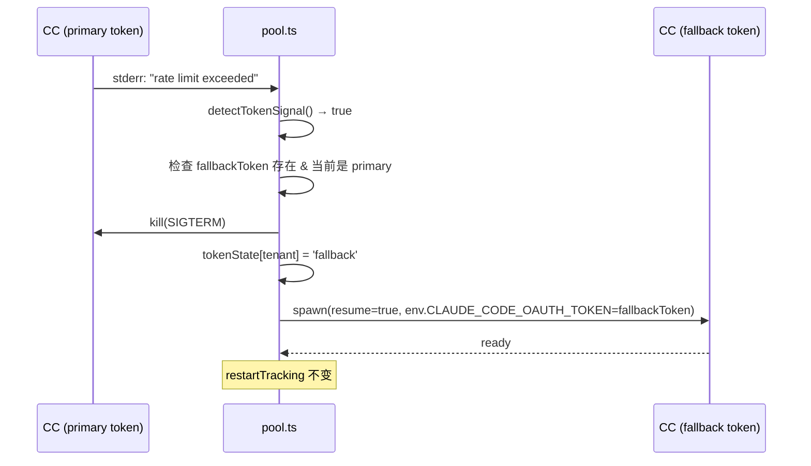
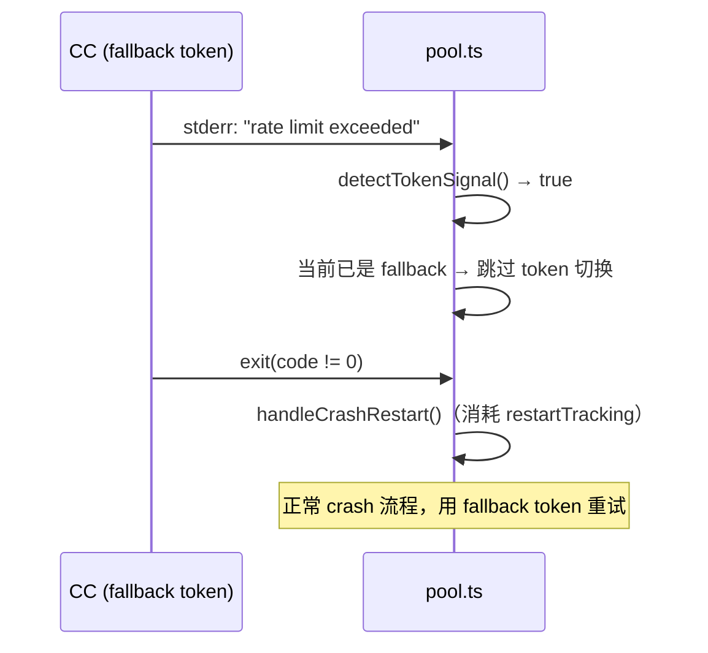
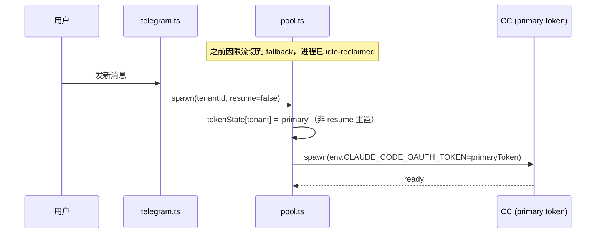

# token-fallback - 技术设计文档

> **设计概述**：在 Pool 层增加双 Token 管理，通过 stderr 信号检测限流/认证失败，自动切换到备用 Token 重新 spawn CC 进程，不消耗 crash restart 配额。
>
> **关联文档**：
> - L1项目架构：`project-specs/project-architecture.md`
> - L2功能需求：`features/token-fallback/requirements.md`
> - L2任务拆分：`features/token-fallback/tasks.md`

---

## 1️⃣ 技术栈（Tech Stack）

**基于L1项目架构**：`project-specs/project-architecture.md`

- **运行时**：Node.js ≥ 18
- **语言**：TypeScript 5.x（strict: true）
- **测试**：vitest
- 无新增依赖

---

## 2️⃣ 架构设计（Architecture Design）

### 组件划分

```
token-fallback — pool.ts 内部增强
├── TokenState（每租户 Token 状态追踪）
├── detectTokenSignal()（stderr 信号匹配）
├── handleTokenFallback()（切换 + respawn 逻辑）
└── spawnProcess() 增强（env 注入当前 Token）
```

### 核心原则

**不新增文件**。Token fallback 是 Pool 进程管理的一部分，逻辑内聚在 pool.ts。仅扩展 types.ts 增加类型定义。

### 模块关系

```
pool.ts
  ├─ spawnProcess()
  │   └─ 读取 tokenState[tenantId] → 注入对应 Token 到 env
  ├─ setupProcess() → stderr listener
  │   └─ detectTokenSignal(text) → 匹配到 → handleTokenFallback(tenantId)
  └─ handleTokenFallback()
      ├─ kill 当前进程
      ├─ 切换 tokenState
      └─ spawnProcess(resume=true)（不消耗 restartTracking）
```

---

## 3️⃣ 接口定义（Interface Definition）

### 内部函数接口（无外部接口变更）

**Function-001：createPool 增强 — PoolOptions 扩展**

```typescript
interface PoolOptions {
  // ... 现有字段不变
  primaryToken?: string;    // 从 env CLAUDE_CODE_OAUTH_TOKEN 读取
  fallbackToken?: string;   // 从 env CLAUDE_CODE_OAUTH_TOKEN_FALLBACK 读取
}
```

**Function-002：detectTokenSignal — stderr 信号检测**

```typescript
function detectTokenSignal(text: string): boolean
// 匹配以下关键词（不区分大小写）：
// - 'rate limit' / 'rate_limit'
// - 'overloaded'
// - '401' / '429'
// - 'insufficient_quota'
// 返回 true 表示需要 Token 切换
```

**Function-003：handleTokenFallback — Token 切换**

```typescript
async function handleTokenFallback(tenantId: string): Promise<void>
// 1. 检查是否有 fallbackToken 可用
// 2. 检查当前是否已在使用 fallback（避免循环）
// 3. Kill 当前进程
// 4. 翻转 tokenState[tenantId]
// 5. spawnProcess(resume=true)
// 6. 不修改 restartTracking
```

---

## 4️⃣ 数据模型（Data Model）

### Entity-001：TokenState（内存，per-tenant）

```typescript
type TokenTier = 'primary' | 'fallback';

// pool.ts 内部 Map
const tokenState = new Map<string, TokenTier>();
// 默认值：'primary'
// 切换时翻转为 'fallback'
// 新 spawn（非 resume）时重置为 'primary'
```

### Entity-002：PoolOptions 扩展

```typescript
interface PoolOptions {
  idleTimeoutMs?: number;
  cleanupIntervalMs?: number;
  maxRestartsPerHour?: number;
  killTimeoutMs?: number;
  primaryToken?: string;      // 新增
  fallbackToken?: string;     // 新增
}
```

---

## 5️⃣ 数据流（Data Flow）

### 场景1：Primary 限流 → Fallback 切换



### 场景2：Fallback 也失败 → 正常 crash 流程



### 场景3：新 spawn 恢复 primary



---

## 6️⃣ 错误处理（Error Handling）

| 场景 | 处理策略 |
|------|---------|
| fallbackToken 未设置 + 检测到限流 | 跳过 fallback，走正常 crash 流程 |
| 已在 fallback + 再次限流 | 跳过 fallback，走正常 crash 流程 |
| fallback spawn 失败 | 标记 dead，走正常 crash-unrecoverable 流程 |
| 两个 Token 相同 | 等同于单 Token 模式 |

---

## 7️⃣ 安全设计（Security Design）

- Token 通过 env 注入 CC 子进程，不写入文件
- 日志仅输出 Token 前 8 字符：`token: "sk-ant-oa..."`
- spawnProcess 的 env 清理逻辑不变（仍剔除 BOT_TOKEN_* 等）

---

## 8️⃣ 性能优化（Performance Optimization）

- **零运行时开销**：detectTokenSignal 仅在 stderr data 事件中调用（已有监听器，不新增）
- **切换延迟**：kill(SIGTERM) + spawn ≤ 5s（与 crash restart 同量级）
- **内存**：tokenState Map 每条目仅一个字符串，可忽略

---

## 9️⃣ Key Pool 机制（Model Catalog 模式，替代 tokenState）

> 当 `models.json` 配置了 `providers` 节时，token fallback 的双 OAuth token 机制被 **key pool** 取代。Key pool 是 provider 级别的多 key 管理，支持 sticky（粘性）、skipped（429 跳过）、和 cooldown（冷却期）。

### 9.1 数据结构

```typescript
// 粘性 key — 每个 poolKey 记住上次成功使用的 envVar，减少 key 轮换
const stickyKeyMap = new Map<string, string>();  // poolKey → envVar

// 跳过的 key — 每个 poolKey 记录 429'd key 及其冷却到期时间
const skippedKeysMap = new Map<string, Map<string, number>>();  // poolKey → (envVar → resetAt)

// poolKey 格式：{tenantId}:{providerName}（如 "eric:companion:openrouter"）
```

### 9.2 resolveApiKey — Key 解析

```typescript
function resolveApiKey(poolKey: string, provider: ProviderDef): { keyEnvVar: string; keyValue: string } | null
```

1. **Sticky key 检查**：如果 sticky key 存在且不在冷却期 → 直接返回
2. **Pool 遍历**：按 `api_key_pool` 数组顺序，跳过冷却中的 key，返回第一个有值的 key，并设为 sticky
3. **全部不可用**：返回 null

### 9.3 clearStickyKey — 429 后标记跳过

```typescript
function clearStickyKey(poolKey: string, skipEnvVar?: string, errorText?: string): void
```

- 清除 sticky key
- 将失败的 key 加入 `skippedKeysMap`，resetAt 由 `parseResetTime(errorText)` 解析；解析失败时默认 60 秒冷却

### 9.4 allKeysInCooldown — 全量冷却判定

```typescript
// 只检查 process.env 中有值的 key（activeKeys）
const activeKeys = provider.api_key_pool.filter(envVar => !!process.env[envVar]);
const allKeysInCooldown = activeKeys.length > 0 && activeKeys.every(envVar => {
  const resetAt = skipped.get(envVar);
  return resetAt !== undefined && Date.now() < resetAt;
});
```

**关键修复（bug-20260617）**：只检查有值的 key。Pool 中未 export 的 env var（如某个备用 key 在 macOS 上从未设置）永远不会被选中，不应阻塞冷却判定。否则即使所有活跃 key 都 429，`every()` 仍返回 false → 永远走指数退避而非切换 provider。

### 9.5 isProviderErrorSignal — Provider 500 错误检测

```typescript
function isProviderErrorSignal(text: string): boolean
```

检测 provider 端 API 错误（非 429 限流）：
- `APIError: 500` / `APIError:500`（PTY 渲染可能截断为 `APIErro: 500`）
- `model not found` / `PathDomainError`
- `request failed`
- 通用模式：`\b500\b` + `error` + `message`

**用途**：`handleCrashRestart` 检测到 provider 500 错误时，不再用同一 provider 重试，而是按 priority 切换到下一个 provider（见 §10）。

### 9.6 detectTokenSignal 更新

```typescript
function detectTokenSignal(text: string): boolean {
  return isRateLimitSignal(text) || text.toLowerCase().includes('401') || isProviderErrorSignal(text);
}
```

stderr 出现 500 错误时也会清除 sticky key，确保下次 spawn 不会选同一个坏 key。

---

## 🔟 handleCrashRestart Provider Fallback

> 当 CC 进程因 provider 500 错误崩溃时（不是 429），`handleCrashRestart` 不再盲目用同一 provider 重试，而是按模型 priority 切换到下一个可用 provider。

### 触发条件

```typescript
const crashText = lastStdoutSignal.get(tenantId) ?? lastStderr.get(tenantId) ?? '';
if (isProviderErrorSignal(crashText) && modelCatalog) {
  // 尝试切换 provider
}
```

### 切换流程

1. 检测 crash 文本是否匹配 `isProviderErrorSignal`
2. 调用 `findNextAvailableModel(currentModelId, isProviderCoolingDown)` 获取下一个可用 provider
3. 如果找到（且不是当前 provider）：
   - Kill 当前进程
   - Spawn 新 session（`resume: false`，不同 provider session 不兼容）
   - 注入 fallbackContext（前一 session JSONL 路径 + 模型名 + 切换原因）
   - 重放待处理消息
4. 如果没找到：走原有 crash restart 逻辑（resume 同一模型）

### 与 handleRateLimitRestart 的区别

| 路径 | 触发 | allKeysInCooldown | 行为 |
|------|------|-------------------|------|
| handleRateLimitRestart | 429 检测 | true | 按 priority 切换 provider（新 session） |
| handleRateLimitRestart | 429 检测 | false | 指数退避 → resolveApiKey 跳过 429 key 选下一个 |
| handleCrashRestart | 500/model-not-found | N/A | 检测 isProviderErrorSignal → 按 priority 切换 provider |

---

## 1️⃣1️⃣ parseResetTime — 429 冷却时间解析

> 从 provider 的 429 错误文本中提取配额重置时间戳，用于 skippedKeysMap 的 cooldown 判定。

### 正则

```typescript
const match = cleaned.match(/(\d{4})-(\d{2})-(\d{2})[T ]?(\d{2}):(\d{2}):(\d{2})/);
```

**关键修复（bug-20260617）**：分隔符 `[T ]?` 可选。PTY 渲染会吃掉日期和时间之间的空格（`2026-06-1801:52:49`），原正则 `[T ]` 要求有分隔符 → 匹配失败 → 默认 60 秒冷却 → 60 秒指数退避后冷却刚好过期 → 同一 key 被重新选中 → 死循环。

### 不依赖 "reset at" 前缀

直接匹配 `\d{4}-\d{2}-\d{2}` 日期模式，因为 PTY 渲染可能把 "reset at" 变成 "rsetat" 等乱码。纯数字 request ID（如 `20260617095543...`）无连字符，不会误匹配。

### 模块独立

`parseResetTime` 和 `stripAnsiEscapes` 提取到 `src/parse-reset-time.ts` 独立模块，便于单元测试。测试覆盖 9 种场景（干净文本、ISO 日期、ANSI 转义、?-前缀 CSI、OSC、乱码前缀、无分隔符日期、纯数字 request ID 不匹配、空字符串）。
