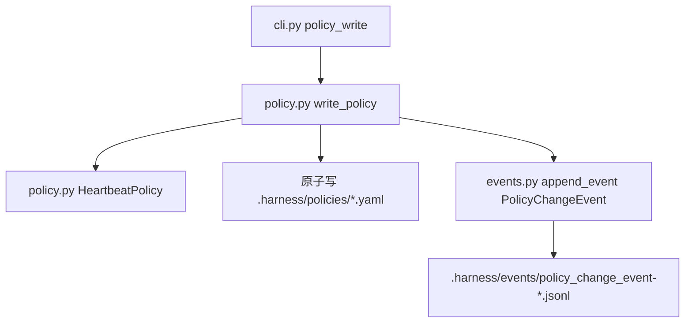

# agent-self-authored-policy - 技术设计文档

> **设计概述**：在现有 `harness/policy.py`（schema）+ `harness/events.py`（事件框架）+ `harness/cli.py`（Click CLI）上**增量扩展**，不改现有代码逻辑。新增 1 类事件（`PolicyChangeEvent`）、3 个模块级函数（`write_policy` / `show_policy` / `diff_policy`）、3 个 CLI 子命令（`policy write` / `policy show` / `policy diff`），扩展 1 个既有子命令（`policy validate` 增 `--from`）。
>
> **关联文档**：
> - L1 项目架构：`project-specs/project-architecture.md`
> - L2 功能需求：`features/agent-self-authored-policy/requirements.md`
> - L2 任务拆分：`features/agent-self-authored-policy/tasks.md`（后续产出）
> - 现有代码：`harness/policy.py`（schema）/ `harness/events.py`（事件）/ `harness/cli.py`（CLI 入口）

---

## 1️⃣ 技术栈

**基于 `project-specs/project-architecture.md`**（无新增依赖）：

| 项 | 选择 | 在本 feature 的用途 |
|----|------|---------------------|
| **Python 3.11+** | 语言 | 全栈 |
| **Click** | CLI 框架 | 新增 `policy write/show/diff` 子命令挂到既有 `@main.group() policy` 下 |
| **Pydantic v2** | Schema | 复用 `HeartbeatPolicy` 做校验；新增 `PolicyChangeEvent` 继承 `EventBase` |
| **PyYAML** | YAML 序列化 | 读草稿 / 写入 / show 输出 |
| **stdlib `hashlib`** | SHA-256 | previous/new content hash（事件字段） |
| **stdlib `tempfile` + `os.replace`** | 原子写 | NFR-REL-001 |
| **stdlib `difflib`** | diff 输出 | `policy diff` 子命令（unified diff 格式） |

**选型依据**：
- 零新依赖：所有功能能在现有栈内实现，避免 `pyproject.toml` 扩容
- 复用 `EventBase` 框架：新事件走同一套 JSONL append + 月 shard，审计链路天然打通
- `os.replace` 原子性：POSIX 保证同目录内 rename 原子，满足"schema 失败时原文件零改动"的强约束

---

## 2️⃣ 架构设计

### 组件划分

```
agent-self-authored-policy
├── CLI 层（harness/cli.py 内扩展）
│   ├── policy write <agent> --from <path> --as-agent <caller>
│   ├── policy show <agent>
│   ├── policy diff <agent> --from <path>
│   └── policy validate <agent> [--from <path>]  (扩展既有命令)
├── 业务逻辑层（harness/policy.py 扩展函数）
│   ├── write_policy(target_agent, source_path, caller, harness_root) → PolicyChangeEvent
│   ├── show_policy(target_agent, harness_root) → str  (yaml 文本)
│   ├── diff_policy(target_agent, source_path, harness_root) → str  (unified diff)
│   └── validate_draft(source_path) → None | raises PolicyValidationError
├── 数据模型层
│   ├── HeartbeatPolicy (既有, 复用)
│   └── PolicyChangeEvent (新增于 harness/events.py)
└── 持久化层（复用既有）
    ├── .harness/policies/<agent>.yaml
    └── .harness/events/policy_change_event-YYYY-MM.jsonl
```

### 模块关系



**职责边界**：

- **CLI 层**：只做参数解析 + exit code 映射；业务逻辑零行
- **业务层 `write_policy`**：串起 validate → atomic-write → append-event 三步；负责事务性（validate 失败时不写文件、不发事件）
- **Schema 层**：完全复用既有 `HeartbeatPolicy.model_validate()`；本 feature 不扩字段
- **事件层**：新增 `PolicyChangeEvent` 继承 `EventBase`，自动享用 `append_event` 已有的 O_APPEND atomicity

---

## 3️⃣ 接口定义

### 3.1 CLI 子命令接口（对外）

#### CLI-001：`policy write`

```
harness policy write <AGENT_ID> --from <PATH> --as-agent <CALLER>
```

| 参数 | 类型 | 必填 | 说明 |
|------|------|------|------|
| `AGENT_ID` | positional str | ✓ | 目标 agent（正则 `[a-z][a-z0-9-]{1,30}`） |
| `--from` | `click.Path(exists=True, dir_okay=False, readable=True)` | ✓ | 草稿 YAML 路径 |
| `--as-agent` | str | ✓ | 声明调用者身份（accountability） |

**退出码**：
- `0` = 写入成功
- `2` = 参数或 schema 校验失败（附 stderr 明细）
- `1` = 其他错误（IO / 未预期异常）

**stdout 格式**（成功）：
```
written to .harness/policies/amanda.yaml (2134 bytes, updated)
event_id: ev_1745119800123_a7f3
```

**stderr 格式**（schema 失败）：
```
policy validation failed for agent=amanda source=<path>
  frequency_hint: Value must be a valid cron expression
  scan_items.0.default_autonomy: Input should be 'mechanical', 'autonomous_llm' or 'escalate'
```

#### CLI-002：`policy show`

```
harness policy show <AGENT_ID>
```

退出码：`0` 成功 / `1` 文件不存在

stdout：YAML 原样输出（`path.read_text(encoding="utf-8")`，保留注释和顺序）

#### CLI-003：`policy diff`

```
harness policy diff <AGENT_ID> --from <PATH>
```

退出码：`0` 命令成功（**无论是否有 diff**）/ `1` 任一文件不存在或不可读

stdout：unified diff（`difflib.unified_diff` 生成），空 diff 时输出为空

#### CLI-004：`policy validate` 扩展

```
harness policy validate <AGENT_ID> [--from <PATH>]
```

- 无 `--from`：沿用既有行为（读 `.harness/policies/<agent>.yaml`）
- 带 `--from`：校验草稿，**不写盘**

退出码不变：`0` valid / `1` 不存在或无效。

### 3.2 业务函数接口（模块内）

```python
# harness/policy.py（新增）

def write_policy(
    target_agent: str,
    source_path: Path,
    caller: str,
    harness_root: Path | None = None,
) -> "PolicyChangeEvent":
    """Validate a policy draft and atomically write it to the canonical location.

    Steps:
        1. Read + parse + schema-validate source_path (raises PolicyValidationError on failure)
        2. Compute previous_sha256 (None if target file absent)
        3. Compute new_sha256 from source bytes
        4. Atomic write: NamedTemporaryFile → fsync → os.replace → .harness/policies/<agent>.yaml
        5. Build PolicyChangeEvent; call events.append_event(event)
        6. Return the event

    Raises:
        PolicyValidationError: schema failure, leaves target untouched
        ValueError: target_agent or caller fails regex
        FileNotFoundError: source_path missing
    """


def show_policy(target_agent: str, harness_root: Path | None = None) -> str:
    """Return UTF-8 text of .harness/policies/<agent>.yaml; raise PolicyNotFoundError if absent."""


def diff_policy(
    target_agent: str,
    source_path: Path,
    harness_root: Path | None = None,
) -> str:
    """Return unified diff (source - target). Empty string if identical.

    Treats missing target as empty string (so first-write diff shows full source).
    """


def validate_draft(source_path: Path) -> None:
    """Parse + schema-validate source_path without touching .harness/policies/.

    Raises:
        PolicyValidationError
        FileNotFoundError
    """
```

### 3.3 事件 schema（`harness/events.py` 新增）

```python
class PolicyChangeEvent(EventBase):
    """Event emitted on successful harness policy write.

    Privacy: does NOT include policy content; only hashes + source path
    + change_type (for auditor to cross-reference Git commits).
    """
    event_type: Literal["policy_change_event"]
    target_agent: str           # agent whose policy file was written
    caller: str                 # --as-agent value (accountability)
    source_path: str            # repo-relative path of the draft YAML
    bytes_written: int          # len of source bytes after atomic replace
    change_type: Literal["created", "updated"]  # previous_sha256 is None ⇒ created
    previous_sha256: str | None # hex digest of prior target content (None if created)
    new_sha256: str             # hex digest of source bytes
```

**字段复用 `EventBase`**：`schema_version / event_id / event_type / agent_id / scan_id / trigger_mode / occurred_at`。`agent_id` 对此事件含义为"target agent"（与 `target_agent` 字段冗余但与其他事件保持字段位一致，便于查询），`scan_id` 固定为 `None`，`trigger_mode` 为 `"policy_write"`。

---

## 4️⃣ 数据模型

### Model-001：PolicyChangeEvent（上节 3.3 已定义）

### Model-002：CLI 参数校验模型（隐式）

无显式 Pydantic 模型；通过 Click 的 type + 业务层的正则校验实现：

- `AGENT_ID` / `caller`：`re.fullmatch(r"[a-z][a-z0-9-]{1,30}", value)`
- `source_path`：Click `type=click.Path(exists=True, dir_okay=False, readable=True)` + 业务层 `_assert_path_in_repo()`

### 路径布局

```
<HARNESS_ROOT>/
├── policies/
│   └── <agent>.yaml                          # 既有，write 原子替换
└── events/
    └── policy_change_event-YYYY-MM.jsonl     # 新增；按月 shard
```

`HARNESS_ROOT` 解析遵循既有约定（env `HARNESS_ROOT` / cwd `.harness` fallback）。

---

## 5️⃣ 数据流

### Flow-001：`write_policy` happy path

```mermaid
sequenceDiagram
    participant U as User/Agent shell
    participant CLI as cli.py policy_write
    participant BL as policy.py write_policy
    participant SC as HeartbeatPolicy (Pydantic)
    participant FS as Filesystem
    participant EV as events.append_event

    U->>CLI: harness policy write amanda --from draft.yaml --as-agent amanda
    CLI->>BL: write_policy("amanda", Path("draft.yaml"), "amanda")
    BL->>FS: read source bytes
    BL->>SC: HeartbeatPolicy.model_validate(yaml.safe_load(bytes))
    SC-->>BL: PolicyInstance (ok)
    BL->>FS: stat .harness/policies/amanda.yaml → previous_sha256 (or None)
    BL->>FS: NamedTemporaryFile(dir=policies/) → write bytes → fsync → os.replace
    FS-->>BL: ok
    BL->>EV: append_event(PolicyChangeEvent(...))
    EV->>FS: append JSONL line to events/policy_change_event-YYYY-MM.jsonl
    BL-->>CLI: event (含 event_id)
    CLI-->>U: stdout "written to ... event_id: ev_..."; exit 0
```

### Flow-002：schema 失败 → 原子拒绝

```mermaid
sequenceDiagram
    participant U
    participant CLI
    participant BL
    participant SC
    participant FS

    U->>CLI: harness policy write amanda --from bad.yaml --as-agent amanda
    CLI->>BL: write_policy(...)
    BL->>FS: read source bytes
    BL->>SC: model_validate(...)
    SC-->>BL: raise ValidationError("frequency_hint: ...")
    BL-->>CLI: raise PolicyValidationError
    Note over FS: .harness/policies/amanda.yaml 未被触碰
    CLI-->>U: stderr "policy validation failed...\n  frequency_hint: ..."; exit 2
```

**关键不变式**：校验失败**必须**在任何 FS 写之前发生。代码顺序：read → parse → validate → hash → atomic-write → append-event。validate 失败直接 raise，后续步骤不执行。

### Flow-003：`diff_policy`

```
source_bytes = source_path.read_bytes()
target_bytes = target_path.read_bytes() if target_path.exists() else b""
source_text = source_bytes.decode("utf-8").splitlines(keepends=True)
target_text = target_bytes.decode("utf-8").splitlines(keepends=True)
diff_lines = difflib.unified_diff(
    target_text, source_text,
    fromfile=f".harness/policies/{agent}.yaml",
    tofile=str(source_path),
    lineterm="",
)
return "".join(diff_lines)
```

---

## 6️⃣ 错误处理

### 异常映射

| 触发条件 | 异常类 | CLI 退出码 | stderr 内容 |
|---------|-------|-----------|-------------|
| schema 非法 | `PolicyValidationError` | `2` | "policy validation failed for agent=..." + Pydantic 错误列表 |
| source 文件不存在 | `FileNotFoundError`（Click 前置校验兜底） | `2` | Click 默认 "Invalid value" |
| target agent 正则不符 | `ValueError` | `2` | "invalid agent_id: ..." |
| caller 正则不符 | `ValueError` | `2` | "invalid as-agent: ..." |
| source_path 逃逸仓库 | `ValueError` | `2` | "source_path must be inside the repository" |
| target 文件不存在（`show`） | `PolicyNotFoundError` | `1` | "policy not found: ..." |
| 写入时磁盘错 | `OSError` | `1` | "failed to write ...: <msg>"（保持既有代码路径不可达时用 pragma: no cover） |

### 日志

本 feature 不引入 logging 框架——所有反馈通过 stdout/stderr。事件 JSONL 即审计日志。

---

## 7️⃣ 安全设计

### 7.1 Accountability（非 Authorization）

- `--as-agent` 只是**声明**，不做密码学验证
- 留痕三层：`PolicyChangeEvent.caller` / Git commit author / 时间戳
- Reeve 可在 daily 审计中交叉验证：`caller` 与 Git commit author 是否一致、是否存在 `caller ≠ target_agent` 的越界写入
- 未来升级路径：与 Relay token 体系整合时，把 `--as-agent` 替换为 token 解析，本 feature 接口保持兼容

### 7.2 路径安全

- `AGENT_ID` / `caller` 严格正则 → 防 `..` / `/` 逃逸和写入恶意路径
- `source_path` 通过 `Path(source_path).resolve()` + 检查是否在 `Path.cwd().resolve()` 子树内 → 拒绝仓库外路径
- 原子写在 target 同目录创建 tmp 文件 → 避免跨文件系统 `os.replace` 失败

### 7.3 并发

- O_APPEND atomicity 已由 `append_event` 提供
- `write_policy` 同目录 `os.replace` POSIX 保证原子 → 多个并发 `policy write` 可能出现"最后写入者胜"，但**每次写入都是完整的**；事件链能追溯顺序（`occurred_at` + JSONL 行序）
- 不引入文件锁（会与 heartbeat-runtime 的 `locks.py` 语义冲突，其用途是 scan 互斥；policy write 是低频管理动作，不需要）

---

## 8️⃣ 性能设计

### 性能目标（对齐 requirements NFR）

- `write`: < 500ms（typical 2KB policy）
- `show`: < 200ms
- 事件 JSONL append: < 50ms

### 预估开销

- YAML parse: ~5-20ms（PyYAML C 扩展）
- Pydantic validate: ~1-5ms
- SHA-256 × 2: ~1ms（2KB 数据）
- `os.replace`: ~1-5ms
- `append_event`: ~5-20ms（小文件 O_APPEND）
- **总计预期 <100ms**，留 5× 余量

### 不做的优化

- 不缓存 `HeartbeatPolicy` schema 实例（Pydantic 本身已缓存类级验证器）
- 不异步化（CLI 单次调用，异步收益为负）

---

## 9️⃣ 关键决策记录

| # | 决策 | 备选 | 选择理由 |
|---|------|------|---------|
| **D-001** | 事件放 `PolicyChangeEvent` 继承 `EventBase` | 独立 JSONL 格式 | 复用 `append_event` 的 O_APPEND 保证 + 统一审计入口 |
| **D-002** | 原子写用 `NamedTemporaryFile` + `os.replace` | 直接 `write_text` | 满足 AC-P0-002"失败时原文件零改动" |
| **D-003** | `--as-agent` 仅 accountability，不做鉴权 | TG-style token 校验 | 平台简单；靠事件 + Git + Reeve 审计三层兜底；未来可扩展 |
| **D-004** | 不新增模块，扩展 `policy.py` / `events.py` / `cli.py` | 新建 `policy_write.py` | 保持 harness 模块数稳定（11→11）；函数规模 <200 行可控 |
| **D-005** | `diff` 返回 unified diff 而非 YAML 语义差 | 语义级 dict diff | 人类可读；复用 stdlib `difflib`；语义差可由 `yq` 等外部工具做 |
| **D-006** | `show` 输出 YAML 原文（带注释顺序）而非 `yaml.safe_dump(load())` | round-trip | 保留 Agent 写的注释；AC-P0-004 等价性按 `safe_load` 后 dict 比较 |
| **D-007** | 校验顺序 read → parse → schema → IO | 先 lock 后校验 | 无需锁（非并发临界）；fail-fast 早拒绝 |
| **D-008** | `PolicyChangeEvent.agent_id` 与 `target_agent` 冗余存放 | 仅 target_agent | 保持 `EventBase.agent_id` 字段位一致，便于跨事件查询 |

---

## 🔟 与既有代码的契约边界

**零修改清单**（AC-P0-006 依据）：
- `harness/policy.py`：`HeartbeatPolicy` schema 类 / `load_policy` / `policy_path` / `PolicyNotFoundError` / `PolicyValidationError` 保持不变
- `harness/dispatcher.py`：零改动
- `harness/scan.py`：零改动
- `harness/cli.py` `policy validate` 既有逻辑：仅增 `--from` 可选参数，无 `--from` 走原路径

**允许扩展清单**：
- `harness/policy.py`：新增 `write_policy` / `show_policy` / `diff_policy` / `validate_draft` 4 个模块级函数
- `harness/events.py`：新增 `PolicyChangeEvent` 类
- `harness/cli.py`：在 `@main.group() policy` 下新增 3 个子命令；扩展 `policy_validate` 一个可选参数

**回归保证**：现有 711 tests 全部通过（新增代码不触碰旧代码路径）。

