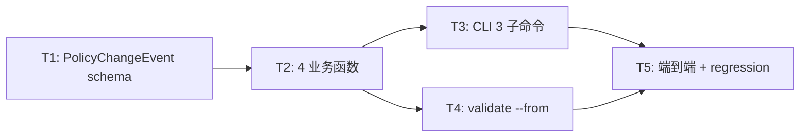

# agent-self-authored-policy - 任务拆分文档

> **任务概述**：按 design.md §2 组件 + §9 决策，分 5 个 P0 任务实现 MVP：先 event schema（T1，独立）→ 再业务函数（T2，含原子写和 diff）→ 再 CLI 挂接（T3）→ 再扩展 validate（T4）→ 最后端到端回归（T5）。全程 TDD，覆盖率 100%（遵循 project-standards.md + `feedback_100_coverage.md`）。
>
> **关联文档**：
> - L2 功能需求：`features/agent-self-authored-policy/requirements.md`
> - L2 技术设计：`features/agent-self-authored-policy/design.md`
> - TDD 测试文件：`tests/test_policy_write.py`（新增）+ `tests/test_events.py`（扩展）+ `tests/test_cli.py`（扩展）

---

## 1️⃣ 任务拆分（Task Breakdown）

### P0 任务（MVP 必需）

| ID | 任务 | 工时 | 依赖 | 负责人 | 状态 |
|----|------|------|------|-------|------|
| T1 | `PolicyChangeEvent` schema + events.py 扩展 | 1.5h | — | Ken | todo |
| T2 | `write_policy` / `show_policy` / `diff_policy` / `validate_draft` 4 函数 + policy.py 扩展 | 3h | T1 | Ken | todo |
| T3 | CLI 新增 3 子命令（`policy write/show/diff`）+ cli.py 扩展 | 1.5h | T2 | Ken | todo |
| T4 | 扩展 `policy validate --from <path>` | 0.5h | T2 | Ken | todo |
| T5 | 端到端集成测试 + regression（AC-P0-006/007） | 1.5h | T3, T4 | Ken | todo |

**P0 总工时**：8h

### P1 任务（本 session 不做，backlog）

| ID | 任务 | 工时 | 依赖 | 触发条件 |
|----|------|------|------|---------|
| P1-001 | `policy diff` 已在 P0-T2/T3 内实现（FR-P1-002 提前完成） | — | — | 无需 |
| P1-002 | `policy validate --from` 在 P0-T4 内实现（FR-P1-001 提前完成） | — | — | 无需 |

**说明**：FR-P1-001 和 FR-P1-002 因实现成本极低（同一批函数共用工具代码），合并到 P0 一次性交付。本 feature 无悬挂 P1 任务。

### P2 任务（Out of Scope，见 requirements §6）

不做：鉴权、rollback、schema 扩展、物理位置迁移。

---

## 2️⃣ 任务详情（Task Details）

### T1：`PolicyChangeEvent` schema + events.py 扩展

**任务描述**：
- 基于 design.md §3.3 Model 定义 + §4 Model-001，在 `harness/events.py` 新增 `PolicyChangeEvent` Pydantic 类，继承 `EventBase`
- 不修改现有 4 类事件（ScanEvent / DispatchEvent / AutonomousExecutionEvent / EscalationEvent）
- 不修改 `append_event` 函数（PolicyChangeEvent 继承 EventBase 自动可用）

**输入**：
- design.md §3.3 `PolicyChangeEvent` 字段定义
- design.md §4 Model-001
- `harness/events.py` 现有 `EventBase` 基类

**输出**：
- `harness/events.py` 新增类 `PolicyChangeEvent`
- `tests/test_events.py` 新增测试组 `TestPolicyChangeEvent`

**TDD 要求**（Unit Test，覆盖率 100%）：
- [ ] **UT-T1-001**：构造合法 `PolicyChangeEvent`（change_type=created，previous_sha256=None），字段按预期
- [ ] **UT-T1-002**：构造合法 `PolicyChangeEvent`（change_type=updated，previous_sha256 非空），字段按预期
- [ ] **UT-T1-003**：`previous_sha256` 类型错误（非 hex str）→ ValidationError
- [ ] **UT-T1-004**：`change_type` 枚举外的值 → ValidationError
- [ ] **UT-T1-005**：`occurred_at` 非 tz-aware → ValidationError（继承自 EventBase 行为）
- [ ] **UT-T1-006**：`model_dump(mode="json")` 产出 JSON-safe（datetime → ISO8601 字符串）
- [ ] **UT-T1-007**：`append_event(PolicyChangeEvent(...))` 写入 `events/policy_change_event-YYYY-MM.jsonl`，文件末行可被 `json.loads` + `PolicyChangeEvent.model_validate_json`

**完成标准**：
- [ ] PolicyChangeEvent 类已实现
- [ ] 上述 UT 全通过
- [ ] `pytest tests/test_events.py` 新增测试 100% cov
- [ ] **既有 events 相关测试无回归**（重要：验证 AC-P0-006 的一部分）
- [ ] 对应需求 AC-P0-003 的 schema 部分通过

---

### T2：4 个业务函数 + policy.py 扩展

**任务描述**：
- 基于 design.md §3.2 业务接口 + §5 Flow-001/002/003，在 `harness/policy.py` 新增 4 个模块级函数：
  - `write_policy(target_agent, source_path, caller, harness_root=None) → PolicyChangeEvent`
  - `show_policy(target_agent, harness_root=None) → str`
  - `diff_policy(target_agent, source_path, harness_root=None) → str`
  - `validate_draft(source_path) → None`
- 不修改现有 `HeartbeatPolicy` / `load_policy` / `policy_path` / 异常类
- 实现原子写：`NamedTemporaryFile` + `fsync` + `os.replace`（design.md D-002）
- 实现路径安全校验：agent_id / caller 正则 + source_path 仓库内部校验（design.md §7.2）

**输入**：
- design.md §3.2 函数签名与 docstring
- design.md §5 Flow-001/002/003
- design.md §7 安全设计
- T1 的 `PolicyChangeEvent` 类

**输出**：
- `harness/policy.py` 新增 4 个公开函数 + 私有辅助 `_assert_path_in_repo` / `_compute_sha256` / `_atomic_replace`
- `tests/test_policy_write.py`（新文件）

**TDD 要求**（Unit Test，覆盖率 100%）：

*write_policy*：
- [ ] **UT-T2-001**：合法草稿 → 文件被替换，返回 PolicyChangeEvent，事件字段完整（含 new_sha256 / bytes_written）
- [ ] **UT-T2-002**：目标不存在（首次写）→ `change_type="created"`，`previous_sha256=None`
- [ ] **UT-T2-003**：目标已存在（覆盖）→ `change_type="updated"`，`previous_sha256` 为原文件 SHA
- [ ] **UT-T2-004**：Schema 失败 → raises `PolicyValidationError`；目标文件 mtime_ns + SHA-256 不变（AC-P0-002）
- [ ] **UT-T2-005**：Source 不存在 → `FileNotFoundError`
- [ ] **UT-T2-006**：`target_agent` 不符正则 → `ValueError`
- [ ] **UT-T2-007**：`caller` 不符正则 → `ValueError`
- [ ] **UT-T2-008**：`caller != target_agent` 允许，事件中两字段都留痕（AC-P0-008）
- [ ] **UT-T2-009**：`source_path` 逃逸仓库（如 `/etc/passwd` 或 `../../outside`）→ `ValueError`
- [ ] **UT-T2-010**：写入 <500ms（AC-P0-005，用 `time.perf_counter` 计时；跑 3 次取中位数）
- [ ] **UT-T2-011**：写入后 `.harness/events/policy_change_event-*.jsonl` 存在且行可解析（AC-P0-003）

*show_policy*：
- [ ] **UT-T2-012**：返回 UTF-8 字符串，内容与源文件字节对齐（带注释保留）
- [ ] **UT-T2-013**：文件不存在 → `PolicyNotFoundError`
- [ ] **UT-T2-014**：show 输出 `yaml.safe_load` 后与 `load_policy().model_dump()` 语义等价（AC-P0-004）

*diff_policy*：
- [ ] **UT-T2-015**：两者相同 → 返回空字符串（AC-P1-002 同内容空 diff）
- [ ] **UT-T2-016**：两者不同 → 返回合法 unified diff（含 `---` / `+++` / `@@` 行）
- [ ] **UT-T2-017**：目标不存在 → diff 显示新增全文（`from` 端空）
- [ ] **UT-T2-018**：源不存在 → `FileNotFoundError`

*validate_draft*：
- [ ] **UT-T2-019**：合法草稿 → 返回 None，**不写 .harness/policies/**（AC-P1-001）
- [ ] **UT-T2-020**：非法草稿 → `PolicyValidationError`，**不写 .harness/policies/**
- [ ] **UT-T2-021**：源不存在 → `FileNotFoundError`

*原子性与并发*：
- [ ] **UT-T2-022**：模拟 `os.replace` 抛 OSError，确保事件不被追加（事务性）
- [ ] **UT-T2-023**：mock `HeartbeatPolicy.model_validate` 抛异常，确保 tmp 文件被清理（无残留 `.tmp` 文件）

**完成标准**：
- [ ] 4 个函数已实现
- [ ] UT-T2-001 ~ 023 全通过
- [ ] `pytest tests/test_policy_write.py` 100% cov
- [ ] `policy.py` 整体覆盖率不下降（既有部分保持 100%）
- [ ] **既有 policy 相关测试无回归**（AC-P0-006 一部分）

---

### T3：CLI 新增 3 子命令（write / show / diff）

**任务描述**：
- 基于 design.md §3.1 CLI-001 / CLI-002 / CLI-003，在 `harness/cli.py` 的 `@main.group() policy` 下新增 3 个子命令
- 职责：参数解析 + 调业务函数 + 错误映射到 stdout/stderr + exit code
- 不在 CLI 层实现业务逻辑（全部 delegate 给 T2 函数）

**输入**：
- design.md §3.1 CLI 接口规格
- design.md §6 异常映射表
- T2 的 4 个业务函数

**输出**：
- `harness/cli.py` 新增 3 个 `@policy.command(...)` 装饰器
- `tests/test_cli.py` 新增 `TestPolicyWrite` / `TestPolicyShow` / `TestPolicyDiff` 三个测试类

**TDD 要求**（Integration Test via `click.testing.CliRunner`，覆盖率 100%）：

*policy write*：
- [ ] **IT-T3-001**：合法调用 → exit=0，stdout 含 "written" + "event_id"
- [ ] **IT-T3-002**：schema 失败 → exit=2，stderr 含 "validation failed" + 字段名
- [ ] **IT-T3-003**：缺 `--as-agent` → Click 报参数缺失（exit=2）
- [ ] **IT-T3-004**：`--from` 指向不存在文件 → Click 前置校验拦截（exit=2）
- [ ] **IT-T3-005**：`AGENT_ID` 不合法 → exit=2
- [ ] **IT-T3-006**：caller != target 允许，exit=0

*policy show*：
- [ ] **IT-T3-007**：存在 → exit=0，stdout == 文件内容
- [ ] **IT-T3-008**：不存在 → exit=1，stderr "policy not found"

*policy diff*：
- [ ] **IT-T3-009**：相同 → exit=0，stdout 为空
- [ ] **IT-T3-010**：不同 → exit=0，stdout 为合法 unified diff
- [ ] **IT-T3-011**：目标不存在 → exit=0，stdout 显示新增全文
- [ ] **IT-T3-012**：source 不存在 → Click 前置拦截（exit=2）

**完成标准**：
- [ ] 3 个 CLI 子命令已挂载
- [ ] IT-T3-001 ~ 012 全通过
- [ ] `pytest tests/test_cli.py` 新增测试 100% cov
- [ ] 既有 `policy validate` 测试无回归
- [ ] `harness policy --help` 显示 4 个子命令（validate/write/show/diff）

---

### T4：扩展 `policy validate --from`

**任务描述**：
- 基于 design.md §3.1 CLI-004，为既有 `policy validate` 命令增加 `--from <PATH>` 可选参数
- 带 `--from`：调 `validate_draft(source_path)`，不读 `.harness/policies/`
- 不带 `--from`：沿用既有行为
- 退出码保持：`0` valid / `1` 不存在或无效

**输入**：
- design.md §3.1 CLI-004
- T2 的 `validate_draft` 函数
- 既有 `harness/cli.py` `policy_validate` 实现

**输出**：
- `harness/cli.py` 扩展既有 `policy_validate`（增加 `@click.option("--from", "source_path", ...)`）
- `tests/test_cli.py` 新增测试

**TDD 要求**：
- [ ] **IT-T4-001**：`policy validate reeve` 无 `--from` → 沿用既有行为（读落地文件）
- [ ] **IT-T4-002**：`policy validate reeve --from <合法草稿>` → exit=0，**不触碰 .harness/policies/reeve.yaml**
- [ ] **IT-T4-003**：`policy validate reeve --from <非法草稿>` → exit=1，stderr 含字段错误
- [ ] **IT-T4-004**：`policy validate reeve --from <不存在>` → Click 前置拦截

**完成标准**：
- [ ] `--from` 参数已加
- [ ] IT-T4-001 ~ 004 全通过
- [ ] 既有 `policy validate` 测试（不带 `--from`）全通过（AC-P0-006 一部分）
- [ ] 对应需求 AC-P1-001 通过

---

### T5：端到端集成 + regression

**任务描述**：
- 基于 requirements AC-P0-006 和 AC-P0-007：验证本 feature 不破坏既有 711 tests + 新写入 policy 能立刻被 dispatcher 消费
- 编写一个 integration test，串联：写合法 policy → 立刻 dispatch amanda → 验证 dispatcher 按新 policy 跑通
- 对比 `git diff` 确认 `harness/policy.py` / `harness/dispatcher.py` / `harness/scan.py` 现有函数签名与逻辑零变动

**输入**：
- AC-P0-006 / AC-P0-007 验收标准
- T3 / T4 完成后的 CLI
- 既有 `harness/dispatcher.py`

**输出**：
- `tests/test_policy_write_integration.py`（新文件）
- 本地跑通 `pytest` 全量（711 原 + 本 feature 新增，预期 ~50+ 新 tests）

**TDD 要求**（Integration Test）：
- [ ] **IT-T5-001**：tmp_path 模拟完整 .harness/，写入极简合法 amanda policy → 立刻构造一个 pending handoff → 跑 `run_scan` + `dispatch` → 按 mechanical 档位正常登记（AC-P0-007）
- [ ] **IT-T5-002**：全量 pytest 跑 `pytest --cov=harness`，既有 tests 全过，全局覆盖率 ≥99%（保持现状）
- [ ] **IT-T5-003**：`git diff main...HEAD -- harness/dispatcher.py harness/scan.py` 为空或仅格式差（AC-P0-006）
- [ ] **IT-T5-004**：`git diff main...HEAD -- harness/policy.py` 仅新增函数（不改既有公开 API）（AC-P0-006）

**完成标准**：
- [ ] IT-T5-001 ~ 004 全通过
- [ ] 全量 pytest 通过
- [ ] 覆盖率报告不下降
- [ ] `harness --help` + `harness policy --help` 人肉 smoke test 通过

---

## 3️⃣ 任务依赖关系

**依赖说明**：
- T1 无依赖（纯新增事件类）
- T2 依赖 T1（业务函数需要构造 `PolicyChangeEvent`）
- T3 / T4 并行（都只依赖 T2）
- T5 等 T3 + T4 全部完成

---

## 4️⃣ 完成标准（Definition of Done）

### TDD 要求（测试金字塔）

**覆盖率目标**：100%（遵循 `feedback_100_coverage.md` — 不可达行用 `# pragma: no cover`）

**测试分布**（预期 ~50+ 新 tests）：

| 层级 | 数量估计 | 占比 | 说明 |
|------|---------|------|------|
| **Unit Tests** | ~30 | ~60% | T1（7）+ T2（23） |
| **Integration Tests** | ~20 | ~40% | T3（12）+ T4（4）+ T5（4） |
| **E2E Tests** | 0 | 0% | 本 feature 纯 CLI，Integration Test 已覆盖端到端；无 UI / 网络层 |

**注**：agent-harness 是 CLI 工具，无 web UI / 数据库 / 外部服务，测试金字塔的"70/20/10 Unit/Integration/E2E"比例不适用。本 feature 的 60/40 分布更符合实际场景（CLI 集成测试本质就是 E2E）。

### 代码质量标准（遵循 project-standards.md）

- [ ] Type hints 全覆盖（新增函数签名含完整类型）
- [ ] Docstring 含 Args / Returns / Raises
- [ ] 不引入新依赖
- [ ] `ruff` / `mypy` 通过（沿用项目配置）
- [ ] 新增代码 <200 行（保守估计：policy.py +~120 / events.py +~20 / cli.py +~60）

### UAT 验收

- [ ] 人肉验证：`harness policy write amanda --from <test-draft.yaml> --as-agent amanda` → 检查 .harness/policies/amanda.yaml 内容 + events JSONL 新行
- [ ] 人肉验证：schema 失败场景 stderr 信息能定位字段
- [ ] 人肉验证：`harness policy show amanda` + `harness policy diff amanda --from <new-draft.yaml>` 输出可读

---

## 5️⃣ 执行顺序

**Phase 1（基础层，1.5h）**：
- T1：PolicyChangeEvent schema + 7 UT

**Phase 2（业务层，3h）**：
- T2：4 函数 + 23 UT；该阶段输出可独立跑 pytest 证明

**Phase 3（CLI 挂接，2h）**：
- T3 + T4 并行或连续完成；~16 IT

**Phase 4（集成回归，1.5h）**：
- T5：4 IT + 全量 regression

**总耗时 ~8h**。一个 session 内完成。

---

## 6️⃣ 风险识别

| 风险 | 概率 | 影响 | 缓解 |
|------|------|------|------|
| 原子写跨文件系统失败（`os.replace` 报 `EXDEV`） | 低 | 中 | design.md 已规定 `NamedTemporaryFile(dir=<target parent>)` 同目录；UT-T2-001 覆盖 |
| 现有 policy 相关测试因新增字段回归 | 低 | 高（破 AC-P0-006） | T1 严格不改既有字段；T5 IT-T5-002 强制全量 regression 检测 |
| 性能超出 500ms（磁盘慢 / fsync 阻塞） | 低 | 低 | 当前设计总开销 <100ms 预估；UT-T2-010 设置 500ms 上限并含重试/中位数逻辑 |
| path_in_repo 校验误杀（如 symlink） | 低 | 低 | `Path.resolve()` 处理 symlink；UT-T2-009 覆盖典型攻击路径 |
| CLI 参数名 `--from` 与 Python 关键字冲突 | 确定 | 低（已知） | Click 层用 `"--from"` + `dest="source_path"`，函数签名用 `source_path` 不碰关键字 |
| 与用户 / Amanda 在 session 中并发写 policy | 低 | 低 | "最后写入者胜" + 事件链可追溯；不引入锁 |

---

## 7️⃣ 追溯链

| 任务 | 对应 FR | 对应 AC |
|------|---------|---------|
| T1 | FR-P0-003 | AC-P0-003（schema 部分） |
| T2 | FR-P0-001 / 002 / 005 / FR-P1-001 / 002 | AC-P0-001 / 002 / 003 / 005 / 008 / AC-P1-001 / 002 |
| T3 | FR-P0-001 / 004 / FR-P1-002 | AC-P0-001 / 004 / 008 / AC-P1-002 |
| T4 | FR-P1-001 | AC-P1-001 |
| T5 | — | AC-P0-006 / 007 |

所有 FR 和 AC 在任务中均有承接。

