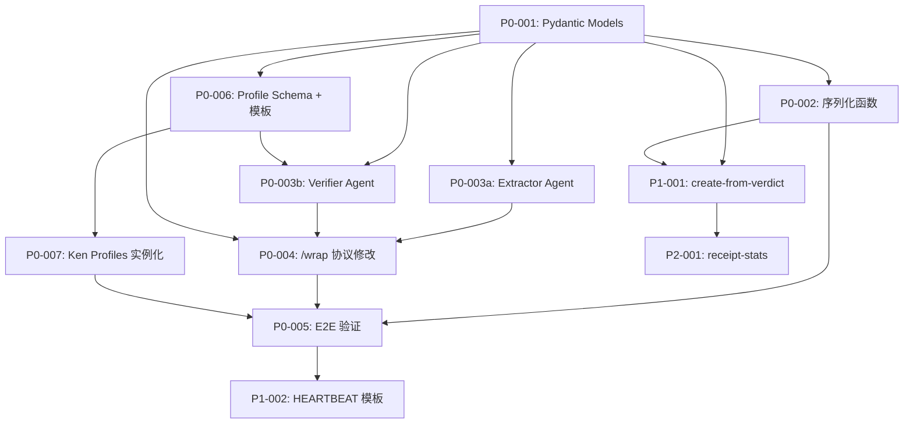

# session-receipt-verifier - 任务拆分文档

> **任务概述**：基于 design.md 实现 receipt/verdict 数据模型、session-verifier agent 定义、CLI 命令扩展和 /wrap 协议集成。
>
> **关联文档**：
> - L2技术设计：`features/session-receipt-verifier/design.md`
> - L2功能需求：`features/session-receipt-verifier/requirements.md`
> - 测试文件：`tests/test_receipt.py`

---

## 1️⃣ 任务拆分（Task Breakdown）

### P0任务（MVP必需）

| 任务ID | 任务名称 | 预估工时 | 依赖任务 | 负责人 | 状态 |
|--------|---------|---------|---------|--------|------|
| P0-001 | Receipt + Verdict Pydantic models | 3h | 无 | Ken | ✅ 完成 |
| P0-002 | Receipt/Verdict 序列化工具函数 | 2h | P0-001 | Ken | ✅ 完成 |
| P0-003a | session-extractor agent 定义 | 3h | P0-001 | Ken | 待开始 |
| P0-003b | session-verifier agent 定义 | 3h | P0-001 | Ken | 待开始 |
| P0-004 | 修改 Ken AGENTS.md /wrap 协议 | 2h | P0-001, P0-003a, P0-003b | Ken | 待开始 |
| P0-006 | VerificationProfile schema + 通用模板 | 3h | P0-001 | Ken | ✅ 完成 |
| P0-007 | Ken verification profiles 实例化 | 2h | P0-006 | Ken | 待开始 |
| P0-005 | 端到端验证——Ken 真实 session | 3h | P0-001~P0-004, P0-007 | Ken | 待开始 |

### P1任务（增强功能）

| 任务ID | 任务名称 | 预估工时 | 依赖任务 | 负责人 | 状态 |
|--------|---------|---------|---------|--------|------|
| P1-001 | create-from-verdict CLI 命令 | 3h | P0-001, P0-002 | Ken | 待开始 |
| P1-002 | HEARTBEAT 审计检查项模板 | 1h | P0-005 | Ken | 待开始 |

### P2任务（锦上添花）

| 任务ID | 任务名称 | 预估工时 | 依赖任务 | 负责人 | 状态 |
|--------|---------|---------|---------|--------|------|
| P2-001 | receipt-stats 批量分析命令 | 4h | P1-001 | Ken | 待开始 |

---

## 2️⃣ 任务详情（Task Details）

### P0-001：Receipt + Verdict Pydantic models

**任务描述**：
- 基于 design.md 的"3️⃣ 接口定义/Model-001~006"，在 `harness/receipt.py` 中实现 8 个 Pydantic models：ReceiptOutput、ReceiptTask、Decision、Receipt、Verdict（enum）、ClaimResult、VerdictSummary、SessionVerdict
- 包含字段校验：claims ≥1 条、verdict enum 限定 PASS/FAIL/UNVERIFIABLE、Decision 四字段全必填

**输入**：
- design.md 的 Model-001~006 定义（含 Model-003a Decision）

**输出**：
- `harness/receipt.py`：全部 Pydantic models

**验证标准（TDD要求）**：
- [ ] **Unit Test-001**：Receipt 实例化——合法数据通过校验（含 outputs + claims + decisions）
- [ ] **Unit Test-002**：Receipt 校验——claims 为空列表时抛 ValidationError
- [ ] **Unit Test-003**：Receipt 校验——claims 含空字符串时抛 ValidationError
- [ ] **Unit Test-004**：ClaimResult 校验——verdict 只接受 PASS/FAIL/UNVERIFIABLE
- [ ] **Unit Test-005**：SessionVerdict 实例化——含 results + summary 的完整对象
- [ ] **Unit Test-006**：SessionVerdict 校验——summary.total 与 results 长度不一致时行为（不强制校验，但测试记录预期）
- [ ] **Unit Test-007**：Decision 实例化——四字段（what/chose/rejected/rationale）全必填
- [ ] **Unit Test-008**：Receipt 纯讨论场景——outputs=[] 且 decisions 非空，通过校验
- [ ] **Unit Test-009**：Receipt 纯执行场景——decisions=[] 且 outputs 非空，通过校验

**完成标准**：
- [ ] 8 个 Pydantic models 实现，字段类型和校验与 design.md 一致
- [ ] Unit Tests 覆盖率 ≥90%
- [ ] `ruff check` 和 `mypy --strict` 通过

---

### P0-002：Receipt/Verdict 序列化工具函数

**任务描述**：
- 基于 design.md 的"4️⃣ 数据模型/文件存储布局"，实现 receipt 和 verdict 的 YAML 读写函数
- 命名规则：`YYYY-MM-DD-{agent}-NNN.yaml`（receipt）、`YYYY-MM-DD-{agent}-NNN.verdict.yaml`（verdict）
- 自动生成序号 NNN（扫描目录下已有文件，+1）

**输入**：
- design.md 的命名规则定义
- P0-001 的 Pydantic models

**输出**：
- `harness/receipt.py` 中新增函数：`save_receipt()`、`load_receipt()`、`save_verdict()`、`load_verdict()`、`generate_receipt_id()`

**验证标准（TDD要求）**：
- [x] **Unit Test-007**：save_receipt 写入 YAML，文件内容可被 load_receipt 正确还原
- [x] **Unit Test-008**：generate_receipt_id 在空目录下返回 001，已有 001 时返回 002
- [x] **Unit Test-009**：save_verdict 使用 `.verdict.yaml` 后缀，与 receipt 文件名对应
- [x] **Unit Test-010**：load_receipt 对不存在的文件抛 FileNotFoundError

**完成标准**：
- [x] 4 个序列化函数 + 1 个 ID 生成函数实现
- [x] Unit Tests 覆盖率 ≥80%（实际 receipt.py 98%，220 tests passed）
- [x] 文件命名规则与 design.md 一致

---

### P0-003a：session-extractor agent 定义

**任务描述**：
- 基于 design.md 的"3️⃣ 接口定义/Agent-001"，编写 OC sub-agent 定义文件
- 放在 agent-harness 项目内的 `agents/session-extractor.md`（实际部署时 symlink 或复制到 `.claude/agents/`）
- system prompt 必须明确：输入格式（对话 attachment）、提取原则（宁多不漏）、输出格式（Receipt YAML）、禁止事项（不美化、不遗漏不利信息）
- tools 为空——extractor 只处理 attachment 文本，不访问文件系统

**输入**：
- design.md 的 Agent-001 session-extractor 定义
- requirements.md 的 FR-P0-003

**输出**：
- `agents/session-extractor.md`：完整的 agent 定义文件

**验证标准**：
- [ ] **Review-E01**：agent 定义 frontmatter 包含 name/description/tools/model/color
- [ ] **Review-E02**：tools 列表为空（不给文件系统访问权限）
- [ ] **Review-E03**：system prompt 包含 claims 提取原则——"宁多不漏"
- [ ] **Review-E04**：system prompt 包含 decisions 提取原则——"选了什么/拒绝了什么/为什么"
- [ ] **Review-E05**：system prompt 包含禁止事项——"不遗漏不利的 claims、不美化失败"
- [ ] **Review-E06**：system prompt 包含 transcript_source / transcript_truncated 字段填写指引

**完成标准**：
- [ ] agent 定义文件完成，通过人工 review
- [ ] 在 OC 中可被 spawn（手动测试）

---

### P0-003b：session-verifier agent 定义

**任务描述**：
- 基于 design.md 的"3️⃣ 接口定义/Agent-002"，编写 OC sub-agent 定义文件
- 放在 agent-harness 项目内的 `agents/session-verifier.md`（实际部署时 symlink 或复制到 `.claude/agents/`）
- system prompt 必须明确：输入格式（receipt 路径 + verification-profiles 目录路径）、验证策略（先匹配 profile 再 ad_hoc）、输出格式（verdict YAML + verification_method 字段）、禁止事项
- verifier 需要能读取 verification-profiles/ 目录下的 YAML 文件

**输入**：
- design.md 的 Agent-002 定义 + Verification Profiles 章节
- requirements.md 的 FR-P0-004 + FR-P0-006

**输出**：
- `agents/session-verifier.md`：完整的 agent 定义文件

**验证标准**：
- [ ] **Review-001**：agent 定义 frontmatter 包含 name/description/tools/model/color
- [ ] **Review-002**：tools 列表包含 Read/Bash/Grep（Read 用于加载 profiles YAML）
- [ ] **Review-003**：system prompt 包含 profile 匹配流程说明（先 profile 后 ad_hoc）
- [ ] **Review-004**：system prompt 包含 verification_method 字段填写规则
- [ ] **Review-005**：system prompt 包含禁止事项（不访问对话、不修改文件、不执行破坏性命令、不忽略 profile 匹配结果）

**完成标准**：
- [ ] agent 定义文件完成，通过人工 review
- [ ] 在 OC 中可被 spawn（手动测试）

---

### P0-004：修改 Ken AGENTS.md /wrap 协议

**任务描述**：
- 基于 design.md 的"5️⃣ 数据流/Flow-001"，直接修改 Ken 的 `ken-space/AGENTS.md` Session Commands `/wrap` 段
- Ken 的 AGENTS.md 是 Ken 自己管辖的文件，修改不需要走 120 规则（120 是 Amanda 为新 OA 设计调度范式用的，不是改自己文件用的）
- 在现有 /wrap 步骤之前插入：(1) sessions_history 获取对话原文；(2) spawn session-extractor 生成 receipt；(3) spawn session-verifier 验证 receipt（传入 verification-profiles 路径）；(4) 读取 verdict 并汇报摘要
- 同时产出一份变更说明文档（`features/session-receipt-verifier/wrap-protocol-change.md`），记录 before/after 对比和错误处理策略，供后续推广到其他 OA 参考

**输入**：
- design.md 的 Flow-001
- 当前 Ken `ken-space/AGENTS.md` 的 Session Commands /wrap 段

**输出**：
- `ken-space/AGENTS.md`：/wrap 段已修改（新增 receipt + verifier 步骤）
- `features/session-receipt-verifier/wrap-protocol-change.md`：变更说明文档（before/after + 错误处理）

**验证标准**：
- [ ] **Review-005**：AGENTS.md /wrap 段包含 receipt 生成步骤和 verifier spawn 步骤
- [ ] **Review-006**：明确 receipt 生成不可跳过，verifier 如 spawn 失败则记录警告但不中断 /wrap
- [ ] **Review-007**：变更说明文档包含 before/after 对比和错误处理说明（对应 design.md Error-001~003）

**完成标准**：
- [ ] Ken AGENTS.md 已修改并可用于下一个 session
- [ ] 变更说明文档完成

---

### P0-006：VerificationProfile schema + 通用模板

**任务描述**：
- 基于 design.md 的"3️⃣ 接口定义/Verification Profiles/Model-007~008"，在 `harness/receipt.py` 中实现 VerificationAction 和 VerificationProfile Pydantic models
- 创建 `templates/verification-profiles/` 目录，编写 5 个通用模板 YAML 文件：test-pass、coverage、lint-clean、file-exists、structure-complete
- 实现 profile 加载函数：`load_profiles(dir_path) -> list[VerificationProfile]`
- 实现 profile 匹配函数：`match_profile(claim, profiles) -> VerificationProfile | None`

**输入**：
- design.md 的 Model-007/008 定义和 Profile YAML 示例

**输出**：
- `harness/receipt.py`：新增 VerificationAction + VerificationProfile models + load/match 函数
- `templates/verification-profiles/`：5 个通用模板 YAML 文件

**验证标准（TDD要求）**：
- [ ] **Unit Test-P01**：VerificationProfile 实例化——合法 YAML 通过校验
- [ ] **Unit Test-P02**：claim_patterns 正则匹配——"183 tests passed" 匹配 test-pass profile
- [ ] **Unit Test-P03**：claim_patterns 不匹配——"达成共识" 不匹配任何 profile，返回 None
- [ ] **Unit Test-P04**：load_profiles 从目录加载所有 YAML 文件
- [ ] **Unit Test-P05**：match_profile 返回第一个匹配的 profile（按文件名排序）

**完成标准**：
- [ ] 2 个 Pydantic models + 2 个函数实现
- [ ] 5 个模板 YAML 文件创建
- [ ] Unit Tests 覆盖率 ≥90%

---

### P0-007：Ken verification profiles 实例化

**任务描述**：
- 基于通用模板，为 Ken 创建定制化的 verification profiles
- 目标路径：`ken-space/verification-profiles/`
- 定制化内容：command 中的 `{project_root}` 替换为 Ken 常用的项目路径、claim_patterns 增加中文匹配模式

**输入**：
- P0-006 的通用模板
- Ken 的 TOOLS.md（项目路径信息）

**输出**：
- `ken-space/verification-profiles/` 下 5 个 YAML 文件

**验证标准**：
- [ ] **Review-P01**：5 个 profile 文件存在且通过 VerificationProfile Pydantic 校验
- [ ] **Review-P02**：test-pass profile 的 command 在 agent-harness 项目目录下可执行
- [ ] **Review-P03**：claim_patterns 覆盖中英文两种表述

**完成标准**：
- [ ] 5 个 profile 文件创建，通过 Pydantic 校验
- [ ] 至少 1 个 profile 的 command 在 Ken 环境下手动验证可执行

---

### P0-005：端到端验证——Ken 真实 session

**任务描述**：
- 在 Ken 的一个真实 session 上执行完整流程：session 工作 → 执行修改后的 /wrap（sessions_history → extractor → verifier + profiles）→ 获取 verdict → 汇报结果
- P0-004 已修改了 Ken 的 AGENTS.md，P0-007 已准备好 verification profiles，本任务验证全链路是否端到端可用
- 记录过程中遇到的问题、schema 调整、verifier prompt 调优、profile 匹配准确率

**输入**：
- P0-001~P0-004 的全部产出物（特别是 P0-004 修改后的 Ken AGENTS.md）
- Ken 的真实 session 上下文

**输出**：
- 1 份真实 receipt（`ken-space/memo/receipts/` 下）
- 1 份真实 verdict（`ken-space/memo/receipts/` 下）
- 1 份端到端验证报告（`features/session-receipt-verifier/e2e-report.md`）

**验证标准**：
- [ ] **E2E-001**：receipt 文件通过 Receipt Pydantic model 校验
- [ ] **E2E-002**：verdict 文件通过 SessionVerdict Pydantic model 校验
- [ ] **E2E-003**：verdict 对 receipt 中每个 claim 都有判定（results 长度 = claims 长度）
- [ ] **E2E-004**：/wrap 总耗时增加 ≤3 分钟

**完成标准**：
- [ ] 端到端流程跑通，receipt + verdict 文件存在
- [ ] 验证报告记录了问题和调整
- [ ] 大鸟确认流程可用

---

### P1-001：create-from-verdict CLI 命令

**任务描述**：
- 基于 design.md 的"3️⃣ 接口定义/Command-001"，在 `harness/cli.py` 中新增 `create-from-verdict` 子命令
- 解析 verdict YAML，过滤 FAIL 项，创建 WorkItem

**输入**：
- design.md 的 Command-001 定义
- P0-001 的 SessionVerdict model

**输出**：
- `harness/cli.py` 中新增 `create_from_verdict` 函数

**验证标准（TDD要求）**：
- [ ] **Unit Test-011**：verdict 无 FAIL 时不创建 work item，输出提示信息
- [ ] **Unit Test-012**：verdict 含 1 个 FAIL 时创建 work item，criteria 含 action_item
- [ ] **Unit Test-013**：verdict 含 3 个 FAIL 时创建 1 个 work item，criteria 含 3 个 action_items
- [ ] **Integration Test-001**：CLI 端到端——读取 verdict 文件 → 创建 work item → `harness show` 验证

**完成标准**：
- [ ] CLI 命令实现，测试覆盖率 ≥70%
- [ ] `harness create-from-verdict --help` 输出正确

---

### P1-002：HEARTBEAT 审计检查项模板

**任务描述**：
- 编写 HEARTBEAT 审计检查项模板，供各 OA 在 HEARTBEAT.md 中加入
- 2 个检查项：(1) 最近 receipt ≤7 天；(2) harness 中无超 14 天的 FAIL 跟进 work item

**输入**：
- requirements.md 的 FR-P1-002

**输出**：
- `features/session-receipt-verifier/heartbeat-audit-template.md`

**验证标准**：
- [ ] **Review-008**：模板包含 2 个检查项和具体的检查命令
- [ ] **Review-009**：检查命令可在 shell 中执行（ls + find + harness list）

**完成标准**：
- [ ] 模板完成，可直接复制到 HEARTBEAT.md

---

## 3️⃣ 任务依赖（Task Dependencies）

### 依赖关系图

### 依赖说明

- **P0-001 → P0-002**：序列化函数操作的对象是 P0-001 的 Pydantic models
- **P0-001 → P0-003a**：extractor 的输出格式由 Receipt model 定义
- **P0-001 → P0-003b**：verifier 的输出格式由 SessionVerdict model 定义
- **P0-001 → P0-006**：profile schema 是 receipt.py 中的 Pydantic model
- **P0-006 → P0-007**：Ken 的 profiles 基于通用模板定制
- **P0-006 → P0-003b**：verifier agent prompt 需要引用 profile 匹配流程
- **P0-003a + P0-003b + P0-001 → P0-004**：/wrap 协议修改需要两个 agent 和 schema 全部就位
- **P0-002 + P0-004 + P0-007 → P0-005**：端到端验证需要序列化函数 + /wrap 协议 + Ken 的 profiles
- **P0-001 + P0-002 → P1-001**：CLI 命令需要读取 verdict（models + 序列化）

---

## 4️⃣ 完成标准（Definition of Done）

### TDD要求

**测试金字塔**：
- **Unit Tests（70%）**：Pydantic model 校验、序列化函数、ID 生成——共 10+ 用例
- **Integration Tests（20%）**：CLI 命令端到端（读 verdict → 创建 work item）——共 1-2 用例
- **E2E / Manual（10%）**：Ken 真实 session 跑通全流程——1 次

### 代码质量标准

- **代码规范**：遵循 project-standards.md（PEP 8 + ruff + mypy strict）
- **测试覆盖率**：receipt.py ≥90%，CLI 扩展 ≥70%
- **文档**：公开函数有 Google style docstring

### UAT验收

- **UAT 执行者**：大鸟
- **UAT 场景**：查看 Ken 的真实 receipt + verdict，判断信息量是否足够做行为审计
- **UAT 通过标准**：大鸟确认"看 receipt + verdict 比翻聊天记录效率更高"

---

## 5️⃣ 执行顺序（Execution Order）

1. **阶段1：数据模型**（P0-001 + P0-002 + P0-006）
   - 实现 Receipt/Verdict/Decision Pydantic models（P0-001）
   - 实现 VerificationProfile/VerificationAction models + load/match 函数（P0-006）
   - 实现序列化函数（P0-002）
   - 编写通用 verification profile 模板（P0-006）
   - 编写全部 Unit Tests

2. **阶段2：Agent 定义 + Profiles + 协议修改**（P0-003a + P0-003b + P0-007 + P0-004）
   - 编写 session-extractor.md（P0-003a）
   - 编写 session-verifier.md（P0-003b，含 profile 匹配流程）——可与 P0-003a 并行
   - 实例化 Ken verification profiles（P0-007）
   - 修改 Ken AGENTS.md /wrap 段（P0-004）

3. **阶段3：端到端验证**（P0-005）
   - 在 Ken 真实 session 上跑通完整流程（sessions_history → extractor → verifier + profiles）
   - 记录 profile 匹配准确率、ad_hoc fallback 频率
   - 记录问题和调整

4. **阶段4：闭环机制**（P1-001 + P1-002）
   - 实现 create-from-verdict CLI
   - 编写 HEARTBEAT 审计模板

---

## 6️⃣ 风险识别（Risk Identification）

### 技术风险

- **风险1：Verifier 判定质量不稳定**
  - 影响：claims 简单时 verifier 判定准确，claims 复杂时可能误判
  - 缓解：MVP 阶段接受 UNVERIFIABLE 作为安全阀；收集真实判定数据后调优 prompt

- **风险2：Extractor 提取偏差**
  - 影响：extractor 可能遗漏对话中不显眼的 claims 或 decisions（尤其 sessions_history 截断时）
  - 缓解：extractor 遵循"宁多不漏"原则；receipt 中标注 transcript_truncated；大鸟可对照 git diff 交叉检查

### 进度风险

- **风险1：OC sub-agent spawn 在 Ken 环境不可用**
  - 影响：verifier 无法被 spawn，只能手动验证
  - 缓解：P0-003 先确认 spawn 可行性；不可行则 MVP 降级为主 agent 内联验证（仍保留 receipt 结构）

---
