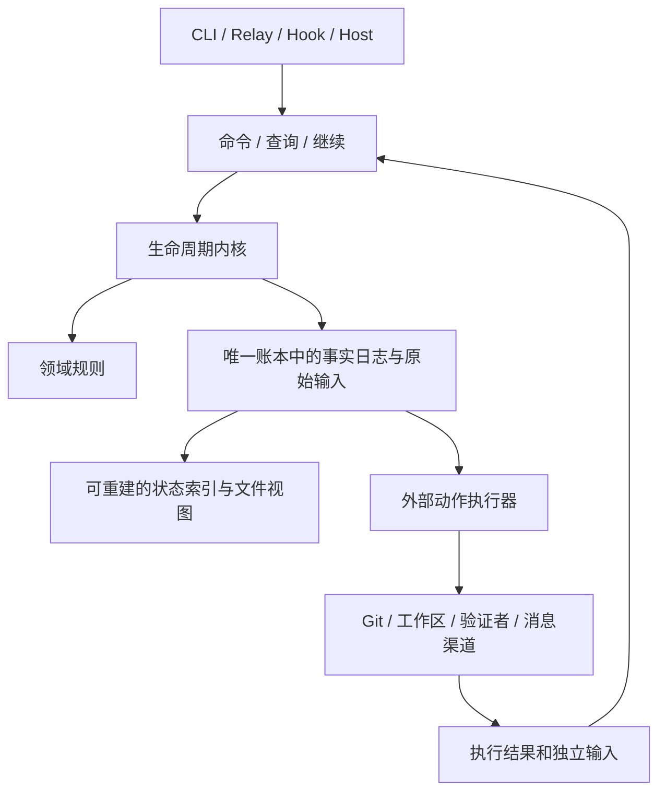

# agent-harness 架构规格

功能正本为 [project-requirements.md](project-requirements.md)，数据与命令合同见 [project-protocol.md](project-protocol.md)。本文规定如何用唯一领域内核实现这些功能；它不声称已有新运行版本。

## 1. 依赖方向

只有内核能接纳生命周期事实。领域规则是内核内部实现，不是客户端可选的另一状态机。投影只能读取日志；适配器只能回报事实；回报本身仍需内核确认与原操作的关联。

正常核心不能 import 旧 `scl_*`、`execution*`、`continuation*`、`store`、`git_broker` 或旧控制器来完成生命周期迁移。迁移模块只读旧格式。旧 CLI 的兼容代码只能调用新公共 API。可复用的无状态底层代码须在依赖检查中逐项声明；不能用动态 import、环境开关或子进程藏回旧控制链。

## 2. 深模块及其接口

| 模块 | 承担的决定与失败语义 | 对外接口 |
| --- | --- | --- |
| Domain | WI 定义/图/任务/授权/候选/人审/终态的合法迁移与不变量；无文件、网络或环境变量读取 | 内部 `decide(state, command, context)` 与 `reduce(state, events)` |
| Kernel | 身份、权限、幂等、并发、事务、持久输入、事件及待执行效果 | `execute(command, host_context)`、`inspect(query)`、`resume(wi, host_context)` |
| Views | 完整状态重放、索引、派生文件集合、版本、原子生成及中断恢复 | `read(wi)`、`materialize(wi, destination, purpose)` |
| Effects | 原请求执行、发送尝试、读回、有限重试及结果未知 | `drain(scope, budget)`；适配器只实现具体执行/读回 |
| Adapters | 参数与真实 Host 事实解析、渠道呈现、实际 Git/资源操作 | 原业务入口与版本化机器协议 |
| SSOT diagnostics | 静态登记表依赖与范围、路径/内容漂移、未知观察；不写WI或登记表 | `inspect_registry(snapshot, root, selectors)`；YAML及兼容类型在适配器 |
| Production ledger | 原始历史解释、同一账本事务、兼容投影与旧写者拒写 | 内部 connection / publication |
| Migration | 旧事实来源识别、封存、转换、源停写、目标接纳与激活 | `inspect_source`、`prepare_import`、`activate_import` |

不新增通用插件总线、通用规则 DSL 或独立协调服务。领域规则按业务职责组织，但共享一个聚合状态和同一提交入口；不按旧报错种类拆恢复模块。

## 3. 唯一事实模型

WI 是聚合边界，保存以下事实序列：

- Definition：WHY、WHAT、验收、负责人、版本及确认来源。
- Workflow：启动/当前类型、已确认 Graph 版本及采用事实。
- Work：节点尝试、结果、工作记录、成果引用和交付轮次。
- Authority：当前持有者、代际、资源集合、协作范围授予/撤回，以及迁移封存。
- Collaboration：请求、责任语义、接收/拒绝/撤回及责任结清。
- Candidate：冻结的声明、定义/图版本、成果内容、独立回执、批准/修改/豁免。
- Delivery：外部意图、每次发送前的尝试事实、实际观察、消费者采用、终态和退役。

事件按 WI 单调 sequence 排序，含 schema、request_id、actor_ref、发生时间、原输入引用和 payload。时间用于解释，不以壁钟顺序裁决有效性。原输入采用内容寻址并保留原始字节和访问范围；候选与人审只引用固定输入，不能引用持续追加的整份日志。

例示事件族：`DraftCreated`、`DefinitionRevised`、`PlanAdopted`、`PlanRevised`、`TaskClaimed`、`TaskResultRecorded`、`ScopeGranted`、`ScopeRevoked`、`CandidateSubmitted`、`VerificationRecorded`、`ReviewRecorded`、`DeliveryObserved`、`WorkCompleted`、`WorkStopped`、`ResourcesRetired`。事件名称是内部合同；客户端不能直接追加这些事件。

生产模式使用既有生产 Git ref 上的同一账本：原 WI 路径与新核心日志在一个提交中原子发布，SQLite 只在事务内存中用于重放。隔离测试可使用独立 SQLite；部署生产模式禁止同时配置独立数据库。事实记录、原请求结果和原始输入属于权威数据；物理状态索引、任务队列和视图元数据属于缓存。原始大输入可按内容摘要写入受管私有对象区：先原子持久化字节，再在日志事务内引用；只有未被事实引用的对象允许回收。迁移和备份包括所有被引用对象。

## 4. 命令与事务

命令包含 schema、request_id、WI、业务意图及必要业务输入。HostContext 提供经入口解析的真实调用者、会话、surface、资源观察和原人类决定；普通用户不填写 fence、Session ref、view digest 或恢复阶段。

执行顺序：

1. 解析语义和原输入；拒绝路径越界、非授权来源及未知必填字段。
2. 开始本地写事务，查原请求：同键同语义返回原结果，同键异语义拒绝。
3. 从内核日志/受验证状态索引读取当前 WI，确认有效授权与代际。
4. Domain 计算唯一事件集、结果及外部意图。客户端不传 `next_state`。
5. 原子追加事件、请求结果和外部意图；提交后才允许外部 I/O。
6. 响应原决定和当前能力；派生文件生成失败不撤销或伪装该决定失败。

不同请求竞争同一权限/任务时，由事务在最新事实下裁定。若业务意图明确基于某个定义、计划或候选，则只验证该语义版本；不把整个 WI 的不相关 checkpoint 变化作为冲突。

`inspect` 不提交事件，也不修业务事实。其缓存修复是内部、可丢弃 I/O；不能因为缓存无法写出而拒绝原本可读的查询。`resume` 不是新的生命周期：读取有效授权、未结任务和外部义务，取得必要视图并继续已有操作；只有新的合法业务决定才提交事件。

## 5. Graph 与三种状态

对外分别观察业务进展、执行许可、交付进度，不维护三份可以互相覆盖的 WI status。摘要 status 由事实推导，仅用于呈现。

| 当前事实 | 正常下一步 |
| --- | --- |
| 只有讨论 | 继续讨论或明确创建 Draft/lightweight |
| Draft 已确认、无已采用方案 | 展示 HOW，记录对方案的确认 |
| 标准方案已采用 | 执行可领取节点，等待未满足依赖 |
| 必需节点及成果齐备 | 自动形成对应候选与独立验真任务 |
| 验真不通过 | 选择修理、计划修订或目标修订；旧结果保留 |
| 当前候选验真通过 | 消费该候选的人审决定 |
| 当前批准成立 | 推进声明的发布/消费者交付及终态条件 |
| 业务已完成 | 观察交付及资源退休，不重新授予生产者执行权 |

每版 Graph 是 DAG（有向无环图）。节点有稳定 ID、类型、输入绑定、输出契约、依赖、执行角色、资源范围与验收规则。节点结果绑定 graph_revision、node_id、attempt_id 和输入摘要；并行汇合只消费对应版本的结果。条件出口的决定及依据进入事实，不能每次重启重新猜分支。

返工是有来源的新执行轮次；修订图时声明复用结果与失效范围，由输入/输出契约验证。已有确认复用，实质目标或主路线变化消费新的实际决定。lightweight 不另造引擎：没有强制 Graph/独立 UAT 的仪式，升级后采用标准图并继承已确认事实。

## 6. 重建算法

Views 从 WI 的确定日志修订建立完整内存读模型，再决定需要哪些文件。公开路径清单完全由事实推导，不依赖旧目录扫描发现“正确副本”。

- 状态索引带来源日志修订及内核记录的内容绑定；不匹配、解码失败或缺失时直接丢弃并重放。缓存不能靠自算摘要获得权威。
- 文件按生成代写入私有暂存区，完成后原子发布该代；读者只看完整代。中断遗留暂存不成为可用状态。
- 工作区内兼容文件按既定输出范围单向刷新；任何命令需要权威值都调用内核，不从这些文件授权或判定迁移。
- 删除缓存目录、WI YAML、执行绑定、登记解析视图、发布工作树和待办队列后，正常查询/继续都可生成必要内容。旧版本或假造完整格式的副本也不能改变结果。
- 相同日志修订产生相同业务内容；生成时间仅为诊断，不参与业务身份。
- 并发新决定与重建共存：构建固定修订，发布代以 kernel revision 选择；旧代不能覆盖新代。重建本身不更改日志，不重新发送效果。
- 真实工作区、原始成果、外部原始回执、未决发送尝试及凭据不在删除范围。符号链接和目标重定向按真实文件系统边界拒绝，不能当作普通缓存覆盖。

缓存中的权限、资源和队列与展示视图遵守同一规则；不能出现“先修好登记文件才有权重建登记文件”的循环。

## 7. 外部动作

效果身份由已提交事件与动作序号确定，绑定原目标和输入。队列可重建；状态事实为 requested、attempt_started、observed_success、observed_absence、observed_failure、unknown 或原决定取消。

执行器先持久记录 attempt_started，再调用外部接口；结果经同一内核入口接纳。发送前退出可重新领取，发送后无结果必须读回；无法区分时归 unknown。新执行代际不自动改写旧请求目标或清除它的未知结果。

适配器仅声明三项能力：执行、按原身份读回、下游是否支持幂等。同一机制处理 Git、运行进程、工作区、消息和独立验真；不为某个 WI 增加专用恢复分支。退避受每轮预算控制；不可自动决定的问题明确呈现，不无限产生新任务。

生命周期决定始终由同一内核裁定。生产账本的 Git CAS 是该决定的唯一持久提交边界；源码发布是另一个有明确目标的外部效果。确切 commit、远端 CAS、真实消费者采用仍需真实证据。晚到发布只完成原交付义务，不回灌当前状态。审批绑定业务内容，不要求未来 publication commit 把自身 SHA 写进自身内容。

## 8. 身份、执行权与跨机迁移

同一 WI 当前只存在一个有效 writer generation。多个 Session 的范围授权属于该 generation 的记录；持有者所属 Agent 的其它 Session 可在当前 generation 下追加工作记录，不成为 writer（AH-087）；旧授权不能凭本地登记文件恢复。人类决定的作用域、namespace/site policy 与具体资源事实在准入边界统一解释。

跨机迁移采用一个持久迁移身份：源端封存并撤销原写权，输出绑定日志/输入/在途效果的迁移包；目标验证并接纳，获得下一 generation，源端只读。激活中断沿同迁移身份读回，不同时恢复源写者与目标写者。新主机拿到 Git clone 不等于拿到写权。

来源真正失联而人类明确要求接管时，记录新决定并区分可落实的本地范围与尚未证明的跨机/外部排他。不能伪称已关闭旧进程、旧发布资格或全局排他；有旧结果风险的外部动作须由实际接收端的代际/请求约束保护。

## 9. 历史导入与替换

导入工具只读旧数据库、原始输入和封存历史，生成一次性转换报告及新事实；没有原始根据的字段保持 unknown。原操作身份、批准、候选与在途请求保留为可追溯引用，不把派生文件更晚的时间当作覆盖依据。

先在隔离副本试导入不同状态/版本，再迁移原 WI；不能在测试中向生产重复发送效果。导入激活与写权转移分开记录，只有源停写后目标才可写。目标已经接纳新事件后，旧快照不能直接回滚上线；回退到兼容新日志的已验证程序，或沿同迁移机制转交，禁止双向账本同步。

旧 CLI 仅薄转译必要参数；删除原控制器、分支开关与运行期旧格式读取。历史转换代码不进入正常调用依赖图。工作成果、未提交修改和历史 .coverage 等既有用户资产不因重写被删除。

## 10. 输出协议与入口兼容

公共响应包含 request_id、operation_id、local revision、原请求结果、当前能力、外部动作状态、下一项业务动作和结构化错误。`read_only`、`local_committed`、`globally_committed`、`degraded`、`rejected`、`human_decision_required` 保持语义分离。

现有 `scl_response/v1` 消费者由边缘编码器适配；内部模型不继承庞大旧响应对象。原先需要用户操作的 repair/reconcile 入口可以变为普通 continue 的内部实现；仍在使用的外部命令不能静默失效。兼容矩阵必须覆盖真实调用者和故障输出，不能只检查 `--help`。

标准 bootstrap 在入口加载失败时仍输出机器错误且不阻断聊天。安装与回退使用精确制品和统一受管 Python。Pi、Codex、Claude Code 的真实授权与会话由既有 Host 使用，新系统不复制 token 或要求无关重新登录。

## 11. 新测试结构

新 `tests_rewrite/` 只依赖新领域 API、临时 SQLite、明确的 Host/外部事实输入及测试适配器；不得引用旧 Harness fixtures。测试入口使用独立配置，避免自动加载旧 coverage/addopts/conftest。

领域模型测试覆盖全部需求命令与非法输入；状态机性质测试对任意合法序列验证唯一写者、重放一致与请求幂等；统一故障注入覆盖每个事务/外部边界；安装及真实 Muse UAT 验证实际消费者。旧大套件可以完整退出新版本门禁，不以恢复旧绿灯为交付任务。

全部实现、测试、适配和删除工作按 AH 编号追踪，验收按 [project-acceptance.md](project-acceptance.md) 执行。

事实库封存迁移的完整目标合同见[封存迁移规范](rewrite-migration-protocol.md)；新格式源封存、认证导出、目标原子接纳/激活和继承效果/资源约束已实现；同主机原生双库迁移及目标新业务已验证，见[当前路线图](project-roadmap.md)；跨Host适配器连续性及旧格式转换尚未完成。
