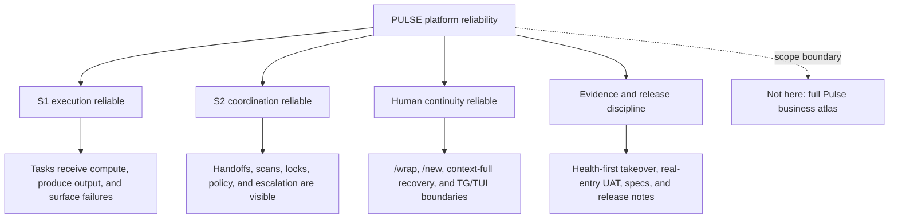
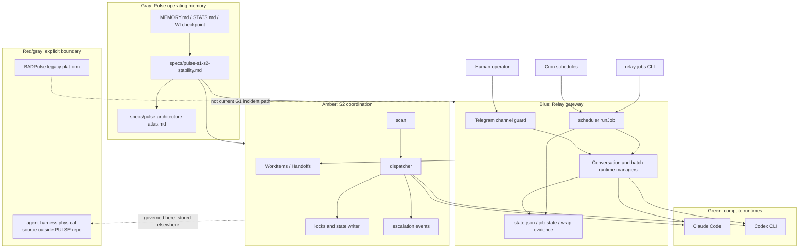
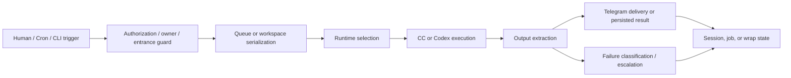
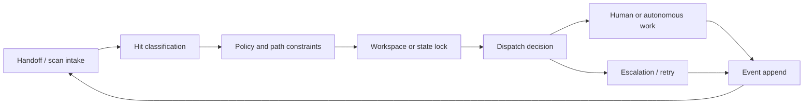
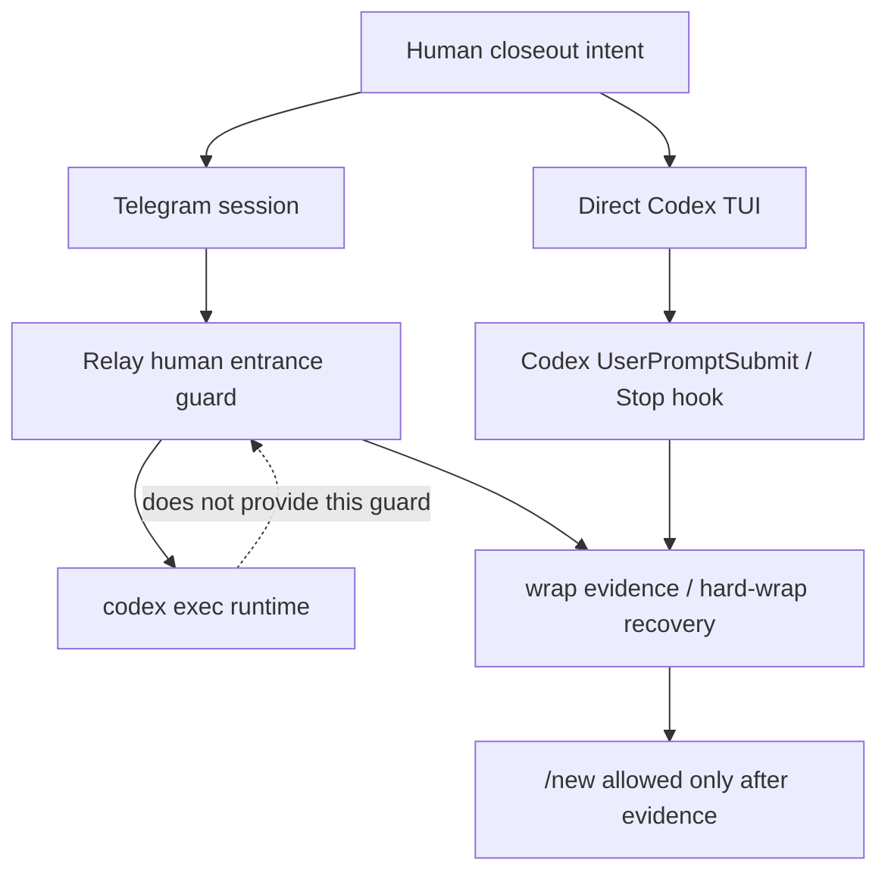
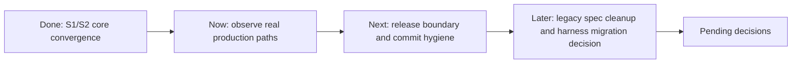

# PULSE Architecture Atlas

> Status: Active draft
> Owner: Pulse
> Audience: human operator, Pulse maintainer, collaborating Agents
> Source truth: `specs/pulse-s1-s2-stability.md`, Relay feature specs, `MEMORY.md`, `STATS.md`, canonical WI/checkpoint
> Last updated: 2026-04-26

## How To Read This Atlas

This atlas is the human visual layer for the PULSE platform subset of Pulse's
broader domain. It should let a human operator, maintainer, or collaborator
answer three questions quickly:

- Goal: what does PULSE need to make reliable?
- Current state: what platform planes exist now, and where are their ownership
  and trust boundaries?
- Path: what stability work is complete, current, and pending?

It is not the full Pulse domain atlas yet. Future subsets can cover Pulse's
business services, Agent operations, management-wheel interfaces, deployment
topology, and release/risk views.

## Page Index

| Page | Question answered | Source truth | Update trigger |
|---|---|---|---|
| Goal Map | What is PULSE trying to make reliable? | `CLAUDE.md`, `MEMORY.md`, `pulse-s1-s2-stability.md` | Mission, S1/S2 definition, or success criteria changes |
| Current System Map | What exists now, and where are the main ownership boundaries? | `pulse-s1-s2-stability.md`, `MEMORY.md` | Relay, runtime, harness, repo, or memory boundary changes |
| S1 Execution Loop | How does work execute from trigger to result? | `pulse-s1-s2-stability.md`, Relay specs | Cron/TG/CLI/runtime semantic changes |
| S2 Coordination Loop | How does coordination move through scan, dispatch, policy, and events? | `pulse-s1-s2-stability.md`, harness behavior | Handoff, scan, dispatch, policy, lock, or escalation changes |
| Human Continuity Boundary | Where do `/wrap`, `/new`, hooks, and hard-wrap apply? | `wrap` skill, Relay conversation runtime spec | Runtime/hook/Telegram guard changes |
| Stabilization Path | What is complete, in flight, and pending? | canonical WI/checkpoint, release checklist | Roadmap or acceptance evidence changes |

## Page: Goal Map

Purpose: state the platform reliability target before the implementation
details.

Source truth: `CLAUDE.md`, `MEMORY.md`, and
`specs/pulse-s1-s2-stability.md`.

Update trigger: update when Pulse's platform mission, S1/S2 definitions,
production status, or success criteria change.

Image prompt: `memo/images/pulse-architecture-atlas/prompts/01-goal-map.md`.

Image path: `memo/images/pulse-atlas-01-goal-map.png`.

Diagram:

Human reading: PULSE's near-term target is not a pretty system diagram; it is a
platform that can execute work, coordinate ownership, preserve human session
continuity, and leave enough evidence for the next session to inherit the
state.

Verification: compare this page with the canonical WI/ResumePacket and
`MEMORY.md` stable decisions. If either says the focus moved beyond G1 S1/S2
stability, this page is stale.

## Page: Current System Map

Purpose: show the full PULSE platform subset in one view.

Source truth: `specs/pulse-s1-s2-stability.md` and `MEMORY.md`.

Update trigger: update when a plane, owner path, runtime surface, or guard
boundary changes.

Image prompt:
`memo/images/pulse-architecture-atlas/prompts/02-current-system-map.md`.

Image path: `memo/images/pulse-atlas-02-current-system-map.png`.

Diagram:

Human reading: PULSE has two coupled loops. S1 executes tasks through Relay and
compute runtimes. S2 coordinates work through agent-harness and `.harness`
state. Operating memory and engineering methods keep both loops inheritable.
The harness is governed by PULSE S2 semantics even while its physical source
lives outside the PULSE repo; BADPulse is legacy context, not the current G1
incident path.

Verification: run `Scripts/ops/pulse-health.sh`, then compare Relay, harness, and
memory status against this page. If a changed component cannot be placed on
this map, update the stability spec before treating the atlas as current.

## Page: S1 Execution Loop

Purpose: make the execution path inspectable from trigger to result.

Source truth: `specs/pulse-s1-s2-stability.md`, Relay `scheduler.ts`,
`runtime.ts`, `conversation-runtime` specs.

Update trigger: cron, TG, CLI, runtime fallback, timeout, delivery, or state
semantics change.

Image prompt:
`memo/images/pulse-architecture-atlas/prompts/03-s1-execution-loop.md`.

Image path: `memo/images/pulse-atlas-03-s1-execution-loop.png`.

Diagram:

Human reading: S1 is credible only when a task leaves an inspectable trace from
trigger through output, failure classification, or escalation.

Verification: for cron/CLI, use Relay job logs and job result state; for TG,
use session state and Telegram delivery logs.

## Page: S2 Coordination Loop

Purpose: show how PULSE prevents hidden coordination failures.

Source truth: `specs/pulse-s1-s2-stability.md`, agent-harness scan/dispatcher
behavior, `.harness` events.

Update trigger: handoff ownership, scan classification, dispatcher dedup,
policy, locks, or escalation behavior changes.

Image prompt:
`memo/images/pulse-architecture-atlas/prompts/04-s2-coordination-loop.md`.

Image path: `memo/images/pulse-atlas-04-s2-coordination-loop.png`.

Diagram:

Human reading: S2 is credible when every skip, suppression, lock conflict,
autonomous spawn, and escalation is visible and replayable.

Verification: inspect `.harness` scan reports, dispatch events, failed
escalations, and workspace locks.

## Page: Human Continuity Boundary

Purpose: prevent humans from confusing direct TUI hooks with Telegram Codex
runtime guarantees.

Source truth: shared `/wrap` skill and Relay `conversation-runtime` design.

Update trigger: `/wrap`, `/new`, Codex hooks, CC Stop hooks, TG entrance guard,
or context-full recovery behavior changes.

Image prompt:
`memo/images/pulse-architecture-atlas/prompts/05-human-continuity-boundary.md`.

Image path: `memo/images/pulse-atlas-05-human-continuity-boundary.png`.

Diagram:

Human reading: TG Codex uses `codex exec`, so its `/wrap` boundary is enforced
before runtime spawn at the Relay Telegram entrance. Direct Codex TUI hooks are
useful but are not the Telegram safety boundary.

Verification: direct TUI close-like prompt should be blocked without `/wrap`;
`codex exec` probes must not be treated as hook coverage.

## Page: Stabilization Path

Purpose: show the current path from stabilization work to release discipline.

Source truth: canonical WI/checkpoint and `ops/release-2026-04-25-s1-s2-stability.md`.

Update trigger: acceptance evidence, release checklist, pending decisions, or
thin-slice status changes.

Image prompt:
`memo/images/pulse-architecture-atlas/prompts/06-stabilization-path.md`.

Image path: `memo/images/pulse-atlas-06-stabilization-path.png`.

Diagram:

Human reading: the platform is running, but stability depends on health-first
takeover, evidence discipline, and explicit split-repo release handling.

Verification: compare this page with the WI/ResumePacket pending and decisions
before every wrap or release.
