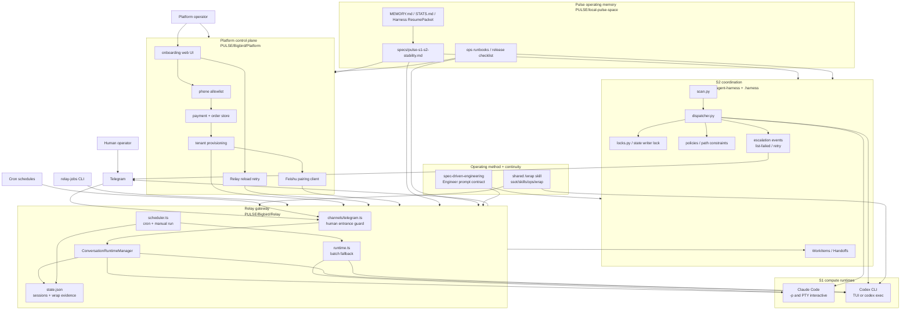

## 工具链与入口位置的现行说明

本文件保留 S1/S2 设计和日期固定的历史决策；下文的旧目录（`scripts/`、`ops/`、`pulse-space/`）只用于追溯。
工具链位置与安装事实以当前 PULSE `config/scl-surfaces.yaml`、正式采用回执及 Coevolution
`ssot/toolchain` 为准。Harness 源码位于受管 PULSE worktree 的 `agent-harness/`，云端 CLI 为
`/home/pulse/.local/share/coevolution/tools/agent-harness/bin/harness`，
Python/pytest 为 `/home/pulse/.local/share/coevolution/python-env/bin/python`，
以 `-I -B` 调用。代码入口不是 Python 环境；不得据历史例子重新建立 `.venv`。
现行入口：健康面板 `Scripts/ops/pulse-health.sh`，运维手册
[pulse-operations.md](../ops-doc/pulse-operations.md#4-agent-harness-operations)，
Platform 接入 UAT 脚本 `Platform/tests/platform-onboarding-uat.mjs`。


# PULSE S1/S2 Stability Spec

> Date: 2026-04-25
> Status: Active convergence spec
> Scope: Platform + Relay + CC runtime + agent-harness + Pulse operating memory
> Decision source: `memo/decision-2026-04-25-pulse-s1-s2-stability-convergence.md`

## Purpose

PULSE must stabilize as VSM infrastructure for:

- **S1 execution**: agents can reliably receive tasks, run compute, produce output, and surface failures.
- **S1 provisioning**: eligible members can move from allowlist/payment to tenant workspace, Relay binding, and Feishu bot pairing without manual config drift.
- **S2 coordination**: agents can coordinate work through handoffs, scans, locks, dispatch, policy, and escalation without creating hidden conflicts.

This spec is not a bug list. Small issues such as scheduler morning-report failures, `relay-jobs` runtime drift, lock conflicts, or duplicated scan hits are symptoms and validation points. They are resolved as by-products of S1/S2 convergence, not as independent strategy.

## System Boundary

For the human-facing diagram collection, see
`specs/pulse-architecture-atlas.md`. This stability spec remains the operating
contract; the atlas is the visual reading layer.

### Global Architecture



Read this diagram as two coupled loops:

- **S1 execution loop**: human/Cron/CLI trigger -> Relay -> runtime -> output/state/delivery.
- **S1 provisioning loop**: allowlist/payment -> Platform provision -> Relay `relay.json`/`bindings[]` -> Feishu bot reload/pairing.
- **S2 coordination loop**: scan/handoff/policy -> dispatch/locks -> autonomous or human work -> events/escalation.

`spec-driven-engineering` shapes engineering changes across both loops. Shared `/wrap` protects human continuity: direct Codex TUI uses hooks, while Telegram Codex sessions are guarded at the Relay Telegram entrance before `codex exec`.

| Plane | Current owner path | Role |
|---|---|---|
| Pulse operating memory | `PULSE/local-pulse-space` | Identity, current decisions, progress, meeting records, handoff memory |
| Platform control plane | `PULSE/Bigbird/Platform` | Member allowlist, payment/order state, tenant provisioning, Relay config merge, onboarding web UI |
| Relay gateway | `PULSE/Bigbird/Relay` | Telegram bots, command routing, CC process pool, scheduler, batch runtime fallback |
| agent-harness | `Lab/BigbirdEnvironment/agent-harness` | Work items, handoffs, scans, dispatcher, locks, policy, escalation |
| harness state | `.harness` | Production work-item, handoff, event, policy, and lock state |
| legacy platform | `PULSE/Bigbird/BADPulse` | GCP/OpenClaw-era code; not part of current G1 incident path |

### Engineering Execution Method

`spec-driven-engineering` is the preferred engineering method for S1/S2 platform changes. It is not a new runtime plane; it is the operating method that keeps S1/S2 fixes from becoming unbounded patches.

Use it for Relay, harness, scheduler, runtime, policy, escalation, deployment, QA, and release work that can affect S1/S2. The minimum contract is:

```text
goal + boundary + context + acceptance evidence + risk
```

S1/S2 stabilization inherits these rules:

- high-risk production-path changes require real-entry evidence, not only CLI probes or unit tests;
- sub-agent engineering work must use the Sub-agent Prompt Contract and be reviewed by the main session before production deployment;
- capability claims must be narrower than the verified path;
- contract drift must update this spec, a Relay feature spec, harness docs, or Pulse memory/progress.

The skill source is `skills/spec-driven-engineering/`. PULSE-specific evidence rules are in `skills/spec-driven-engineering/references/pulse-adapter.md`.

### agent-harness Governance Boundary

`agent-harness` is part of the PULSE S2 coordination plane, even while its current physical source path lives outside the PULSE git repository boundary. PULSE owns its operating semantics for S1/S2 stabilization:

- handoff ownership and responsibility transfer,
- WorkItem/Handoff state durability,
- CLI state writer lock discipline,
- scan/dispatcher dedup and lock behavior,
- policy and escalation failure visibility.

Until a separate repository-boundary decision is made, `agent-harness` is a PULSE-governed external component:

- PULSE specs and runbooks must document harness behavior that affects S2.
- Harness code changes must be verified from the physical source tree at `/Users/owner/Coevolution/Bigbird/Lab/BigbirdEnvironment/agent-harness`.
- Commit/release planning must account for the second git boundary at `/Users/owner/Coevolution`.
- Do not physically move `agent-harness` into the PULSE repository as an incidental stabilization change. Migration requires a separate decision with affected import paths, CLI entrypoints, test commands, rollback path, and downstream users.

Known negative impact of postponing physical unification:

| Impact | Why it matters for S1/S2 | Required mitigation while postponed |
|---|---|---|
| Split commit boundary | A single S2 change can require one PULSE commit and one `/Users/owner/Coevolution` commit, so partial staging/release can leave docs and runtime behavior out of sync | Release notes must list both git roots and exact staged files |
| Non-atomic rollback | Reverting only Relay/Pulse or only harness can break the S2 chain between dispatch, handoff, policy, and escalation | Rollback plans must name both repos and the production `.harness` state assumptions |
| New-session rediscovery cost | A PULSE session starts in `local-pulse-space`, but key S2 implementation lives elsewhere | `scripts/pulse-health.sh` and this spec must keep the harness path and test commands explicit |
| Ownership ambiguity | Other sessions may treat harness as generic shared infrastructure instead of a PULSE-governed S2 component | PULSE memory/runbook must state that harness S2 semantics are governed here |
| CI/test fragmentation | Relay and harness regressions cannot be proven by one local command | Acceptance evidence must include both Relay and harness test commands when both sides changed |
| Migration debt grows invisibly | More PULSE-specific assumptions in harness make a later move harder | Keep repository-boundary migration as a pending decision, not an implicit non-issue |

## S1 Execution Plane

S1 is credible only when every task has one inspectable path from trigger to result:

```text
trigger
  -> authorization / ownership
  -> queue or overlap guard
  -> runtime selection
  -> process execution
  -> output extraction
  -> delivery or persisted result
  -> failure classification
  -> escalation when failure is not recoverable
```

Current S1 entrypoints:

| Entrypoint | Code path | Current status |
|---|---|---|
| Platform onboarding web/API | `Bigbird/Platform/src/http-server.ts -> provision.ts -> relay-merge.ts -> relay-pairing-client.ts` | Three-step member onboarding path; writes Relay config only after paid order and validated Feishu credentials |
| Platform relay reload retry | `POST /internal/relay/reload -> relay-reload.ts -> Relay /internal/agents/reload` | Step 3 support path when the new Feishu bot has not replied; side-effecting and therefore excluded from read-only health checks |
| Relay loopback pairing/reload | `Relay/src/http-server.ts -> channels/feishu.ts -> router` | Internal HTTP path for Platform Step 2 reload and Step 3 pairing approval; disabled unless `RELAY_HTTP_PORT` is set |
| Telegram user message | `channels/telegram.ts -> ConversationRuntimeManager -> cc/codex adapter` | Online conversation path; CC remains default, Codex is supported for configured/canary agents |
| Feishu Duke message | `channels/feishu.ts -> Gateway route facade -> ConversationRuntimeManager` | Online Feishu path for Duke `main`; dual-channel uses scoped tenant `owner:main:feishu` |
| Telegram `/job_run` | `job-commands.ts -> scheduler.runJob()` | Uses scheduler execution semantics |
| Cron job | `scheduler.ts -> runtime.ts` | Batch runtime path with workspace serialization |
| CLI job run | `dist/relay-jobs.js run -> scheduler.runJob()` | Converged 2026-04-25; manual runner disables cron registration and TG delivery but shares scheduler execution semantics; `scripts/relay-jobs.ts` remains a tsx compatibility shim |

S1 convergence rules:

1. There must be one canonical batch job execution semantic for cron, TG `/job_run`, and CLI run.
2. Runtime fallback must be described by runtime id, provider, mode, timeout, cooldown, and failure classification.
3. PTY prompt submit semantics must not drift between batch and interactive paths without an explicit reason.
4. `inject_file`, workspace serialization, job state, owner delivery, and failure classification are part of job execution semantics, not optional decorations.
5. A failed S1 task must leave at least one observable signal: structured Relay log, job state, Telegram delivery failure log, harness event, or escalation.
6. Telegram conversation runtime changes must preserve the CC default path while allowing configured agents to use Codex through the `conversation-runtime` contract.
7. Human session closeout is part of S1 continuity: `/wrap`, `/new`, context-full recovery, and runtime state must not trap a user in an unrecoverable session.
8. Gateway route facade is the current compatibility layer: channel handlers still use legacy router authorization first, then consume Gateway route results for runtime preference and drift detection.
9. Delivery failure is part of S1 result semantics: execution success without delivery success must remain observable via `deliveryStatus`, `deliveryReceipt`, scheduler logs, or harness escalation state.
10. Platform provisioning is now part of S1: payment/order state, tenant directory creation, `relay.json` merge, `bindings[]` state, Relay hot reload, and Feishu pairing must be inspectable from health checks and feature specs.
11. Platform may create a pending Feishu binding after paid order and credential validation, but production-use binding activation requires Relay pairing approval and a real `open_id`; paid-before-bind remains the invariant.
12. Read-only health checks may probe `/health`, `/internal/capabilities`, and Relay `/internal/health`; they must not call side-effecting endpoints such as Platform `/internal/relay/reload`, Relay `/internal/agents/reload`, or pairing approval.
13. Payment provider "already paid" responses are a poll hint, not a failure terminal: Platform records the internal order as `paid` so the UI can advance to Step 2, while still reporting `provider_order_already_paid` to the native-payment caller.
14. Current Relay pairing approval writes an active explicit Gateway binding and may retain the Step 2 pending placeholder binding with empty `address.value`. Health checks must distinguish paired pending placeholders from unpaired pending bindings; production readiness is the active binding with matching `principalId`, `defaultAgentId`, app id, and real open id.

Known S1 symptoms to consume during convergence:

| Symptom | Main chain | Treatment |
|---|---|---|
| Morning report scheduler trigger suspected never successful | Cron -> scheduler -> runtime -> delivery | Use as validation for canonical batch job execution |
| Emergency fix lived in `relay-jobs` | CLI run vs scheduler run | Consumed 2026-04-25: `relay-jobs run` now reuses `scheduler.runJob()` instead of duplicated runtime loops |
| PTY warmup / submit / chunking differs across files | Runtime semantics | Consumed 2026-04-25: pool interactive defaults now align with batch PTY 5s/500ms/512B chunking |
| Session JSONL path differs under symlinked workspaces | Output extraction | Consumed 2026-04-25: batch PTY now realpath-normalizes workspace before JSONL path encoding |
| Rate-limit fallback may fail fast without trying later runtimes | Failure policy | Consumed 2026-04-25: batch runtime now marks rate-limited runtime cooldown and continues to next runtime |
| `cc-interactive` can exit 0 after a partial `tool_use` turn | Output extraction -> success classification -> fallback | Consumed 2026-04-25: batch PTY success now requires a terminal assistant turn; incomplete turns trigger fallback |
| Pool token fallback tests failing for stderr rate-limit / overloaded | TG long-lived CC -> pool.ts -> token fallback | Consumed 2026-04-25: stderr quota/rate/auth signals again trigger one Max→Pro token fallback |
| Pulse needs TG access through Codex as an alternate compute path | TG -> conversation runtime manager -> Codex adapter | Consumed 2026-04-25: `conversation-runtime` P0/P1/P2 delivered CC façade, Codex text/image runtime, `/session` visibility, and spawn-failure fallback canary |
| Codex TG long turn timed out despite active assistant output | TG -> Codex runtime -> timeout/session-end -> user notice | Consumed 2026-04-25: Codex timeout became activity-based and timeout no longer produces duplicate generic crash notice |
| CC TG session lost settings and `/compact` recovery path | TG -> CC interactive PTY -> settings/slash lifecycle | Consumed 2026-04-26: CC interactive passes explicit settings sources; `/compact` is forwarded and handled as a slash-command lifecycle |
| Context-full session cannot execute `/wrap` but `/new` is blocked by wrap guard | TG human entrance -> wrap guard -> runtime recovery | Consumed 2026-04-26: context-full `/wrap` records hard-wrap evidence out-of-band; `/new` is allowed after recovery evidence |
| Codex project hook expectation exceeded real `codex exec` boundary | TG -> Relay Codex runtime -> `codex exec`; direct TUI -> Codex hooks | Consumed 2026-04-26: direct Codex TUI is protected by shared `/wrap` hook, but Relay TG Codex runtime must enforce `/wrap` / `/new` at Telegram channel entrance because `codex exec` does not trigger the same hook path |
| Duke Feishu identity split as `duke-feishu` | Feishu -> Gateway binding -> logical agent identity | Consumed 2026-04-27: Duke Feishu migrated to `main` dual-channel; `duke-feishu` is no longer a long-term agent identity |
| Feishu Duke reply also appeared in TG | Feishu -> runtime tenant -> response mapping | Consumed 2026-04-27: dual-channel Feishu uses scoped tenant `owner:main:feishu`; scoped sessions do not write back to shared TG `owner:main` |
| Scheduler execution succeeded but delivery failed silently | scheduler -> delivery dispatcher -> JobResult | Consumed 2026-04-27: `executionStatus` and `deliveryStatus` are separated; delivery failure makes aggregate `status=error` while preserving execution result |
| New binding registry UAT lacks real Feishu share scenario | Feishu pairing -> `/approve` -> `relay.json.bindings[]` | Deferred 2026-04-27: read/write path is deployed, but real newly-unbound binding UAT waits for an actual product scenario; do not add TG pairing just to fabricate evidence |
| Member onboarding requires manual field assembly and Relay restart | Platform UI/API -> payment/order -> `relay.json` -> Relay Feishu reload/pairing | Consumed 2026-05-07: `Bigbird/Platform` provides phone allowlist, payment/order state, automatic tenant/agent naming, Feishu credential validation, same-origin web UI, Relay config merge, Step 3 pairing through Relay loopback HTTP, and manual Step 3 reload retry; production-live status still requires service wiring/UAT |
| Native-payment polling can stall when provider says "already paid" before webhook arrives | Platform payment API -> provider response -> order store -> UI polling | Consumed 2026-05-07: `provider_order_already_paid` now marks the internal order `paid`, preserving idempotence and letting the UI advance without waiting for a missing or delayed webhook |
| CC fallback rate can spike without appearing in takeover checks | Relay scheduler logs -> runtime fallback -> Codex completion | Consumed 2026-05-07: `scripts/pulse-health.sh` now reports same-day UTC job starts, runtime fallback count, and `>=10%` warning so fallback trend is visible during takeover |
| Successful Platform Step 3 can still leave a pending placeholder count in health output | Platform Step 2 pending binding -> Relay Step 3 active binding -> health interpretation | Consumed 2026-05-07: local loopback UAT proved active pairing while one empty pending placeholder remained; `scripts/pulse-health.sh` now reports `pairedPendingPlaceholders` separately from `unpairedPending` so takeover checks do not misclassify a paired tenant as blocked |

## S2 Coordination Plane

S2 is credible only when ownership, conflict control, autonomous dispatch, and escalation form one loop:

```text
scan
  -> hit classification
  -> policy decision
  -> lock acquisition
  -> handoff / autonomous session / escalation
  -> event append
  -> dedup / retry / audit
```

Current S2 entrypoints:

| Entrypoint | Code path | Role |
|---|---|---|
| Handoff intake | `machine.py`, `store.py`, CLI handoff commands | Transfer work and result responsibility |
| Scan | `scan.py` | Find pending handoffs, violations, SSOT drift |
| Dispatch | `dispatcher.py` | Apply heartbeat policy, spawn autonomous sessions, escalate |
| Locking | `locks.py` | Prevent concurrent sessions from trampling agent workspaces |
| Policy | `policy.py`, `.harness/policies/*.yaml` | Bound autonomy and writable paths |
| Escalation | `escalation.py`, `events.py` | Push or aggregate non-silent failures |

S2 convergence rules:

1. Handoff acceptance must make ownership and responsibility transfer explicit.
2. Scan lock conflicts must be visible as skip/defer/escalate decisions, never silent disappearance.
3. Dispatcher dedup must reduce noise without hiding unresolved work.
4. Autonomous sessions must respect policy path constraints and context hygiene; their wrap behavior is part of policy compliance.
5. Escalation push failures must themselves be queryable and retryable.
6. State writes that affect ownership or policy must be either atomic or protected by a clear lock discipline.
7. Autonomous cron sessions may produce evidence memo and recommended next actions, but must not directly close another owner's WorkItem or mutate durable WorkItem/Handoff/Policy/SSOT state.
8. Human `/wrap` is the continuity boundary for interactive sessions, while headless/cron sessions use memo/escalation artifacts instead of human closeout hooks.

Known S2 symptoms to consume during convergence:

| Symptom | Main chain | Treatment |
|---|---|---|
| `ho_20260425_396` Reeve night patrol lock conflict | scheduler -> workspace serialization; scan -> lock -> dispatch | Consumed 2026-04-25: same-workspace Relay jobs are queued; heartbeat scans moved out of 3AM night patrol window |
| `ho_20260425_745` duplicate scan hit aggregation | scan -> dispatch -> dedup | Consumed 2026-04-25: dispatcher suppresses repeated same hit after threshold and records suppressed dispositions |
| Handoff owner propagation relied on caller discipline | handoff ack -> owner transfer | Consumed 2026-04-25: `apply_handoff_acceptance()` now rejects non-accepted handoffs before changing owner |
| Handoff responsibility metadata was passed by CLI but dropped by model | handoff create/assign -> YAML -> show/list | Consumed 2026-04-25: `HandoffContract` now persists responsibility transfer fields |
| Pulse policy allows only memo writes | policy -> autonomous session | Baseline accepted 2026-04-25: production Pulse autonomous is observation/recording only; Relay/harness repair remains main-session work until an explicit policy decision expands write scope |
| Autonomous `/wrap` can try to update workspace state files outside a memo-only policy | dispatcher prompt -> autonomous session -> path_guard -> event classification | Consumed 2026-04-25: dispatcher prompt now echoes `path_constraints.read/write` and requires policy-aware `/wrap`; local wrap habits must skip `PROGRESS.md` / `CLAUDE.md` / `MEMORY.md` when they are outside `path_constraints.write` |
| Autonomous intake reported completion while `.harness` WorkItem/Handoff state stayed uncommitted | cron autonomous -> harness complete -> wrap commit -> durable state | Consumed 2026-04-25: `harness complete` is disabled when `HARNESS_TRIGGER_MODE=cron`; dispatcher snapshots durable `.harness/work-items` and `.harness/handoffs` state and marks uncommitted drift as `error` |
| Memo-only cron policy could still mutate `.harness` through `Bash(harness:*)` | policy -> allowed tools -> CLI durable state writes | Consumed 2026-04-25: cron mode blocks durable-state CLI writers (`create`, `assign`, `assign-batch`, `transition`, `complete`, `handoff`, `ack`, `compliance create-work-item`, `ssot create-work-item`, `policy write`, `ssot register`) and spawn prompt now says memo-only review, not ack/reject/create |
| Handoff text that asks an agent to obey its Red Lines can be misclassified as a red-line breach | scan -> handoff classifier -> dispatch policy -> escalation | Consumed 2026-04-25: red-line handoff classification now requires breach/check/risk semantics; `ho_20260425_517` is the regression sample and classifies as `format_compliant` |
| Handoff text that references `agent-constitution/` ownership can be misclassified as a constitution/red-line breach | scan -> handoff classifier -> dispatch policy -> escalation | Consumed 2026-04-25: constitution matching now requires check/against/audit/breach/violation/risk semantics; `ho_20260425_800` is the regression sample and classifies as `format_compliant` |
| Workspace-active skip can count unrelated commits in the parent repo | dispatch context hygiene -> workspace activity gate -> autonomous spawn | Consumed 2026-04-25: workspace activity and recent-commit prompt context are path-scoped with `git log -- .`; `ho_20260425_767` is the regression sample |
| Dispatch records do not reveal which harness revision made a decision or what operator action should follow | dispatch -> event append -> replay/audit | Consumed 2026-04-25: every dispatch event records `harness_revision`, and every disposition carries a normalized `next_action` |
| Dispatch tests can write production events if event append resolves root from global env instead of explicit dispatch root | dispatch -> event append -> test/prod boundary | Consumed 2026-04-25: `events_path()`, `append_event()`, `record_escalation()`, and dispatcher event writes accept/pass explicit `harness_root` |
| Dispatcher dedup can suppress unresolved autonomous handoffs after repeated workspace-active skips | scan -> dispatch -> dedup -> autonomous spawn | Consumed 2026-04-25: dedup still suppresses mechanical/escalation noise, but `autonomous_llm` hits are never silently suppressed; `ho_20260425_767` is the regression sample |
| Dispatcher can repeatedly spawn no-op autonomous sessions for the same already-covered pending handoff | scan -> dispatch -> autonomous spawn -> success-with-output escalation -> TG | Consumed 2026-04-26: autonomous hits with existing success-with-output evidence now dispatch as `skipped_autonomous_covered` with `owner_review_required`; `ho_20260426_277` is the regression sample |
| TG escalation messages can be too terse and over-page on soft failures | dispatch/escalation -> TG | Consumed 2026-04-26: root commit `94cf58ac8b`; immediate escalation TG uses Chinese triage fields; soft wrap-missing with output evidence is minor daily aggregate, while timeout/tool_denied/no-output wrap_missing still page immediately. Follow-up 2026-04-29: immediate TG messages use `来源` instead of `地点`; dispatcher cron autonomous events render as `Relay cron 定时扫描（scan=...） → <agent> 心跳分身`; Relay-delivered night patrol completion events render as `Relay 夜巡 job（harness_escalation 代发） → <agent> 心跳分身`. |
| Escalation push may fail due to missing token or TG failure | escalation -> event append -> retry | Consumed 2026-04-25: failed pushes are queryable/retryable; manual harness sessions now resolve tokens from the Relay launchd service environment when process env lacks them |
| YAML store lacked atomic single-object writes | store -> ownership / handoff state | Consumed 2026-04-25: WorkItem/Handoff YAML saves use same-directory temp file + `os.replace()`; event append uses one append syscall |
| CLI multi-file writes lacked a common writer lock | CLI create/assign/handoff/ack/transition/complete -> store | Consumed 2026-04-25: core HarnessStore CLI writes acquire `.harness/locks/__state__.lock` in wait mode |
| `/wrap` existed as runtime-specific command copies | human closeout -> skill/hook -> session continuity | Consumed 2026-04-25: `/wrap` became a shared skill under `ssot/skills/ops/wrap`; CC/Codex project hooks and Relay TG human entrance enforce closeout for interactive sessions only |

## Spec Convergence Rule

Every platform fix must update at least one of:

- this S1/S2 stability spec,
- a feature spec under `Relay/specs/features/*`,
- an agent-harness design or README,
- Pulse `MEMORY.md` for stable judgment, `STATS.md` for current instance facts, and the canonical WI/checkpoint for operating posture.

The update must state:

1. Which S1 or S2 chain the change belongs to.
2. Which symptom it consumes.
3. Which path is now canonical.
4. Which path is legacy, emergency-only, or deprecated.
5. How a new session verifies the behavior.

## New Session Takeover

First command:

```bash
cd /Users/owner/Coevolution/Bigbird/PULSE/local-pulse-space
scripts/pulse-health.sh
```

The script is read-only. It prints Pulse memory/progress, Relay launchd state, cron jobs, recent Relay logs, Pulse handoffs, failed Pulse escalations, harness locks, recent harness events, dirty git summaries, and test entrypoints. It redacts token/auth/secret lines from `launchctl print`.

The script also prints the Platform onboarding surface: package/build/dependency presence, current-shell Platform/Relay HTTP env readiness, Relay config counts for legacy agents and `bindings[]`, `bindingDerived` counts for paired pending placeholders vs unpaired pending bindings, Feishu-enabled agent summaries without secrets, optional read-only loopback health/capability probes, and same-day runtime fallback rate. It may discover `RELAY_CONFIG_PATH` and `RELAY_HTTP_PORT` from the Relay launchd environment, but it must not trigger reload or pairing side effects.

If the health check shows an anomaly, use `ops-doc/pulse-operations.md` as the runbook for classification, evidence collection, tests, restart, and rollback.

For release/commit continuation, use `ops/release-2026-04-25-s1-s2-stability.md`. It lists the two git roots, files to include, files to exclude, verification evidence, suggested commit order, and rollback shape.

Manual fallback:

```bash
cd /Users/owner/Coevolution/Bigbird/PULSE/local-pulse-space
sed -n '1,220p' MEMORY.md
sed -n '1,120p' STATS.md
/Users/owner/Coevolution/Bigbird/.venv/bin/harness --root /Users/owner/Coevolution/.harness handoffs --to pulse --state pending
```

Relay health:

```bash
launchctl print gui/$(id -u)/com.pulse.relay
tail -n 100 ~/.relay/*.log | rg "fatal|error|warn|Scheduler|job started|job finished|session-end|rate-limited|wrap"
node -e "const d=require('/Users/owner/Coevolution/Bigbird/PULSE/Bigbird/Relay/config/cron-jobs.json'); for (const j of d.jobs||[]) console.log([j.id,j.enabled,j.owner,j.schedule.expr,j.agent.timeout,j.agent.runtimePreference].join('\t'))"
```

Platform health:

```bash
cd /Users/owner/Coevolution/Bigbird/PULSE/Bigbird/Platform
npm run typecheck
npm run build
npm test
node /Users/owner/Coevolution/Bigbird/PULSE/Platform/tests/platform-onboarding-uat.mjs
curl -fsS "$PLATFORM_HTTP_URL/health"
curl -fsS "$PLATFORM_HTTP_URL/internal/capabilities"
```

Relay HTTP / pairing health:

```bash
cd /Users/owner/Coevolution/Bigbird/PULSE/Bigbird/Relay
npm test -- --run tests/relay-http.test.ts tests/feishu-channel.test.ts tests/provision.test.ts
curl -fsS "http://127.0.0.1:$RELAY_HTTP_PORT/internal/health"
```

Harness health:

```bash
/Users/owner/Coevolution/Bigbird/.venv/bin/harness --root /Users/owner/Coevolution/.harness escalation list-failed --agent-id pulse
tail -n 30 /Users/owner/Coevolution/.harness/events/escalation_event-$(date +%Y-%m).jsonl
```

## Acceptance Criteria

PULSE S1/S2 convergence is not accepted until:

- cron, TG `/job_run`, and CLI job run share canonical batch execution semantics or explicitly document why one path differs.
- runtime fallback behavior is test-covered for success, runtime failure, timeout, and rate-limit cases.
- PTY submit semantics are consistent or explicitly split by batch vs long-lived interaction.
- at least one real S1 production job can be traced from trigger through output or escalation.
- at least one S2 pending-handoff hit can be traced through scan, dispatch, lock acquisition, autonomous spawn, output, event recording, and completion or explicit failure classification.
- handoff scan/dispatch can explain lock conflicts and duplicate hits without silent failure.
- new session takeover requires a dual-root bootstrap receipt plus `MEMORY.md`, `STATS.md`, and the Harness ResumePacket; old transcripts are not a recovery source.

Current acceptance evidence:

- 2026-04-25: lightweight production cron probe `pulse-19dc2a3fb33` was temporarily added with `delivery=none`, timeout 60s, and a minimal prompt.
- Relay SIGHUP reloaded scheduler from 10 to 11 enabled jobs, registered the probe, and cron automatically triggered it at `2026-04-25T03:17:00Z`.
- Probe result: `status=ok`, `runtime=cc`, `attemptedRuntimes=['cc']`, `durationMs=7957`.
- Probe was deleted immediately after validation; scheduler reloaded back to 10 enabled jobs and `cron-jobs.json` returned to 12 total / 10 enabled jobs.
- 2026-04-25: Amanda production heartbeat validated S2 autonomous success-with-output:
  - `scan_id=sc_20260425_140711_amanda_d273`, `trigger_mode=cron`, `scan_event` at `2026-04-25T14:07:11+08:00`.
  - `dispatch_event` spawned `pending_handoffs / format_compliant / ho_20260425_861` and suppressed duplicate S4 drift.
  - `autonomous_execution_event` ended `status=success`, `exit_code=0`, `duration_ms=310829`, no denied tools.
  - Commit `a2586db9ba110a836d76b6742e88a5d344f4260a`: `[cron autonomous] harness(amanda/review): approve Duke ws migration wi_20260425_231`.
  - Artifacts: `Doc/amanda-space/memo/cron-20260425-1407-wrap.md` and `Doc/amanda-space/memo/cron-20260425-review-wi231-evidence.md`.
  - `escalation_event ev_sc_20260425_140711_amanda_d273_2` updated from `push_status=pending` to `push_status=sent` at `2026-04-25T14:12:42+08:00`.
- This validates the real cron trigger -> scheduler -> runtime -> job finished path for a lightweight S1 task. It does not validate heavy early-report business logic or delivery.
- 2026-04-25 early-report generation was then inspected without rerunning the heavy job:
  - `aki-19dad28dcce` started at 2026-04-25 06:15 CST and finished `status=ok` at 06:50 CST, `runtime=cc`, `attempted=[cc-interactive,cc]`.
  - `/Users/owner/Coevolution/PARA/Inbox/News/2026-04-25_全球新闻早报.md` and `.done` were created at 06:49 CST, matching the cron result.
  - `aki-19da9ee9105` started at 07:00 CST and Relay marked `status=ok runtime=cc-interactive`, but its JSONL ended after checking `.done` with `stop_reason=tool_use`; there was no EPUB conversion or Telegram `sendDocument` turn.
  - The current `.epub` was created at 08:12 CST, so it was not produced by the 07:00 automatic run.
  - EPUB conversion itself was validated on a temporary copy; `briefing-to-epub.sh` produced a 14562-byte EPUB without touching production files.
- This converts the early-report suspicion into a platform S1 finding: job success semantics were too weak for `cc-interactive`; the business script was not the immediate root cause.
- 2026-04-25 S2 duplicate-hit suppression was observed in production:
  - `.harness/scan-reports/dedup-state.json` currently tracks repeated `ssot_drift:S4:major` for `amanda` and `pulse`.
  - `dispatch_event-2026-04.jsonl` shows `amanda` S4 drift switching to `outcome=suppressed` from 08:50 CST and `pulse` from 09:01 CST.
  - Suppressed hits do not spawn autonomous sessions and do not escalate.
- 2026-04-25 Reeve lock-conflict mitigation is deployed but still needs next 3AM empirical confirmation:
  - Reeve night patrol remains `0 3 * * *`.
  - Reeve heartbeat scan now runs `0 7-22 * * *`.
  - Amanda heartbeat scan now runs `7 7-22 * * *`.
  - Scheduler also serializes same-workspace jobs, so future accidental same-minute collisions queue instead of racing.
- 2026-04-25 handoff owner-transfer invariant is enforced in agent-harness:
  - `apply_handoff_acceptance()` raises `PreconditionError` unless `handoff.ack_state == ACCEPTED`.
  - `HandoffContract` persists responsibility-transfer metadata: `responsibility_transfer`, `original_responsible_owner`, `decision_rights_granted`, and `deviation_first_responder`.
  - CLI `harness ack --accept` still transitions the handoff first, then propagates owner.
  - Verification: `python -m pytest -q` in agent-harness -> 1023 tests passed.
- 2026-04-25 store single-object durability is improved in agent-harness:
  - `HarnessStore.save_work_item()` and `save_handoff()` write to a same-directory temp file, fsync, then `os.replace()` the target.
  - A failed replace preserves the existing YAML and removes the temp file.
  - `HarnessStore.append_event()` writes each YAML multi-doc event as one append payload.
  - Verification: `python -m pytest tests/test_store.py tests/test_machine.py tests/test_cli.py::TestAck tests/test_scan.py tests/test_dispatcher.py::TestDedup tests/test_scan_locks_integration.py -q` -> 174 tests passed.
- 2026-04-25 policy/escalation baseline is explicit:
  - Pulse production autonomous policy can read PULSE, agent-harness, `.harness`, and ssot, but can only write `Bigbird/PULSE/local-pulse-space/memo/**`.
  - This is accepted as an observation/recording boundary during stabilization; autonomous code repair requires a future policy decision.
  - Production check: Pulse has no pending handoffs and no failed escalation events.
  - Isolated check: missing-token `harness escalation emit` exits 1, records `push_status=failed`, appears in `list-failed`, and remains retryable via `retry-failed`.
- 2026-04-25 CLI state writer discipline is explicit:
  - Core HarnessStore-writing CLI commands acquire `.harness/locks/__state__.lock` with `mode=wait`.
  - Covered commands include create, assign, assign-batch, transition, complete, handoff, ack, compliance create-work-item, and ssot create-work-item.
  - This is a writer-writer serialization lock; it does not change scan/dispatcher workspace locks.
  - Verification: `python -m pytest -q` in agent-harness -> 1025 tests passed.
- 2026-04-25 autonomous closure contract is explicit after Amanda review feedback on `wi_20260425_231`:
  - Autonomous commit `a2586db9ba110a836d76b6742e88a5d344f4260a` completed the review memo but did not include `.harness/work-items/wi_20260425_231.yaml` or related handoff state.
  - Manual follow-up commit `a3ee34678e` captured the missing durable state, proving the closure gap.
  - Decision: autonomous cron sessions are evidence producers, not final closers for another owner's WorkItem; they must hand off closure to a human/session owner.
  - Guardrail: `harness complete` exits non-zero under `HARNESS_TRIGGER_MODE=cron`.
  - Dispatcher gate: successful autonomous runs compare before/after git porcelain state for `.harness/work-items/**` and `.harness/handoffs/**`; changed durable state without a commit becomes `status=error`.
  - Verification: `python -m pytest -q` in agent-harness -> 1035 tests passed.
- 2026-04-25 Reeve `ho_20260425_517` exposed a false red-line escalation:
  - The handoff asked Reeve to keep its own Red Lines while independently auditing Duke's `wi_20260425_231` migration.
  - The old classifier matched any `red line / 红线` mention and emitted `red_line_flag`, so dispatch escalated instead of spawning Reeve.
  - The classifier now requires explicit breach/check/risk semantics such as `触发红线`, `违反红线`, `red line check`, or `red line breach`.
  - Real sample check: `ho_20260425_517` now classifies as `format_compliant`.
  - Verification: `python -m pytest -q` in agent-harness -> 1036 tests passed.
- 2026-04-25 Amanda `ho_20260425_800` exposed a false constitution/red-line escalation:
  - The handoff text said Amanda remains the `agent-constitution/` content owner.
  - The old classifier still matched bare `constitution` / `宪法`, so dispatch escalated and sent `[MINOR] [amanda] red_line_flag`.
  - Constitution references now require check/against/audit/breach/violation/risk semantics before becoming `red_line_flag`.
  - Real sample check: `ho_20260425_800` now classifies as `format_compliant`.
  - Verification: targeted classifier tests -> 7 passed; broader scan/dispatch tests -> 67 passed; full agent-harness suite -> 1044 passed.
- 2026-04-25 Hume -> Reeve `ho_20260425_767` exposed a false workspace-active skip:
  - Reeve scan `sc_20260425_160014_reeve_053d` saw `ho_20260425_767` as `format_compliant`, but skipped autonomous spawn with `skipped_workspace_active: 7 commits in last 30min`.
  - Those seven commits were parent-repo activity, not Reeve workspace edits; the gate used `git -C <workspace> log` without a pathspec.
  - `check_workspace_active()` and `recent_commits_summary()` now use `git log ... -- .`, so the gate and prompt context are scoped to `policy.workspace`.
  - Real sample check: `.harness/reeve-space` no longer skips due to unrelated parent-repo commits.
  - Verification: `python -m pytest -q` in agent-harness -> 1038 tests passed.
- 2026-04-25 dispatch observability contract is explicit:
  - `DispatchEvent` records `harness_revision`, so a future session can tell which harness code revision produced a decision.
  - Every disposition records `next_action`, including `monitor`, `retry_when_hit_changes`, `no_retry_terminal_work_item`, `retry_next_scan`, `await_autonomous_event`, `dry_run_only`, and `owner_review_required`.
  - This turns `skipped_workspace_active` and similar outcomes from ambiguous terminal-looking states into explicit retry/audit states.
  - Explicit dispatch roots are now passed through event append and escalation recording, so `dispatch(..., harness_root=temp)` cannot write through a leaked production `HARNESS_ROOT`.
  - Verification: targeted dispatch/event/root-isolation tests -> 29 passed; broader dispatcher/escalation/context tests -> 268 passed; full agent-harness suite -> 1042 passed.
- 2026-04-25 Reeve 18:00 heartbeat exposed a dedup/autonomy conflict:
  - `sc_20260425_180010_reeve_952e` saw `ho_20260425_767` as `format_compliant`, but dispatch produced `outcome=suppressed`, `suppressed_after=3`.
  - The dedup counter was `pending_handoffs:ho_20260425_767:info -> count=3`.
  - This suppressed an unresolved autonomous handoff after previous retries had not produced work, violating the rule that dedup must reduce noise without hiding unresolved work.
  - Fix: `autonomous_llm` dispositions ignore dedup suppression and continue through terminal/workspace/spawn handling.
  - Real sample dry-run: `sc_20260425_180010_reeve_952e` now prints `pending_handoffs format_compliant ref=ho_20260425_767 -> autonomous_llm (planned)`.
  - Verification: targeted dedup/routing tests -> 16 passed; broader dispatcher/event/escalation/context tests -> 269 passed; full agent-harness suite -> 1043 passed.
- 2026-04-26 Amanda `ho_20260426_277` exposed the inverse noise problem:
  - Amanda cron spawned three times for the same pending Duke handoff after the first run had already produced owner-action evidence.
  - The repeated runs produced duplicate memo/commit/TG pushes: `b60870334`, `42866b08`, and `95420347`.
  - Root cause: autonomous hits intentionally bypassed normal dedup suppression, and Amanda policy still had a temporary `workspace_activity_window_minutes: 0`.
  - Fix: when an autonomous run succeeds with `[cron autonomous]` output, dispatcher marks the hit as `autonomous_covered_*` in dedup state; if that marker or historical dispatch + `autonomous_success_with_output` events already exist, later scans produce `skipped_autonomous_covered` and `owner_review_required` instead of spawning.
  - Amanda policy decision: restore `workspace_activity_window_minutes: 30`; the durable fix is dispatcher-level covered-output skip, not relying only on workspace activity.
  - Real sample dry-run: `sc_20260426_130719_amanda_d31f` now prints `pending_handoffs format_compliant ref=ho_20260426_277 -> autonomous_llm (skipped_autonomous_covered)`.
  - Verification: dispatcher dedup/success/routing tests -> 21 passed; `py_compile` and `git diff --check` passed; full agent-harness suite -> 1052 passed.
- 2026-04-25 Reeve 19:00 heartbeat exposed a memo-only enforcement gap:
  - `sc_20260425_190012_reeve_5261` spawned and produced review commits, but the autonomous event ended `status=error` because `.harness/work-items` / `.harness/handoffs` durable state changed outside the autonomous commit.
  - Root cause: heartbeat policy write paths were memo-only, but `allowed_tools` included `Bash(harness:*)`; `path_guard` did not constrain CLI side effects, and the spawn prompt still told the subagent to `ack / reply / reject / 创建 wi`.
  - Fix: agent-harness blocks durable-state writer commands whenever `HARNESS_TRIGGER_MODE=cron`; dispatcher prompt now frames the session as memo-only review, instructs the subagent to write pass/findings/recommendations in memo, and removes the `harness ack --reject` hint.
  - Verification: cron-state writer targeted tests + prompt tests -> 17 passed; CLI/dispatcher/prompt integration tests -> 212 passed; full agent-harness suite -> 1050 passed.

## Current Thin Slices

| Slice | Plane | Goal | Symptom consumed |
|---|---|---|---|
| Canonical batch job execution | S1 | Make cron, TG `/job_run`, and CLI run share execution semantics | First pass complete 2026-04-25: `relay-jobs run` uses scheduler manual-run mode |
| CLI packaging | S1 | Make `relay-jobs` a build artifact instead of a tsx-only script | Complete 2026-04-25: `src/relay-jobs.ts` builds to `dist/relay-jobs.js`; `npm run jobs -- ...` is the stable entry; old script remains as shim |
| Runtime fallback semantics | S1 | Clarify runtime order, cooldown, PTY submit, JSONL path | GLM/PTY and rate-limit drift |
| Lock conflict visibility | S2 | Ensure scan/dispatch lock conflicts are visible and actionable | First pass complete 2026-04-25: same-workspace scheduler serialization + scan schedules separated from 3AM night patrol |
| Scan hit dedup | S2 | Reduce repeated hits without hiding unresolved work | Complete 2026-04-26: dispatcher suppresses repeated mechanical/escalation noise, never hides unresolved autonomous handoffs, and skips autonomous handoffs already covered by success-with-output evidence |
| Owner transfer invariant | S2 | Ensure only accepted handoffs can transfer WorkItem owner and responsibility metadata survives CLI/model/store | Complete 2026-04-25: state-machine helper rejects pending/rejected/timed_out handoffs; `HandoffContract` persists responsibility metadata |
| Store single-object durability | S2 | Prevent partial YAML overwrite for WorkItem/Handoff state | Complete 2026-04-25: atomic replace + failure-preserves-old-file tests |
| Policy/escalation baseline | S2 | Make autonomy boundary explicit and prove escalation failure is visible | Complete 2026-04-25: Pulse autonomous is memo-write only; isolated failed emit/list/retry verified; manual harness token fallback now reads Relay launchd service env |
| Escalation signal quality | S2 | Make TG alerts actionable without hiding important failures | Complete 2026-04-26: immediate TG carries Chinese triage fields; output-backed wrap_missing aggregates instead of paging |
| CLI state writer lock | S2 | Serialize multi-file harness state writes across human/autonomous CLI sessions | Complete 2026-04-25: core write commands use `__state__` lock; full harness suite 1025 passed |
| Autonomous spawn validation | S2 | Prove pending handoff can traverse scan -> dispatch -> lock -> autonomous session -> artifact/event | Complete 2026-04-25: Amanda WI spawned, accepted, produced memo and commit; dispatcher now requires policy-aware wrap so memo-only policies do not induce PROGRESS writes |
| Autonomous closure contract | S2 | Prevent cron分身 from claiming final closure while durable `.harness` state remains outside the commit | Complete 2026-04-25: cron `harness complete` is blocked; dispatcher dirty-gates WorkItem/Handoff state; full harness suite 1035 passed |
| Cron memo-only enforcement | S2 | Prevent heartbeat subagents from mutating `.harness` durable state through `Bash(harness:*)` and keep spawn context aligned with policy | Complete 2026-04-25: cron mode blocks durable-state harness CLI writers; prompt says memo-only review and recommendations; full harness suite 1050 passed |
| Handoff classifier precision | S2 | Avoid false escalation when a handoff mentions Red Lines or `agent-constitution/` ownership as context | Complete 2026-04-25: `ho_20260425_517` and `ho_20260425_800` regressions classify as `format_compliant`; full harness suite 1044 passed |
| Workspace activity precision | S2 | Avoid false skip when unrelated parent-repo commits occur near an agent heartbeat | Complete 2026-04-25: workspace-active gate and recent-commit prompt context are path-scoped; full harness suite 1038 passed |
| Dispatch observability contract | S2 | Make every dispatch decision replayable by code revision, operator next action, and explicit event root | Complete 2026-04-25: dispatch events record `harness_revision`; dispositions record `next_action`; event append uses explicit root; full harness suite 1042 passed |
| agent-harness governance boundary | S2 | Make harness a PULSE-governed component without accidental physical migration | Complete 2026-04-25: spec/runbook record current physical path, git boundary, and migration decision rule |
| Ops takeover entry | S1/S2 | Give new sessions one read-only health command before source spelunking | Complete 2026-04-25: `scripts/pulse-health.sh` added with launchd redaction and takeover checks |
| Ops runbook | S1/S2 | Turn health output into concrete incident classification and recovery steps | Complete 2026-04-25: `ops/pulse-operations.md` added |
| Release checklist | S1/S2 | Prevent split-repo release mistakes during stabilization commit | Complete 2026-04-25: `ops/release-2026-04-25-s1-s2-stability.md` lists include/exclude files, verification, commit order, rollback |
| Engineering method | S1/S2 | Make future development/debugging tasks use a reproducible minimum contract and review gate | Complete 2026-04-25: `spec-driven-engineering` v0.2.4 is the preferred method for Pulse engineering work and sub-agent patches |
| TG conversation runtime | S1 | Let Telegram online sessions route through a runtime contract while preserving CC default and enabling Codex canary | Complete 2026-04-25: Relay `conversation-runtime` feature spec owns detailed design; Pulse Codex canary passed text/resume/session/image and spawn-failure fallback UAT |
| Human wrap guard | S1/S2 | Preserve interactive session continuity without applying human closeout rules to cron/headless agents | Complete 2026-04-25/26: shared `/wrap` skill plus direct Codex TUI hook and Relay TG entrance guard; `codex exec` is not hook-protected, so Telegram Codex closeout is enforced before runtime spawn; context-full hard-wrap recovery prevents `/new` deadlock |

## Change Log

### 2026-04-25 S1 Thin Slice: CLI Run Converged

Change:

- `scheduler.ts` gained manual-run options:
  - `registerCronTasks: false` loads jobs without registering cron callbacks.
  - `deliveryEnabled: false` reuses execution semantics without Telegram delivery.
- `scripts/relay-jobs.ts run` now creates this manual scheduler and calls `scheduler.runJob(id)`.
- The duplicated `cc` / `cc-interactive` / `codex` runtime implementation was removed from `relay-jobs.ts`.

S1 chain:

```text
CLI relay-jobs run
  -> createScheduler(registerCronTasks=false, deliveryEnabled=false)
  -> scheduler.runJob()
  -> executeJob()
  -> runtime.ts orchestrator
  -> JobResult printed to CLI
```

Canonical path:

- Batch job execution semantics now live in `scheduler.ts` + `runtime.ts`.
- `relay-jobs.ts` is a CLI surface, not a runtime implementation.

Verification:

- `npm test -- --run tests/scheduler.test.ts`
- `npm run typecheck`
- Fake `CLAUDE_BIN` CLI run with `CRON_JOBS_PATH` override showed scheduler `job started/job finished` logs and successful CLI output.

### 2026-04-25 S1 Thin Slice: relay-jobs Packaging

Change:

- Moved the maintained `relay-jobs` CLI implementation into `src/relay-jobs.ts`, so normal `npm run build` emits `dist/relay-jobs.js`.
- Added package script `jobs`, making the stable operational entry:

```bash
cd /Users/owner/Coevolution/Bigbird/PULSE/Bigbird/Relay
npm run jobs -- list --owner pulse
```

- Kept `scripts/relay-jobs.ts` as a compatibility shim that imports `src/relay-jobs.ts`, so existing `npx tsx scripts/relay-jobs.ts ...` calls keep working.

S1 chain:

```text
npm run jobs -- run <job-id>
  -> node dist/relay-jobs.js
  -> createScheduler(registerCronTasks=false, deliveryEnabled=false)
  -> scheduler.runJob()
  -> runtime.ts orchestrator
```

Verification:

- `npm run build` emits `dist/relay-jobs.js` and `dist/relay-jobs.d.ts`.
- `node dist/relay-jobs.js list --owner pulse` and `npx tsx scripts/relay-jobs.ts list --owner pulse` produced the same Pulse job list.

### 2026-04-25 S1 Side Product: Pool Token Fallback Restored

While verifying the S1 thin slice, the full Relay suite exposed an existing S1 red light: `token-fallback.test.ts` expected stderr `rate limit` / `overloaded` to trigger fallback token respawn, but `pool.ts` only handled auth/quota. This would reduce long-lived TG session resilience under account-tier rate limits.

Change:

- `pool.ts` stderr listener now uses `detectTokenSignal()` for one-time token fallback.
- `detectTokenSignal()` covers `rate limit`, `rate_limit`, `overloaded`, `401`, `429`, and `insufficient_quota`.
- Fallback still only switches primary -> fallback once; fallback-tier failures do not loop.

S1 chain:

```text
TG long-lived CC stderr
  -> pool.ts detectTokenSignal()
  -> handleTokenFallback()
  -> kill current CC without consuming restart quota
  -> spawnProcess(resume=true) with fallback token
```

Verification:

- `npm test -- --run tests/token-fallback.test.ts tests/scheduler.test.ts`
- `npm run typecheck`
- `npm run build`
- `npm test`

### 2026-04-25 S1 Acceptance Probe: Real Cron Trigger

Why:

- The early-report job is too heavy for the first production scheduler validation.
- A small probe isolates scheduler trigger/runtime mechanics from business workload complexity.

Probe:

```text
id: pulse-19dc2a3fb33
owner: pulse
schedule: * * * * *
workspace: /Users/owner/Coevolution/Bigbird/PULSE/local-pulse-space
timeout: 60
delivery: none
prompt: PULSE S1 scheduler probe. Do not inspect files. Reply exactly: PULSE_S1_PROBE_OK
```

Observed:

```text
2026-04-25T03:16:59Z Scheduler reloaded 11 jobs
2026-04-25T03:17:00Z job started
2026-04-25T03:17:07Z job finished status=ok runtime=cc attempted=[cc] durationMs=7957
```

Cleanup:

- Probe removed via `relay-jobs del pulse-19dc2a3fb33 --owner pulse`.
- Scheduler reloaded 10 jobs.
- Config check: 12 total jobs, 10 enabled jobs.

### 2026-04-25 S1 Runtime Convergence: Fallback / PTY / JSONL

Changes:

- `runtime.ts` batch orchestrator now treats `rate-limit` as fallback-worthy: mark current runtime unavailable, then continue to the next runtime.
- `runtime.ts` batch `cc-interactive` JSONL path now uses `realpathSync(workspace)` before Claude project path encoding.
- `pool.ts` TG interactive path now aligns core PTY submit parameters with batch PTY:
  - default warmup 5s,
  - default submit delay 500ms,
  - prompt writes in 512B chunks.

Temporary isolated validation:

- `CRON_JOBS_PATH=/tmp/pulse-s1-verify/cron-jobs.json`
- `HOME=/tmp/pulse-s1-verify/home`
- fake `CLAUDE_BIN` and fake `CODEX_BIN`

Results:

```text
probe-cc-success:
  status=ok runtime=cc attempted=[cc] output=CC_OK

probe-cc-429-codex:
  status=ok runtime=codex attempted=[cc,codex] output=CODEX_FALLBACK_OK

probe-pty-symlink:
  status=ok runtime=cc-interactive attempted=[cc-interactive]
  output contains PTY_OK symlink-jsonl-ok
  JSONL path used real workspace path, not symlink path
```

Test/build verification:

- `npm test -- --run tests/runtime.test.ts tests/pool.test.ts tests/scheduler.test.ts`
- `npm run typecheck`
- `npm run build`
- `npm test` -> 17 files / 214 tests passed

### 2026-04-25 S1 Runtime Convergence: Incomplete Interactive Turn

Finding:

- The 07:00 early-report EPUB job exposed a false-success mode.
- Relay logged `status=ok runtime=cc-interactive`, but the Claude JSONL for session `2043b7b5-fd38-4370-a60e-b307e6082c45` stopped after:
  - date check,
  - `.done` existence check,
  - tool result `EXISTS`.
- There was no terminal assistant turn, no `briefing-to-epub.sh` execution, and no Telegram `sendDocument`.

Change:

- `runtime.ts` now parses `cc-interactive` JSONL into an interactive run outcome.
- A batch PTY result is successful only if it contains a terminal assistant turn (`stop_reason=end_turn|stop_sequence` with text) or a JSONL `result`.
- If the process exits 0 after a partial `tool_use` turn, the adapter rewrites the result to non-zero with `cc-interactive incomplete turn`.
- `classifyGenericFailure()` treats `incomplete turn` as runtime-level failure, so orchestrator falls back to the next runtime.

Verification:

- Unit coverage: `tests/runtime.test.ts` asserts a tool-use-only JSONL is not terminal success, then becomes terminal after an `end_turn` assistant record.
- Isolated scheduler run with fake `CLAUDE_BIN`:
  - `cc-interactive` wrote a partial `tool_use` JSONL and exited 0.
  - orchestrator logged fallback and selected `cc`.
  - final result: `status=ok runtime=cc attempted=[cc-interactive,cc] output=CC_FALLBACK_OK`.

### 2026-04-25 S2 Thin Slice: Lock Conflict And Duplicate Hit Control

Inputs:

- `ho_20260425_396`: Reeve night patrol and heartbeat scan shared `.harness/reeve-space` and both fired at 3AM, creating a likely CC workspace/session lock race.
- `ho_20260425_745`: Amanda and Pulse heartbeat scans repeatedly emitted identical S4 drift hits without aggregation.

Changes already present in the platform and verified in this session:

- Relay scheduler serializes jobs by `agent.workspace` with a Promise queue.
  - Same workspace: second job waits until the first releases.
  - Different workspace: jobs run concurrently.
  - Released workspaces are removed from the queue to avoid false `workspace busy` logs.
- Cron config separates night patrol from heartbeat scans:
  - Reeve night patrol: 03:00 CST.
  - Reeve heartbeat scan: hourly from 07:00 through 22:00 CST.
  - Amanda heartbeat scan: minute 7, hourly from 07:00 through 22:00 CST.
- Harness dispatcher dedup tracks repeated hits by agent and hit key.
  - Threshold: `DEDUP_THRESHOLD = 3`.
  - Key: `hit_type:ref_id:severity`, scoped under `agent_id`.
  - Suppressed dispositions include `outcome=suppressed` and `suppressed_after`.
  - Suppressed hits do not spawn autonomous sessions and do not escalate.

Verification:

- Relay: `npm test -- --run tests/scheduler.test.ts` -> 50 tests passed.
- Harness: `python -m pytest tests/test_dispatcher.py::TestDedup tests/test_scan_locks_integration.py -q` -> 19 tests passed.
- Production evidence:
  - `.harness/scan-reports/dedup-state.json` contains counters for Amanda and Pulse S4 drift.
  - `dispatch_event-2026-04.jsonl` contains suppressed Amanda/Pulse S4 dispositions after the third repeated hit.

Remaining empirical check:

- Confirm the next 03:00 CST Reeve night patrol produces its heartbeat memo. The code and schedule mitigation are in place, but the actual next-night cron outcome is still pending.

### 2026-04-25 S2 Thin Slice: Owner Transfer Invariant

Finding:

- `harness.machine.apply_handoff_acceptance()` documented that the handoff must already be accepted, but the helper did not enforce that precondition.
- CLI `harness ack --accept` currently calls `transition_handoff()` first, so the normal path was correct.
- The risk was future misuse: any caller could pass a pending, rejected, or timed-out handoff and silently change the WorkItem owner.

Change:

- `apply_handoff_acceptance()` now raises `PreconditionError` unless `handoff.ack_state == AckState.ACCEPTED`.
- This turns owner propagation from a calling convention into a state-machine invariant.
- `HandoffContract` now defines and serializes the responsibility-transfer fields that CLI handoff/assign already accepted:
  - `responsibility_transfer`,
  - `original_responsible_owner`,
  - `decision_rights_granted`,
  - `deviation_first_responder`.

S2 chain:

```text
handoff ack
  -> transition_handoff(PENDING -> ACCEPTED)
  -> apply_handoff_acceptance()
  -> WorkItem owner update
```

Verification:

- `python -m pytest tests/test_machine.py tests/test_cli.py::TestAck tests/test_escalation.py::TestListFailedAndRetryCLI -q`
- Result: 77 tests passed.
- Full regression after metadata persistence fix: `python -m pytest -q` -> 1023 tests passed.

### 2026-04-25 S2 Thin Slice: Store Single-Object Durability

Finding:

- `HarnessStore.save_work_item()` and `save_handoff()` previously overwrote YAML with `Path.write_text()`.
- A process interruption during overwrite could leave a truncated or partial WorkItem/Handoff file, which directly weakens S2 ownership and coordination state.
- `append_event()` wrote the YAML document separator and document body separately, increasing the chance of interleaved or partial event records under concurrent writers.

Change:

- WorkItem and Handoff saves now use a same-directory temp file, flush/fsync, then `os.replace()` the target path.
- If replace fails, the previous YAML remains intact and the temp file is removed.
- Signal events are encoded as one payload and appended with a single `os.write()` on an `O_APPEND` file descriptor.

S2 chain:

```text
handoff / work item transition
  -> serialize state
  -> same-directory temp write
  -> atomic replace
  -> load/list sees old complete state or new complete state
```

Verification:

- `python -m pytest tests/test_store.py tests/test_machine.py tests/test_cli.py::TestAck tests/test_scan.py tests/test_dispatcher.py::TestDedup tests/test_scan_locks_integration.py -q`
- Result: 174 tests passed.

### 2026-04-25 S2 Thin Slice: Policy And Escalation Baseline

Policy baseline:

- Pulse production autonomous sessions are intentionally constrained during stabilization.
- Read scope:
  - `Bigbird/PULSE/**`
  - `Bigbird/Lab/BigbirdEnvironment/agent-harness/**`
  - `.harness/**`
  - `ssot/**`
- Write scope:
  - `Bigbird/PULSE/local-pulse-space/memo/**`
- Interpretation: Pulse autonomous sessions may observe, classify, and record findings, but may not repair Relay/harness code without main-session intervention or a future explicit policy expansion.

Production check:

```bash
harness --root /Users/owner/Coevolution/.harness handoffs --to pulse --state pending
harness --root /Users/owner/Coevolution/.harness escalation list-failed --agent-id pulse
```

Observed:

- no pending handoffs,
- no failed Pulse escalation events.

Isolated escalation failure check:

- A temporary `.harness` root copied only `policies/pulse.yaml`.
- `RELAY_BOT_TOKEN_PULSE` and `HARNESS_ESCALATION_BOT_TOKEN` were unset.
- `harness escalation emit --agent-id pulse --label red_line_flag --severity critical ...` exited `1`.
- The event was appended with `aggregate_policy=push_immediately` and `push_status=failed`.
- `harness escalation list-failed --agent-id pulse` returned the failed event.
- `harness escalation retry-failed --agent-id pulse` with no token appended another failed latest state and kept the event queryable.

S2 chain:

```text
policy decision
  -> escalation emit
  -> append event
  -> push attempt
  -> failed status append
  -> list-failed / retry-failed
```

### 2026-04-25 S2 Thin Slice: CLI State Writer Lock

Finding:

- agent-harness already had per-agent workspace locks for scan/dispatcher.
- Core CLI writes still performed multi-file state changes without a common writer lock:
  - WorkItem YAML,
  - Handoff YAML,
  - WorkItem event YAML.
- Atomic single-object writes protect files from truncation, but they do not by themselves serialize two concurrent writers updating the same coordination state.

Change:

- `HarnessStore` exposes its resolved `root`.
- The CLI added `_state_write_lock(ctx)`, which acquires `.harness/locks/__state__.lock` in `wait` mode.
- Core HarnessStore-writing commands now run their state mutation section under that lock:
  - `create`,
  - `assign`,
  - `assign-batch`,
  - `transition`,
  - `complete`,
  - `handoff`,
  - `ack`,
  - `compliance create-work-item`,
  - `ssot create-work-item`.

Scope:

- This is writer-writer serialization for harness coordination state.
- It does not replace or alter the existing scan/dispatcher workspace locks.
- Readers may still observe old or new complete objects; the single-object atomic write rule prevents partial YAML reads.

S2 chain:

```text
CLI state mutation
  -> acquire .harness/locks/__state__.lock
  -> save WorkItem/Handoff via atomic replace
  -> append event payload
  -> release state lock
```

Verification:

- Targeted: `python -m pytest tests/test_cli.py::TestCreate tests/test_cli.py::TestAck tests/test_cli.py::TestAssign tests/test_cli.py::TestAssignBatch tests/test_cli.py::TestHandoff tests/test_cli.py::TestComplete tests/test_locks.py tests/test_store.py -q` -> 91 tests passed.
- Full: `python -m pytest -q` -> 1025 tests passed.

### 2026-04-25 S2 Thin Slice: Autonomous Spawn Validation

Validation task:

- Pulse assigned `wi_20260425_179` to Amanda via `ho_20260425_040`.
- Task: evaluate whether `/Users/owner/Coevolution/Doc/amanda-space/skills/adversarial-review` can be upgraded from Amanda-specific operating skill to public operating skill.
- Amanda policy classifies pending handoffs as `autonomous_llm`, with write access limited to `Doc/amanda-space/memo/**`.

Observed S2 chain:

```text
harness assign
  -> pending handoff ho_20260425_040
  -> harness scan amanda --mode manual --json --enforce-lock
  -> scan_id sc_20260425_133336_amanda_c6ed
  -> harness dispatch
  -> amanda.lock acquired
  -> claude autonomous session spawned
  -> handoff accepted
  -> memo artifact written
  -> commit created
  -> reverse handoff to Pulse
  -> Pulse accepted reverse handoff and completed wi_20260425_179
```

Evidence:

- Dispatch event recorded `pending_handoffs / format_compliant / ho_20260425_040 -> autonomous_llm (spawned)`.
- Autonomous session process was observed under dispatcher.
- Artifact: `/Users/owner/Coevolution/Doc/amanda-space/memo/adversarial-review-publicization-assessment.md`.
- Commit: `2c7cc2b986 [cron autonomous] docs(amanda/review): adversarial-review publicization assessment`.
- Final WI state: `wi_20260425_179` completed with the memo artifact.

Result:

- S2 spawn path is proven for a real pending handoff.
- Amanda autonomous `/wrap` attempted to edit `Doc/amanda-space/PROGRESS.md`, which is outside policy write scope. This showed path_guard was working, but dispatcher prompt still had an unconditional `/wrap` instruction that did not account for memo-only policies.
- The escalation event `ev_sc_20260425_133336_amanda_c6ed_2` was recorded, but push failed because this manual dispatch context did not inherit the Relay bot-token environment.

Fix:

- `agent-harness/harness/dispatcher.py` now includes `path_constraints.read/write` in autonomous prompts.
- The required wrap instruction is now policy-aware: write only allowed memo/artifact paths, skip local `/wrap` habits that would edit `PROGRESS.md` / `CLAUDE.md` / `MEMORY.md` outside `path_constraints.write`, and record the skipped state update in memo or handoff.
- This preserves the path-hardening boundary instead of widening Amanda write scope.

Follow-up:

- `agent-harness/harness/escalation.py` now resolves `RELAY_BOT_TOKEN_<AGENT>` / `HARNESS_ESCALATION_BOT_TOKEN` from process env first, then from the Relay launchd service environment. This keeps production cron behavior unchanged while allowing manual harness verification sessions to reuse the same loaded token source.

### 2026-04-25 S2 Thin Slice: agent-harness Governance Boundary

Decision:

- `agent-harness` is a PULSE S2 component because it owns WorkItems, handoffs, scans, dispatcher, locks, policy, and escalation.
- Its current physical source path remains `/Users/owner/Coevolution/Bigbird/Lab/BigbirdEnvironment/agent-harness`.
- Its current git boundary is the upper `/Users/owner/Coevolution` repository, while Relay and Pulse operating memory are in `/Users/owner/Coevolution/Bigbird/PULSE`.

Operating rule:

- Treat `agent-harness` as a PULSE-governed external component until a separate migration decision is made.
- Every harness change that affects S2 must update PULSE spec/runbook/memory enough for a new PULSE session to diagnose and verify it.
- Physical migration into the PULSE repository is not a side effect of S1/S2 stabilization. It requires its own decision covering import paths, CLI installation, production `.harness` state, tests, release, rollback, and downstream users.
- This postponement is accepted as tactical only. It carries split-commit, non-atomic rollback, rediscovery, ownership, and CI fragmentation costs; those costs must be paid down through explicit release notes and eventual repository-boundary decision work.

S2 chain:

```text
PULSE S2 spec
  -> agent-harness physical source path
  -> harness tests and production state checks
  -> PULSE runbook / memory
  -> release plan across git boundaries
```

Verification:

- `git rev-parse --show-toplevel` from `pulse-space` -> `/Users/owner/Coevolution/Bigbird/PULSE`.
- `git rev-parse --show-toplevel` from `agent-harness` -> `/Users/owner/Coevolution`.
- `ops/pulse-operations.md` records the current path, tests, and migration rule.

### 2026-04-25 S1/S2 Thin Slice: Ops Takeover Entry

Finding:

- New sessions had the right facts scattered across `MEMORY.md`, `PROGRESS.md`, Relay launchd state, Relay logs, cron config, harness events, and git status.
- That still required too much source and shell rediscovery before a session could safely decide where a production issue lives.

Change:

- Added `scripts/pulse-health.sh` under `pulse-space`.
- The script is read-only and accepts path overrides through env vars:
  - `PULSE_SPACE`,
  - `RELAY_DIR`,
  - `HARNESS_DIR`,
  - `HARNESS_ROOT`,
  - `HARNESS_BIN`,
  - `PYTHON_BIN`,
  - `RELAY_LABEL`,
  - `LOG_GLOB`.
- It checks:
  - Pulse memory/progress,
  - Relay launchd state,
  - Relay cron job table,
  - recent Relay error/fallback/scheduler logs,
  - Pulse pending handoffs,
  - Pulse failed escalations,
  - harness locks,
  - recent dispatch/escalation events,
  - dirty git summaries,
  - test entrypoints.
- `launchctl print` output is redacted for token/auth/key/secret lines.

Verification:

- `bash -n scripts/pulse-health.sh`
- Executed the script against production state:
  - Relay launchd was running,
  - Pulse had no pending handoffs,
  - Pulse had no failed escalation events,
  - launchd token/auth lines printed as `[REDACTED]`.

Canonical new-session entry:

```bash
cd /Users/owner/Coevolution/Bigbird/PULSE/local-pulse-space
scripts/pulse-health.sh
```

### 2026-04-25 S1/S2 Thin Slice: Ops Runbook

Change:

- Added `ops/pulse-operations.md`.
- The runbook converts health-check output into operational action:
  - incident classification,
  - Relay health/restart/cron/test procedures,
  - runtime evidence collection,
  - harness intake/state/lock/test procedures,
  - escalation list/retry semantics,
  - release and rollback checklists.

Important commit note:

- `local-pulse-space/` is the Git-tracked Local Pulse workspace.
- `pulse-space/` is site-local runtime state and stays ignored.

### 2026-04-25 S1/S2 Thin Slice: Release Checklist

Change:

- Added `ops/release-2026-04-25-s1-s2-stability.md`.
- It records:
  - current meeting decision completion,
  - open items,
  - the PULSE and Coevolution git roots,
  - PULSE files to include,
  - ignored PULSE files requiring `git add -f`,
  - unrelated dirty files to exclude,
  - `agent-harness` files to include,
  - verification evidence already collected,
  - minimum rerun commands before commit,
  - suggested commit order,
  - two-root rollback shape.

Reason:

- Postponing physical `agent-harness` unification creates split-commit and non-atomic rollback risk.
- The release checklist makes that cost explicit and gives the next session a concrete staging boundary.

### 2026-04-25 S2 Thin Slice: Autonomous Closure Contract

Finding:

- Amanda's heartbeat review was valuable, but its autonomous commit `a2586db9ba110a836d76b6742e88a5d344f4260a` committed only memo evidence while `.harness/work-items/wi_20260425_231.yaml` and related handoff state remained dirty.
- Manual follow-up commit `a3ee34678e` captured the missing durable state, proving that the previous success signal was too strong.

Decision:

- Autonomous cron sessions may produce evidence memo and recommended next actions.
- Autonomous cron sessions must not run `harness complete` for final closure.
- The source owner or human session closes the WorkItem after reviewing the evidence and durable state.

Change:

- `harness complete` exits non-zero when `HARNESS_TRIGGER_MODE=cron`.
- `dispatcher.spawn_autonomous_session()` snapshots git porcelain state for durable `.harness/work-items/**` and `.harness/handoffs/**` before/after a successful autonomous run.
- If durable harness state changes without being included in the autonomous commit, the final autonomous event is classified as `status=error` with a clear stderr snippet.
- Existing dirty state before the run is tolerated by comparing before/after snapshots, so the gate catches new uncommitted drift rather than all repository dirt.

Verification:

- `python -m pytest tests/test_cli.py::TestComplete tests/test_dispatcher.py::TestSpawnAutonomousSession -q` -> 19 passed.
- `python -m pytest -q` in agent-harness -> 1035 passed.

### 2026-04-25 S2 Thin Slice: Cron Memo-Only Enforcement

Finding:

- Reeve's 19:00 heartbeat produced useful review commits, but the autonomous event became `status=error` because `.harness/work-items` / `.harness/handoffs` durable state changed outside the commit.
- The prior guard only disabled `harness complete` in cron mode. Other writer commands such as `harness ack`, `handoff`, `transition`, `create`, `assign`, `policy write`, and `ssot register` could still mutate durable state through `Bash(harness:*)`.
- The spawn prompt still framed the session as ordinary autonomous work and suggested ack/reject/create behavior, so the subagent was incentivized to finish coordination state instead of producing review evidence.

Decision:

- Heartbeat cron subagents are memo-only evidence producers.
- They may inspect handoffs and recent commits, then write pass/findings/recommendations in memo.
- They must not mutate durable WorkItem/Handoff/Policy/SSOT state; a human/session owner applies durable closure after review.

Change:

- Added a shared cron guard for durable-state harness CLI writers.
- Blocked cron mode for `create`, `assign`, `assign-batch`, `transition`, `complete`, `handoff`, `ack`, `compliance create-work-item`, `ssot create-work-item`, `policy write`, and `ssot register`.
- Updated dispatcher spawn prompt to say memo-only review, remove `harness ack --reject`, and explicitly forbid durable `.harness` state mutations.

Verification:

- Targeted cron-state writer + prompt tests -> 17 passed.
- `tests/test_cli.py tests/test_dispatcher.py tests/test_dispatcher_integration_hygiene.py` -> 212 passed.
- Full agent-harness suite -> 1050 passed.

### 2026-04-25 S2 Thin Slice: Dispatch Observability Contract

Finding:

- Reeve `ho_20260425_767` proved that a heartbeat failure could look like an ordinary `skipped_workspace_active` outcome even when the skip itself was caused by a platform bug.
- The dispatch event did not record which harness revision made the decision.
- A disposition outcome such as `skipped_workspace_active`, `suppressed`, or `planned` did not say whether the next operator action was retry, monitor, owner review, or no action.
- Event append still resolved its root from global `HARNESS_ROOT`, even when `dispatch()` received an explicit `harness_root`. This made test/prod isolation depend on ambient shell state.

Change:

- `DispatchEvent` now records `harness_revision`, resolved from the git repository containing `harness/dispatcher.py`.
- Dispatcher dispositions now carry a normalized `next_action`:
  - `recorded` -> `monitor`,
  - `suppressed` -> `retry_when_hit_changes`,
  - `skipped_wi_terminal` -> `no_retry_terminal_work_item`,
  - `skipped_workspace_active` -> `retry_next_scan`,
  - `spawned` -> `await_autonomous_event`,
  - `planned` -> `dry_run_only`,
  - `escalated` -> `owner_review_required`.
- `events_path()` and `append_event()` accept an explicit `harness_root`.
- `record_escalation()` accepts an explicit `harness_root`.
- Dispatcher passes its resolved root through dispatch, autonomous, deferred, and escalation event writes.

S2 chain:

```text
scan
  -> dispatch
  -> disposition outcome
  -> next_action
  -> dispatch_event(harness_revision)
  -> replay / monitor / owner review
```

Verification:

- `HARNESS_ROOT=$(mktemp -d /tmp/harness-test-root.XXXXXX) python -m pytest tests/test_events.py::TestDispatchEvent tests/test_dispatcher.py::TestDispatchRouting tests/test_dispatcher.py::TestDispatchHygieneGates -q` -> 23 passed.
- `HARNESS_ROOT=$(mktemp -d /tmp/harness-test-root.XXXXXX) python -m pytest tests/test_events.py::TestEventsPath tests/test_events.py::TestAppendEvent tests/test_dispatcher.py::TestDispatchRouting tests/test_dispatcher.py::TestDedup -q` -> 29 passed.
- `HARNESS_ROOT=$(mktemp -d /tmp/harness-test-root.XXXXXX) python -m pytest tests/test_events.py tests/test_dispatcher.py tests/test_escalation.py tests/test_context_hygiene.py tests/test_dispatcher_integration_hygiene.py -q` -> 268 passed.
- `HARNESS_ROOT=$(mktemp -d /tmp/harness-test-root.XXXXXX) python -m pytest -q` -> 1042 passed.
